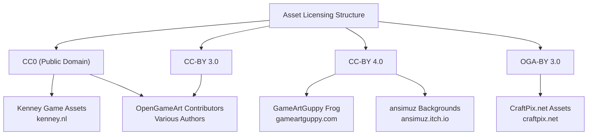
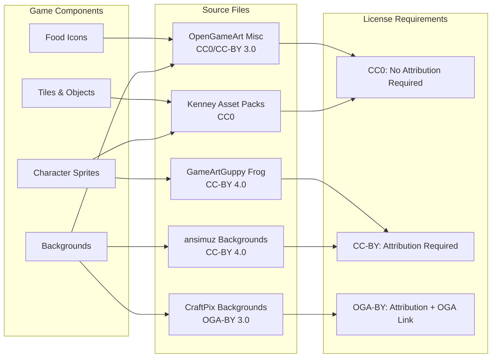

<!-- source: DeepWiki mcp.deepwiki.com · repo openai/procgen · page 6.2 Legal and Licensing · fetched 2026-10-26 -->

# Legal and Licensing

<details>
<summary>Relevant source files</summary>

The following files were used as context for generating this wiki page:

- [ASSET_LICENSES.md](ASSET_LICENSES.md)
- [LICENSE](LICENSE)

</details>


This document provides comprehensive licensing information for the Procgen Benchmark codebase and all third-party assets. It covers the main software license, asset licensing, and compliance considerations for users and contributors.

For information about the asset library itself, see [Asset Library](#6.1). For technical package structure details, see [Package Structure](#6.3).

## Software License

The Procgen Benchmark is released under the MIT License, which provides broad permissions for use, modification, and distribution.

### MIT License Terms

The main codebase is licensed under the MIT License as specified in [LICENSE:1-21](). This license grants users the following permissions:

| Permission | Description |
|------------|-------------|
| Commercial use | Use the software for commercial purposes |
| Modification | Modify the source code |
| Distribution | Distribute copies of the software |
| Private use | Use the software privately |
| Sublicensing | Grant sublicenses to third parties |

The MIT License requires only that the copyright notice and license terms be included in all copies or substantial portions of the software.

**Sources:** [LICENSE:1-21]()

## Asset Licensing Overview

Game assets used in Procgen environments are sourced from multiple creators and are subject to different licensing terms. All asset licenses are documented in [ASSET_LICENSES.md:1-85]().

### License Distribution by Type



**Sources:** [ASSET_LICENSES.md:1-85]()

### Asset Categories and Licensing



**Sources:** [ASSET_LICENSES.md:1-85]()

## License Types and Compliance

### CC0 (Public Domain)

Assets under CC0 license require no attribution and can be used without restrictions. Major contributors include:

| Author | Assets | Lines in ASSET_LICENSES.md |
|--------|---------|---------------------------|
| kenney | Game asset packs | [ASSET_LICENSES.md:2-4]() |
| thekingphoenix | Food icons | [ASSET_LICENSES.md:10-12]() |
| ansimuz | Space backgrounds | [ASSET_LICENSES.md:14-16]() |
| rubberduck | Glitch backgrounds | [ASSET_LICENSES.md:30-32]() |
| Rawdanitsu | Space backgrounds | [ASSET_LICENSES.md:34-36]() |

### CC-BY (Creative Commons Attribution)

These licenses require attribution of the original creator:

#### CC-BY 4.0
- **GameArtGuppy.com**: Frog assets [ASSET_LICENSES.md:6-8]()
- **ansimuz**: Mountain and forest backgrounds [ASSET_LICENSES.md:22-28]()

#### CC-BY 3.0  
- **davis123**: Top-down backgrounds [ASSET_LICENSES.md:42-44]()
- **Alucard**: Water and 2D backgrounds [ASSET_LICENSES.md:50-64]()
- **SugarMoonWitch**: Underwater backgrounds [ASSET_LICENSES.md:54-56]()

### OGA-BY 3.0 (OpenGameArt Attribution)

CraftPix.net assets require attribution and linking to OpenGameArt:
- Parallax 2D backgrounds [ASSET_LICENSES.md:66-68]()
- Fantasy cartoon backgrounds [ASSET_LICENSES.md:70-72]()
- Beach backgrounds [ASSET_LICENSES.md:74-76]()

**Sources:** [ASSET_LICENSES.md:1-85]()

## Compliance Requirements

### For End Users

Users of Procgen environments must comply with asset licensing when:
- Redistributing modified versions of Procgen
- Using Procgen assets in derivative works
- Publishing research that includes visual content from environments

### For Contributors

Contributors must ensure:
- New assets include proper licensing documentation
- Asset licenses are compatible with MIT license
- Attribution requirements are maintained in `ASSET_LICENSES.md`

### Attribution Template

For CC-BY licensed assets, use this attribution format:
```
Asset Name by Author Name
Licensed under CC-BY X.X
Source: [URL]
```

**Sources:** [ASSET_LICENSES.md:1-85](), [LICENSE:1-21]()

## License Compatibility Matrix

| Original License | Compatible With | Redistribution Requirements |
|------------------|-----------------|----------------------------|
| MIT (Code) | All asset licenses | Include MIT license text |
| CC0 (Assets) | Any use | None |
| CC-BY 3.0/4.0 | Commercial/Non-commercial | Attribution required |
| OGA-BY 3.0 | Commercial/Non-commercial | Attribution + OGA link |

The combination of MIT software license with mixed asset licenses allows broad usage while respecting creator attribution requirements.

**Sources:** [LICENSE:1-21](), [ASSET_LICENSES.md:1-85]()

---

