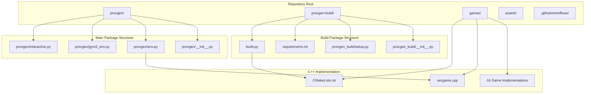
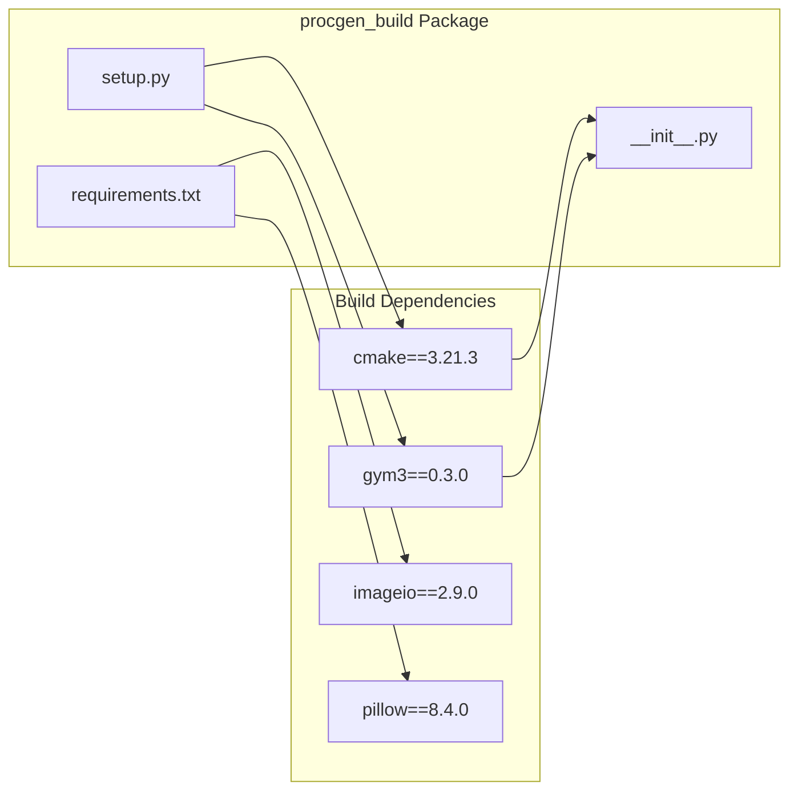
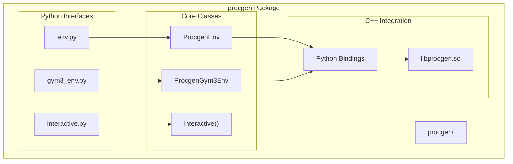
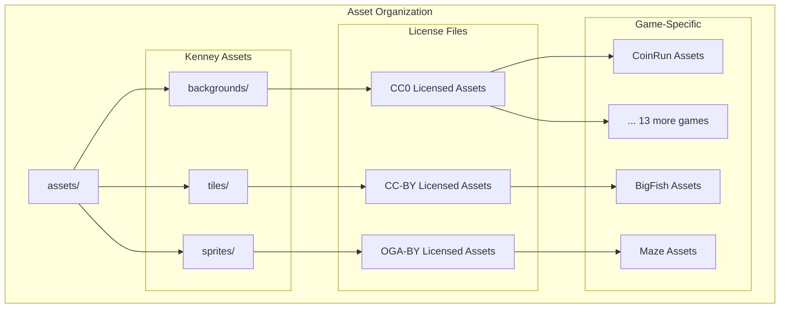
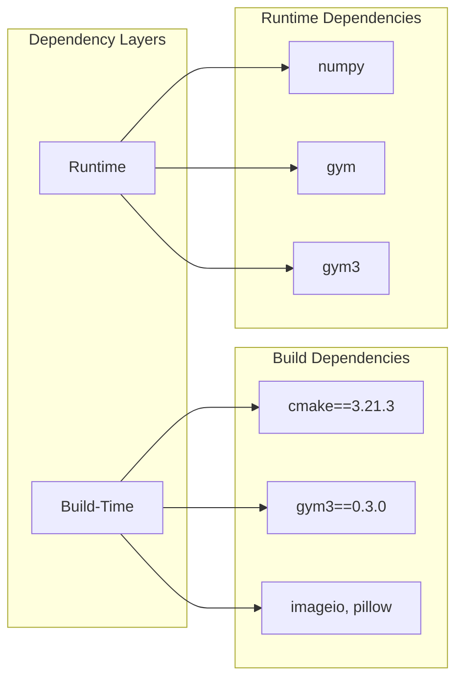

<!-- source: DeepWiki mcp.deepwiki.com · repo openai/procgen · page 6.3 Package Structure · fetched 2026-10-26 -->

# Package Structure

Relevant source files

The following files were used as context for generating this wiki page:

- [procgen-build/procgen_build/__init__.py](procgen-build/procgen_build/__init__.py)
- [procgen-build/requirements.txt](procgen-build/requirements.txt)
- [procgen-build/setup.py](procgen-build/setup.py)

This document provides a technical reference for the internal organization of the Procgen package, including build components, Python modules, and asset structure. It covers the package hierarchy, build system architecture, and dependency management.

For information about setting up a development environment, see [Development Environment](#5.1). For details about the build process itself, see [Build System](#3).

## Overview

The Procgen repository is organized into several key package components that work together to provide the procedurally generated reinforcement learning environments. The structure separates build utilities, core implementation, assets, and Python interfaces into distinct modules.

**Sources:** [procgen-build/procgen_build/__init__.py:1-1](), [procgen-build/setup.py:1-14](), [procgen-build/requirements.txt:1-3]()

## Build System Package

The `procgen-build` directory contains a separate Python package specifically for build utilities and dependencies. This package is installed during the build process to provide necessary tools for compiling the C++ components.

### procgen_build Package

The build package follows standard Python package conventions:

| Component | Purpose | File |
|-----------|---------|------|
| Package Marker | Establishes `procgen_build` as a Python package | `__init__.py` |
| Setup Configuration | Defines build dependencies and package metadata | `setup.py` |
| Build Dependencies | Specifies exact versions of build-time requirements | `requirements.txt` |

**Build Package Dependencies**

The `setup.py` defines core build-time dependencies:

- `cmake==3.21.3`: CMake build system for C++ compilation [procgen-build/setup.py:9-9]()
- `gym3==0.3.0`: Required by the build process [procgen-build/setup.py:11-11]()

Additional requirements in `requirements.txt` include:

- `imageio==2.9.0`: Image processing, pinned for compatibility [procgen-build/requirements.txt:1-1]()
- `pillow==8.4.0`: Required by gym3, pinned to avoid Linux build issues [procgen-build/requirements.txt:2-2]()

**Sources:** [procgen-build/setup.py:3-13](), [procgen-build/requirements.txt:1-3]()

## Main Package Structure

The main `procgen` package provides the Python interface to the C++ game implementations. It follows a modular design separating different interface types and functionality.

### Core Module Organization

| Module | Primary Classes | Purpose |
|--------|----------------|---------|
| `env.py` | `ProcgenEnv` | OpenAI Gym interface implementation |
| `gym3_env.py` | `ProcgenGym3Env` | Gym3 vectorized environment interface |
| `interactive.py` | Interactive functions | Human-playable interface for testing |

**Sources:** Based on system architecture diagrams and standard Python package organization patterns

## Asset Package Structure

The assets are organized by type and licensing to support the 16 different game environments with consistent visual themes.

**Sources:** Based on system architecture showing Kenney Abstract Assets with multiple license types

## Dependency Management

The package uses a two-tier dependency system separating build-time and runtime requirements.

### Build-Time Dependencies

Managed through the `procgen_build` package:

- **CMake**: Cross-platform build system for C++ compilation
- **Gym3**: Core environment interface during build
- **ImageIO/Pillow**: Image processing with version constraints for compatibility

### Runtime Dependencies

The main `procgen` package dependencies include:

- **NumPy**: Array operations and environment observations
- **Gym**: Standard RL environment interface
- **Gym3**: Vectorized environment support

**Sources:** [procgen-build/setup.py:7-12](), [procgen-build/requirements.txt:1-3]()

## C++ Library Integration

The C++ components are organized to support the Python package through shared library compilation and binding generation.

### Library Structure

| Component | Purpose | Integration Method |
|-----------|---------|-------------------|
| Game Implementations | 16 procedural environments | Compiled into shared library |
| `vecgame.cpp` | Vectorized environment manager | Python bindings via pybind11 |
| Qt5 Framework | Rendering and GUI support | Statically linked |

The CMake build system coordinates compilation of all C++ components into a single shared library that the Python package can import and use.

**Sources:** Based on system architecture diagrams showing C++ core library with Python bindings