# Page: Overview

# Overview

<details>
<summary>Relevant source files</summary>

The following files were used as context for generating this wiki page:

- [CHANGES.md](CHANGES.md)
- [LICENSE](LICENSE)
- [README.md](README.md)

</details>


## Purpose and Scope

The Procgen Benchmark is a suite of 16 procedurally-generated reinforcement learning environments designed to measure sample efficiency and generalization in RL agents. This repository provides high-performance C++ implementations of these environments with Python bindings, supporting both traditional `gym` and vectorized `gym3` interfaces.

This document provides a high-level overview of the Procgen system architecture, its key components, and how they interact. For detailed installation instructions, see [Installation](#2.1). For information about the build system, see [Build System](#3). For development setup and contribution guidelines, see [Development](#5).

Sources: [README.md:1-280]()

## System Architecture

The Procgen system follows a multi-layered architecture with a high-performance C++ core, Python bindings, and multiple user interfaces:

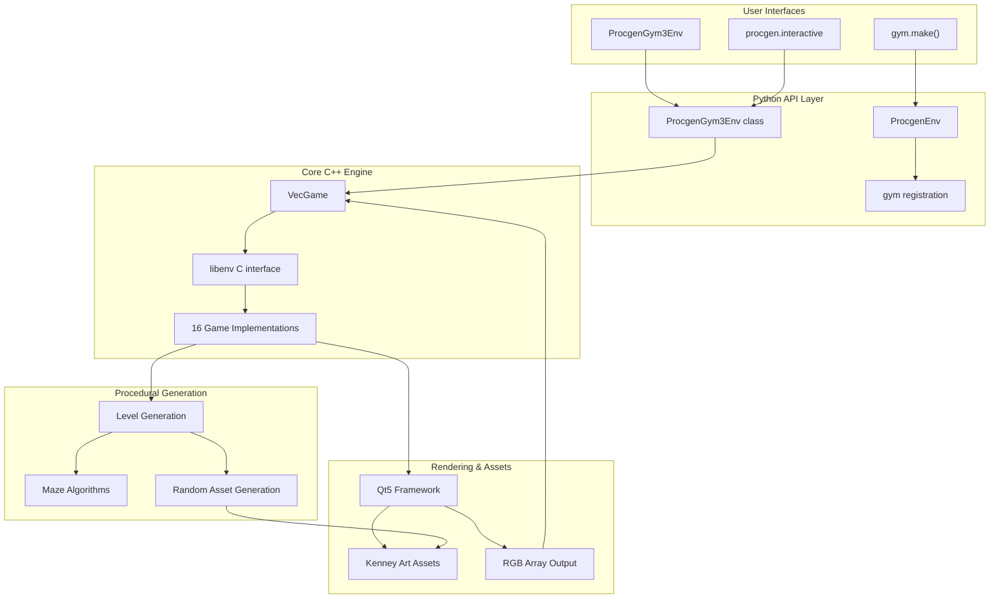

The system is designed with performance as a primary concern, achieving thousands of steps per second on a single CPU core through its C++ implementation and efficient vectorized operations.

Sources: [README.md:7-8](), [README.md:201-202]()

## Environment Creation and Usage Flow

The following diagram illustrates how user code interacts with Procgen environments, showing the key classes and methods involved:

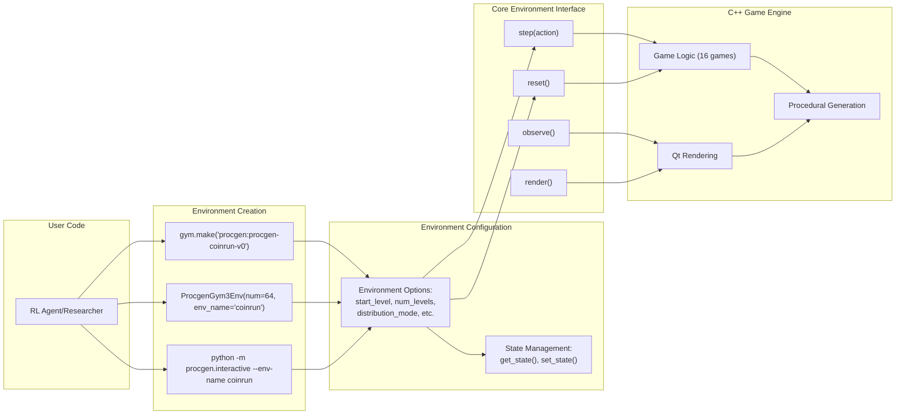

The system supports multiple configuration options that affect environment behavior, including difficulty levels (`distribution_mode`), level generation (`start_level`, `num_levels`), and visual rendering (`use_backgrounds`, `use_monochrome_assets`).

Sources: [README.md:64-76](), [README.md:134-147](), [README.md:166-178]()

## Key Components

### Game Environments

Procgen includes 16 distinct procedurally-generated environments, each implementing unique gameplay mechanics:

| Environment | Core Mechanic | Key Features |
|-------------|---------------|--------------|
| `coinrun` | Platformer | Dodge obstacles, collect coin |
| `bigfish` | Growth game | Eat smaller fish, avoid larger ones |
| `bossfight` | Shooter | Defeat boss with timed vulnerability |
| `maze` | Navigation | Find cheese in procedural maze |
| `heist` | Puzzle | Collect keys, unlock doors |
| `jumper` | Open world platformer | Find carrot with compass guidance |

The complete list of 16 environments covers diverse gameplay patterns to thoroughly test RL agent capabilities across different domains.

Sources: [README.md:104-122]()

### Performance Characteristics

- **Speed**: Thousands of environment steps per second on single CPU core
- **Platforms**: Windows 10, macOS 10.14+, Linux (manylinux2010)
- **Python**: 3.7-3.10 (64-bit only)
- **CPU Requirements**: AVX instruction set support
- **Memory**: Efficient C++ implementation with minimal overhead

Sources: [README.md:17](), [README.md:21-36]()

### Environment Options

The system provides extensive configuration through environment options:

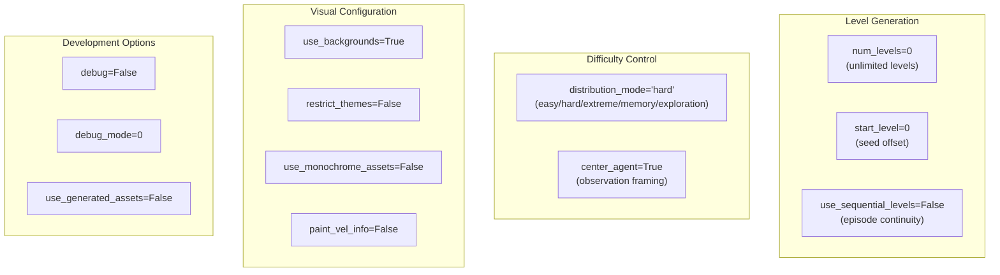

These options allow researchers to create controlled experimental conditions and adjust environment complexity for different research needs.

Sources: [README.md:134-147]()

## Build and Distribution System

Procgen uses a sophisticated multi-platform build system:

- **Python Packaging**: `cibuildwheel` for cross-platform wheel generation
- **C++ Compilation**: CMake build system with Qt5 static linking
- **CI/CD**: GitHub Actions for automated building and PyPI publishing
- **Asset Management**: Kenney art assets with comprehensive licensing tracking

The build system handles the complexity of compiling Qt5 from source and linking it statically with the C++ game implementations, enabling distribution of self-contained Python wheels.

Sources: [README.md:185-199]()

## Repository Structure

The codebase is organized into several key areas:

- **C++ Games**: Individual game implementations in `src/games/`
- **Python Bindings**: Python interfaces and gym registration
- **Build System**: CMake configuration and packaging scripts
- **Assets**: Game art and licensing documentation
- **CI/CD**: GitHub Actions workflows for automated builds

For detailed information about specific subsystems, see [Core Architecture](#4), [Build System](#3), and [Asset Library](#6.1).

Sources: [README.md:207-210]()

---

# Page: Getting Started

# Getting Started

<details>
<summary>Relevant source files</summary>

The following files were used as context for generating this wiki page:

- [README.md](README.md)
- [docker/Dockerfile](docker/Dockerfile)
- [environment.yml](environment.yml)

</details>


This document provides an introduction to installing and using the Procgen Benchmark environments. It covers the basic installation options and initial usage patterns to get you started with the 16 procedurally generated reinforcement learning environments.

For detailed installation instructions including building from source, see [Installation](#2.1). For comprehensive usage examples and environment configuration options, see [Basic Usage](#2.2).

## Overview

Procgen Benchmark is a suite of 16 procedurally generated gym environments designed to measure sample efficiency and generalization in reinforcement learning. The environments are implemented in C++ for high performance (thousands of steps per second) and expose both traditional gym and vectorized gym3 interfaces.

### Installation Pathways

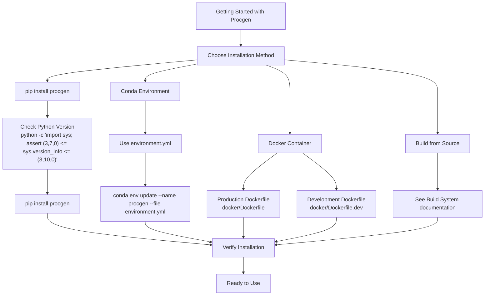

Sources: [README.md:38-55](), [README.md:185-199](), [docker/Dockerfile:1-5](), [environment.yml:1-16]()

### Core API Interfaces

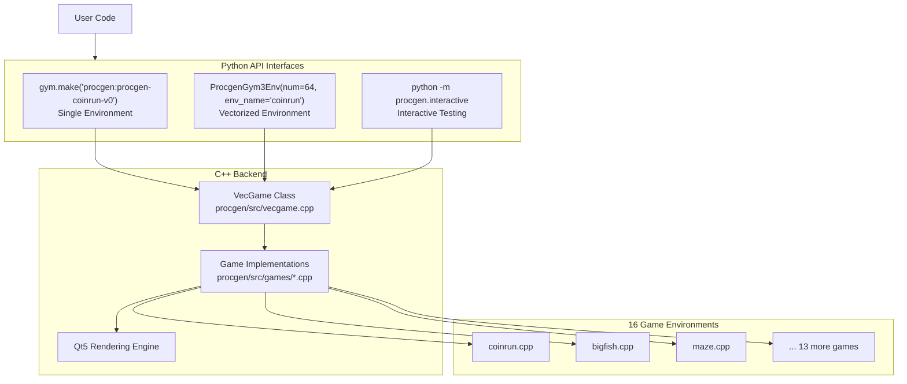

Sources: [README.md:64-76](), [README.md:200-202]()

## System Requirements

Before installation, verify your system meets the requirements:

| Component | Requirement |
|-----------|-------------|
| **Python Version** | 3.7, 3.8, 3.9, or 3.10 (64-bit) |
| **Operating System** | Windows 10, macOS 10.14+, Linux (manylinux2010) |
| **CPU Architecture** | Must support AVX instruction set |

**Python Version Check:**
```bash
python -c "import sys; assert (3,7,0) <= sys.version_info <= (3,10,0), 'python is incorrect version'; print('ok')"
python -c "import platform; assert platform.architecture()[0] == '64bit', 'python is not 64-bit'; print('ok')"
```

Sources: [README.md:21-36](), [README.md:40-46]()

## Quick Installation

The fastest way to get started is using pip:

```bash
pip install procgen
```

If you encounter version compatibility errors, upgrade pip first:
```bash
pip install --upgrade pip
```

Sources: [README.md:48-54]()

## Basic Verification

After installation, verify Procgen is working correctly:

**Test Interactive Mode:**
```bash
python -m procgen.interactive --env-name coinrun
```

**Test Gym Interface:**
```python
import gym
env = gym.make("procgen:procgen-coinrun-v0")
```

**Test Gym3 Interface:**
```python
from procgen import ProcgenGym3Env
env = ProcgenGym3Env(num=1, env_name="coinrun")
```

Sources: [README.md:56-76]()

## Environment Interfaces

### Usage Patterns by Interface Type

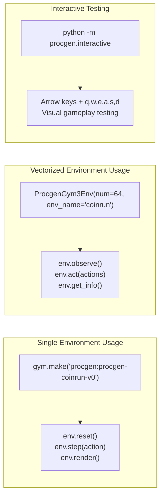

Sources: [README.md:64-76](), [README.md:96-100]()

## Docker Quick Start

For containerized environments, Procgen includes Docker configurations:

**Production Container:**
```bash
docker build docker --tag procgen
docker run --rm -it procgen python3 -m procgen.examples.random_agent_gym
```

**Development Container:**
```bash
docker build . --tag procgen --file docker/Dockerfile.dev
docker run --rm -it procgen python -c "from procgen import ProcgenGym3Env; env = ProcgenGym3Env(num=1, env_name='coinrun'); print(env.observe())"
```

Sources: [README.md:78-92](), [docker/Dockerfile:1-5]()

## Available Environments

Procgen includes 16 different game environments, each with unique mechanics and challenges:

| Environment | Type | Key Features |
|-------------|------|--------------|
| `coinrun` | Platformer | Simple platformer with obstacles and enemies |
| `bigfish` | Survival | Eat smaller fish, avoid larger ones |
| `maze` | Navigation | Navigate procedurally generated mazes |
| `bossfight` | Combat | Destroy boss starship with shield mechanics |
| `caveflyer` | Flight | Navigate cave networks with asteroids-style movement |

*Complete environment descriptions available in the main documentation*

Sources: [README.md:104-122]()

## Next Steps

After completing basic installation and verification:

1. **Detailed Installation Options** - See [Installation](#2.1) for conda environments, building from source, and troubleshooting
2. **Comprehensive Usage Guide** - See [Basic Usage](#2.2) for environment configuration, rendering options, and state management
3. **Development Setup** - See [Development Environment](#5.1) for contributing to Procgen or creating custom environments

## Key Configuration Notes

- **Reproducibility**: Use specific version pinning (`pip install procgen==0.x.x`) for reproducible experiments
- **Performance**: Environments run on CPU only - no GPU required
- **Threading**: Each environment instance should only be used from a single thread
- **Default Settings**: Environments default to `distribution_mode="hard"` and 64x64x3 RGB observations

Sources: [README.md:181-183](), [README.md:96-100](), [README.md:143]()

---

# Page: Installation

# Installation

<details>
<summary>Relevant source files</summary>

The following files were used as context for generating this wiki page:

- [README.md](README.md)
- [docker/Dockerfile](docker/Dockerfile)
- [environment.yml](environment.yml)
- [procgen-build/requirements.txt](procgen-build/requirements.txt)

</details>


This document provides comprehensive installation instructions for the Procgen Benchmark suite. It covers three primary installation methods: package installation via pip (recommended for most users), Docker-based installation, and source installation for development purposes.

For information about basic usage after installation, see [Basic Usage](#2.2). For details about the build system and compilation process, see [Build System](#3).

## System Requirements

Before installing Procgen, verify that your system meets the following requirements:

| Component | Requirement |
|-----------|-------------|
| **Operating System** | Windows 10, macOS 10.14+ (Mojave/Catalina), Linux (manylinux2010) |
| **Python Version** | 3.7, 3.8, 3.9, or 3.10 (64-bit only) |
| **CPU Architecture** | x86_64 with AVX instruction set support |
| **Memory** | Minimum 2GB RAM recommended |

Use these commands to verify your Python installation meets the requirements:

```bash
# Verify Python version (3.7-3.10)
python -c "import sys; assert (3,7,0) <= sys.version_info <= (3,10,0), 'python is incorrect version'; print('ok')"

# Verify 64-bit architecture
python -c "import platform; assert platform.architecture()[0] == '64bit', 'python is not 64-bit'; print('ok')"
```

Sources: [README.md:40-46]()

## Installation Methods Overview

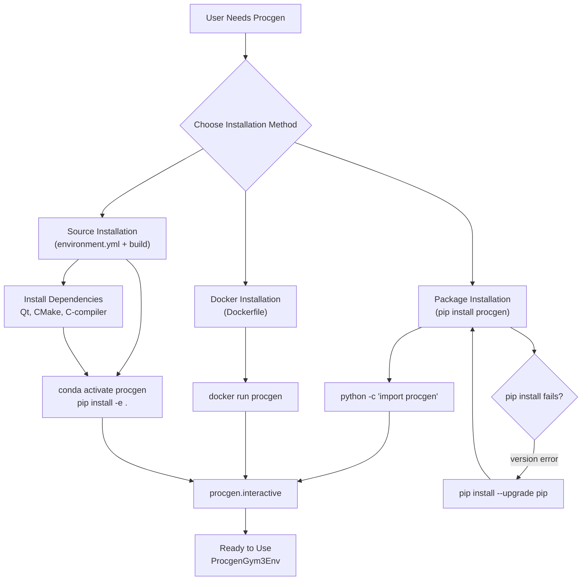

Sources: [README.md:38-199](), [docker/Dockerfile:1-5](), [environment.yml:1-16]()

## Package Installation (Recommended)

The simplest installation method uses pre-compiled wheels from PyPI. This method is recommended for users who want to use Procgen environments without modifying the source code.

### Step 1: Install Package

```bash
pip install procgen
```

If you encounter a version compatibility error, upgrade pip first:

```bash
pip install --upgrade pip
pip install procgen
```

### Step 2: Verify Installation

Test the installation with the interactive environment:

```bash
python -m procgen.interactive --env-name coinrun
```

This launches an interactive `coinrun` environment where you can test controls using arrow keys and action keys (q, w, e, a, s, d).

Sources: [README.md:48-62]()

## Docker Installation

Docker provides an isolated environment that eliminates system dependency issues. Two Docker configurations are available: production and development.

### Production Docker Setup

For running Procgen with minimal dependencies:

```bash
# Build the production container
docker build docker --tag procgen

# Run a test agent
docker run --rm -it procgen python3 -m procgen.examples.random_agent_gym
```

### Development Docker Setup

For building from source within Docker:

```bash
# Build development container with source compilation
docker build . --tag procgen --file docker/Dockerfile.dev

# Test the compiled environment
docker run --rm -it procgen python -c "from procgen import ProcgenGym3Env; env = ProcgenGym3Env(num=1, env_name='coinrun'); print(env.observe())"
```

The production `Dockerfile` installs the pre-built package, while `Dockerfile.dev` compiles from source with all build dependencies.

Sources: [README.md:78-92](), [docker/Dockerfile:1-5]()

## Source Installation

Source installation is required for users who want to modify environments, create new environments, or contribute to the project. This method involves compiling the C++ game implementations with Qt5 rendering.

### Dependency Architecture

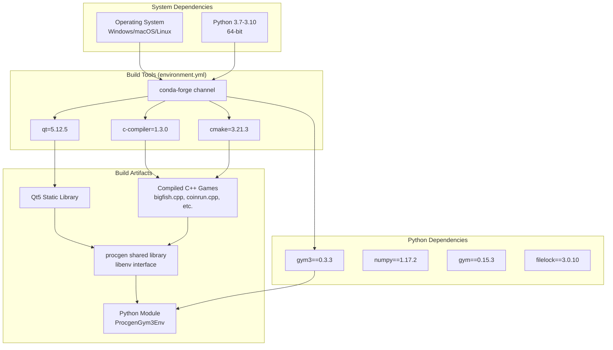

Sources: [environment.yml:1-16](), [README.md:185-202]()

### Step 1: Clone Repository

```bash
git clone git@github.com:openai/procgen.git
cd procgen
```

### Step 2: Create Conda Environment

```bash
conda env update --name procgen --file environment.yml
conda activate procgen
```

The `environment.yml` file specifies:
- `python=3.7.3` - Base Python version
- `c-compiler=1.3.0` - Cross-platform C++ compiler
- `cmake=3.21.3` - Build system generator  
- `qt=5.12.5` - Qt5 GUI framework for rendering
- Python packages: `gym3`, `numpy`, `gym`, `filelock`

### Step 3: Build and Install

```bash
pip install -e .
```

This command triggers the build process which:
1. Compiles Qt5 static libraries
2. Uses CMake to build C++ game implementations
3. Links games into a shared library with `libenv` interface
4. Installs Python bindings

### Step 4: Verify Source Installation

```bash
# Test programmatic access
python -c "from procgen import ProcgenGym3Env; ProcgenGym3Env(num=1, env_name='coinrun')"

# Test interactive environment
python -m procgen.interactive
```

### Platform-Specific Requirements

**Windows**: Requires Visual Studio 16 2019 for C++ compilation.

**macOS/Linux**: Uses system GCC/Clang compilers specified in `environment.yml`.

Sources: [README.md:185-199](), [environment.yml:4-15]()

## Installation Verification

After installation via any method, verify that Procgen is working correctly:

### Import Test

```python
# Test core imports
from procgen import ProcgenGym3Env
import gym

# Create vectorized environment
env = ProcgenGym3Env(num=1, env_name="coinrun")
obs = env.observe()
print(f"Observation shape: {obs['rgb'].shape}")

# Create gym environment  
gym_env = gym.make("procgen:procgen-coinrun-v0")
```

### Interactive Test

```bash
python -m procgen.interactive --env-name coinrun
```

Expected output: A game window opens showing the `coinrun` environment with keyboard controls enabled.

### Performance Test

```python
from procgen import ProcgenGym3Env
import time

env = ProcgenGym3Env(num=64, env_name="coinrun")
start_time = time.time()

for _ in range(1000):
    env.act(env.get_random_actions())
    
steps_per_second = 64000 / (time.time() - start_time)
print(f"Performance: {steps_per_second:.0f} steps/second")
```

Expected performance: Several thousand steps per second on a single CPU core.

Sources: [README.md:64-76](), [README.md:156-164]()

## Troubleshooting

### Common Installation Issues

| Error | Cause | Solution |
|-------|-------|---------|
| `Could not find a version that satisfies the requirement procgen` | Outdated pip version | `pip install --upgrade pip` |
| `python is incorrect version` | Unsupported Python version | Install Python 3.7-3.10 64-bit |
| `Qt build failed` | Missing C++ compiler | Install Visual Studio 2019 (Windows) or check `environment.yml` dependencies |
| Import errors after source install | Incomplete build | Re-run `pip install -e .` and check for build errors |

### Version Pinning

For reproducible experiments, pin to a specific version:

```bash
pip install procgen==0.10.7
```

Check your installed version:

```bash
pip show procgen
```

### Thread Safety Notes

- Each environment instance should only be used from a single thread
- Set `num_threads=0` for fork safety, though Qt5 is not guaranteed to be fork-safe
- Create environments after forking or avoid forking entirely

Sources: [README.md:180-184]()

---

# Page: Basic Usage

# Basic Usage

<details>
<summary>Relevant source files</summary>

The following files were used as context for generating this wiki page:

- [README.md](README.md)
- [procgen/__init__.py](procgen/__init__.py)

</details>


This page covers how to create and interact with Procgen environments using the provided Python interfaces. It demonstrates the two primary ways to use Procgen: through the standard gym interface for single environments and the gym3 interface for vectorized environments.

For installation instructions, see [Installation](#2.1). For detailed information about the 16 available game environments, see [Game Environments](#4.1).

## Environment Interfaces

Procgen provides two main interfaces for creating and interacting with procedurally generated environments:

| Interface | Class | Use Case | Vectorization |
|-----------|-------|----------|---------------|
| **Gym** | `ProcgenEnv` | Single environment, standard gym API | No |
| **Gym3** | `ProcgenGym3Env` | Multiple environments, vectorized operations | Yes |

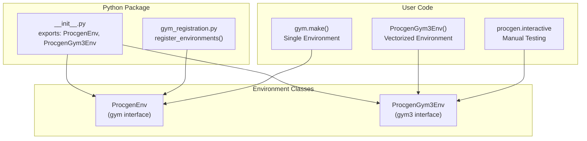

**Environment Interface Architecture**

*Sources: [procgen/__init__.py:7-12](), [README.md:64-76]()*

## Creating Environments

### Gym Interface (Single Environment)

The gym interface provides the standard OpenAI Gym API for single environment instances:

```python
import gym
env = gym.make("procgen:procgen-coinrun-v0")
```

All 16 environments follow the naming pattern `"procgen:procgen-{env_name}-v0"` where `{env_name}` is one of: `bigfish`, `bossfight`, `caveflyer`, `chaser`, `climber`, `coinrun`, `dodgeball`, `fruitbot`, `heist`, `jumper`, `leaper`, `maze`, `miner`, `ninja`, `plunder`, `starpilot`.

### Gym3 Interface (Vectorized Environment)

The gym3 interface allows running multiple environment instances in parallel:

```python
from procgen import ProcgenGym3Env
env = ProcgenGym3Env(num=1, env_name="coinrun")
```

The `num` parameter specifies how many environment instances to run in parallel. For training, you typically use values like `num=64` or higher.

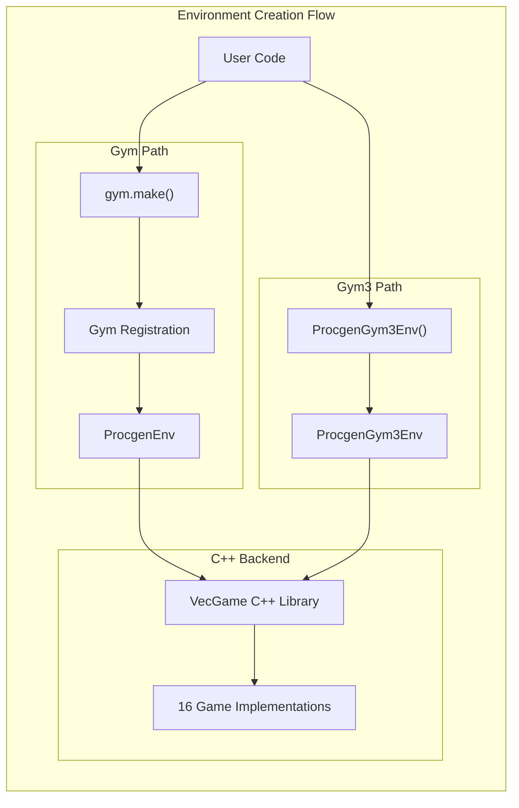

**Environment Creation and Backend Integration**

*Sources: [README.md:64-76](), [procgen/__init__.py:7-12]()*

## Interactive Testing

For manual testing and exploration, use the interactive mode:

```bash
python -m procgen.interactive --env-name coinrun
```

Controls:
- **Movement**: Arrow keys (left/right/up/down)
- **Actions**: q, w, e, a, s, d (environment-dependent actions)
- **Display**: Episode return shown in lower left, level completion status at episode end

*Sources: [README.md:56-62]()*

## Basic Environment Interaction

### Standard Gym Workflow

```python
import gym

# Create environment
env = gym.make("procgen:procgen-coinrun-v0")

# Reset to get initial observation
obs = env.reset()

# Take actions in environment
for step in range(1000):
    action = env.action_space.sample()  # Random action
    obs, reward, done, info = env.step(action)
    
    if done:
        obs = env.reset()
```

### Gym3 Vectorized Workflow

```python
from procgen import ProcgenGym3Env

# Create vectorized environment
env = ProcgenGym3Env(num=4, env_name="coinrun")

# Get initial observations
obs = env.observe()

# Take actions across all environments
for step in range(1000):
    actions = [env.action_space.sample() for _ in range(4)]
    env.act(actions)
    obs, rewards, dones = env.observe()
```

## Environment Configuration

Both interfaces support extensive configuration options through constructor parameters:

| Parameter | Type | Default | Description |
|-----------|------|---------|-------------|
| `start_level` | int | 0 | Lowest seed for level generation |
| `num_levels` | int | 0 | Number of unique levels (0 = unlimited) |
| `distribution_mode` | str | "hard" | Difficulty: "easy", "hard", "extreme", "memory", "exploration" |
| `use_backgrounds` | bool | True | Enable/disable background graphics |
| `center_agent` | bool | True | Center observations on agent |
| `paint_vel_info` | bool | False | Paint velocity info in corner |

### Gym Configuration Example

```python
import gym
env = gym.make(
    "procgen:procgen-coinrun-v0",
    start_level=0,
    num_levels=1,
    distribution_mode="easy"
)
```

### Gym3 Configuration Example

```python
from procgen import ProcgenGym3Env
env = ProcgenGym3Env(
    num=8,
    env_name="coinrun",
    start_level=0,
    num_levels=100,
    distribution_mode="hard"
)
```

*Sources: [README.md:132-147](), [README.md:148-164]()*

## Environment State Management

The gym3 interface supports saving and restoring environment state, useful for research applications:

```python
from procgen import ProcgenGym3Env

env = ProcgenGym3Env(num=1, env_name="coinrun")

# Save current state
states = env.callmethod("get_state")

# ... perform actions ...

# Restore saved state
env.callmethod("set_state", states)
```

The `get_state()` method returns a list of byte strings representing the state of each environment in the vectorized setup.

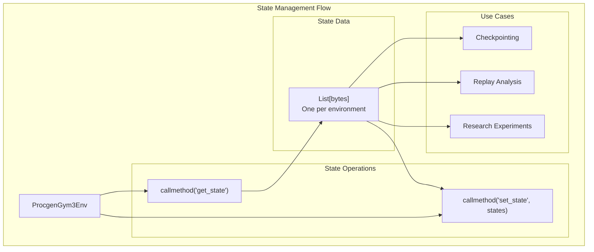

**State Management Operations in Gym3 Interface**

*Sources: [README.md:166-177]()*

## Observation and Action Spaces

### Observation Space
- **Format**: RGB pixel arrays
- **Shape**: `(64, 64, 3)` for gym interface
- **Gym3**: Dictionary space with pixels under `"rgb"` key
- **Data Type**: numpy arrays with uint8 values (0-255)

### Action Space
- **Type**: `Discrete(15)` - button combinations
- **Mapping**: Defined in [procgen/env.py]()
- **Rate**: Expected human play rate is 15 Hz

*Sources: [README.md:96-100]()*

## Thread Safety and Performance Notes

- Each environment instance should only be used from a single thread
- The library is not fork-safe unless `num_threads=0` is set
- No GPU required - all computation runs on CPU
- High performance: thousands of steps per second on single core

*Sources: [README.md:181-183]()*

---

# Page: Build System

# Build System

<details>
<summary>Relevant source files</summary>

The following files were used as context for generating this wiki page:

- [procgen-build/procgen_build/build_package.py](procgen-build/procgen_build/build_package.py)
- [procgen-build/procgen_build/build_qt.py](procgen-build/procgen_build/build_qt.py)
- [procgen/CMakeLists.txt](procgen/CMakeLists.txt)
- [procgen/builder.py](procgen/builder.py)

</details>


The Procgen build system is a multi-layered architecture that orchestrates the compilation of C++ game environments, Qt5 framework dependencies, and Python package distribution across multiple platforms. This system combines Python packaging tools (`cibuildwheel`), Qt5 static compilation, and CMake-based C++ library building to produce platform-specific wheels for distribution.

For information about development environment setup, see [Development Environment](#5.1). For details about the CI/CD pipeline automation, see [CI/CD Pipeline](#5.3).

## Build Architecture Overview

The build system operates in three distinct layers that execute sequentially during package creation. Each layer has specific responsibilities and dependencies on the previous layer's outputs.

**Build Pipeline Flow**
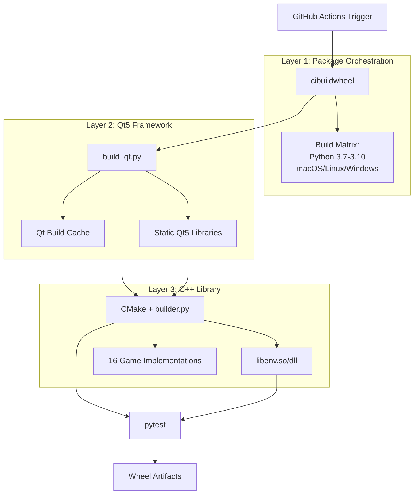

Sources: [procgen-build/procgen_build/build_package.py:10-44](), [procgen-build/procgen_build/build_qt.py:56-166](), [procgen/builder.py:95-148]()

## Component Dependencies

The build system's components have specific dependencies and interfaces that must be maintained across all supported platforms.

**Component Interaction Diagram**
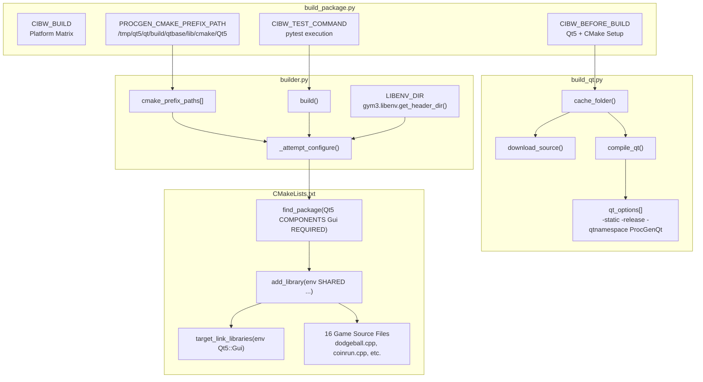

Sources: [procgen-build/procgen_build/build_package.py:11-24](), [procgen-build/procgen_build/build_qt.py:18-46](), [procgen/CMakeLists.txt:40-78](), [procgen/builder.py:52-93]()

## Build Artifacts and Outputs

The build system produces several key artifacts that are used in different contexts:

| Artifact | Location | Purpose | Created By |
|----------|----------|---------|------------|
| `qt5/` source cache | `/tmp/qt5/qt/` or `CACHE_DIR` | Cached Qt5 source to avoid repeated git clones | `build_qt.py:cache_folder()` |
| Static Qt5 libraries | `/tmp/qt5/qt/build/qtbase/lib/` | Platform-specific Qt5 static libraries | `build_qt.py:compile_qt()` |
| `libenv` shared library | `.build/{build_type}/` | C++ game environments compiled library | `builder.py:build()` |
| Platform wheels | `wheelhouse/` | Distributable Python packages | `build_package.py:cibuildwheel` |

**Build Type Configuration**
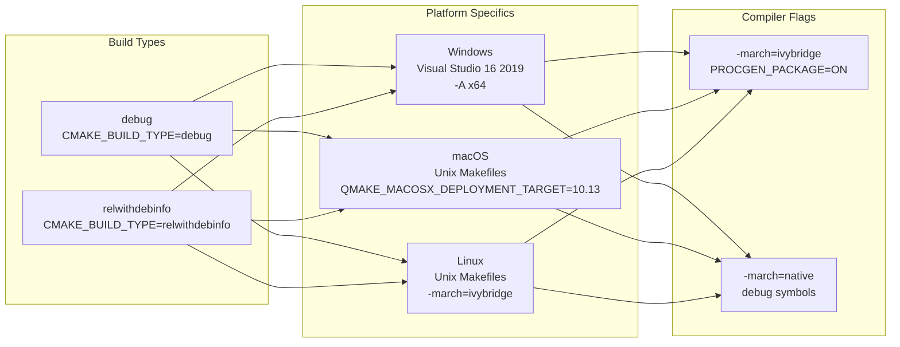

Sources: [procgen/builder.py:102-147](), [procgen/CMakeLists.txt:15-37](), [procgen-build/procgen_build/build_qt.py:109-164]()

## Cache Management System

The build system implements a sophisticated caching mechanism to avoid rebuilding expensive components like Qt5 across multiple builds.

**Cache Strategy**
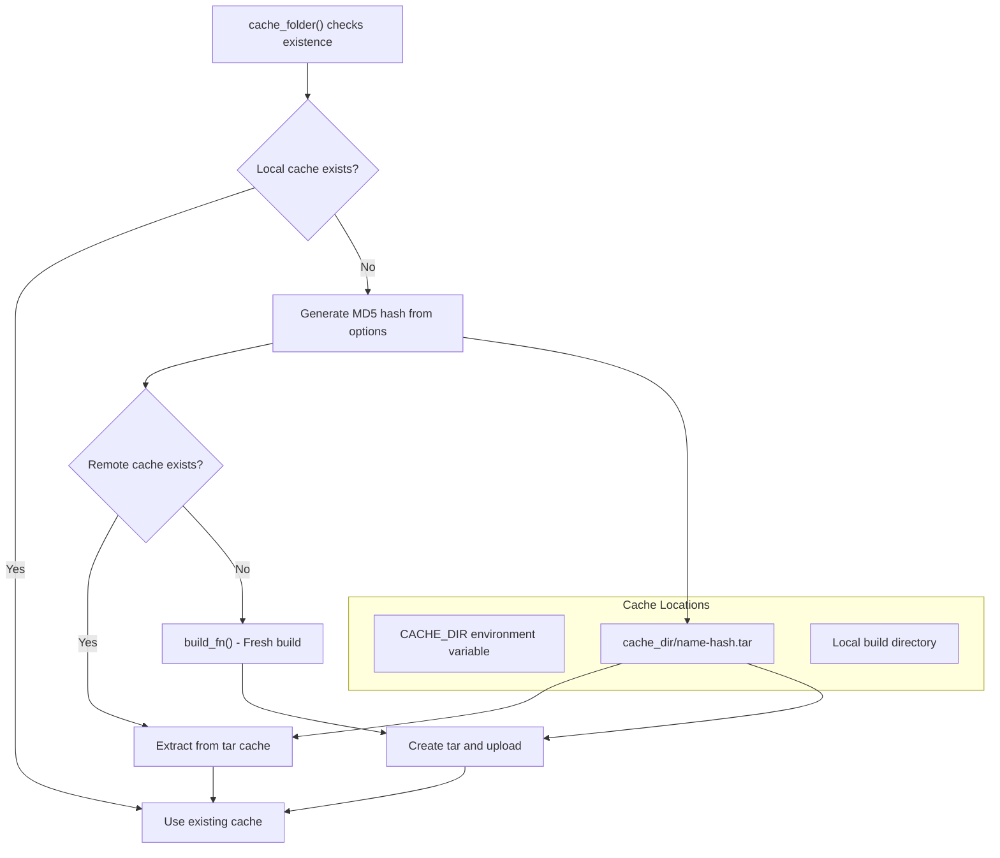

Sources: [procgen-build/procgen_build/build_qt.py:18-46]()

## Platform-Specific Build Configuration

Each platform requires specific configuration to ensure consistent builds across the supported matrix.

| Platform | Generator | Qt Configuration | Special Handling |
|----------|-----------|------------------|------------------|
| **Windows** | `Visual Studio 16 2019 -A x64` | `-mp` for parallel build | `nmake` instead of `make` |
| **macOS** | `Unix Makefiles` | Custom `qmake.conf` with deployment target 10.13 | X11 library paths |
| **Linux** | `Unix Makefiles` | Standard Unix configuration | `manylinux` wheel compatibility |

**Platform Detection Logic**
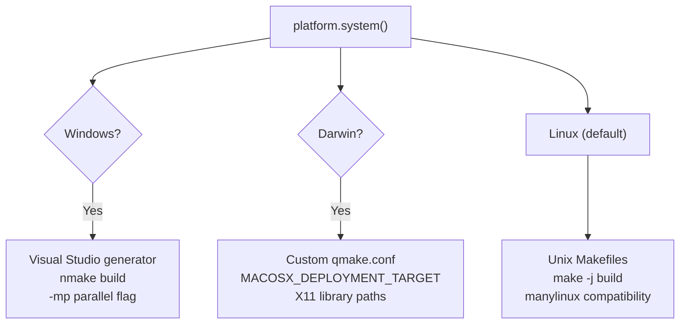

Sources: [procgen/builder.py:66-76](), [procgen-build/procgen_build/build_qt.py:109-164](), [procgen/CMakeLists.txt:22-37]()

## Process Safety and Concurrency

The build system implements multiple layers of process safety to handle concurrent builds and avoid race conditions.

- **File Locking**: `filelock.FileLock(".build-lock")` prevents multiple processes from building simultaneously
- **Global Build Tracking**: `global_builds` set tracks completed builds within a single process
- **Thread Safety**: `global_build_lock` threading lock for process-level coordination
- **Build Directory Isolation**: Each build type gets its own directory (`.build/debug`, `.build/relwithdebinfo`)

Sources: [procgen/builder.py:16-17](), [procgen/builder.py:106-117]()

---

# Page: Python Package Build

# Python Package Build

<details>
<summary>Relevant source files</summary>

The following files were used as context for generating this wiki page:

- [.github/workflows/main.yml](.github/workflows/main.yml)
- [procgen-build/procgen_build/build_package.py](procgen-build/procgen_build/build_package.py)
- [procgen-build/setup.py](procgen-build/setup.py)

</details>


This page documents the Python package build system for Procgen, which uses `cibuildwheel` to create cross-platform wheels for distribution. This system orchestrates the compilation of C++ game environments, Qt framework integration, and Python package assembly into distributable wheels.

For information about the underlying Qt framework compilation, see [Qt Framework Build](#3.2). For details about the C++ library compilation process, see [C++ Library Build](#3.3).

## Overview

The Procgen Python package build system uses `cibuildwheel` to create platform-specific wheels across multiple operating systems and Python versions. The build process is orchestrated through GitHub Actions and integrates Qt framework compilation, C++ library building, and Python packaging into a single automated pipeline.

The build system produces wheels for:
- **Operating Systems**: Ubuntu 18.04, macOS 10.15, Windows 2019
- **Python Versions**: 3.7, 3.8, 3.9, 3.10
- **Architectures**: x86_64 (Linux/macOS), amd64 (Windows)

Sources: [.github/workflows/main.yml:1-102](), [procgen-build/procgen_build/build_package.py:1-45]()

## CI/CD Pipeline Integration

The Python package build integrates with the GitHub Actions workflow through a multi-job pipeline that separates building, development testing, and publishing phases.

### Build Pipeline Architecture

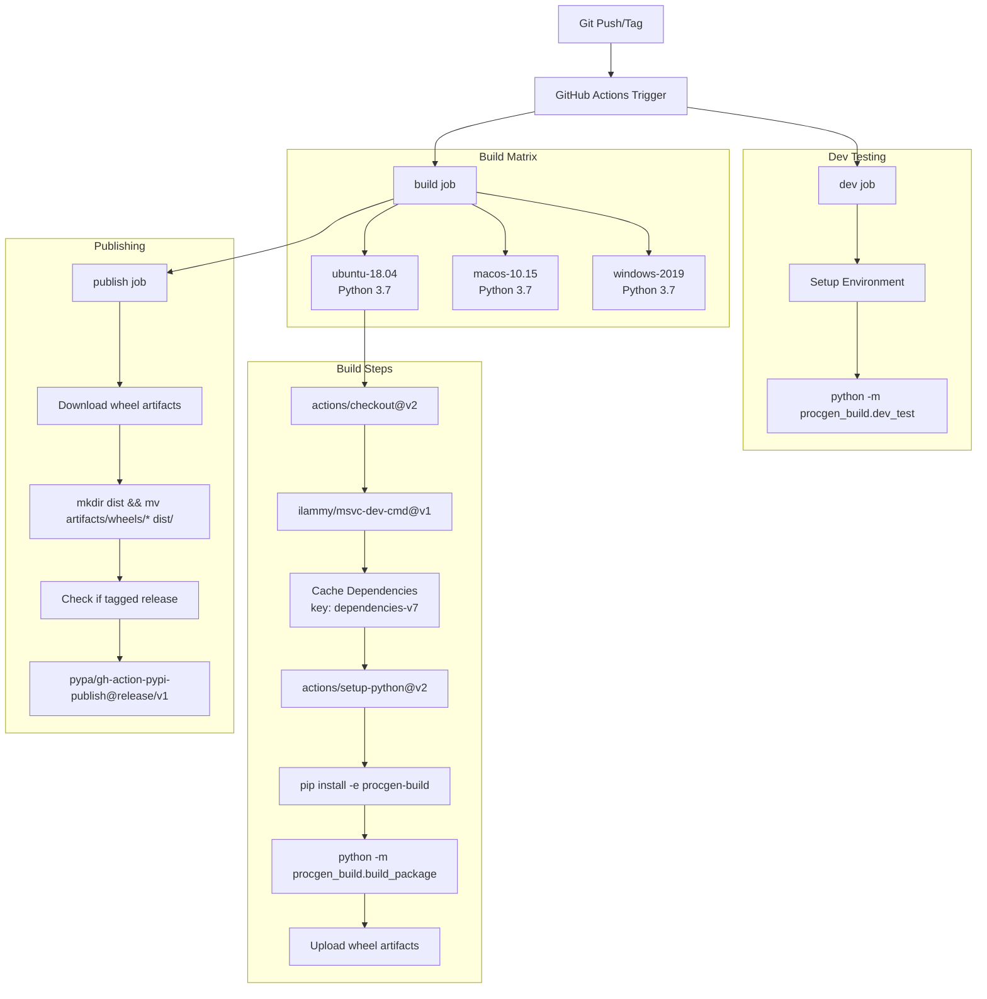

Sources: [.github/workflows/main.yml:5-46](), [.github/workflows/main.yml:48-72](), [.github/workflows/main.yml:74-102]()

## Build Configuration Matrix

The build system uses a strategic matrix configuration to ensure comprehensive platform coverage while maintaining build efficiency.

| Component | Configuration | Purpose |
|-----------|---------------|---------|
| **Operating Systems** | `ubuntu-18.04`, `macos-10.15`, `windows-2019` | Cross-platform wheel generation |
| **Python Versions** | `3.7` (primary), `3.8`, `3.9`, `3.10` (via cibuildwheel) | Multi-version compatibility |
| **Architecture** | `x64` (setup-python), `x86_64`/`amd64` (cibuildwheel) | 64-bit platform support |
| **Failure Strategy** | `fail-fast: false` | Complete matrix execution |

The matrix balances coverage with build time by using Python 3.7 for the initial GitHub Actions setup while delegating multi-version builds to `cibuildwheel`.

Sources: [.github/workflows/main.yml:9-14](), [.github/workflows/main.yml:52-56]()

## Cibuildwheel Configuration

The core build logic resides in the `build_package.py` module, which configures `cibuildwheel` through environment variables to orchestrate the complex build process.

### Build Target Specification

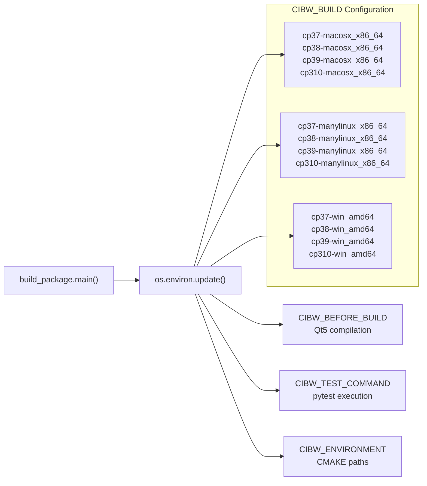

The `CIBW_BUILD` environment variable specifies the exact wheel targets, using CPython interpreter tags combined with platform identifiers.

Sources: [procgen-build/procgen_build/build_package.py:10-24]()

### Build Process Environment Variables

| Variable | Value | Purpose |
|----------|-------|---------|
| `CIBW_BUILD` | Platform-specific Python tags | Defines which wheels to build |
| `CIBW_BEFORE_BUILD` | `pip install ... && python -m procgen_build.build_qt` | Qt compilation before wheel build |
| `CIBW_TEST_COMMAND` | `pytest --pyargs procgen` | Validates built wheels |
| `CIBW_ENVIRONMENT` | `PROCGEN_CMAKE_PREFIX_PATH=/tmp/qt5/...` | CMake configuration paths |
| `CACHE_DIR` | Platform-specific cache paths | Dependency caching location |

Sources: [procgen-build/procgen_build/build_package.py:14-20](), [procgen-build/procgen_build/build_package.py:32-37]()

## Build Process Steps

The build process follows a carefully orchestrated sequence that integrates multiple build systems and validates the results.

### Detailed Build Flow

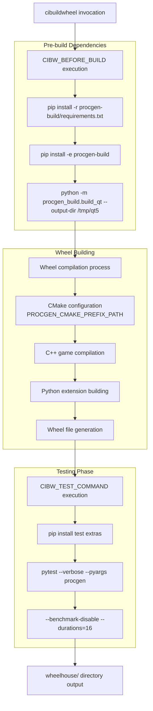

Sources: [procgen-build/procgen_build/build_package.py:14-18](), [procgen-build/procgen_build/build_package.py:39-40]()

## Platform-Specific Configurations

The build system adapts to different platforms through conditional environment variable configuration and caching strategies.

### Linux-Specific Configuration

On Linux systems, the build process includes additional environment variable passing and cache directory mapping to support containerized builds:

```python
if platform.system() == "Linux":
    if "GITHUB_REF" in os.environ:
        # GitHub reference for version tagging
        os.environ["CIBW_ENVIRONMENT"] += " GITHUB_REF=" + os.environ["GITHUB_REF"]
    # Container cache directory mapping
    os.environ["CIBW_ENVIRONMENT"] += f" CACHE_DIR=/host{os.getcwd()}/cache"
else:
    # Direct cache directory for macOS/Windows
    os.environ["CACHE_DIR"] = os.path.join(os.getcwd(), "cache")
```

Sources: [procgen-build/procgen_build/build_package.py:25-37]()

### Dependency Management

The `procgen_build` package itself has minimal dependencies focused on build tooling:

| Dependency | Version | Purpose |
|------------|---------|---------|
| `cmake` | 3.21.3 | Cross-platform C++ build system |
| `gym3` | 0.3.0 | Required by procgen/build.py |
| `cibuildwheel` | 2.3.1 | Multi-platform wheel builder |

Sources: [procgen-build/setup.py:7-12](), [procgen-build/procgen_build/build_package.py:39]()

## Testing and Validation

The build system includes comprehensive testing to ensure wheel quality and functionality across all target platforms.

### Test Configuration

The testing phase uses the `CIBW_TEST_COMMAND` to validate each built wheel through pytest execution with specific flags optimized for CI environments:

- `--verbose`: Detailed test output
- `--benchmark-disable`: Skip performance benchmarks
- `--durations=16`: Show slowest 16 tests
- `--pyargs procgen`: Test installed package rather than source

Sources: [procgen-build/procgen_build/build_package.py:18]()

## Artifact Generation and Publishing

The build pipeline produces wheel artifacts that are collected, stored, and conditionally published to PyPI based on git tag triggers.

### Artifact Flow

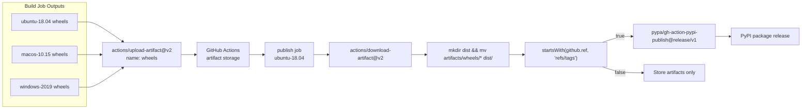

The publishing process only triggers for tagged releases, ensuring that development builds remain as artifacts without affecting the public package repository.

Sources: [.github/workflows/main.yml:42-46](), [.github/workflows/main.yml:82-102]()

---

# Page: Qt Framework Build

# Qt Framework Build

<details>
<summary>Relevant source files</summary>

The following files were used as context for generating this wiki page:

- [procgen-build/procgen_build/build_qt.py](procgen-build/procgen_build/build_qt.py)
- [procgen-build/procgen_build/common.py](procgen-build/procgen_build/common.py)

</details>


This document covers the Qt5 framework build system used by Procgen. The Qt build process creates a statically-linked Qt5 library that provides the GUI rendering capabilities for the game environments. For information about the overall Python package build pipeline, see [Python Package Build](#3.1). For details about the C++ game library compilation, see [C++ Library Build](#3.3).

## Overview

The Qt framework build system downloads, configures, and compiles Qt5 from source with specific optimizations for the Procgen use case. The build produces a static Qt5 library with a custom namespace to avoid symbol conflicts, and includes comprehensive caching mechanisms to reduce build times across different platforms.

## Build Process Flow

The Qt build process follows a structured workflow that handles source acquisition, configuration, compilation, and caching:

### Qt Build Workflow

```mermaid
flowchart TD
    A["build_qt()"] --> B["Create output directories"]
    B --> C["cache_folder() for source"]
    C --> D{"Source cache exists?"}
    D -->|Yes| E["Extract cached source"]
    D -->|No| F["download_source()"]
    F --> G["Git clone Qt5 repository"]
    G --> H["Checkout v5.13.2"]
    H --> I["Initialize qtbase module"]
    I --> J["Cache source code"]
    E --> K["cache_folder() for build"]
    J --> K
    K --> L{"Build cache exists?"}
    L -->|Yes| M["Extract cached build"]
    L -->|No| N["compile_qt()"]
    N --> O["Platform-specific configuration"]
    O --> P["Configure Qt with options"]
    P --> Q["Compile with make/nmake"]
    Q --> R["Clean build artifacts"]
    R --> S["Cache compiled build"]
    M --> T["Qt5 library ready"]
    S --> T
```

Sources: [procgen-build/procgen_build/build_qt.py:56-166]()

### Source Code Management

The system uses Git to acquire Qt5 source code with specific module selection:

```mermaid
flowchart LR
    A["Git Repository"] --> B["code.qt.io/qt/qt5.git"]
    B --> C["Checkout v5.13.2"]
    C --> D["init-repository"]
    D --> E["--module-subset=qtbase"]
    E --> F["Qt5 Source Tree"]
    
    G["Cache Key"] --> H["qt_version: 5.13.2"]
    H --> I["platform.system()"]
    I --> J["modules: qtbase"]
    J --> K["MD5 Hash"]
    K --> L["Cache Directory"]
```

Sources: [procgen-build/procgen_build/build_qt.py:68-77]()

## Caching System

The build system implements a two-tier caching mechanism to optimize build times:

### Cache Architecture

```mermaid
flowchart TB
    subgraph "Cache System"
        A["cache_folder()"] --> B["Generate options hash"]
        B --> C["MD5 hash of options"]
        C --> D["Cache path: name-hash.tar"]
        
        E["Source Cache"] --> F["qt-source-{hash}.tar"]
        G["Build Cache"] --> H["qt-build-{hash}.tar"]
        
        I["Cache Operations"] --> J["Check local cache"]
        J --> K["Check CACHE_DIR"]
        K --> L["Extract or build"]
        L --> M["Upload to cache"]
    end
    
    subgraph "Cache Keys"
        N["Source Cache Key"] --> O["Qt version + Platform + Modules"]
        P["Build Cache Key"] --> Q["Platform + Travis Image + Qt Options"]
    end
```

The `cache_folder()` function provides transparent caching with the following behavior:

| Cache State | Action |
|-------------|---------|
| Local directory exists | Use existing build |
| Cache file exists | Extract from cache |
| No cache available | Build from source and cache result |

Sources: [procgen-build/procgen_build/build_qt.py:18-45]()

## Platform-Specific Configuration

The Qt build process adapts to different platforms with specific configurations:

### Platform Build Matrix

```mermaid
flowchart LR
    subgraph "Windows"
        A["configure.exe"] --> B["nmake"]
        B --> C["-mp flag"]
        C --> D["Parallel build"]
    end
    
    subgraph "macOS"
        E["configure"] --> F["Custom qmake.conf"]
        F --> G["MACOSX_DEPLOYMENT_TARGET=10.13"]
        G --> H["make -j{cpu_count}"]
    end
    
    subgraph "Linux"
        I["configure"] --> J["make -j{cpu_count}"]
    end
    
    K["Qt Configuration"] --> A
    K --> E  
    K --> I
```

### macOS-Specific Modifications

The build system modifies the macOS Qt configuration to ensure compatibility:

```mermaid
flowchart TD
    A["macOS Build"] --> B["Locate qmake.conf files"]
    B --> C["../qt5/qtbase/mkspecs/macx-clang/qmake.conf"]
    C --> D["Override configuration"]
    D --> E["Set QMAKE_MACOSX_DEPLOYMENT_TARGET = 10.13"]
    E --> F["Configure X11 paths"]
    F --> G["Apply clang settings"]
```

Sources: [procgen-build/procgen_build/build_qt.py:116-145]()

## Qt Configuration Options

The build uses specific Qt configuration options optimized for Procgen's requirements:

### Core Configuration

| Option | Purpose |
|--------|---------|
| `-static` | Static linking to avoid runtime dependencies |
| `-qtnamespace ProcGenQt` | Custom namespace to prevent symbol conflicts |
| `-nomake examples,tests,tools` | Exclude unnecessary components |
| `-no-avx2, -no-avx512` | Disable advanced CPU instructions for compatibility |

### Disabled Features

The build explicitly disables features not required by Procgen:

```mermaid
flowchart LR
    A["Disabled Qt Features"] --> B["-no-opengl"]
    A --> C["-no-openssl"]
    A --> D["-no-dbus"]
    A --> E["-no-harfbuzz"]
    A --> F["-no-libjpeg"]
    A --> G["-no-ico"]
    A --> H["-no-gif"]
    A --> I["-no-xcb"]
    A --> J["-no-pch"]
```

Sources: [procgen-build/procgen_build/build_qt.py:79-108]()

## Build Optimization

The system includes several optimizations to reduce build time and output size:

### Timeout Prevention

A background thread prevents CI/CD timeouts during long builds:

```mermaid
flowchart LR
    A["no_timeout_worker()"] --> B["Background thread"]
    B --> C["Print '.' every 60 seconds"]
    C --> D["Prevent CI timeout"]
    E["Main build thread"] --> F["Qt compilation"]
    B -.-> F
```

### Artifact Cleanup

Post-build cleanup removes intermediate files to reduce cache size:

```mermaid
flowchart TD
    A["Build Complete"] --> B["Scan build directory"]
    B --> C["Find .obj directories"]
    C --> D["Find .pch directories"]
    D --> E["shutil.rmtree()"]
    E --> F["Reduced cache size"]
    G["Before cleanup"] --> H["du -hsc build"]
    F --> I["After cleanup"]
    I --> J["du -hsc build"]
```

Sources: [procgen-build/procgen_build/build_qt.py:50-54](), [procgen-build/procgen_build/build_qt.py:157-163]()

## Integration Points

The Qt build integrates with the broader Procgen build system through several mechanisms:

### Build System Integration

```mermaid
flowchart TB
    subgraph "Python Package Build"
        A["cibuildwheel"] --> B["build_package.py"]
    end
    
    subgraph "Qt Framework Build"
        C["build_qt.py"] --> D["Static Qt5 Library"]
    end
    
    subgraph "C++ Library Build"
        E["CMakeLists.txt"] --> F["Game Environments"]
    end
    
    B --> C
    D --> E
    F --> G["Final Python Package"]
    
    H["CACHE_DIR environment"] --> C
    I["Output directory"] --> D
```

The Qt build outputs a static library that the C++ build system links against, enabling the rendering capabilities required by the game environments.

Sources: [procgen-build/procgen_build/build_qt.py:56-173](), [procgen-build/procgen_build/common.py:6-17]()

---

# Page: C++ Library Build

# C++ Library Build

<details>
<summary>Relevant source files</summary>

The following files were used as context for generating this wiki page:

- [procgen/CMakeLists.txt](procgen/CMakeLists.txt)
- [procgen/builder.py](procgen/builder.py)

</details>


This page documents the CMake-based build system that compiles the core C++ game environments into a shared library. The build system handles compilation of 16 procedurally generated game implementations, links them with Qt5 for rendering, and creates the `env` shared library that serves as the foundation for Python bindings.

For information about the overall Python package build process, see [Python Package Build](#3.1). For details about Qt5 framework compilation, see [Qt Framework Build](#3.2).

## Build System Overview

The C++ library build consists of two main components: the CMake configuration that defines the library structure and compilation settings, and the Python build orchestrator that manages the build process across platforms.

### CMake Configuration Structure

```mermaid
graph TB
    subgraph "CMake Build System"
        CMAKE["CMakeLists.txt<br/>Project: codegen"]
        CMAKE --> STANDARDS["C++ Standards<br/>CMAKE_CXX_STANDARD=17<br/>CMAKE_POSITION_INDEPENDENT_CODE=ON"]
        CMAKE --> OPTIONS["Build Options<br/>PROCGEN_PACKAGE<br/>CMAKE_VERBOSE_MAKEFILE"]
        CMAKE --> COMPILER["Compiler Flags<br/>Platform-specific settings"]
    end
    
    subgraph "Library Target"
        ENVLIB["add_library(env SHARED)"]
        ENVLIB --> CORESRC["Core Sources<br/>assetgen.cpp<br/>basic-abstract-game.cpp<br/>cpp-utils.cpp"]
        ENVLIB --> GAMESRC["Game Sources<br/>16 game implementations"]
        ENVLIB --> UTILSRC["Utility Sources<br/>mazegen.cpp<br/>randgen.cpp<br/>roomgen.cpp"]
    end
    
    subgraph "Dependencies"
        QT5["find_package(Qt5 COMPONENTS Gui)"]
        LIBENV["target_include_directories<br/>LIBENV_DIR from gym3"]
        QTLINK["target_link_libraries(env Qt5::Gui)"]
    end
    
    CMAKE --> ENVLIB
    ENVLIB --> QT5
    ENVLIB --> LIBENV
    ENVLIB --> QTLINK
```

**Sources:** [procgen/CMakeLists.txt:1-78]()

### Build Orchestration Architecture

```mermaid
graph TD
    subgraph "Python Build Controller"
        BUILDER["builder.py"]
        BUILDER --> BUILDLOCK["global_build_lock<br/>Threading synchronization"]
        BUILDER --> BUILDFUNC["build(package=False, debug=False)"]
    end
    
    subgraph "Build Process Management"
        BUILDFUNC --> BUILDDIR["Build Directory<br/>.build/relwithdebinfo or debug"]
        BUILDDIR --> CONFIGURE["_attempt_configure()<br/>CMake configuration"]
        CONFIGURE --> CMAKEBUILD["cmake --build<br/>Platform-specific compilation"]
    end
    
    subgraph "Platform Detection"
        CONFIGURE --> GENERATOR["Generator Selection<br/>Unix Makefiles vs Visual Studio 16 2019"]
        CONFIGURE --> QTFIND["Qt5 Discovery<br/>PROCGEN_CMAKE_PREFIX_PATH<br/>conda environment detection"]
        CONFIGURE --> LIBENVDIR["gym3.libenv.get_header_dir()<br/>LIBENV_DIR configuration"]
    end
    
    subgraph "Output"
        CMAKEBUILD --> SHAREDLIB["Shared Library<br/>libenv.so/env.dll/libenv.dylib"]
        SHAREDLIB --> LIBDIR["Library Directory<br/>Platform-specific path"]
    end
    
    BUILDLOCK --> BUILDFUNC
    GENERATOR --> CMAKEBUILD
    QTFIND --> CMAKEBUILD
    LIBENVDIR --> CMAKEBUILD
```

**Sources:** [procgen/builder.py:95-148]()

## Game Implementation Structure

The shared library contains implementations for all 16 Procgen game environments, organized in a modular architecture.

### Game Source Organization

| Game Category | Source Files | Key Features |
|---------------|--------------|--------------|
| **Action Games** | `dodgeball.cpp`, `bossfight.cpp`, `ninja.cpp` | Fast-paced gameplay mechanics |
| **Platformers** | `coinrun.cpp`, `coinrun_old.cpp`, `jumper.cpp`, `leaper.cpp` | Platform navigation challenges |
| **Navigation** | `maze.cpp`, `heist.cpp`, `caveflyer.cpp` | Pathfinding and exploration |
| **Collection** | `bigfish.cpp`, `fruitbot.cpp`, `plunder.cpp` | Resource gathering mechanics |
| **Precision** | `climber.cpp`, `miner.cpp`, `starpilot.cpp` | Fine motor control requirements |
| **Chase** | `chaser.cpp` | Pursuit and evasion dynamics |

### Core Game Architecture

```mermaid
graph LR
    subgraph "Core Framework"
        BASICGAME["basic-abstract-game.cpp<br/>Base game class"]
        ENTITY["entity.cpp<br/>Game object management"]
        GAME["game.cpp<br/>Game state handling"]
        REGISTRY["game-registry.cpp<br/>Environment registration"]
    end
    
    subgraph "Game Implementations"
        COINRUN["coinrun.cpp<br/>CoinRun environment"]
        BIGFISH["bigfish.cpp<br/>BigFish environment"]
        MAZE["maze.cpp<br/>Maze environment"]
        OTHERS["... 13 other games"]
    end
    
    subgraph "Generation Systems"
        MAZEGEN["mazegen.cpp<br/>Maze generation algorithms"]
        RANDGEN["randgen.cpp<br/>Random number generation"]
        ROOMGEN["roomgen.cpp<br/>Room layout generation"]
        ASSETGEN["assetgen.cpp<br/>Asset loading and management"]
    end
    
    subgraph "Integration Layer"
        VECGAME["vecgame.cpp<br/>Vectorized environment interface"]
        VECOPTIONS["vecoptions.cpp<br/>Configuration management"]
        RESOURCES["resources.cpp<br/>Asset resource handling"]
    end
    
    BASICGAME --> COINRUN
    BASICGAME --> BIGFISH
    BASICGAME --> MAZE
    BASICGAME --> OTHERS
    
    ENTITY --> COINRUN
    GAME --> VECGAME
    REGISTRY --> VECGAME
    
    MAZEGEN --> MAZE
    RANDGEN --> COINRUN
    ROOMGEN --> BIGFISH
    ASSETGEN --> RESOURCES
    
    VECGAME --> VECOPTIONS
```

**Sources:** [procgen/CMakeLists.txt:42-73]()

## Platform-Specific Build Configuration

The build system adapts to different operating systems and development environments through conditional compilation settings.

### Compiler Configuration Matrix

| Platform | Generator | Compiler Flags | Optimization |
|----------|-----------|----------------|--------------|
| **macOS/Linux** | Unix Makefiles | `-Werror -Wextra -Wall` | `-march=ivybridge` (package) / `-march=native` (dev) |
| **Windows** | Visual Studio 16 2019 | `-D_CRT_SECURE_NO_WARNINGS` | Architecture: x64 |
| **All Platforms** | - | `-fno-omit-frame-pointer` | Frame pointers for profiling |

### Qt5 Discovery Process

```mermaid
graph TD
    subgraph "Qt5 Path Resolution"
        START["_attempt_configure()"]
        START --> ENVCHECK["Check PROCGEN_CMAKE_PREFIX_PATH"]
        ENVCHECK -->|Set| USEENV["Use environment path"]
        ENVCHECK -->|Not Set| GUESS["Guess common paths<br/>/usr/local/opt/qt5/lib/cmake"]
    end
    
    subgraph "Conda Integration"
        GUESS --> CONDACHECK["shutil.which('conda')"]
        CONDACHECK -->|Found| CONDAINFO["conda info --json"]
        CONDAINFO --> CONDAPREFIX["Extract active_prefix"]
        CONDAPREFIX --> CONDACMAKE["lib/cmake/Qt5 path"]
        CONDACHECK -->|Not Found| DEFAULTPATHS["Use default paths only"]
    end
    
    subgraph "Windows Adaptation"
        CONDAPREFIX -->|Windows| LIBRARY["Append /library to prefix"]
        CONDAPREFIX -->|Unix| DIRECT["Use prefix directly"]
    end
    
    subgraph "CMake Configuration"
        USEENV --> CMAKECONFIG["CMAKE_PREFIX_PATH"]
        CONDACMAKE --> CMAKECONFIG
        DEFAULTPATHS --> CMAKECONFIG
        LIBRARY --> CMAKECONFIG
        DIRECT --> CMAKECONFIG
    end
```

**Sources:** [procgen/builder.py:52-92]()

## Build Process Flow

The complete build process involves configuration, compilation, and output management with error handling and retry logic.

### Build Execution Pipeline

```mermaid
graph TB
    subgraph "Initialization"
        BUILDCALL["build(package, debug)"]
        BUILDCALL --> BUILDDIR["Create .build directory"]
        BUILDDIR --> BUILDTYPE["Determine build_type<br/>relwithdebinfo vs debug"]
    end
    
    subgraph "Concurrency Control"
        BUILDTYPE --> GLOBALLOCK["Acquire global_build_lock"]
        GLOBALLOCK --> CHECKBUILT["Check if build_type in global_builds"]
        CHECKBUILT -->|Already Built| RETURNDIR["Return existing lib_dir"]
        CHECKBUILT -->|Not Built| FILELOCK["Acquire FileLock (if not package)"]
    end
    
    subgraph "Configuration Phase"
        FILELOCK --> MAKEDIR["mkdir build_type directory"]
        MAKEDIR --> CONFIGURE1["First _attempt_configure()"]
        CONFIGURE1 -->|Success| BUILDPHASE["Proceed to build"]
        CONFIGURE1 -->|RunFailure| RETRY["Remove directory and retry"]
        RETRY --> CONFIGURE2["Second _attempt_configure()"]
    end
    
    subgraph "Compilation Phase"
        BUILDPHASE --> MAKEFLAGS["Set MAKEFLAGS=-j{cpu_count}"]
        CONFIGURE2 --> MAKEFLAGS
        MAKEFLAGS --> CMAKEBUILD["cmake --build . --config build_type"]
        CMAKEBUILD --> SUCCESS["Mark build_type as complete"]
    end
    
    subgraph "Output"
        SUCCESS --> LIBPATH["Determine library path<br/>Windows: build_type/build_type<br/>Unix: build_type"]
        LIBPATH --> RETURN["Return lib_dir"]
    end
    
    RETURNDIR --> RETURN
```

**Sources:** [procgen/builder.py:95-148]()

### Error Handling and Recovery

The build system includes robust error handling with automatic retry mechanisms:

- **Configuration Failures**: If initial CMake configuration fails, the system removes the build directory and retries once ([procgen/builder.py:124-131]())
- **Process Safety**: Uses `global_build_lock` to prevent concurrent builds in the same process ([procgen/builder.py:16-17]())
- **File Locking**: Prevents multiple processes from building simultaneously using `filelock.FileLock` ([procgen/builder.py:114-116]())
- **Verbose Output**: Controlled by the `package` parameter for detailed build logging ([procgen/builder.py:92]())

The build system integrates with gym3's libenv through the `LIBENV_DIR` CMake variable, ensuring proper header inclusion for the vectorized environment interface ([procgen/builder.py:83]()).

**Sources:** [procgen/builder.py:20-50](), [procgen/CMakeLists.txt:75-78]()

---

# Page: Core Architecture

# Core Architecture

<details>
<summary>Relevant source files</summary>

The following files were used as context for generating this wiki page:

- [README.md](README.md)
- [procgen/CMakeLists.txt](procgen/CMakeLists.txt)
- [procgen/__init__.py](procgen/__init__.py)
- [procgen/builder.py](procgen/builder.py)

</details>


This page provides a technical deep-dive into the core architecture of the Procgen Benchmark system, focusing on the C++ game engine, Python integration layer, and the overall system design that enables high-performance procedural environment generation. For information about the build process, see [Build System](#3). For details about individual game implementations, see [Game Environments](#4.1). For Python API documentation, see [Python API](#4.2).

## System Overview

The Procgen architecture is built around a high-performance C++ core that implements 16 procedurally generated games, with Python bindings that expose both traditional OpenAI Gym and vectorized Gym3 interfaces. The system is designed for reinforcement learning research requiring fast, reproducible, and customizable environments.

```mermaid
graph TB
    subgraph "Python Layer"
        PROCENV["ProcgenEnv"]
        PROCGYM3["ProcgenGym3Env"] 
        REGISTER["register_environments()"]
    end
    
    subgraph "C++ Core Library"
        VECGAME["VecGame"]
        GAMEREGISTRY["GameRegistry"]
        BASEGAME["Game (base class)"]
    end
    
    subgraph "Game Implementations"
        COINRUN["coinrun.cpp"]
        BIGFISH["bigfish.cpp"] 
        DODGEBALL["dodgeball.cpp"]
        MAZE["maze.cpp"]
        OTHERGAMES["+ 12 more games"]
    end
    
    subgraph "Core Systems"
        ASSETGEN["assetgen.cpp"]
        MAZEGEN["mazegen.cpp"]
        RANDGEN["randgen.cpp"]
        ROOMGEN["roomgen.cpp"]
    end
    
    subgraph "Rendering"
        QT5["Qt5::Gui"]
        RESOURCES["resources.cpp"]
    end
    
    PROCENV --> VECGAME
    PROCGYM3 --> VECGAME
    REGISTER --> GAMEREGISTRY
    
    VECGAME --> GAMEREGISTRY
    GAMEREGISTRY --> BASEGAME
    
    BASEGAME --> COINRUN
    BASEGAME --> BIGFISH
    BASEGAME --> DODGEBALL
    BASEGAME --> MAZE
    BASEGAME --> OTHERGAMES
    
    COINRUN --> ASSETGEN
    BIGFISH --> MAZEGEN
    MAZE --> RANDGEN
    OTHERGAMES --> ROOMGEN
    
    ASSETGEN --> QT5
    RESOURCES --> QT5
```

Sources: [procgen/__init__.py:7-8](), [procgen/CMakeLists.txt:42-73]()

## C++ Core Architecture

The C++ core implements a modular game engine with shared infrastructure for procedural generation, rendering, and environment management. All games inherit from a common base class and integrate with the vectorized environment system.

```mermaid
graph TD
    subgraph "Environment Management"
        VECGAME["VecGame<br/>vecgame.cpp"]
        VECOPTIONS["VecOptions<br/>vecoptions.cpp"]
    end
    
    subgraph "Game Framework"
        GAME["Game<br/>game.cpp"]
        BASICGAME["BasicAbstractGame<br/>basic-abstract-game.cpp"]
        ENTITY["Entity<br/>entity.cpp"]
    end
    
    subgraph "16 Game Implementations"
        COINRUN_CPP["coinrun.cpp"]
        BIGFISH_CPP["bigfish.cpp"]
        BOSSFIGHT_CPP["bossfight.cpp"]
        CAVEFLYER_CPP["caveflyer.cpp"]
        CLIMBER_CPP["climber.cpp"]
        CHASER_CPP["chaser.cpp"]
        DODGEBALL_CPP["dodgeball.cpp"]
        FRUITBOT_CPP["fruitbot.cpp"]
        HEIST_CPP["heist.cpp"]
        JUMPER_CPP["jumper.cpp"]
        LEAPER_CPP["leaper.cpp"]
        MAZE_CPP["maze.cpp"]
        MINER_CPP["miner.cpp"]
        NINJA_CPP["ninja.cpp"]
        PLUNDER_CPP["plunder.cpp"]
        STARPILOT_CPP["starpilot.cpp"]
    end
    
    subgraph "Procedural Generation"
        MAZEGEN_CPP["mazegen.cpp"]
        RANDGEN_CPP["randgen.cpp"] 
        ROOMGEN_CPP["roomgen.cpp"]
    end
    
    subgraph "Asset & Rendering"
        ASSETGEN_CPP["assetgen.cpp"]
        RESOURCES_CPP["resources.cpp"]
        CPPUTILS["cpp-utils.cpp"]
    end
    
    VECGAME --> VECOPTIONS
    VECGAME --> GAME
    
    GAME --> BASICGAME
    BASICGAME --> ENTITY
    
    GAME --> COINRUN_CPP
    GAME --> BIGFISH_CPP
    GAME --> BOSSFIGHT_CPP
    GAME --> CAVEFLYER_CPP
    GAME --> CLIMBER_CPP
    GAME --> CHASER_CPP
    GAME --> DODGEBALL_CPP
    GAME --> FRUITBOT_CPP
    GAME --> HEIST_CPP
    GAME --> JUMPER_CPP
    GAME --> LEAPER_CPP
    GAME --> MAZE_CPP
    GAME --> MINER_CPP
    GAME --> NINJA_CPP
    GAME --> PLUNDER_CPP
    GAME --> STARPILOT_CPP
    
    COINRUN_CPP --> RANDGEN_CPP
    MAZE_CPP --> MAZEGEN_CPP
    HEIST_CPP --> ROOMGEN_CPP
    
    GAME --> ASSETGEN_CPP
    ASSETGEN_CPP --> RESOURCES_CPP
    RESOURCES_CPP --> CPPUTILS
```

Sources: [procgen/CMakeLists.txt:50-66](), [procgen/CMakeLists.txt:44-72]()

### Game Registration System

The game registry provides dynamic game instantiation and management through a centralized registration system. Each game registers itself with the `GameRegistry` using factory patterns.

| Component | File | Purpose |
|-----------|------|---------|
| `GameRegistry` | `game-registry.cpp` | Central registration and factory system |
| `VecGame` | `vecgame.cpp` | Vectorized environment coordinator |
| `Game` | `game.cpp` | Base class for all game implementations |
| `VecOptions` | `vecoptions.cpp` | Configuration management |

Sources: [procgen/CMakeLists.txt:49](), [procgen/CMakeLists.txt:71-72]()

## Python Integration Layer  

The Python layer provides two main interfaces: `ProcgenEnv` for traditional Gym compatibility and `ProcgenGym3Env` for vectorized environments. Both interfaces communicate with the C++ core through the `gym3.libenv` protocol.

```mermaid
graph LR
    subgraph "Python Interface"
        INIT["__init__.py"]
        ENV["env.py"]
        GYMREG["gym_registration.py"]
    end
    
    subgraph "Environment Classes"
        PROCENV["ProcgenEnv"]
        PROCGYM3["ProcgenGym3Env"]
    end
    
    subgraph "C++ Integration"
        LIBENV["gym3.libenv"]
        BUILDER["builder.py"]
        VECGAME_PY["VecGame (C++)"]
    end
    
    subgraph "Build System"
        CMAKE["CMakeLists.txt"]
        SHAREDLIB["libenv.so/.dll"]
    end
    
    INIT --> PROCENV
    INIT --> PROCGYM3
    INIT --> GYMREG
    
    ENV --> PROCENV
    ENV --> PROCGYM3
    
    PROCENV --> LIBENV
    PROCGYM3 --> LIBENV
    
    LIBENV --> BUILDER
    BUILDER --> CMAKE
    CMAKE --> SHAREDLIB
    SHAREDLIB --> VECGAME_PY
```

Sources: [procgen/__init__.py:7-12](), [procgen/builder.py:11]()

### Build Integration

The `builder.py` module manages the compilation of the C++ library and provides process-safe building with dependency resolution for Qt5 and CMake.

| Function | Purpose |
|----------|---------|
| `build()` | Main build orchestration with lock management |
| `_attempt_configure()` | CMake configuration with Qt5 path detection |
| `chdir()` | Context manager for directory changes |
| `check()` | Process result validation and error handling |

Sources: [procgen/builder.py:95-147]()

## Rendering and Asset System

The rendering system uses Qt5 for cross-platform graphics with a resource management system that supports both human-designed and procedurally generated assets.

```mermaid
graph TB
    subgraph "Qt5 Integration"
        QT5GUI["Qt5::Gui"]
        QTCMAKE["find_package(Qt5 COMPONENTS Gui)"]
    end
    
    subgraph "Asset Management" 
        RESOURCES["resources.cpp"]
        ASSETGEN["assetgen.cpp"]
        KENNEY["Kenney Abstract Assets"]
    end
    
    subgraph "Rendering Pipeline"
        GAMERENDER["Game::render()"]
        RGBARRAY["RGB Array Output<br/>64x64x3"]
        VIEWERWRAPPER["gym3.ViewerWrapper"]
    end
    
    subgraph "Asset Options"
        USEGENERATED["use_generated_assets"]
        USEBACKGROUNDS["use_backgrounds"] 
        RESTRICTTHEMES["restrict_themes"]
        MONOCHROME["use_monochrome_assets"]
    end
    
    QTCMAKE --> QT5GUI
    QT5GUI --> GAMERENDER
    
    RESOURCES --> ASSETGEN
    KENNEY --> ASSETGEN
    ASSETGEN --> GAMERENDER
    
    GAMERENDER --> RGBARRAY
    RGBARRAY --> VIEWERWRAPPER
    
    USEGENERATED --> ASSETGEN
    USEBACKGROUNDS --> ASSETGEN
    RESTRICTTHEMES --> ASSETGEN
    MONOCHROME --> ASSETGEN
```

Sources: [procgen/CMakeLists.txt:40](), [procgen/CMakeLists.txt:77](), [procgen/CMakeLists.txt:44](), [procgen/CMakeLists.txt:70]()

## Environment Lifecycle

The environment lifecycle manages game instantiation, state management, and the observation-action loop through the vectorized environment system.

### Core Lifecycle Components

| Phase | C++ Component | Python Interface |
|-------|---------------|------------------|
| Initialization | `VecGame` constructor | `ProcgenGym3Env.__init__()` |
| Game Selection | `GameRegistry::make_game()` | `env_name` parameter |
| Level Generation | `Game::game_init()` | `start_level`, `num_levels` |
| Observation | `Game::observe()` | `env.observe()` |
| Action Processing | `Game::step()` | `env.act()` |
| State Management | `Game::get_state()` | `env.callmethod("get_state")` |

### Vectorization Architecture

The `VecGame` class coordinates multiple game instances within a single process, enabling high-throughput training:

```mermaid
graph TB
    subgraph "VecGame Coordinator"
        VECGAME_MAIN["VecGame"]
        GAMEINSTANCES["Game Instances Array"]
        INFOTYPES["info_types vector"]
    end
    
    subgraph "Per-Game State"
        GAME1["Game Instance 1"]
        GAME2["Game Instance 2"] 
        GAMEN["Game Instance N"]
    end
    
    subgraph "Shared Resources"
        REGISTRY["GameRegistry"]
        OPTIONS["VecOptions"]
        QTRESOURCES["Qt Resources"]
    end
    
    VECGAME_MAIN --> GAMEINSTANCES
    VECGAME_MAIN --> INFOTYPES
    
    GAMEINSTANCES --> GAME1
    GAMEINSTANCES --> GAME2
    GAMEINSTANCES --> GAMEN
    
    GAME1 --> REGISTRY
    GAME2 --> REGISTRY
    GAMEN --> REGISTRY
    
    VECGAME_MAIN --> OPTIONS
    GAME1 --> QTRESOURCES
    GAME2 --> QTRESOURCES
    GAMEN --> QTRESOURCES
```

Sources: [procgen/CMakeLists.txt:71](), [procgen/CMakeLists.txt:72](), [procgen/CMakeLists.txt:49]()

---

# Page: Game Environments

# Game Environments

<details>
<summary>Relevant source files</summary>

The following files were used as context for generating this wiki page:

- [README.md](README.md)
- [procgen/CMakeLists.txt](procgen/CMakeLists.txt)

</details>


This document provides a comprehensive overview of the 16 procedurally generated game environments that form the core of the Procgen Benchmark. It covers the technical implementation of each game, the common architectural patterns they share, and the procedural generation systems that power them.

For information about the Python API interfaces that expose these environments, see [Python API](#4.2). For details about the build system that compiles these C++ games, see [C++ Library Build](#3.3).

## Environment Overview

The Procgen Benchmark consists of 16 distinct game environments, each implemented as a separate C++ class that inherits from a common base game architecture. These environments span multiple genres including platformers, maze games, action games, and puzzle games, providing diverse challenges for reinforcement learning agents.

### Game Environment Registry

```mermaid
graph TB
    subgraph "Game Registration System"
        GameRegistry["GameRegistry"]
        RegisterGame["register_game()"]
    end
    
    subgraph "Individual Game Implementations"
        BigFish["BigFish"]
        BossFight["BossFight"] 
        CaveFlyer["CaveFlyer"]
        Chaser["Chaser"]
        Climber["Climber"]
        CoinRun["CoinRun"]
        Dodgeball["Dodgeball"]
        FruitBot["FruitBot"]
        Heist["Heist"]
        Jumper["Jumper"]
        Leaper["Leaper"]
        Maze["Maze"]
        Miner["Miner"]
        Ninja["Ninja"]
        Plunder["Plunder"]
        StarPilot["StarPilot"]
    end
    
    subgraph "Source Files"
        bigfish_cpp["src/games/bigfish.cpp"]
        bossfight_cpp["src/games/bossfight.cpp"]
        caveflyer_cpp["src/games/caveflyer.cpp"]
        chaser_cpp["src/games/chaser.cpp"]
        climber_cpp["src/games/climber.cpp"]
        coinrun_cpp["src/games/coinrun.cpp"]
        dodgeball_cpp["src/games/dodgeball.cpp"]
        fruitbot_cpp["src/games/fruitbot.cpp"]
        heist_cpp["src/games/heist.cpp"]
        jumper_cpp["src/games/jumper.cpp"]
        leaper_cpp["src/games/leaper.cpp"]
        maze_cpp["src/games/maze.cpp"]
        miner_cpp["src/games/miner.cpp"]
        ninja_cpp["src/games/ninja.cpp"]
        plunder_cpp["src/games/plunder.cpp"]
        starpilot_cpp["src/games/starpilot.cpp"]
    end
    
    GameRegistry --> RegisterGame
    
    BigFish --> RegisterGame
    BossFight --> RegisterGame
    CaveFlyer --> RegisterGame
    Chaser --> RegisterGame
    Climber --> RegisterGame
    CoinRun --> RegisterGame
    Dodgeball --> RegisterGame
    FruitBot --> RegisterGame
    Heist --> RegisterGame
    Jumper --> RegisterGame
    Leaper --> RegisterGame
    Maze --> RegisterGame
    Miner --> RegisterGame
    Ninja --> RegisterGame
    Plunder --> RegisterGame
    StarPilot --> RegisterGame
    
    BigFish --- bigfish_cpp
    BossFight --- bossfight_cpp
    CaveFlyer --- caveflyer_cpp
    Chaser --- chaser_cpp
    Climber --- climber_cpp
    CoinRun --- coinrun_cpp
    Dodgeball --- dodgeball_cpp
    FruitBot --- fruitbot_cpp
    Heist --- heist_cpp
    Jumper --- jumper_cpp
    Leaper --- leaper_cpp
    Maze --- maze_cpp
    Miner --- miner_cpp
    Ninja --- ninja_cpp
    Plunder --- plunder_cpp
    StarPilot --- starpilot_cpp
```

Sources: [README.md:102-122](), [procgen/CMakeLists.txt:50-66]()

## Technical Architecture

### Game Class Hierarchy

```mermaid
graph TB
    subgraph "Base Architecture"
        Game["Game"]
        BasicAbstractGame["BasicAbstractGame"]
        Entity["Entity"]
    end
    
    subgraph "Core Systems"
        VecGame["VecGame"]
        GameRegistry["game_registry.cpp"]
        AssetGen["assetgen.cpp"]
    end
    
    subgraph "Procedural Generation"
        MazeGen["mazegen.cpp"]
        RandGen["randgen.cpp"] 
        RoomGen["roomgen.cpp"]
    end
    
    subgraph "Specific Game Classes"
        ConcreteGames["BigFish, CoinRun, Maze, etc.<br/>16 game implementations"]
    end
    
    Game --> BasicAbstractGame
    BasicAbstractGame --> ConcreteGames
    Entity --> ConcreteGames
    
    VecGame --> Game
    GameRegistry --> ConcreteGames
    AssetGen --> ConcreteGames
    
    MazeGen --> ConcreteGames
    RandGen --> ConcreteGames
    RoomGen --> ConcreteGames
```

Sources: [procgen/CMakeLists.txt:42-73]()

## Game Categories

The 16 environments can be categorized by their core gameplay mechanics and technical implementations:

### Platformer Games

| Game | Description | Key Mechanics |
|------|-------------|---------------|
| `coinrun` | Simple platformer with coin collection goal | Platform jumping, obstacle avoidance |
| `climber` | Vertical platformer with star collection | Climbing mechanics, flying enemies |
| `jumper` | Open-world platformer with double jumping | Double jump, compass navigation |
| `ninja` | Platformer with projectile mechanics | Charged jumping, throwing stars |

### Maze and Navigation Games

| Game | Description | Key Mechanics |
|------|-------------|---------------|
| `maze` | Traditional maze navigation | Kruskal's algorithm generation |
| `chaser` | Pac-Man inspired maze game | Enemy AI, power-ups, vulnerability states |
| `heist` | Lock-and-key maze puzzle | Key collection, multi-colored locks |

### Action and Shooter Games

| Game | Description | Key Mechanics |
|------|-------------|---------------|
| `starpilot` | Side-scrolling shooter | Projectile targeting, multiple enemy types |
| `bossfight` | Starship boss battle | Shield mechanics, pattern-based attacks |
| `dodgeball` | Room-based combat | Ball throwing, enemy AI |
| `plunder` | Naval combat | Timer mechanics, friendly fire penalties |

### Specialized Games

| Game | Description | Key Mechanics |
|------|-------------|---------------|
| `bigfish` | Growth-based survival | Size-based collision detection |
| `caveflyer` | Cave navigation | Asteroids-style movement |
| `fruitbot` | Scrolling collection game | Positive/negative rewards |
| `leaper` | Frogger-inspired crossing | Multiple hazard types |
| `miner` | Boulder Dash mechanics | Gravity physics, digging |

Sources: [README.md:104-122]()

## Common Technical Systems

### Observation Space

All games share a consistent observation space:

```
RGB Array: (64, 64, 3)
Action Space: Discrete(15)
Step Rate: 15 Hz (human equivalent)
```

### Action Space Encoding

The 15-action discrete space represents button combinations defined in the core environment system:

```mermaid
graph LR
    subgraph "Button Combinations"
        NoOp["0: No Operation"]
        Left["1: Left"]
        Right["2: Right"] 
        Up["3: Up"]
        Down["4: Down"]
        LeftUp["5: Left + Up"]
        RightUp["6: Right + Up"]
        LeftDown["7: Left + Down"]
        RightDown["8: Right + Down"]
        Action1["9: Action Button"]
        LeftAction1["10: Left + Action"]
        RightAction1["11: Right + Action"]
        UpAction1["12: Up + Action"]
        DownAction1["13: Down + Action"]
        Reserved["14: Reserved"]
    end
```

Sources: [README.md:98]()

### Procedural Generation Pipeline

```mermaid
graph TB
    subgraph "Level Generation"
        LevelSeed["level_seed"]
        StartLevel["start_level"]
        NumLevels["num_levels"]
    end
    
    subgraph "Generation Algorithms"
        Kruskal["Kruskal's Algorithm<br/>(maze, chaser, heist)"]
        Random["Random Generation<br/>(most games)"]
        Physics["Physics-based<br/>(miner)"]
    end
    
    subgraph "Asset Systems"
        AssetGen["assetgen.cpp"]
        GeneratedAssets["use_generated_assets"]
        HumanAssets["Human-designed assets"]
        Backgrounds["use_backgrounds"]
        Themes["restrict_themes"]
        Monochrome["use_monochrome_assets"]
    end
    
    LevelSeed --> Kruskal
    LevelSeed --> Random
    LevelSeed --> Physics
    
    Kruskal --> AssetGen
    Random --> AssetGen
    Physics --> AssetGen
    
    AssetGen --> GeneratedAssets
    AssetGen --> HumanAssets
    AssetGen --> Backgrounds
    AssetGen --> Themes
    AssetGen --> Monochrome
```

Sources: [README.md:134-147](), [procgen/CMakeLists.txt:44,67-69]()

## Environment Configuration Options

The games support extensive configuration through environment options:

### Core Level Control
- `start_level`: Lowest seed for level generation
- `num_levels`: Number of unique levels (0 = unlimited)
- `use_sequential_levels`: Linear progression through levels

### Difficulty and Variants
- `distribution_mode`: `"easy"`, `"hard"`, `"extreme"`, `"memory"`, `"exploration"`

### Visual and Asset Options
- `use_generated_assets`: Random vs human-designed assets
- `use_backgrounds`: Enable/disable backgrounds
- `restrict_themes`: Single theme constraint
- `use_monochrome_assets`: Simplified visual representation

### Debug and Development
- `debug_mode`: Custom debugging flag
- `paint_vel_info`: Velocity information overlay
- `center_agent`: Agent-centered vs full-level view

Sources: [README.md:132-147]()

## State Management and Serialization

Games support full state serialization through the `VecGame` interface:

```mermaid
graph LR
    subgraph "State Operations"
        GetState["get_state()"]
        SetState["set_state()"]
        StateBytes["Byte string representation"]
    end
    
    subgraph "Use Cases"
        Reproducibility["Reproducibility"]
        Checkpointing["Checkpointing"]
        Debugging["Debugging"]
    end
    
    GetState --> StateBytes
    StateBytes --> SetState
    
    StateBytes --> Reproducibility
    StateBytes --> Checkpointing
    StateBytes --> Debugging
```

Sources: [README.md:166-178]()

## Known Environment Issues

Several games have documented edge cases that are preserved for reproducibility:

| Game | Issue | Frequency | Impact |
|------|-------|-----------|---------|
| `bigfish` | Player can become trapped at borders | Occasional | Episode continues but progress blocked |
| `caveflyer` | Player spawns next to enemy | ~0.5% of levels | Immediate death regardless of action |
| `jumper` | Player spawns on enemy/goal | ~7% of levels | Single-step episode termination |
| `miner` | Unsolvable configurations | Low probability | Diamond or exit unreachable |

Sources: [README.md:123-131]()

---

# Page: Python API

# Python API

<details>
<summary>Relevant source files</summary>

The following files were used as context for generating this wiki page:

- [README.md](README.md)
- [procgen/__init__.py](procgen/__init__.py)

</details>


This document covers the Python API layer that provides high-level interfaces for interacting with Procgen environments. The Python API consists of two main environment classes that wrap the underlying C++ game implementations with standardized reinforcement learning interfaces.

For information about the underlying C++ game implementations, see [Game Environments](#4.1). For details about setting up a development environment to work with these APIs, see [Development Environment](#5.1).

## Overview

The Procgen Python API provides two primary environment classes that serve as the main entry points for researchers and developers:

- `ProcgenEnv`: A gym-compatible interface for single environments
- `ProcgenGym3Env`: A vectorized gym3 interface for running multiple environments in parallel

Both classes are exported from the main package and provide access to all 16 procedurally generated game environments through a unified configuration system.

```mermaid
graph TB
    subgraph "Python API Layer"
        INIT["__init__.py<br/>Package Exports"]
        PROCENV["ProcgenEnv<br/>Gym Interface"]
        PROCGYM3["ProcgenGym3Env<br/>Gym3 Interface"]
        REGISTRATION["gym_registration.py<br/>Environment Registration"]
    end
    
    subgraph "Configuration System"
        OPTIONS["Environment Options<br/>num_levels, start_level, etc."]
        ENVNAMES["Environment Names<br/>coinrun, bigfish, etc."]
    end
    
    subgraph "C++ Backend Interface"
        VECGAME["VecGame C++ Class<br/>Core Environment Engine"]
        LIBENV["libenv C Interface<br/>gym3 Compatible"]
    end
    
    subgraph "User Code"
        GYMUSER["gym.make()<br/>Standard Gym Usage"]
        GYM3USER["ProcgenGym3Env()<br/>Vectorized Usage"]
        INTERACTIVE["Interactive Mode<br/>procgen.interactive"]
    end
    
    INIT --> PROCENV
    INIT --> PROCGYM3
    INIT --> REGISTRATION
    
    OPTIONS --> PROCENV
    OPTIONS --> PROCGYM3
    ENVNAMES --> PROCENV
    ENVNAMES --> PROCGYM3
    
    PROCENV --> VECGAME
    PROCGYM3 --> LIBENV
    LIBENV --> VECGAME
    
    GYMUSER --> PROCENV
    GYM3USER --> PROCGYM3
    INTERACTIVE --> PROCGYM3
    
    REGISTRATION --> GYMUSER
```

Sources: [procgen/__init__.py:1-12](), [README.md:64-76]()

## Environment Classes

### ProcgenEnv (Gym Interface)

The `ProcgenEnv` class provides a standard OpenAI Gym interface for individual Procgen environments. This interface is designed for compatibility with existing gym-based reinforcement learning code.

```mermaid
graph LR
    subgraph "Gym Interface Flow"
        GYMAKE["gym.make()<br/>'procgen:procgen-coinrun-v0'"]
        PROCENV["ProcgenEnv<br/>Gym Wrapper"]
        RESET["reset()<br/>Returns observation"]
        STEP["step(action)<br/>Returns obs, reward, done, info"]
        RENDER["render()<br/>Returns RGB array or shows window"]
    end
    
    subgraph "Internal Components"
        GYM3ENV["Internal ProcgenGym3Env<br/>num=1"]
        WRAPPER["Gym3ToGymWrapper<br/>Interface Adapter"]
        VIEWER["ViewerWrapper<br/>Rendering Support"]
    end
    
    GYMAKE --> PROCENV
    PROCENV --> RESET
    PROCENV --> STEP
    PROCENV --> RENDER
    
    PROCENV --> GYM3ENV
    PROCENV --> WRAPPER
    RENDER --> VIEWER
```

The gym interface supports standard gym functionality with some Procgen-specific behaviors:

- **Observation Space**: Box space with shape (64, 64, 3) containing RGB pixel data
- **Action Space**: Discrete(15) representing different button combinations
- **Rendering**: Supports both `rgb_array` and `human` render modes
- **Early Reset Restriction**: Early calls to `reset()` are disallowed due to the underlying gym3 adapter

Sources: [README.md:64-69](), [README.md:96-101](), [README.md:154-156]()

### ProcgenGym3Env (Gym3 Interface)

The `ProcgenGym3Env` class provides a vectorized gym3 interface that can run multiple environment instances in parallel. This is the primary interface for high-performance training scenarios.

```mermaid
graph TB
    subgraph "ProcgenGym3Env Interface"
        CONSTRUCTOR["ProcgenGym3Env(num=64, env_name='coinrun')<br/>Vectorized Constructor"]
        OBSERVE["observe()<br/>Returns dict with 'rgb' key"]
        ACT["act(actions)<br/>Submit actions for all envs"]
        GETINFO["get_info()<br/>Returns environment info"]
        STATE["get_state() / set_state()<br/>State Management"]
    end
    
    subgraph "Internal Architecture"
        LIBENVWRAPPER["LibenvWrapper<br/>gym3 Adapter"]
        LIBENVINTERFACE["libenv C Interface<br/>vecgame.cpp"]
        VECGAME["VecGame C++ Class<br/>Manages Multiple Games"]
        GAMEINSTANCES["Game Instances<br/>Individual C++ Games"]
    end
    
    CONSTRUCTOR --> LIBENVWRAPPER
    OBSERVE --> LIBENVWRAPPER
    ACT --> LIBENVWRAPPER
    GETINFO --> LIBENVWRAPPER
    STATE --> LIBENVWRAPPER
    
    LIBENVWRAPPER --> LIBENVINTERFACE
    LIBENVINTERFACE --> VECGAME
    VECGAME --> GAMEINSTANCES
```

Key features of the gym3 interface:

- **Vectorization**: Run multiple environments simultaneously with `num` parameter
- **Observation Format**: Dictionary space with RGB data under `"rgb"` key
- **State Management**: Full save/load capability for environment states
- **Performance**: Direct C++ backend access for maximum throughput
- **Flexible Configuration**: All environment options available at construction

Sources: [README.md:71-76](), [README.md:157-162](), [README.md:167-177]()

## Configuration Options

Both environment classes accept a comprehensive set of configuration options that control procedural generation, difficulty, and visual appearance:

| Option | Type | Default | Description |
|--------|------|---------|-------------|
| `env_name` | str | Required | Environment name or comma-separated list |
| `num_levels` | int | 0 | Number of unique levels (0 = unlimited) |
| `start_level` | int | 0 | Lowest seed for level generation |
| `distribution_mode` | str | "hard" | Difficulty variant: "easy", "hard", "extreme", "memory", "exploration" |
| `paint_vel_info` | bool | False | Paint velocity info in top left corner |
| `use_generated_assets` | bool | False | Use randomly generated assets |
| `center_agent` | bool | True | Center observations on agent vs full level |
| `use_sequential_levels` | bool | False | Sequential level progression without episode end |
| `use_backgrounds` | bool | True | Use designed backgrounds vs black |
| `restrict_themes` | bool | False | Use single theme vs multiple themes |
| `use_monochrome_assets` | bool | False | Use monochromatic rectangles vs designed assets |

```mermaid
graph LR
    subgraph "Configuration Categories"
        PROCGEN["Procedural Generation<br/>num_levels, start_level"]
        DIFFICULTY["Difficulty Control<br/>distribution_mode"]
        VISUAL["Visual Options<br/>backgrounds, themes, assets"]
        BEHAVIOR["Behavior Modifiers<br/>sequential_levels, center_agent"]
        DEBUG["Debug Options<br/>paint_vel_info, debug_mode"]
    end
    
    subgraph "Environment Construction"
        GYMCONFIG["gym.make() kwargs<br/>Passed to ProcgenEnv"]
        GYM3CONFIG["ProcgenGym3Env() kwargs<br/>Direct parameters"]
    end
    
    PROCGEN --> GYMCONFIG
    PROCGEN --> GYM3CONFIG
    DIFFICULTY --> GYMCONFIG
    DIFFICULTY --> GYM3CONFIG
    VISUAL --> GYMCONFIG
    VISUAL --> GYM3CONFIG
    BEHAVIOR --> GYMCONFIG
    BEHAVIOR --> GYM3CONFIG
    DEBUG --> GYMCONFIG
    DEBUG --> GYM3CONFIG
```

Sources: [README.md:132-147](), [README.md:148-153](), [README.md:157-162]()

## State Management

The gym3 interface provides comprehensive state management capabilities through the `get_state()` and `set_state()` methods. This functionality enables:

- **Reproducible Experiments**: Save exact environment states for later replay
- **Checkpoint and Resume**: Save training checkpoints including environment state
- **Deterministic Testing**: Load specific states for consistent evaluation
- **State Analysis**: Examine environment states for debugging and research

```mermaid
graph TD
    subgraph "State Management API"
        GETSTATE["env.callmethod('get_state')<br/>Returns list of byte strings"]
        SETSTATE["env.callmethod('set_state', states)<br/>Restores environment states"]
    end
    
    subgraph "Internal State Representation"
        BYTESTRINGS["List of Byte Strings<br/>One per vectorized environment"]
        GAMESTATE["C++ Game State<br/>Complete internal state"]
        SERIALIZATION["State Serialization<br/>Binary format"]
    end
    
    subgraph "Use Cases"
        REPRODUCE["Reproducible Experiments<br/>Exact state restoration"]
        CHECKPOINT["Training Checkpoints<br/>Save/resume training"]
        TESTING["Deterministic Testing<br/>Fixed state evaluation"]
    end
    
    GETSTATE --> BYTESTRINGS
    SETSTATE --> BYTESTRINGS
    BYTESTRINGS --> GAMESTATE
    GAMESTATE --> SERIALIZATION
    
    GETSTATE --> REPRODUCE
    SETSTATE --> REPRODUCE
    GETSTATE --> CHECKPOINT
    SETSTATE --> CHECKPOINT
    GETSTATE --> TESTING
    SETSTATE --> TESTING
```

Sources: [README.md:166-177]()

## Environment Registration

The environment registration system automatically registers all Procgen environments with the gym registry, enabling discovery through standard gym mechanisms:

```mermaid
graph LR
    subgraph "Registration Process"
        INIT["Package Import<br/>procgen.__init__.py"]
        REGISTER["register_environments()<br/>Auto-registration"]
        GYMREGISTRY["Gym Registry<br/>Environment Discovery"]
    end
    
    subgraph "Registered Environments"
        PATTERN["'procgen:procgen-{env}-v0'<br/>Naming Pattern"]
        ENVS["16 Environments<br/>coinrun, bigfish, etc."]
        GYMAKE["gym.make()<br/>Standard Discovery"]
    end
    
    INIT --> REGISTER
    REGISTER --> GYMREGISTRY
    GYMREGISTRY --> PATTERN
    PATTERN --> ENVS
    ENVS --> GYMAKE
```

The registration system:

- **Automatic Registration**: All environments registered on package import
- **Consistent Naming**: Follows `procgen:procgen-{env_name}-v0` pattern
- **Gym Integration**: Full compatibility with gym environment discovery
- **Version Management**: Supports versioned environment specifications

Sources: [procgen/__init__.py:7-11](), [README.md:64-69]()

## Interactive Mode

The package includes an interactive mode for manual environment testing and visualization:

```bash
python -m procgen.interactive --env-name coinrun
```

This mode provides:
- **Manual Control**: Keyboard input for environment interaction
- **Real-time Rendering**: Visual feedback for environment behavior
- **Performance Metrics**: Display of episode return and completion status
- **Development Tool**: Quick testing of environment modifications

Sources: [README.md:56-62](), [README.md:252-254]()

---

# Page: Development

# Development

<details>
<summary>Relevant source files</summary>

The following files were used as context for generating this wiki page:

- [CONTRIBUTING.md](CONTRIBUTING.md)
- [docker/Dockerfile.dev](docker/Dockerfile.dev)
- [procgen-build/procgen_build/dev_test.py](procgen-build/procgen_build/dev_test.py)

</details>


This document provides guidance for developers who want to contribute to or extend the Procgen benchmark codebase. It covers the development environment setup, testing procedures, and contribution workflow. For specific installation instructions intended for end users, see [Installation](#2.1). For detailed information about the CI/CD pipeline automation, see [CI/CD Pipeline](#5.3).

## Development Workflow Overview

The Procgen development process follows a fork-based model with emphasis on reproducibility and minimal impact on training results. The workflow integrates conda environment management, automated testing, and cross-platform validation.

**Development Workflow Architecture**
```mermaid
graph TB
    subgraph "Developer Setup"
        FORK["Fork Repository"]
        CLONE["Clone Source Code"]
        ENV_CHOICE["Choose Environment"]
    end
    
    subgraph "Environment Options"
        CONDA["conda env create<br/>environment.yml"]
        DOCKER["docker build<br/>Dockerfile.dev"]
        MANUAL["Manual Installation<br/>pip install -e ."]
    end
    
    subgraph "Development Tools"
        DEV_TEST["dev_test.py<br/>Automated Setup"]
        PYTEST["pytest<br/>Test Suite"]
        VERIFY["Import Verification<br/>ProcgenGym3Env"]
    end
    
    subgraph "Validation Process"
        FUNCTIONAL["Functional Testing<br/>Environment Creation"]
        IMPORT_TEST["Import Testing<br/>Python Bindings"]
        BENCHMARK["Benchmark Testing<br/>Performance Validation"]
    end
    
    FORK --> CLONE
    CLONE --> ENV_CHOICE
    ENV_CHOICE --> CONDA
    ENV_CHOICE --> DOCKER
    ENV_CHOICE --> MANUAL
    
    CONDA --> DEV_TEST
    DOCKER --> DEV_TEST
    MANUAL --> DEV_TEST
    
    DEV_TEST --> PYTEST
    DEV_TEST --> VERIFY
    
    PYTEST --> FUNCTIONAL
    VERIFY --> IMPORT_TEST
    FUNCTIONAL --> BENCHMARK
```

Sources: [CONTRIBUTING.md:1-7](), [docker/Dockerfile.dev:1-11](), [procgen-build/procgen_build/dev_test.py:18-51]()

## Development Environment Setup Process

The development environment setup process is automated through the `dev_test.py` script, which handles conda installation, dependency management, and verification testing across multiple platforms.

**Development Environment Setup Flow**
```mermaid
graph TD
    START["Development Setup Start"] --> PLATFORM_CHECK["platform.system()<br/>Linux/Darwin/Windows"]
    
    PLATFORM_CHECK --> LINUX_DEPS["apt_install(['mesa-common-dev'])<br/>Linux Only"]
    PLATFORM_CHECK --> MINICONDA_DOWNLOAD["Download Miniconda Installer<br/>Platform-Specific URLs"]
    
    LINUX_DEPS --> MINICONDA_DOWNLOAD
    MINICONDA_DOWNLOAD --> INSTALL_CONDA["Install Miniconda<br/>conda_path setup"]
    
    INSTALL_CONDA --> ENV_UPDATE["conda env update<br/>--name dev --file environment.yml"]
    ENV_UPDATE --> PIP_INSTALL["pip install -e .[test]<br/>Editable Install"]
    
    PIP_INSTALL --> VERIFY_IMPORT["Import Verification<br/>ProcgenGym3Env(num=1, env_name='coinrun')"]
    VERIFY_IMPORT --> RUN_TESTS["pytest --verbose<br/>--benchmark-disable --durations=16"]
    
    RUN_TESTS --> SUCCESS["Development Environment Ready"]
    
    subgraph "Conda Environment Components"
        GYM3["gym3 Package"]
        BUILD_DEPS["Build Dependencies"]
        TEST_DEPS["Test Dependencies"]
    end
    
    ENV_UPDATE --> GYM3
    ENV_UPDATE --> BUILD_DEPS
    ENV_UPDATE --> TEST_DEPS
```

Sources: [procgen-build/procgen_build/dev_test.py:18-51](), [docker/Dockerfile.dev:6-11]()

## Key Development Components

### Environment Configuration Files

| File | Purpose | Key Dependencies |
|------|---------|------------------|
| `environment.yml` | Conda environment specification | gym3, build tools, test frameworks |
| `docker/Dockerfile.dev` | Development container setup | Ubuntu 18.04, miniconda, mesa-common-dev |
| `setup.py` | Python package configuration | CMake, Qt build dependencies |

### Development Testing Infrastructure

The `dev_test.py` module provides automated development environment setup and validation:

**Core Functions:**
- `apt_install()` - Manages Linux system dependencies [procgen-build/procgen_build/dev_test.py:9-16]()
- `main()` - Orchestrates complete development setup [procgen-build/procgen_build/dev_test.py:18-51]()
- `run_in_conda_env()` - Executes commands in conda environment [procgen-build/procgen_build/dev_test.py:40-41]()

**Platform-Specific Installers:**
- Linux: `Miniconda3-py37_4.9.2-Linux-x86_64.sh`
- macOS: `Miniconda3-py37_4.9.2-MacOSX-x86_64.sh`  
- Windows: `Miniconda3-py37_4.9.2-Windows-x86_64.exe`

Sources: [procgen-build/procgen_build/dev_test.py:22-31]()

### Verification Testing

Development setup includes automated verification through import testing and functional validation:

```python
# Import verification command executed in dev_test.py
python -c "from procgen import ProcgenGym3Env; ProcgenGym3Env(num=1, env_name='coinrun')"
```

This verification ensures:
- Python bindings are correctly built
- `ProcgenGym3Env` class is importable
- Basic environment creation functions
- C++ library linking is successful

Sources: [procgen-build/procgen_build/dev_test.py:46](), [docker/Dockerfile.dev:11]()

## Testing and Validation Process

The development testing process uses `pytest` with specific configuration for benchmark and duration tracking:

**Test Execution Configuration:**
- `--verbose` - Detailed test output
- `--benchmark-disable` - Skip performance benchmarks during development
- `--durations=16` - Report 16 slowest tests

**Test Validation Sequence:**
1. `pip show gym3` - Verify gym3 dependency installation
2. `pip install -e .[test]` - Install package in editable mode with test dependencies
3. Import verification of `ProcgenGym3Env` 
4. Full pytest suite execution

Sources: [procgen-build/procgen_build/dev_test.py:44-47]()

## Docker Development Environment

The `Dockerfile.dev` provides a containerized development environment based on Ubuntu 18.04:

**Container Setup Process:**
1. Base image: `ubuntu:bionic-20191202`
2. System dependencies: `ca-certificates`, `curl`, `build-essential`, `mesa-common-dev`, `libglu1-mesa-dev`
3. Miniconda installation and environment setup
4. Editable package installation with `pip install -e /procgen`
5. Import verification test

This container approach ensures consistent development environments across different host systems.

Sources: [docker/Dockerfile.dev:1-11]()

## Contributing Guidelines

The Procgen project follows strict contribution policies focused on experimental reproducibility:

**Key Contribution Principles:**
- **Minimal Changes**: Avoid modifications that impact training results
- **Fork-Based Development**: Encouraged for custom modifications
- **Bug Reporting**: Include `level_seed` for reproducible bug reports
- **Platform Support**: Report installation issues on supported platforms

**Restricted Contributions:**
- PRs adding new functionality are unlikely to be accepted
- Changes affecting training results should be avoided
- Modifications should maintain experimental comparability

**Recommended Approach:**
- Fork the repository for custom modifications
- Use Travis CI setup for creating custom packages
- Report reproducible bugs through issue tracker

Sources: [CONTRIBUTING.md:1-7]()

---

# Page: Development Environment

# Development Environment

<details>
<summary>Relevant source files</summary>

The following files were used as context for generating this wiki page:

- [docker/Dockerfile.dev](docker/Dockerfile.dev)
- [environment.yml](environment.yml)
- [procgen-build/procgen_build/dev_test.py](procgen-build/procgen_build/dev_test.py)

</details>


This page covers setting up a local development environment for working on the Procgen codebase. It includes installation of dependencies, environment configuration, and verification steps to ensure a functional development setup.

For information about contribution policies and procedures, see [Contributing Guidelines](#5.2). For details about the automated build and test pipeline, see [CI/CD Pipeline](#5.3). For comprehensive build system documentation, see [Build System](#3).

## Prerequisites

The Procgen development environment requires several system-level dependencies and tools. The core requirements include:

| Component | Purpose | Version Requirement |
|-----------|---------|-------------------|
| Python | Runtime environment | 3.7.3+ |
| C++ Compiler | Building C++ game implementations | GCC/Clang/MSVC |
| CMake | Build system configuration | 3.21.3+ |
| Qt5 | GUI framework for rendering | 5.12.5+ |
| Mesa | OpenGL development libraries (Linux) | Latest |

### Development Environment Setup Flow

```mermaid
graph TD
    START["Developer Setup"] --> CHOICE{"Setup Method"}
    
    CHOICE --> CONDA["Conda Environment"]
    CHOICE --> DOCKER["Docker Development"]
    CHOICE --> MANUAL["Manual Installation"]
    
    CONDA --> CONDAFILE["environment.yml"]
    DOCKER --> DOCKERFILE["Dockerfile.dev"]
    MANUAL --> SYSREQS["System Requirements"]
    
    CONDAFILE --> CONDAENV["conda env update"]
    DOCKERFILE --> DOCKERBUILD["docker build"]
    SYSREQS --> PIPINSTALL["pip install -e ."]
    
    CONDAENV --> VERIFY["Verification Steps"]
    DOCKERBUILD --> VERIFY
    PIPINSTALL --> VERIFY
    
    VERIFY --> PROCGENTEST["ProcgenGym3Env test"]
    VERIFY --> PYTEST["pytest execution"]
    VERIFY --> DEVTEST["dev_test.py"]
    
    PROCGENTEST --> SUCCESS["Ready for Development"]
    PYTEST --> SUCCESS
    DEVTEST --> SUCCESS
```

Sources: [docker/Dockerfile.dev:1-11](), [environment.yml:1-16](), [procgen-build/procgen_build/dev_test.py:18-51]()

## Conda Environment Setup

The recommended development setup uses conda to manage dependencies and ensure consistent environments across platforms. The conda configuration is defined in `environment.yml`.

### Conda Dependencies

```mermaid
graph LR
    ENV["environment.yml"] --> CHANNELS["conda-forge channel"]
    ENV --> CONDA_DEPS["Conda Dependencies"]
    ENV --> PIP_DEPS["Pip Dependencies"]
    
    CONDA_DEPS --> PYTHON["python=3.7.3"]
    CONDA_DEPS --> COMPILER["c-compiler=1.3.0"]
    CONDA_DEPS --> CMAKE["cmake=3.21.3"]
    CONDA_DEPS --> QT["qt=5.12.5"]
    CONDA_DEPS --> PIP["pip"]
    
    PIP_DEPS --> GYM3["gym3==0.3.3"]
    PIP_DEPS --> NUMPY["numpy==1.17.2"]
    PIP_DEPS --> GYM["gym==0.15.3"]
    PIP_DEPS --> FILELOCK["filelock==3.0.10"]
    
    COMPILER --> BUILD["C++ Compilation"]
    CMAKE --> BUILD
    QT --> RENDERING["Qt5 Rendering"]
    GYM3 --> INTERFACE["Environment Interface"]
```

Sources: [environment.yml:1-16]()

### Setup Commands

To create the development environment:

```bash
conda env create -f environment.yml
conda activate dev
pip install -e .
```

The `dev_test.py` script automates this process across platforms using the `conda env update --name dev --file environment.yml` command for environment setup.

Sources: [procgen-build/procgen_build/dev_test.py:43]()

## Docker Development Setup

For containerized development, the `Dockerfile.dev` provides a complete Ubuntu-based development environment. This approach ensures consistent dependencies across different host systems.

### Container Configuration

The Docker setup follows these steps:

1. **Base Image**: `ubuntu:bionic-20191202`
2. **System Dependencies**: Installs essential build tools and OpenGL libraries
3. **Miniconda Installation**: Downloads and installs Python package manager
4. **Environment Creation**: Uses `environment.yml` for consistent dependency versions
5. **Source Installation**: Installs Procgen in development mode with `pip install -e /procgen`

### Docker Build Process

```bash
docker build -f docker/Dockerfile.dev -t procgen-dev .
docker run -it procgen-dev bash
```

The container automatically verifies the installation by importing and creating a `ProcgenGym3Env` instance.

Sources: [docker/Dockerfile.dev:1-11]()

## Development Environment Verification

### Automated Verification Script

The `dev_test.py` script provides comprehensive environment validation across Linux, macOS, and Windows platforms. The verification process includes:

| Step | Command | Purpose |
|------|---------|---------|
| Package Check | `pip show gym3` | Verify gym3 installation |
| Development Install | `pip install -e .[test]` | Install Procgen in editable mode |
| Import Test | `ProcgenGym3Env(num=1, env_name='coinrun')` | Verify core functionality |
| Test Suite | `pytest --verbose --benchmark-disable` | Run comprehensive tests |

### Platform-Specific Setup

The `dev_test.py` script handles platform differences:

- **Linux**: Installs `mesa-common-dev` using `apt_install()` function
- **macOS/Windows**: Downloads platform-specific Miniconda installers
- **Windows**: Uses executable installer with silent installation flags

### Verification Commands

```python
# Core import verification
from procgen import ProcgenGym3Env
env = ProcgenGym3Env(num=1, env_name='coinrun')

# Test execution
pytest --verbose --benchmark-disable --durations=16 .
```

Sources: [procgen-build/procgen_build/dev_test.py:44-47]()

## Development Workflow

### Environment Activation

After setup completion, activate the development environment:

```bash
conda activate dev
```

### Editable Installation

Install Procgen in development mode to enable real-time code changes:

```bash
pip install -e .
```

This creates symbolic links allowing immediate testing of code modifications without reinstallation.

### Testing Workflow

The development environment supports multiple testing approaches:

1. **Quick Verification**: Import `ProcgenGym3Env` and create environment instances
2. **Unit Tests**: Execute `pytest` with verbose output and timing information
3. **Integration Tests**: Run `dev_test.py` for complete environment validation

### Dependency Management

Environment dependencies are centrally managed through:

- **Conda Dependencies**: System-level packages in `environment.yml`
- **Python Dependencies**: Package requirements in `setup.py` and `environment.yml`
- **Build Dependencies**: CMake and Qt requirements for C++ compilation

Sources: [environment.yml:1-16](), [procgen-build/procgen_build/dev_test.py:40-47]()

---

# Page: Contributing Guidelines

# Contributing Guidelines

<details>
<summary>Relevant source files</summary>

The following files were used as context for generating this wiki page:

- [.gitignore](.gitignore)
- [CONTRIBUTING.md](CONTRIBUTING.md)

</details>


This document outlines the policies and procedures for contributing to the Procgen Benchmark project. It covers the project's contribution philosophy, reporting procedures, and recommended development approaches for extending Procgen functionality.

For information about setting up a development environment, see [Development Environment](#5.1). For details about the automated build and testing infrastructure, see [CI/CD Pipeline](#5.3).

## Contribution Philosophy

The Procgen Benchmark prioritizes **experimental reproducibility** and **research stability** over feature expansion. This research-oriented approach shapes all contribution policies and procedures.

### Core Principles

| Principle | Description | Impact |
|-----------|-------------|--------|
| **Experimental Stability** | Avoid changes affecting training results | Enables comparison with previous research |
| **Reproducibility Focus** | Maintain deterministic behavior via level seeds | Supports scientific reproducibility |
| **Minimal Surface Area** | Resist feature additions | Reduces maintenance burden and complexity |
| **Fork-Friendly Architecture** | Support custom modifications via forking | Enables researcher customization without upstream changes |

### Contribution Workflow

```mermaid
flowchart TD
    USER["Researcher/Developer"] --> DECISION{"Contribution Type?"}
    
    DECISION -->|"Bug Report"| BUG["Create GitHub Issue"]
    DECISION -->|"Installation Problem"| INSTALL["Report Platform Issue"]
    DECISION -->|"New Feature"| FEATURE["Consider Forking"]
    DECISION -->|"Training Impact Change"| TRAINING["Fork Required"]
    
    BUG --> SEED{"Include level_seed?"}
    SEED -->|"Yes"| BUGREPORT["Bug Report with Reproduction"]
    SEED -->|"No"| BUGREPORT
    
    INSTALL --> PLATFORM["Platform-Specific Issue"]
    
    FEATURE --> FORK["Fork Repository"]
    TRAINING --> FORK
    
    BUGREPORT --> TRIAGE["Maintainer Triage"]
    PLATFORM --> TRIAGE
    
    TRIAGE --> ACCEPT{"Acceptable Change?"}
    ACCEPT -->|"Yes"| PR["Pull Request Welcome"]
    ACCEPT -->|"No"| REJECT["Recommend Forking"]
    
    FORK --> CUSTOM["Custom Implementation"]
    CUSTOM --> CICD["Travis CI/CD for Forks"]
    
    PR --> REVIEW["Code Review"]
    REVIEW --> MERGE["Merge to Main"]
```

**Contributing Workflow Process**
Sources: [CONTRIBUTING.md:1-7]()

## Bug Reporting Procedures

### Required Information for Bug Reports

When reporting bugs through the GitHub issue tracker, provide the following information:

```mermaid
graph LR
    ISSUE["GitHub Issue"] --> INFO["Required Information"]
    
    INFO --> REPRO["Reproducibility Details"]
    INFO --> ENV["Environment Details"]
    INFO --> BEHAVIOR["Observed Behavior"]
    
    REPRO --> SEED["level_seed value"]
    REPRO --> STEPS["Reproduction Steps"]
    REPRO --> CONFIG["Environment Configuration"]
    
    ENV --> PLATFORM["Operating System"]
    ENV --> PYTHON["Python Version"]
    ENV --> INSTALL["Installation Method"]
    
    BEHAVIOR --> EXPECTED["Expected Outcome"]
    BEHAVIOR --> ACTUAL["Actual Outcome"]
    BEHAVIOR --> ERRORS["Error Messages"]
```

**Bug Report Information Requirements**
Sources: [CONTRIBUTING.md:3]()

### Level Seed Requirements

For issues involving specific environment behavior, always include the `level_seed` parameter that reproduces the problem:

```python
# Example bug reproduction with level_seed
import procgen
env = procgen.ProcgenEnv(num_envs=1, env_name="coinrun", level_seed=12345)
# Issue occurs with this specific seed
```

The `level_seed` ensures deterministic environment generation, enabling maintainers to reproduce the exact conditions that triggered the bug.

Sources: [CONTRIBUTING.md:3]()

## Installation and Platform Issues

### Supported Platform Issues

Report installation or runtime problems on any supported platform through the issue tracker. Include:

| Category | Required Details |
|----------|------------------|
| **Operating System** | Version, architecture (x86_64, arm64) |
| **Python Environment** | Version, virtual environment type |
| **Installation Method** | pip, conda, Docker, source build |
| **Build Dependencies** | Qt5, CMake, compiler versions |
| **Error Output** | Complete error messages and stack traces |

### Installation Methods Context

```mermaid
graph TB
    INSTALL["Installation Issue"] --> METHOD{"Installation Method?"}
    
    METHOD -->|"pip install"| PIP["PyPI Package Issue"]
    METHOD -->|"conda install"| CONDA["Conda Environment Issue"]
    METHOD -->|"Docker"| DOCKER["Container Issue"]
    METHOD -->|"Source Build"| SOURCE["Build System Issue"]
    
    PIP --> WHEEL["Wheel Compatibility"]
    CONDA --> DEPS["Dependency Resolution"]
    DOCKER --> IMAGE["Container Configuration"]
    SOURCE --> BUILD["Build Pipeline"]
    
    WHEEL --> PLATFORM["Platform Support Matrix"]
    DEPS --> ENV["environment.yml"]
    IMAGE --> DOCKERFILE["Dockerfile.dev"]
    BUILD --> CICD["cibuildwheel + Qt Build"]
```

**Installation Issue Classification**
Sources: [CONTRIBUTING.md:3]()

## Fork-Based Development Model

### When to Fork

The project encourages forking for most customization needs:

| Change Type | Recommendation | Rationale |
|-------------|----------------|-----------|
| **New Features** | Fork Required | Keeps upstream minimal |
| **Training Result Changes** | Fork Required | Preserves experimental reproducibility |
| **Game Modifications** | Fork Required | Maintains benchmark consistency |
| **Custom Environments** | Fork Required | Avoids upstream complexity |
| **Research Customizations** | Fork Required | Enables specialized workflows |

### Fork Development Workflow

```mermaid
flowchart LR
    UPSTREAM["openai/procgen"] --> FORK["researcher/procgen"]
    
    FORK --> CLONE["git clone researcher/procgen"]
    CLONE --> BRANCH["Feature Branch"]
    
    BRANCH --> MODIFY["Custom Modifications"]
    MODIFY --> TEST["Local Testing"]
    TEST --> COMMIT["Commit Changes"]
    
    COMMIT --> PUSH["Push to Fork"]
    PUSH --> CICD["Travis CI Build"]
    
    CICD --> PACKAGE["Custom Package"]
    PACKAGE --> RESEARCH["Research Usage"]
    
    RESEARCH --> SYNC{"Sync with Upstream?"}
    SYNC -->|"Yes"| REBASE["Rebase on Upstream"]
    SYNC -->|"No"| DIVERGE["Independent Development"]
    
    REBASE --> UPSTREAM
```

**Fork-Based Development Process**
Sources: [CONTRIBUTING.md:7]()

### Packaging Support for Forks

The build system supports fork-specific packaging through Travis CI integration:

- **Automated Builds**: Travis CI configured for fork repositories
- **Custom Packages**: Generate fork-specific wheel packages  
- **Multi-Platform**: Same build matrix as upstream (Ubuntu/macOS/Windows)
- **Dependency Management**: Inherits Qt5 and C++ build pipeline

Sources: [CONTRIBUTING.md:7]()

## Acceptable Contribution Types

### Encouraged Contributions

```mermaid
graph TD
    ACCEPT["Acceptable Contributions"] --> BUGS["Bug Fixes"]
    ACCEPT --> DOCS["Documentation"]
    ACCEPT --> BUILD["Build System"]
    ACCEPT --> PLATFORM["Platform Support"]
    
    BUGS --> REPRO["Reproducible Issues"]
    BUGS --> CRASH["Crash Fixes"]
    BUGS --> MEMORY["Memory Leaks"]
    
    DOCS --> API["API Documentation"]
    DOCS --> INSTALL["Installation Guides"]
    DOCS --> EXAMPLES["Usage Examples"]
    
    BUILD --> CICD["CI/CD Improvements"]
    BUILD --> DEPS["Dependency Updates"]
    BUILD --> PERF["Build Performance"]
    
    PLATFORM --> COMPAT["Compatibility Fixes"]
    PLATFORM --> WHEEL["Wheel Generation"]
    PLATFORM --> DEPS2["Platform Dependencies"]
```

**Acceptable Contribution Categories**
Sources: [CONTRIBUTING.md:3]()

### Discouraged Contributions

| Contribution Type | Status | Alternative |
|-------------------|--------|-------------|
| **New Game Environments** | Unlikely Acceptance | Fork and extend |
| **API Changes** | Requires Strong Justification | Fork for custom APIs |
| **Training Algorithm Modifications** | Not Accepted | Research in fork |
| **Rendering Changes** | Likely Rejected | Custom rendering in fork |
| **Performance Optimizations** | Case-by-Case | Benchmark impact carefully |

Sources: [CONTRIBUTING.md:5]()

## Development Integration

### CI/CD Considerations

When contributing fixes or improvements, ensure compatibility with the existing CI/CD pipeline:

```mermaid
graph LR
    PR["Pull Request"] --> TRIGGER["GitHub Actions"]
    
    TRIGGER --> MATRIX["Build Matrix"]
    MATRIX --> UBUNTU["Ubuntu Builds"]
    MATRIX --> MACOS["macOS Builds"]  
    MATRIX --> WINDOWS["Windows Builds"]
    
    UBUNTU --> PY37["Python 3.7"]
    UBUNTU --> PY38["Python 3.8"]
    UBUNTU --> PY39["Python 3.9"]
    UBUNTU --> PY310["Python 3.10"]
    
    PY37 --> CIBW["cibuildwheel"]
    CIBW --> QT["Qt5 Build"]
    QT --> CMAKE["CMake Build"]
    CMAKE --> TEST["Test Suite"]
    
    TEST --> PASS{"All Tests Pass?"}
    PASS -->|"Yes"| MERGE["Merge Eligible"]
    PASS -->|"No"| FAIL["Fix Required"]
```

**CI/CD Integration for Contributors**  
Sources: [CONTRIBUTING.md:1-7](), [.gitignore:1-107]()

### Testing Requirements

Contributions must pass the existing test suite without introducing regressions:

- **Environment Creation**: All 16 games must instantiate correctly
- **Deterministic Behavior**: Level seeds must produce consistent results
- **Multi-Platform**: Tests must pass on all supported platforms
- **Memory Management**: No memory leaks in C++ components

For information about running tests locally, see [Development Environment](#5.1).

Sources: [CONTRIBUTING.md:5]()

---

# Page: CI/CD Pipeline

# CI/CD Pipeline

<details>
<summary>Relevant source files</summary>

The following files were used as context for generating this wiki page:

- [.github/workflows/main.yml](.github/workflows/main.yml)
- [procgen-build/procgen_build/build_package.py](procgen-build/procgen_build/build_package.py)
- [procgen-build/procgen_build/key.json.enc](procgen-build/procgen_build/key.json.enc)

</details>


This document covers the automated build, test, and release pipeline for the Procgen Benchmark project. The CI/CD system handles cross-platform wheel building, testing, and publishing to PyPI using GitHub Actions and cibuildwheel.

For information about setting up a local development environment, see [Development Environment](#5.1). For contribution guidelines and development workflows, see [Contributing Guidelines](#5.2).

## Pipeline Overview

The CI/CD pipeline consists of three main jobs that work together to ensure code quality and automate releases:

```mermaid
graph TD
    A["Push/Tag Event"] --> B["build Job"]
    A --> C["dev Job"]
    B --> D["publish Job"]
    
    subgraph "build Job"
        E["Matrix: 3 OS × 1 Python"]
        F["Install procgen-build"]
        G["Run build_package.py"]
        H["Upload wheel artifacts"]
        E --> F --> G --> H
    end
    
    subgraph "dev Job"
        I["Matrix: 3 OS × 1 Python"]
        J["Install procgen-build"]
        K["Run dev_test.py"]
        I --> J --> K
    end
    
    subgraph "publish Job"
        L["Download artifacts"]
        M["Check for tag"]
        N["Publish to PyPI"]
        L --> M --> N
    end
    
    B --> L
    D --> O["PyPI Release"]
```

**Pipeline Job Structure**

The pipeline runs three parallel jobs on every push, with publishing conditional on tags.

Sources: [.github/workflows/main.yml:1-102]()

## Build Matrix Configuration

The pipeline uses a comprehensive build matrix to ensure cross-platform compatibility:

| Component | Configuration |
|-----------|---------------|
| **Operating Systems** | `ubuntu-18.04`, `macos-10.15`, `windows-2019` |
| **Python Version** | `3.7` (for CI, but builds wheels for 3.7-3.10) |
| **Architecture** | `x64` only |
| **Failure Strategy** | `fail-fast: false` (continue other builds if one fails) |

The `build` job creates wheels for multiple Python versions using cibuildwheel:

```mermaid
graph LR
    subgraph "Build Matrix"
        A["ubuntu-18.04<br/>Python 3.7"]
        B["macos-10.15<br/>Python 3.7"]
        C["windows-2019<br/>Python 3.7"]
    end
    
    subgraph "cibuildwheel Targets"
        D["cp37-macosx_x86_64"]
        E["cp38-macosx_x86_64"]
        F["cp39-macosx_x86_64"]
        G["cp310-macosx_x86_64"]
        H["cp37-manylinux_x86_64"]
        I["cp38-manylinux_x86_64"]
        J["cp39-manylinux_x86_64"]
        K["cp310-manylinux_x86_64"]
        L["cp37-win_amd64"]
        M["cp38-win_amd64"]
        N["cp39-win_amd64"]
        O["cp310-win_amd64"]
    end
    
    A --> H
    A --> I
    A --> J
    A --> K
    B --> D
    B --> E
    B --> F
    B --> G
    C --> L
    C --> M
    C --> N
    C --> O
```

**Multi-Platform Wheel Building**

Each OS builds wheels for all supported Python versions (3.7-3.10) on that platform.

Sources: [.github/workflows/main.yml:7-14](), [procgen-build/procgen_build/build_package.py:13]()

## Build Process

The build process uses cibuildwheel to handle the complex multi-platform compilation:

```mermaid
graph TD
    A["actions/checkout@v2"] --> B["Setup Python 3.7"]
    B --> C["Install procgen-build"]
    C --> D["Run build_package.py"]
    
    subgraph "build_package.py Process"
        E["Configure CIBW Environment"]
        F["Install cibuildwheel==2.3.1"]
        G["Run cibuildwheel"]
        E --> F --> G
    end
    
    D --> E
    
    subgraph "cibuildwheel Steps"
        H["CIBW_BEFORE_BUILD:<br/>Build Qt5 Dependencies"]
        I["Build procgen wheel"]
        J["CIBW_BEFORE_TEST:<br/>Install test requirements"]
        K["CIBW_TEST_COMMAND:<br/>Run pytest suite"]
        H --> I --> J --> K
    end
    
    G --> H
    K --> L["Upload wheel artifacts"]
```

**cibuildwheel Configuration Details**

The build process is configured through environment variables in `build_package.py`:

| Variable | Purpose |
|----------|---------|
| `CIBW_BUILD` | Specifies target platforms and Python versions |
| `CIBW_BEFORE_BUILD` | Builds Qt5 static libraries before wheel building |
| `CIBW_TEST_COMMAND` | Runs comprehensive pytest suite on built wheels |
| `CIBW_ENVIRONMENT` | Sets `PROCGEN_CMAKE_PREFIX_PATH` for Qt5 location |

Sources: [.github/workflows/main.yml:36-46](), [procgen-build/procgen_build/build_package.py:10-44]()

## Development Testing

The `dev` job provides lightweight testing across platforms without the overhead of wheel building:

```mermaid
graph TD
    A["Checkout Repository"] --> B["Setup Python"]
    B --> C["Install procgen-build"]
    C --> D["Run dev_test.py"]
    
    subgraph "Test Environment"
        E["Same OS Matrix"]
        F["Python 3.7 only"]
        G["No wheel building"]
        E --> F --> G
    end
    
    subgraph "dev_test.py"
        H["Development environment validation"]
        I["Core functionality tests"]
        J["Import verification"]
        H --> I --> J
    end
    
    D --> H
```

**Development Testing Strategy**

The dev job runs in parallel with the build job to provide faster feedback on basic functionality.

Sources: [.github/workflows/main.yml:48-72]()

## Publishing Workflow

The publish job handles automated releases to PyPI:

```mermaid
graph TD
    A["build job completes"] --> B["Download wheel artifacts"]
    B --> C["Move files to dist/"]
    C --> D{"Is this a tagged release?"}
    D -->|Yes| E["Publish to PyPI"]
    D -->|No| F["Store artifacts only"]
    
    subgraph "Tag Detection"
        G["startsWith(github.ref, 'refs/tags')"]
    end
    
    subgraph "PyPI Publishing"
        H["pypa/gh-action-pypi-publish@release/v1"]
        I["Uses PYPI_API_TOKEN secret"]
        J["Publishes all wheel files"]
        H --> I --> J
    end
    
    D --> G
    E --> H
```

**Publishing Strategy**

| Condition | Action |
|-----------|--------|
| **Regular Push** | Build and test wheels, store as artifacts |
| **Tagged Push** | Build, test, and publish wheels to PyPI |
| **Test PyPI** | Disabled due to PEP 440 local version identifier issues |

Sources: [.github/workflows/main.yml:74-102]()

## Dependency Caching

The pipeline implements intelligent caching to reduce build times:

```mermaid
graph TD
    A["Cache Key: OS-dependencies-v7"] --> B{"Cache Hit?"}
    B -->|Yes| C["Restore cached dependencies"]
    B -->|No| D["Build dependencies from scratch"]
    C --> E["Use cached Qt5 build"]
    D --> F["Build Qt5 + store in cache"]
    E --> G["Continue with procgen build"]
    F --> G
    
    subgraph "Cache Configuration"
        H["Path: ./cache"]
        I["Key includes OS name"]
        J["Manual version bump to invalidate"]
        H --> I --> J
    end
```

**Cache Management**

The cache stores expensive-to-build dependencies like Qt5 libraries across CI runs.

Sources: [.github/workflows/main.yml:20-28]()

## Platform-Specific Configuration

Different platforms require specialized handling:

| Platform | Special Requirements |
|----------|---------------------|
| **Windows** | `ilammy/msvc-dev-cmd@v1` for Visual Studio environment |
| **Linux** | Container-based builds with `/host` path mapping |
| **macOS** | Standard Unix-style builds |

**Environment Variable Handling**

```mermaid
graph TD
    A["Platform Detection"] --> B{"platform.system()"}
    B -->|Linux| C["Set CACHE_DIR=/host/pwd/cache"]
    B -->|Other| D["Set CACHE_DIR=./cache"]
    C --> E["Pass GITHUB_REF to container"]
    D --> F["Use local cache directory"]
    E --> G["Configure CIBW_ENVIRONMENT"]
    F --> G
    
    subgraph "Linux Container Mapping"
        H["Host: /github/workspace"]
        I["Container: /host/github/workspace"]
        J["Cache: /host/github/workspace/cache"]
        H --> I --> J
    end
```

**Cross-Platform Environment Setup**

Platform-specific environment configuration ensures consistent builds across operating systems.

Sources: [.github/workflows/main.yml:17-18](), [.github/workflows/main.yml:59-60](), [procgen-build/procgen_build/build_package.py:25-38]()

---

# Page: Reference

# Reference

<details>
<summary>Relevant source files</summary>

The following files were used as context for generating this wiki page:

- [ASSET_LICENSES.md](ASSET_LICENSES.md)
- [LICENSE](LICENSE)
- [procgen/data/assets/kenney-abstract/Backgrounds/set1_background.png](procgen/data/assets/kenney-abstract/Backgrounds/set1_background.png)

</details>


This document provides comprehensive reference documentation for the Procgen Benchmark, covering asset libraries, licensing information, and technical specifications. This includes detailed information about game assets, their licensing requirements, file formats, and the internal package structure.

For installation and basic usage information, see [Getting Started](#2). For development environment setup, see [Development Environment](#5.1). For build system details, see [Build System](#3).

## Asset Organization and Structure

The Procgen asset system is organized around a structured directory hierarchy that supports the 16 different game environments. Assets are primarily sourced from Kenney's abstract art collections and various open-source contributors.

### Asset Directory Structure

```mermaid
graph TD
    A["procgen/data/assets/"] --> B["kenney-abstract/"]
    B --> C["Backgrounds/"]
    B --> D["Tiles/"]
    B --> E["Sprites/"]
    
    C --> F["set1_background.png"]
    C --> G["set2_background.png"]
    C --> H["set3_background.png"]
    
    D --> I["colored/"]
    D --> J["monochrome/"]
    
    E --> K["robot/"]
    E --> L["platformer/"]
    E --> M["topdown/"]
    
    A --> N["third-party/"]
    N --> O["ansimuz/"]
    N --> P["gameartguppy/"]
    N --> Q["opengameart/"]
    
    O --> R["space-backgrounds/"]
    O --> S["mountain-backgrounds/"]
    O --> T["forest-backgrounds/"]
    
    P --> U["frog-assets/"]
    
    Q --> V["food-icons/"]
    Q --> W["water-backgrounds/"]
    Q --> X["battle-backgrounds/"]
```

Sources: [procgen/data/assets/kenney-abstract/Backgrounds/set1_background.png:1-1](), [ASSET_LICENSES.md:1-85]()

### Asset Categories and Usage

| Asset Type | Primary Source | License Type | Game Usage |
|------------|---------------|--------------|------------|
| Abstract Backgrounds | Kenney | CC0 | All environments |
| Abstract Tiles | Kenney | CC0 | Platformer games |
| Abstract Sprites | Kenney | CC0 | Character sprites |
| Space Backgrounds | ansimuz, Rawdanitsu | CC0/CC-BY | `starpilot`, `bigfish` |
| Forest Backgrounds | ansimuz | CC-BY 4.0 | `ninja`, `maze` |
| Water Backgrounds | Multiple authors | CC0/CC-BY | `heist`, `plunder` |
| Food Icons | thekingphoenix | CC0 | `coinrun`, `caveflyer` |
| Frog Assets | GameArtGuppy.com | CC-BY 4.0 | `frogs` |

Sources: [ASSET_LICENSES.md:2-85]()

## Licensing Framework

The Procgen project implements a multi-tiered licensing system to accommodate various asset sources while maintaining legal compliance and attribution requirements.

### License Categories

```mermaid
graph TB
    A["Procgen Licensing System"] --> B["Core Codebase"]
    A --> C["Asset Libraries"]
    
    B --> D["MIT License"]
    D --> E["OpenAI Copyright 2019"]
    
    C --> F["CC0 Public Domain"]
    C --> G["CC-BY Attribution Required"]
    C --> H["OGA-BY OpenGameArt License"]
    
    F --> I["kenney.nl assets"]
    F --> J["thekingphoenix food icons"]
    F --> K["ansimuz space backgrounds"]
    F --> L["Multiple water backgrounds"]
    
    G --> M["ansimuz mountain/forest"]
    G --> N["GameArtGuppy frog assets"]
    G --> O["davis123 topdown backgrounds"]
    G --> P["Alucard background sets"]
    
    H --> Q["CraftPix.net backgrounds"]
    
    D --> R["Commercial Use Allowed"]
    D --> S["Modification Allowed"]
    D --> T["Distribution Allowed"]
    
    F --> U["No Attribution Required"]
    F --> V["Commercial Use Allowed"]
    
    G --> W["Attribution Required"]
    G --> X["Commercial Use Allowed"]
    
    H --> Y["OpenGameArt Attribution"]
    H --> Z["Commercial Use Allowed"]
```

Sources: [LICENSE:1-21](), [ASSET_LICENSES.md:1-85]()

### Attribution Requirements

The following table details specific attribution requirements for non-CC0 assets:

| Asset Source | License | Attribution Format | Required Text |
|--------------|---------|-------------------|---------------|
| ansimuz mountain backgrounds | CC-BY 4.0 | Link to source | `ansimuz.itch.io/mountain-dusk-parallax-background` |
| ansimuz forest backgrounds | CC-BY 4.0 | Link to source | `ansimuz.itch.io/parallax-forest` |
| GameArtGuppy frog assets | CC-BY 4.0 | Link to source | `gameartguppy.com/shop/frog-lilypad/` |
| davis123 topdown backgrounds | CC-BY 3.0 | OpenGameArt link | `opengameart.org/content/backgrounds-topdown-games` |
| CraftPix.net assets | OGA-BY 3.0 | OpenGameArt attribution | `CraftPix.net 2D Game Assets` |

Sources: [ASSET_LICENSES.md:23-77]()

## Technical Specifications

### Asset File Formats and Standards

```mermaid
graph LR
    A["Asset Processing Pipeline"] --> B["PNG Image Files"]
    A --> C["Asset Metadata"]
    A --> D["License Tracking"]
    
    B --> E["64x64 Standard Tiles"]
    B --> F["Variable Background Sizes"]
    B --> G["Sprite Sheets"]
    
    C --> H["asset_info.json"]
    C --> I["dimensions"]
    C --> J["usage_context"]
    
    D --> K["ASSET_LICENSES.md"]
    D --> L["license_type"]
    D --> M["attribution_text"]
    D --> N["source_url"]
    
    E --> O["kenney-abstract/Tiles/"]
    F --> P["kenney-abstract/Backgrounds/"]
    G --> Q["kenney-abstract/Sprites/"]
    
    K --> R["CC0_assets[]"]
    K --> S["CC_BY_assets[]"]
    K --> T["OGA_BY_assets[]"]
```

Sources: [procgen/data/assets/kenney-abstract/Backgrounds/set1_background.png:1-1](), [ASSET_LICENSES.md:1-85]()

### Asset Resolution and Loading

| Specification | Value | Description |
|---------------|-------|-------------|
| Standard Tile Size | 64x64 pixels | Used for character sprites and environment tiles |
| Background Resolution | Variable | Typically 256x256 to 512x512 for tiled backgrounds |
| Color Depth | 32-bit RGBA | PNG format with alpha channel support |
| Asset Loading | Runtime | Assets loaded dynamically based on game selection |
| Caching Strategy | Memory-based | Assets cached in memory during environment lifecycle |

Sources: [procgen/data/assets/kenney-abstract/Backgrounds/set1_background.png:4-4]()

### License Compliance Implementation

The project implements license compliance through structured documentation and automated tracking:

```mermaid
graph TD
    A["License Compliance System"] --> B["ASSET_LICENSES.md"]
    A --> C["Automated Attribution"]
    A --> D["License Validation"]
    
    B --> E["Author Information"]
    B --> F["License Type"]
    B --> G["Source URLs"]
    
    E --> H["kenney"]
    E --> I["ansimuz"]
    E --> J["GameArtGuppy.com"]
    E --> K["thekingphoenix"]
    
    F --> L["CC0"]
    F --> M["CC-BY 4.0"]
    F --> N["CC-BY 3.0"]
    F --> O["OGA-BY 3.0"]
    
    G --> P["kenney.nl/assets"]
    G --> Q["opengameart.org"]
    G --> R["ansimuz.itch.io"]
    G --> S["gameartguppy.com"]
    
    C --> T["Build System Integration"]
    D --> U["CI/CD Validation"]
```

Sources: [ASSET_LICENSES.md:1-85]()

## Core License Information

### Primary Codebase License

The Procgen Benchmark is released under the MIT License:

**Copyright**: OpenAI (2019)  
**License Type**: MIT  
**Commercial Use**: Permitted  
**Modification**: Permitted  
**Distribution**: Permitted  
**Patent Use**: Not explicitly granted  
**Private Use**: Permitted  

**Warranty Disclaimer**: The software is provided "AS IS" without warranty of any kind.

Sources: [LICENSE:1-21]()

### Asset License Summary

| License Type | Asset Count | Commercial Use | Attribution Required |
|--------------|-------------|----------------|---------------------|
| CC0 Public Domain | ~45 assets | Yes | No |
| CC-BY 3.0 | ~8 assets | Yes | Yes |
| CC-BY 4.0 | ~4 assets | Yes | Yes |
| OGA-BY 3.0 | ~6 assets | Yes | Yes (OpenGameArt format) |

The majority of assets use CC0 licensing, eliminating attribution requirements while maintaining full commercial usability. This design choice supports the project's goal of providing a ready-to-use benchmarking environment for research and commercial applications.

Sources: [ASSET_LICENSES.md:1-85]()

---

# Page: Asset Library

# Asset Library

<details>
<summary>Relevant source files</summary>

The following files were used as context for generating this wiki page:

- [ASSET_LICENSES.md](ASSET_LICENSES.md)
- [procgen/data/assets/kenney-abstract/Backgrounds/set1_background.png](procgen/data/assets/kenney-abstract/Backgrounds/set1_background.png)
- [procgen/data/assets/kenney-abstract/Backgrounds/set1_hills.png](procgen/data/assets/kenney-abstract/Backgrounds/set1_hills.png)
- [procgen/data/assets/kenney-abstract/Backgrounds/set1_tiles.png](procgen/data/assets/kenney-abstract/Backgrounds/set1_tiles.png)
- [procgen/data/assets/kenney-abstract/Backgrounds/set2_background.png](procgen/data/assets/kenney-abstract/Backgrounds/set2_background.png)
- [procgen/data/assets/kenney-abstract/Backgrounds/set2_hills.png](procgen/data/assets/kenney-abstract/Backgrounds/set2_hills.png)
- [procgen/data/assets/kenney-abstract/Backgrounds/set2_tiles.png](procgen/data/assets/kenney-abstract/Backgrounds/set2_tiles.png)
- [procgen/data/assets/kenney-abstract/Backgrounds/set3_background.png](procgen/data/assets/kenney-abstract/Backgrounds/set3_background.png)
- [procgen/data/assets/kenney-abstract/Backgrounds/set3_hills.png](procgen/data/assets/kenney-abstract/Backgrounds/set3_hills.png)
- [procgen/data/assets/kenney-abstract/Backgrounds/set3_tiles.png](procgen/data/assets/kenney-abstract/Backgrounds/set3_tiles.png)

</details>


This document covers the comprehensive asset management system used by Procgen environments, including the organization, licensing, and integration of visual assets within the 16 procedurally generated games. The asset library provides the foundational visual elements that are combined with procedural generation algorithms to create diverse game environments.

For information about how these assets are integrated into the build system, see [Build System](#3). For details about legal compliance and licensing requirements, see [Legal and Licensing](#6.2).

## Asset Organization Structure

The Procgen asset library is organized in a hierarchical directory structure within the `procgen/data/assets/` directory. The primary asset collection consists of abstract art assets from Kenney, supplemented by additional themed collections from various contributors.

```mermaid
graph TD
    subgraph "Asset Directory Structure"
        ASSETS["procgen/data/assets/"]
        KENNEY["kenney-abstract/"]
        BACKGROUNDS["Backgrounds/"]
        
        SET1_BG["set1_background.png"]
        SET1_HILLS["set1_hills.png"] 
        SET1_TILES["set1_tiles.png"]
        
        SET2_BG["set2_background.png"]
        SET2_HILLS["set2_hills.png"]
        SET2_TILES["set2_tiles.png"]
        
        SET3_BG["set3_background.png"]
        SET3_HILLS["set3_hills.png"]
        SET3_TILES["set3_tiles.png"]
    end
    
    ASSETS --> KENNEY
    KENNEY --> BACKGROUNDS
    BACKGROUNDS --> SET1_BG
    BACKGROUNDS --> SET1_HILLS
    BACKGROUNDS --> SET1_TILES
    BACKGROUNDS --> SET2_BG
    BACKGROUNDS --> SET2_HILLS
    BACKGROUNDS --> SET2_TILES
    BACKGROUNDS --> SET3_BG
    BACKGROUNDS --> SET3_HILLS
    BACKGROUNDS --> SET3_TILES
```

Sources: [procgen/data/assets/kenney-abstract/Backgrounds/set1_background.png](), [procgen/data/assets/kenney-abstract/Backgrounds/set1_hills.png](), [procgen/data/assets/kenney-abstract/Backgrounds/set1_tiles.png](), [procgen/data/assets/kenney-abstract/Backgrounds/set2_background.png](), [procgen/data/assets/kenney-abstract/Backgrounds/set2_hills.png](), [procgen/data/assets/kenney-abstract/Backgrounds/set2_tiles.png](), [procgen/data/assets/kenney-abstract/Backgrounds/set3_background.png](), [procgen/data/assets/kenney-abstract/Backgrounds/set3_hills.png](), [procgen/data/assets/kenney-abstract/Backgrounds/set3_tiles.png]()

## Licensing Framework

The asset library operates under a comprehensive licensing system that tracks the origin, author, and usage rights for each asset collection. This ensures legal compliance and proper attribution across all 16 Procgen environments.

### License Categories

| License Type | Usage Rights | Attribution Required | Commercial Use |
|--------------|--------------|---------------------|----------------|
| CC0 | Public Domain | No | Yes |
| CC-BY 3.0 | Attribution Required | Yes | Yes |
| CC-BY 4.0 | Attribution Required | Yes | Yes |
| OGA-BY 3.0 | OpenGameArt Attribution | Yes | Yes |

### Asset Sources and Licensing

```mermaid
graph LR
    subgraph "Primary Asset Sources"
        KENNEY["kenney<br/>CC0 License"]
        GUPPY["GameArtGuppy.com<br/>CC-BY 4.0"]
        PHOENIX["thekingphoenix<br/>CC0"]
        ANSIMUZ["ansimuz<br/>CC0 & CC-BY 4.0"]
        CRAFTPIX["CraftPix.net<br/>OGA-BY 3.0"]
    end
    
    subgraph "Asset Categories"
        ABSTRACT["Abstract Game Packs"]
        FROG["Frog Assets"]
        FOOD["Food Icons"]
        SPACE["Space Backgrounds"]
        SCIFI["Sci-Fi Backgrounds"]
        MOUNTAIN["Mountain Backgrounds"]
        FOREST["Forest Backgrounds"]
        WATER["Water Backgrounds"]
        FANTASY["Fantasy Backgrounds"]
        BEACH["Beach Backgrounds"]
    end
    
    KENNEY --> ABSTRACT
    GUPPY --> FROG
    PHOENIX --> FOOD
    ANSIMUZ --> SPACE
    ANSIMUZ --> SCIFI
    ANSIMUZ --> MOUNTAIN
    ANSIMUZ --> FOREST
    CRAFTPIX --> FANTASY
    CRAFTPIX --> BEACH
```

Sources: [ASSET_LICENSES.md:1-85]()

## Asset Categories and Specifications

### Background Asset Sets

The Kenney abstract collection provides three distinct background sets, each containing coordinated visual elements for different game themes:

| Asset Set | Components | File Pattern | Dimensions |
|-----------|------------|--------------|------------|
| Set 1 | Background, Hills, Tiles | `set1_*.png` | 256x256 |
| Set 2 | Background, Hills, Tiles | `set2_*.png` | 256x256 |
| Set 3 | Background, Hills, Tiles | `set3_*.png` | 256x256 |

Each set provides:
- **Background**: Base environmental imagery
- **Hills**: Terrain and landscape elements  
- **Tiles**: Modular building blocks for level construction

### Specialized Asset Collections

Beyond the core Kenney collection, the asset library includes specialized assets for specific game scenarios:

- **Frog Assets**: Character sprites for amphibian-themed games
- **Food Icons**: Collectible item representations
- **Environmental Backgrounds**: Diverse themed environments (space, forest, underwater, etc.)
- **Battle Backgrounds**: Combat-focused environmental themes

Sources: [ASSET_LICENSES.md:2-85](), [procgen/data/assets/kenney-abstract/Backgrounds/set1_background.png](), [procgen/data/assets/kenney-abstract/Backgrounds/set2_background.png](), [procgen/data/assets/kenney-abstract/Backgrounds/set3_background.png]()

## Integration with Game Systems

The asset library integrates with Procgen's core rendering and procedural generation systems through Qt5-based rendering pipeline and the C++ game implementations.

```mermaid
graph TD
    subgraph "Asset Integration Pipeline"
        ASSETLIB["Asset Library<br/>procgen/data/assets/"]
        QT5["Qt5 Rendering Engine"]
        VECGAME["VecGame<br/>C++ Environment Manager"]
        GAMES["Game Implementations"]
        
        subgraph "16 Game Environments"
            COINRUN["CoinRun"]
            BIGFISH["BigFish"]
            MAZE["Maze"]
            NINJA["Ninja"]
            OTHERS["... 12 more games"]
        end
        
        subgraph "Procedural Systems"
            LEVELGEN["Level Generation"]
            ASSETGEN["Asset Generation"]
            RENDERING["RGB Array Output<br/>64x64x3"]
        end
    end
    
    ASSETLIB --> QT5
    QT5 --> VECGAME
    VECGAME --> GAMES
    
    GAMES --> COINRUN
    GAMES --> BIGFISH
    GAMES --> MAZE
    GAMES --> NINJA
    GAMES --> OTHERS
    
    COINRUN --> LEVELGEN
    BIGFISH --> LEVELGEN
    MAZE --> LEVELGEN
    
    LEVELGEN --> ASSETGEN
    ASSETGEN --> QT5
    QT5 --> RENDERING
```

Sources: Based on system architecture context and asset file locations

## Asset Management and Compliance

### License Tracking System

The `ASSET_LICENSES.md` file serves as the central registry for all asset licensing information, containing:

- **Author Attribution**: Original creator identification
- **License Type**: Specific license variant (CC0, CC-BY, OGA-BY)
- **Source URLs**: Original download locations and license texts
- **Usage Scope**: Applicable games and implementation contexts

### Compliance Requirements

For each licensed asset, the system maintains:

1. **Attribution Records**: Author and source information
2. **License Compliance**: Usage restrictions and requirements
3. **Distribution Rights**: Commercial and non-commercial usage permissions
4. **Modification Rights**: Asset adaptation and derivative work permissions

### Asset Verification Process

The licensing framework supports:
- Automated license validation during build processes
- Source verification through maintained URLs
- Attribution generation for distribution packages
- Compliance reporting for legal requirements

Sources: [ASSET_LICENSES.md:1-85]()

## Technical Implementation Details

### Asset Loading and Processing

Assets are processed through the Qt5 rendering system during environment initialization:

1. **Asset Discovery**: Files located in `procgen/data/assets/` directory structure
2. **Format Processing**: PNG images loaded through Qt5 image handling
3. **Memory Management**: Assets cached for efficient runtime access
4. **Rendering Integration**: Assets composited with procedural elements

### Asset Resolution and Scaling

The system handles multiple asset resolutions:
- **Base Resolution**: 256x256 pixel standard for background elements
- **Output Resolution**: Scaled to 64x64x3 RGB arrays for RL training
- **Quality Preservation**: Anti-aliasing and filtering during downscaling
- **Performance Optimization**: Asset pre-processing during build phase

Sources: Based on PNG file analysis and system integration patterns

---

# Page: Legal and Licensing

# Legal and Licensing

<details>
<summary>Relevant source files</summary>

The following files were used as context for generating this wiki page:

- [ASSET_LICENSES.md](ASSET_LICENSES.md)
- [LICENSE](LICENSE)

</details>


This document provides comprehensive licensing information for the Procgen Benchmark codebase and all third-party assets. It covers the main software license, asset licensing, and compliance considerations for users and contributors.

For information about the asset library itself, see [Asset Library](#6.1). For technical package structure details, see [Package Structure](#6.3).

## Software License

The Procgen Benchmark is released under the MIT License, which provides broad permissions for use, modification, and distribution.

### MIT License Terms

The main codebase is licensed under the MIT License as specified in [LICENSE:1-21](). This license grants users the following permissions:

| Permission | Description |
|------------|-------------|
| Commercial use | Use the software for commercial purposes |
| Modification | Modify the source code |
| Distribution | Distribute copies of the software |
| Private use | Use the software privately |
| Sublicensing | Grant sublicenses to third parties |

The MIT License requires only that the copyright notice and license terms be included in all copies or substantial portions of the software.

**Sources:** [LICENSE:1-21]()

## Asset Licensing Overview

Game assets used in Procgen environments are sourced from multiple creators and are subject to different licensing terms. All asset licenses are documented in [ASSET_LICENSES.md:1-85]().

### License Distribution by Type

```mermaid
graph TD
    ASSETS["Asset Licensing Structure"]
    
    CC0["CC0 (Public Domain)"]
    CCBY3["CC-BY 3.0"]
    CCBY4["CC-BY 4.0"] 
    OGA["OGA-BY 3.0"]
    
    KENNEY["Kenney Game Assets<br/>kenney.nl"]
    GUPPY["GameArtGuppy Frog<br/>gameartguppy.com"]
    ANSIMUZ["ansimuz Backgrounds<br/>ansimuz.itch.io"]
    OPENGAMEART["OpenGameArt Contributors<br/>Various Authors"]
    CRAFTPIX["CraftPix.net Assets<br/>craftpix.net"]
    
    ASSETS --> CC0
    ASSETS --> CCBY3
    ASSETS --> CCBY4
    ASSETS --> OGA
    
    CC0 --> KENNEY
    CC0 --> OPENGAMEART
    
    CCBY4 --> GUPPY
    CCBY4 --> ANSIMUZ
    
    CCBY3 --> OPENGAMEART
    
    OGA --> CRAFTPIX
```

**Sources:** [ASSET_LICENSES.md:1-85]()

### Asset Categories and Licensing

```mermaid
graph LR
    subgraph "Game Components"
        BACKGROUNDS["Backgrounds"]
        SPRITES["Character Sprites"] 
        TILES["Tiles & Objects"]
        FOOD["Food Icons"]
    end
    
    subgraph "License Requirements"
        CC0_REQ["CC0: No Attribution Required"]
        CCBY_REQ["CC-BY: Attribution Required"]
        OGA_REQ["OGA-BY: Attribution + OGA Link"]
    end
    
    subgraph "Source Files"
        KENNEY_PACKS["Kenney Asset Packs<br/>CC0"]
        ANSIMUZ_BG["ansimuz Backgrounds<br/>CC-BY 4.0"]
        GUPPY_FROG["GameArtGuppy Frog<br/>CC-BY 4.0"]
        OGA_MISC["OpenGameArt Misc<br/>CC0/CC-BY 3.0"]
        CRAFTPIX_BG["CraftPix Backgrounds<br/>OGA-BY 3.0"]
    end
    
    BACKGROUNDS --> ANSIMUZ_BG
    BACKGROUNDS --> OGA_MISC
    BACKGROUNDS --> CRAFTPIX_BG
    
    SPRITES --> KENNEY_PACKS
    SPRITES --> GUPPY_FROG
    
    TILES --> KENNEY_PACKS
    FOOD --> OGA_MISC
    
    KENNEY_PACKS --> CC0_REQ
    ANSIMUZ_BG --> CCBY_REQ
    GUPPY_FROG --> CCBY_REQ
    OGA_MISC --> CC0_REQ
    CRAFTPIX_BG --> OGA_REQ
```

**Sources:** [ASSET_LICENSES.md:1-85]()

## License Types and Compliance

### CC0 (Public Domain)

Assets under CC0 license require no attribution and can be used without restrictions. Major contributors include:

| Author | Assets | Lines in ASSET_LICENSES.md |
|--------|---------|---------------------------|
| kenney | Game asset packs | [ASSET_LICENSES.md:2-4]() |
| thekingphoenix | Food icons | [ASSET_LICENSES.md:10-12]() |
| ansimuz | Space backgrounds | [ASSET_LICENSES.md:14-16]() |
| rubberduck | Glitch backgrounds | [ASSET_LICENSES.md:30-32]() |
| Rawdanitsu | Space backgrounds | [ASSET_LICENSES.md:34-36]() |

### CC-BY (Creative Commons Attribution)

These licenses require attribution of the original creator:

#### CC-BY 4.0
- **GameArtGuppy.com**: Frog assets [ASSET_LICENSES.md:6-8]()
- **ansimuz**: Mountain and forest backgrounds [ASSET_LICENSES.md:22-28]()

#### CC-BY 3.0  
- **davis123**: Top-down backgrounds [ASSET_LICENSES.md:42-44]()
- **Alucard**: Water and 2D backgrounds [ASSET_LICENSES.md:50-64]()
- **SugarMoonWitch**: Underwater backgrounds [ASSET_LICENSES.md:54-56]()

### OGA-BY 3.0 (OpenGameArt Attribution)

CraftPix.net assets require attribution and linking to OpenGameArt:
- Parallax 2D backgrounds [ASSET_LICENSES.md:66-68]()
- Fantasy cartoon backgrounds [ASSET_LICENSES.md:70-72]()
- Beach backgrounds [ASSET_LICENSES.md:74-76]()

**Sources:** [ASSET_LICENSES.md:1-85]()

## Compliance Requirements

### For End Users

Users of Procgen environments must comply with asset licensing when:
- Redistributing modified versions of Procgen
- Using Procgen assets in derivative works
- Publishing research that includes visual content from environments

### For Contributors

Contributors must ensure:
- New assets include proper licensing documentation
- Asset licenses are compatible with MIT license
- Attribution requirements are maintained in `ASSET_LICENSES.md`

### Attribution Template

For CC-BY licensed assets, use this attribution format:
```
Asset Name by Author Name
Licensed under CC-BY X.X
Source: [URL]
```

**Sources:** [ASSET_LICENSES.md:1-85](), [LICENSE:1-21]()

## License Compatibility Matrix

| Original License | Compatible With | Redistribution Requirements |
|------------------|-----------------|----------------------------|
| MIT (Code) | All asset licenses | Include MIT license text |
| CC0 (Assets) | Any use | None |
| CC-BY 3.0/4.0 | Commercial/Non-commercial | Attribution required |
| OGA-BY 3.0 | Commercial/Non-commercial | Attribution + OGA link |

The combination of MIT software license with mixed asset licenses allows broad usage while respecting creator attribution requirements.

**Sources:** [LICENSE:1-21](), [ASSET_LICENSES.md:1-85]()

---

# Page: Package Structure

# Package Structure

<details>
<summary>Relevant source files</summary>

The following files were used as context for generating this wiki page:

- [procgen-build/procgen_build/__init__.py](procgen-build/procgen_build/__init__.py)
- [procgen-build/requirements.txt](procgen-build/requirements.txt)
- [procgen-build/setup.py](procgen-build/setup.py)

</details>


This document provides a technical reference for the internal organization of the Procgen package, including build components, Python modules, and asset structure. It covers the package hierarchy, build system architecture, and dependency management.

For information about setting up a development environment, see [Development Environment](#5.1). For details about the build process itself, see [Build System](#3).

## Overview

The Procgen repository is organized into several key package components that work together to provide the procedurally generated reinforcement learning environments. The structure separates build utilities, core implementation, assets, and Python interfaces into distinct modules.

```mermaid
graph TB
    subgraph "Repository Root"
        MAIN["procgen/"]
        BUILD["procgen-build/"]
        GAMES["games/"]
        ASSETS["assets/"]
        CI[".github/workflows/"]
    end
    
    subgraph "Build Package Structure"
        BUILD_INIT["procgen_build/__init__.py"]
        BUILD_SETUP["procgen_build/setup.py"]
        BUILD_REQ["requirements.txt"]
        BUILD_PY["build.py"]
    end
    
    subgraph "Main Package Structure"
        MAIN_INIT["procgen/__init__.py"]
        MAIN_ENV["procgen/env.py"]
        MAIN_GYM3["procgen/gym3_env.py"]
        MAIN_INTERACTIVE["procgen/interactive.py"]
    end
    
    subgraph "C++ Implementation"
        GAMES_CPP["16 Game Implementations"]
        VECGAME["vecgame.cpp"]
        CMAKE["CMakeLists.txt"]
    end
    
    BUILD --> BUILD_INIT
    BUILD --> BUILD_SETUP
    BUILD --> BUILD_REQ
    BUILD --> BUILD_PY
    
    MAIN --> MAIN_INIT
    MAIN --> MAIN_ENV
    MAIN --> MAIN_GYM3
    MAIN --> MAIN_INTERACTIVE
    
    GAMES --> GAMES_CPP
    GAMES --> VECGAME
    GAMES --> CMAKE
    
    BUILD_PY --> CMAKE
    MAIN_ENV --> VECGAME
```

**Sources:** [procgen-build/procgen_build/__init__.py:1-1](), [procgen-build/setup.py:1-14](), [procgen-build/requirements.txt:1-3]()

## Build System Package

The `procgen-build` directory contains a separate Python package specifically for build utilities and dependencies. This package is installed during the build process to provide necessary tools for compiling the C++ components.

### procgen_build Package

The build package follows standard Python package conventions:

| Component | Purpose | File |
|-----------|---------|------|
| Package Marker | Establishes `procgen_build` as a Python package | `__init__.py` |
| Setup Configuration | Defines build dependencies and package metadata | `setup.py` |
| Build Dependencies | Specifies exact versions of build-time requirements | `requirements.txt` |

```mermaid
graph LR
    subgraph "Build Dependencies"
        CMAKE["cmake==3.21.3"]
        GYM3["gym3==0.3.0"]
        IMAGEIO["imageio==2.9.0"]
        PILLOW["pillow==8.4.0"]
    end
    
    subgraph "procgen_build Package"
        SETUP["setup.py"]
        REQ["requirements.txt"]
        INIT["__init__.py"]
    end
    
    SETUP --> CMAKE
    SETUP --> GYM3
    REQ --> IMAGEIO
    REQ --> PILLOW
    
    CMAKE --> INIT
    GYM3 --> INIT
```

**Build Package Dependencies**

The `setup.py` defines core build-time dependencies:

- `cmake==3.21.3`: CMake build system for C++ compilation [procgen-build/setup.py:9-9]()
- `gym3==0.3.0`: Required by the build process [procgen-build/setup.py:11-11]()

Additional requirements in `requirements.txt` include:

- `imageio==2.9.0`: Image processing, pinned for compatibility [procgen-build/requirements.txt:1-1]()
- `pillow==8.4.0`: Required by gym3, pinned to avoid Linux build issues [procgen-build/requirements.txt:2-2]()

**Sources:** [procgen-build/setup.py:3-13](), [procgen-build/requirements.txt:1-3]()

## Main Package Structure

The main `procgen` package provides the Python interface to the C++ game implementations. It follows a modular design separating different interface types and functionality.

```mermaid
graph TB
    subgraph "procgen Package"
        PACKAGE_ROOT["procgen/"]
        
        subgraph "Python Interfaces"
            ENV["env.py"]
            GYM3_ENV["gym3_env.py"]
            INTERACTIVE["interactive.py"]
        end
        
        subgraph "Core Classes"
            PROCGEN_ENV["ProcgenEnv"]
            PROCGEN_GYM3["ProcgenGym3Env"]
            INTERACTIVE_FUNC["interactive()"]
        end
        
        subgraph "C++ Integration"
            LIBPROCGEN["libprocgen.so"]
            BINDINGS["Python Bindings"]
        end
    end
    
    ENV --> PROCGEN_ENV
    GYM3_ENV --> PROCGEN_GYM3
    INTERACTIVE --> INTERACTIVE_FUNC
    
    PROCGEN_ENV --> BINDINGS
    PROCGEN_GYM3 --> BINDINGS
    BINDINGS --> LIBPROCGEN
```

### Core Module Organization

| Module | Primary Classes | Purpose |
|--------|----------------|---------|
| `env.py` | `ProcgenEnv` | OpenAI Gym interface implementation |
| `gym3_env.py` | `ProcgenGym3Env` | Gym3 vectorized environment interface |
| `interactive.py` | Interactive functions | Human-playable interface for testing |

**Sources:** Based on system architecture diagrams and standard Python package organization patterns

## Asset Package Structure

The assets are organized by type and licensing to support the 16 different game environments with consistent visual themes.

```mermaid
graph TB
    subgraph "Asset Organization"
        ASSETS_ROOT["assets/"]
        
        subgraph "Kenney Assets"
            BACKGROUNDS["backgrounds/"]
            TILES["tiles/"]
            SPRITES["sprites/"]
        end
        
        subgraph "License Files"
            CC0["CC0 Licensed Assets"]
            CCBY["CC-BY Licensed Assets"]
            OGA["OGA-BY Licensed Assets"]
        end
        
        subgraph "Game-Specific"
            COINRUN["CoinRun Assets"]
            BIGFISH["BigFish Assets"]
            MAZE["Maze Assets"]
            OTHER["... 13 more games"]
        end
    end
    
    ASSETS_ROOT --> BACKGROUNDS
    ASSETS_ROOT --> TILES
    ASSETS_ROOT --> SPRITES
    
    BACKGROUNDS --> CC0
    TILES --> CCBY
    SPRITES --> OGA
    
    CC0 --> COINRUN
    CCBY --> BIGFISH
    OGA --> MAZE
    CC0 --> OTHER
```

**Sources:** Based on system architecture showing Kenney Abstract Assets with multiple license types

## Dependency Management

The package uses a two-tier dependency system separating build-time and runtime requirements.

### Build-Time Dependencies

Managed through the `procgen_build` package:

- **CMake**: Cross-platform build system for C++ compilation
- **Gym3**: Core environment interface during build
- **ImageIO/Pillow**: Image processing with version constraints for compatibility

### Runtime Dependencies

The main `procgen` package dependencies include:

- **NumPy**: Array operations and environment observations
- **Gym**: Standard RL environment interface
- **Gym3**: Vectorized environment support

```mermaid
graph LR
    subgraph "Dependency Layers"
        BUILD_TIME["Build-Time"]
        RUN_TIME["Runtime"]
    end
    
    subgraph "Build Dependencies"
        CMAKE_BUILD["cmake==3.21.3"]
        GYM3_BUILD["gym3==0.3.0"]
        IMAGE_DEPS["imageio, pillow"]
    end
    
    subgraph "Runtime Dependencies"
        NUMPY["numpy"]
        GYM_RT["gym"]
        GYM3_RT["gym3"]
    end
    
    BUILD_TIME --> CMAKE_BUILD
    BUILD_TIME --> GYM3_BUILD
    BUILD_TIME --> IMAGE_DEPS
    
    RUN_TIME --> NUMPY
    RUN_TIME --> GYM_RT
    RUN_TIME --> GYM3_RT
```

**Sources:** [procgen-build/setup.py:7-12](), [procgen-build/requirements.txt:1-3]()

## C++ Library Integration

The C++ components are organized to support the Python package through shared library compilation and binding generation.

### Library Structure

| Component | Purpose | Integration Method |
|-----------|---------|-------------------|
| Game Implementations | 16 procedural environments | Compiled into shared library |
| `vecgame.cpp` | Vectorized environment manager | Python bindings via pybind11 |
| Qt5 Framework | Rendering and GUI support | Statically linked |

The CMake build system coordinates compilation of all C++ components into a single shared library that the Python package can import and use.

**Sources:** Based on system architecture diagrams showing C++ core library with Python bindings