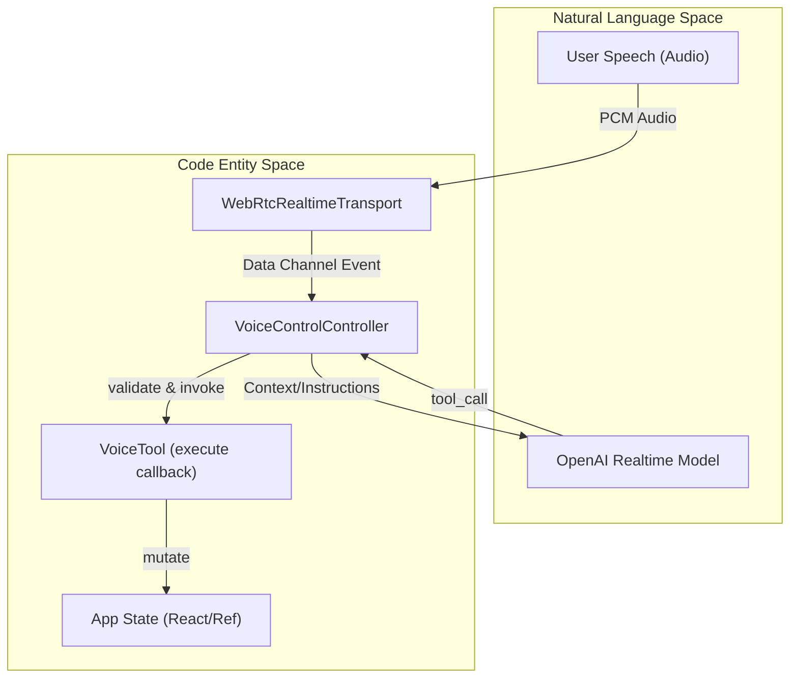
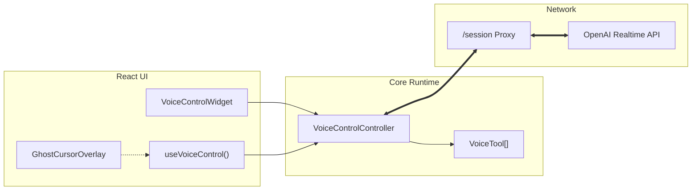

<!-- source: DeepWiki mcp.deepwiki.com · repo openai/realtime-voice-component · page 1 Overview · fetched 2026-10-26 -->

# Overview

Relevant source files

The following files were used as context for generating this wiki page:

- [LLM.txt](LLM.txt)
- [README.md](README.md)
- [demo/AGENTS.md](demo/AGENTS.md)
- [demo/src/demos/overview/index.tsx](demo/src/demos/overview/index.tsx)
- [docs/README.md](docs/README.md)
- [docs/architecture-choices.md](docs/architecture-choices.md)
- [docs/demo-architecture.md](docs/demo-architecture.md)
- [docs/getting-started.md](docs/getting-started.md)
- [docs/integrating-with-an-existing-app.md](docs/integrating-with-an-existing-app.md)
- [package.json](package.json)
- [src/index.ts](src/index.ts)

The `realtime-voice-component` is a React-based reference implementation for adding voice-driven controls to web applications using the **OpenAI Realtime API**. It is designed specifically for "tool-constrained" UIs where the AI assistant performs narrow, app-defined actions rather than general-purpose automation [README.md:1-28]().

The package provides a high-level state machine to manage WebRTC connections, audio capture, and tool execution, allowing developers to focus on mapping voice commands to existing application logic [README.md:114-124]().

### Key Problems Solved
*   **Complex State Management**: Orchestrates the transition between idle, listening, thinking, and executing states [src/index.ts:55-63]().
*   **Tool Execution Pipeline**: Handles the discovery, validation (via Zod), and reporting of tool calls back to the model [README.md:74-75]().
*   **WebRTC Complexity**: Abstracts SDP negotiation and data channel management through a specialized transport layer [docs/README.md:24-31]().
*   **UI Feedback**: Provides a pre-built launcher widget and a "ghost cursor" system for visual confirmation of AI actions [README.md:30-38]().

---

## System Architecture

The system is organized into five functional layers that bridge the gap between user speech and application state changes.

### Conceptual Flow: Speech to Action
This diagram illustrates how user intent flows from the `RealtimeTransport` through the `VoiceControlController` to trigger application-specific tools.

**Sources:** [README.md:74-82](), [docs/README.md:24-31](), [src/index.ts:1-73]()

---

## Major Subsystems

### 1. Core Controller & Hook
The `VoiceControlController` is the central runtime. Created via `createVoiceControlController`, it manages the session lifecycle, transport, and transcript assembly [README.md:76-77](). React components bind to this logic using the `useVoiceControl` hook [src/index.ts:5-8]().
*   For details, see [Core Controller & Hook](#2).

### 2. Tool System
Tools are defined using `defineVoiceTool`, which requires a **Zod schema** for parameter validation [README.md:74-75](). This ensures that the model only sends arguments that match your application's expected types [LLM.txt:101-127]().
*   For details, see [Tool System](#3).

### 3. Transport & Auth
The library uses WebRTC for low-latency audio. The recommended integration uses a `/session` backend proxy to securely handle SDP negotiation and API keys [LLM.txt:38-72]().
*   For details, see [Transport Layer](#4).

### 4. UI Components
The package includes two main visual elements:
*   `VoiceControlWidget`: A floating or inline launcher UI [README.md:80]().
*   `GhostCursorOverlay`: A helper that animates a "cursor" to elements on the screen to provide visual feedback for tool executions [README.md:81-82]().
*   For details, see [UI Components](#6).

---

## Integration Patterns

The library supports two primary architectural shapes depending on whether the voice session is localized to a single view or shared across the entire application.

### Component Relationship Diagram
This diagram shows how the `VoiceControlController` acts as the bridge between the React UI and the underlying Realtime session.

**Sources:** [docs/integrating-with-an-existing-app.md:11-56](), [docs/getting-started.md:72-118]()

### Architectural Choices
*   **Packaged Widget**: Best for fast integration with a standardized launcher [docs/architecture-choices.md:12-19]().
*   **Headless Controller**: Best for custom UI or sessions that must survive route changes [docs/architecture-choices.md:20-26]().
*   **App-Owned Wrapper**: A recommended pattern where a small adapter layer sits between the tools and your real handlers to maintain a single source of truth [docs/integrating-with-an-existing-app.md:11-27]().

For details, see [Architecture Choices](#1.2) and [Getting Started](#1.1).

---

## Demo Reference
The repository includes a `demo/` application that serves as a teaching surface for:
*   **Theme Switching**: Minimal tool integration [demo/src/demos/overview/index.tsx:41-71]().
*   **Form Filling**: Multi-step structured data collection [docs/demo-architecture.md:58-75]().
*   **Chess**: Complex state synchronization and shared controller usage [docs/demo-architecture.md:9-14]().

**Sources:** [README.md:52-61](), [demo/AGENTS.md:1-10]()

---

