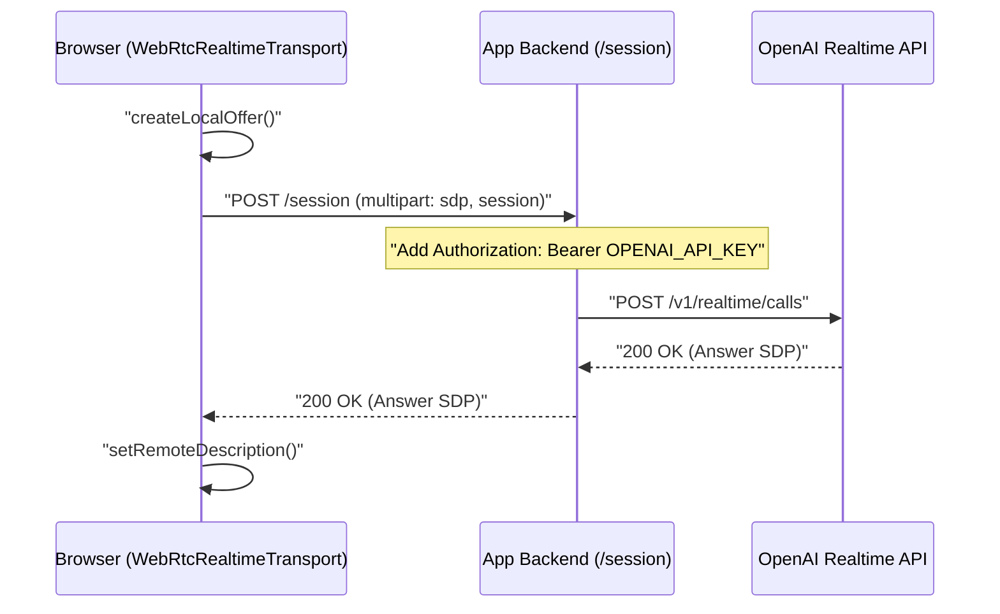
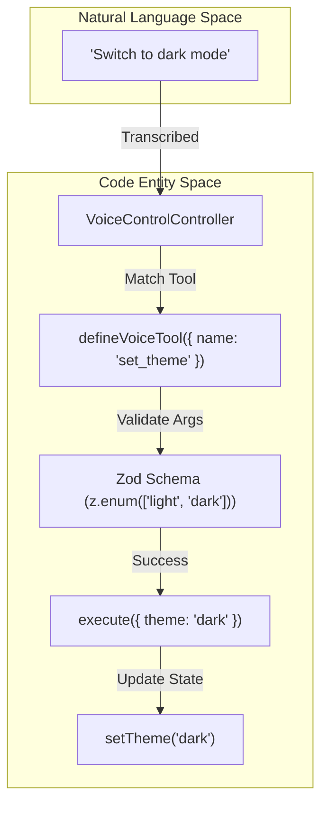

<!-- source: DeepWiki mcp.deepwiki.com · repo openai/realtime-voice-component · page 1.1 Getting Started · fetched 2026-10-26 -->

# Getting Started

<details>
<summary>Relevant source files</summary>

The following files were used as context for generating this wiki page:

- [LLM.txt](LLM.txt)
- [README.md](README.md)
- [demo/.env.example](demo/.env.example)
- [demo/dev.mjs](demo/dev.mjs)
- [demo/session-server.mjs](demo/session-server.mjs)
- [docs/authentication.md](docs/authentication.md)
- [docs/getting-started.md](docs/getting-started.md)
- [docs/integrating-with-an-existing-app.md](docs/integrating-with-an-existing-app.md)
- [src/transport/webRtcRealtimeTransport.ts](src/transport/webRtcRealtimeTransport.ts)

</details>


This page provides a step-by-step guide for installing the `realtime-voice-component` package, setting up a secure backend session proxy, and wiring your first voice-controlled tool.

The package is designed for React applications where the UI remains the source of truth, and the voice assistant is restricted to a narrow set of app-defined actions [README.md:17-24]().

## Installation

The package is currently distributed as a reference implementation and should be installed from a local checkout of the repository [README.md:10-15]().

1.  **Add the dependency**: Install the package from your local path along with `zod` for tool schema validation [LLM.txt:28-30]().
    ```bash
    npm add ../path/to/realtime-voice-component zod
    ```
2.  **Import Styles**: If using the `VoiceControlWidget` or `GhostCursorOverlay`, import the required CSS in your client-side entry point [LLM.txt:32-36]().
    ```ts
    import "realtime-voice-component/styles.css";
    ```

**Sources:** [README.md:10-15](), [LLM.txt:28-36]()

## Backend Session Proxy Setup

To maintain security, the browser must never hold a long-lived OpenAI API key. Instead, the client sends a WebRTC SDP offer and session configuration to your backend, which proxies the request to OpenAI [docs/authentication.md:3-5]().

### Data Flow: Session Initialization

The following diagram illustrates the flow from the browser through your backend to the OpenAI Realtime API.

**Session Initialization Flow**


### Implementation Example (Node.js/Express)
Your backend should forward the multipart body to `POST https://api.openai.com/v1/realtime/calls` and return the answer SDP [LLM.txt:48-52]().

```ts
app.post("/session", async (request, response) => {
  const contentType = request.header("content-type");

  const realtimeResponse = await fetch("https://api.openai.com/v1/realtime/calls", {
    method: "POST",
    headers: {
      Authorization: `Bearer ${process.env.OPENAI_API_KEY}`,
      ...(contentType ? { "Content-Type": contentType } : {}),
    },
    body: request,
    duplex: "half",
  });

  response
    .status(realtimeResponse.status)
    .type(realtimeResponse.headers.get("content-type") ?? "application/sdp")
    .send(await realtimeResponse.text());
});
```

**Sources:** [docs/authentication.md:3-5](), [docs/authentication.md:37-58](), [LLM.txt:48-52](), [src/transport/webRtcRealtimeTransport.ts:202-223]()

## Wiring Your First Voice Tool

To integrate voice controls, you must define a tool using `defineVoiceTool` and initialize a `VoiceControlController` [LLM.txt:80-89]().

### 1. Define the Tool
Tools require a `name`, `description`, and a `zod` schema for parameters. The `execute` callback is where your application logic lives [LLM.txt:102-127]().

### 2. Create the Controller
The `createVoiceControlController` manages the WebRTC connection and the tool execution pipeline [LLM.txt:129-137]().

### Code Entity Mapping: Tool Execution
The diagram below shows how high-level voice commands map to specific code entities during a tool call.

**Voice to Code Execution Map**


### Minimal Integration Example
```tsx
import { useState, useMemo } from "react";
import { z } from "zod";
import { createVoiceControlController, defineVoiceTool, VoiceControlWidget } from "realtime-voice-component";

export function App() {
  const [theme, setTheme] = useState("light");

  const controller = useMemo(() => {
    const setThemeTool = defineVoiceTool({
      name: "set_theme",
      description: "Set the UI theme.",
      parameters: z.object({ theme: z.enum(["light", "dark"]) }),
      async execute({ theme }) {
        setTheme(theme);
        return { ok: true };
      }
    });

    return createVoiceControlController({
      auth: { sessionEndpoint: "/session" },
      outputMode: "tool-only",
      tools: [setThemeTool]
    });
  }, []);

  return <VoiceControlWidget controller={controller} />;
}
```

**Sources:** [LLM.txt:80-137](), [docs/getting-started.md:76-118](), [src/transport/webRtcRealtimeTransport.ts:237-250]()

## Recommended Defaults

For the best experience in a browser-based UI, follow these default settings:

| Setting | Recommended Value | Reason |
| :--- | :--- | :--- |
| `outputMode` | `"tool-only"` | Focuses the model on acting rather than chatting [LLM.txt:16]() |
| `activationMode` | `"vad"` | Voice Activity Detection is standard for launcher widgets [LLM.txt:20]() |
| `turnDetection` | `server_vad` | Reliable server-side silence detection [README.md:95-102]() |
| `interruptResponse` | `false` | Prevents new speech from canceling in-flight tool calls [README.md:110]() |

**Sources:** [README.md:93-112](), [LLM.txt:14-25](), [docs/getting-started.md:120-132]()

---

