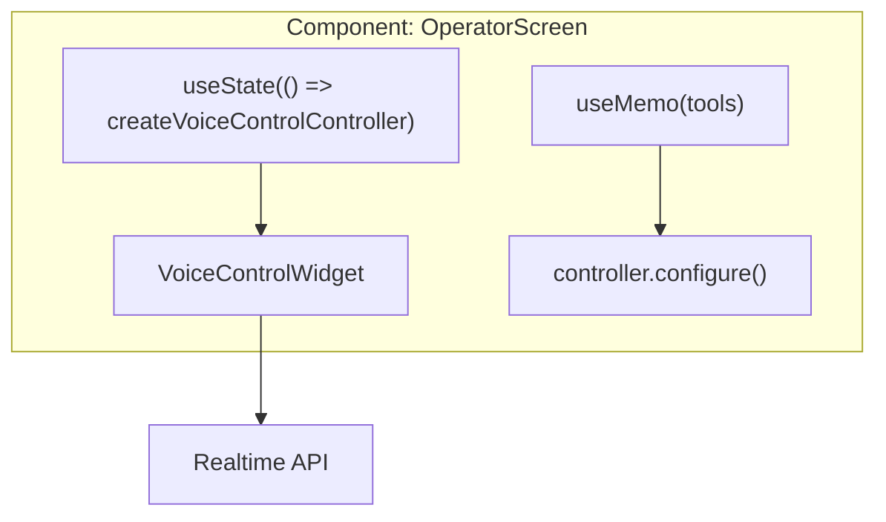
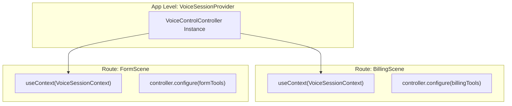
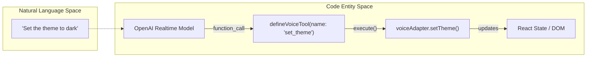

<!-- source: DeepWiki mcp.deepwiki.com · repo openai/realtime-voice-component · page 1.2 Architecture Choices · fetched 2026-10-26 -->

# Architecture Choices

Relevant source files

The following files were used as context for generating this wiki page:

- [README.md](README.md)
- [demo/AGENTS.md](demo/AGENTS.md)
- [demo/src/demos/overview/index.tsx](demo/src/demos/overview/index.tsx)
- [docs/README.md](docs/README.md)
- [docs/architecture-choices.md](docs/architecture-choices.md)
- [docs/demo-architecture.md](docs/demo-architecture.md)
- [docs/integrating-with-an-existing-app.md](docs/integrating-with-an-existing-app.md)

This page outlines the primary integration patterns and architectural philosophies of the `realtime-voice-component` package. Choosing the correct integration shape early ensures that the voice session lifecycle aligns with your application's routing and state management requirements.

## Integration Shapes: Packaged vs. Headless

The package provides two main entry points depending on the level of UI control required: the **Packaged Widget** and the **Headless Controller**.

### 1. Packaged Widget (`VoiceControlWidget`)
The `VoiceControlWidget` is a high-level React component that includes a launcher UI, status indicators, and built-in drag/snap physics [docs/architecture-choices.md:12-18]().

*   **When to use:** Use this for the fastest integration path where a floating or inline "voice bubble" is acceptable. It is ideal for apps where one or two narrow tools are sufficient for the voice experience [docs/architecture-choices.md:12-18]().
*   **Implementation:** It wraps the `useVoiceControl` hook internally but can also accept an external `controller` instance [README.md:72-82]().

### 2. Headless Controller (`createVoiceControlController`)
The headless approach separates the voice runtime logic from the UI. You use `createVoiceControlController` to manage the session and `useVoiceControl` to bind your custom UI to the controller's state [docs/architecture-choices.md:20-26]().

*   **When to use:** Use this when you have existing custom UI controls (e.g., a custom microphone button), require push-to-talk (PTT) behavior, or need the voice session to survive layout/route changes [docs/architecture-choices.md:20-26]().
*   **Implementation:** You manually instantiate the controller and pass it to the hook or components [docs/integrating-with-an-existing-app.md:90-96]().

### Architecture Shape Comparison

| Feature | Packaged Widget | Headless Controller |
| :--- | :--- | :--- |
| **Primary Class/Hook** | `VoiceControlWidget` | `createVoiceControlController` |
| **UI Ownership** | Package-owned (opinionated) | App-owned (custom) |
| **State Access** | Internal | Via `useVoiceControl` hook |
| **Lifecycle** | Tied to component mount | Managed by app/provider |
| **Best For** | Rapid prototyping, VAD launchers | Production-grade custom UI, complex routing |

**Sources:** [docs/architecture-choices.md:3-26](), [README.md:72-82]()

---

## Ownership Patterns

The relationship between the controller and the React component tree determines how the voice session behaves during navigation.

### Single-View Ownership
In this pattern, the controller is created inside a specific screen component. When the user navigates away, the controller is destroyed, and the session ends [docs/integrating-with-an-existing-app.md:73-101]().

**Data Flow: Single-View**

**Sources:** [docs/integrating-with-an-existing-app.md:73-101]()

### Shared-Controller Pattern
For multi-route applications, the controller is hoisted into a `Provider` (e.g., `DemoSessionProvider` in the demo app). This allows the same voice session to persist while the user switches tabs or scenes [docs/demo-architecture.md:23-41](), [docs/integrating-with-an-existing-app.md:102-146]().

**Data Flow: Shared Provider**

**Sources:** [docs/demo-architecture.md:23-41](), [docs/integrating-with-an-existing-app.md:102-146]()

---

## Philosophy of Narrow Browser Tools

The package is designed for **App-Owned Tools**. This means tools should be narrow, predictable, and act as bridges to existing application logic rather than containing business logic themselves [README.md:114-125](), [docs/architecture-choices.md:27-41]().

### The Voice Adapter Wrapper
The recommended pattern is to create a "Voice Adapter" or wrapper. This wrapper exposes stable methods to the `execute` callback of a tool defined via `defineVoiceTool` [docs/integrating-with-an-existing-app.md:11-27]().

*   **Avoid:** Passing raw React setters (like `setPrompt`) directly into tools, as they may lead to stale closures if not handled carefully [README.md:212-215]().
*   **Prefer:** Using a `useRef` to hold the latest app state and providing a `getState()` method to the tool [docs/integrating-with-an-existing-app.md:171-206]().

**System Entity Mapping: Tool Execution**

**Sources:** [README.md:173-215](), [docs/integrating-with-an-existing-app.md:151-224](), [demo/src/demos/overview/index.tsx:49-59]()

---

## Wake Word Integration

Wake-word activation (e.g., "Hey Assistant") is explicitly **not** part of the core runtime. It is treated as a separate layer that manages microphone ownership [docs/architecture-choices.md:55-66]().

1.  **Idle State:** The wake-word engine (e.g., Porcupine) owns the microphone [docs/demo-architecture.md:79-88]().
2.  **Activation:** Once the wake word is detected, the engine releases the microphone.
3.  **Handoff:** The `VoiceControlController` is triggered to start, taking over the microphone for the WebRTC session [docs/demo-architecture.md:79-88]().

**Sources:** [docs/architecture-choices.md:55-66](), [docs/demo-architecture.md:79-88]()

---

## When to Use Other Libraries

| Requirement | Recommendation |
| :--- | :--- |
| **React UI + Browser Tools** | Use `realtime-voice-component` (this package) |
| **Custom Audio/Non-React** | Use raw OpenAI Realtime SDK/WebRTC [README.md:39-44]() |
| **Agent Orchestration/MCP** | Use `openai-agents-js` [README.md:45-51]() |
| **Server-side Agents** | Use `openai-agents-js` [docs/architecture-choices.md:67-73]() |

**Sources:** [README.md:30-51](), [docs/architecture-choices.md:67-73]()

---

