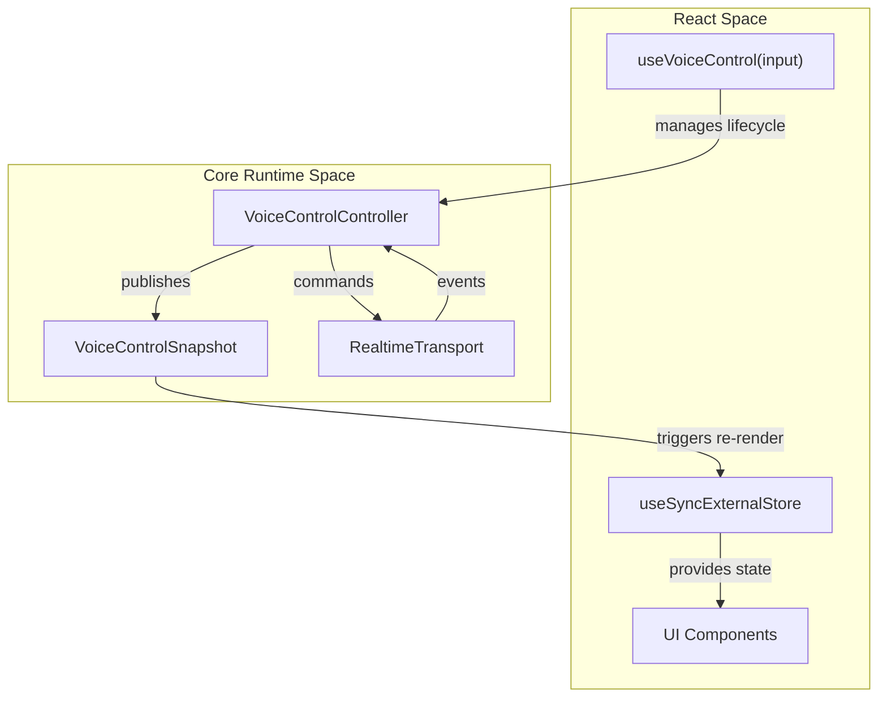
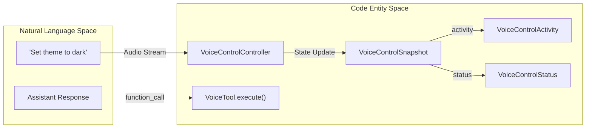

<!-- source: DeepWiki mcp.deepwiki.com · repo openai/realtime-voice-component · page 2 Core Controller & Hook · fetched 2026-10-26 -->

# Core Controller & Hook

Relevant source files

The following files were used as context for generating this wiki page:

- [docs/api-reference.md](docs/api-reference.md)
- [docs/api/functions/createVoiceControlController.md](docs/api/functions/createVoiceControlController.md)
- [docs/api/type-aliases/UseVoiceControlInput.md](docs/api/type-aliases/UseVoiceControlInput.md)
- [docs/api/type-aliases/UseVoiceControlOptions.md](docs/api/type-aliases/UseVoiceControlOptions.md)
- [docs/controller-runtime.md](docs/controller-runtime.md)
- [src/useVoiceControl.ts](src/useVoiceControl.ts)
- [src/voiceControlController.ts](src/voiceControlController.ts)

The `VoiceControlController` is the central runtime engine of the `realtime-voice-component` library. It manages the lifecycle of the OpenAI Realtime session, coordinates the transport layer, executes tool calls, and maintains a consistent state snapshot. The `useVoiceControl` hook provides the primary React interface to this controller, allowing for both automatic lifecycle management and shared controller patterns.

## The Runtime Architecture

The architecture is designed to decouple the React UI from the complex state machine of the voice session. The `VoiceControlController` acts as a headless state manager that can exist independently of the React component tree.

### High-Level Component Interaction
This diagram shows how the `useVoiceControl` hook bridges the React rendering cycle with the persistent `VoiceControlController` instance.

**Diagram: Hook to Controller Binding**

**Sources:** [src/useVoiceControl.ts:16-81](), [src/voiceControlController.ts:224-251]()

## VoiceControlController

The controller is created via `createVoiceControlController(options)` [src/voiceControlController.ts:253](). It is responsible for:
- **Session Management**: Handling `connect()` and `disconnect()` [src/controller-runtime.md:62]().
- **Tool Execution**: Orchestrating the flow from a server `function_call` to the local `execute()` implementation [src/controller-runtime.md:100-109]().
- **State Normalization**: Converting raw server events into a simplified `VoiceControlSnapshot` [src/voiceControlController.ts:224-251]().
- **Configuration**: Dynamically updating `instructions`, `tools`, and `session` parameters without restarting the connection [src/controller-runtime.md:187-193]().

For a deep dive into the task queue and tool pipeline, see [VoiceControlController Internals](#2.1).

## useVoiceControl Hook

The `useVoiceControl` hook is the primary entry point for React applications. It supports two distinct ownership models:

| Model | Input Type | Behavior |
| :--- | :--- | :--- |
| **Hook-Owned** | `UseVoiceControlOptions` | The hook creates the controller on mount and calls `.destroy()` on unmount. |
| **App-Owned** | `VoiceControlController` | The app creates the controller externally (e.g., in a Provider). The hook merely subscribes to it. |

**Sources:** [src/useVoiceControl.ts:16-28](), [src/controller-runtime.md:28-43]()

### Integration Patterns
The hook uses `useSyncExternalStore` to ensure that React components stay in sync with the controller's internal state [src/useVoiceControl.ts:58]().

**Diagram: Entity Mapping**

**Sources:** [src/voiceControlController.ts:224-251](), [src/types.ts:1-20]()

## State and Events

The controller maintains a read-only snapshot of the current session state. This includes the connection status, current activity (e.g., "speaking", "thinking"), and a history of tool calls.

- **Status & Activity**: Tracks the high-level state machine (e.g., `idle` -> `connecting` -> `listening`). For details, see [State Model & Snapshot](#2.2).
- **Event Flow**: All events (local and server-side) flow through a unified event system. For details, see [Event System](#2.3).

## Key API Summary

### Methods
The controller (and the object returned by the hook) exposes several methods to control the session:
- `connect()` / `disconnect()`: Manages the WebRTC connection [src/controller-runtime.md:62]().
- `startCapture()` / `stopCapture()`: Manages microphone state for push-to-talk or manual control [src/controller-runtime.md:63]().
- `updateInstructions(text)`: Updates the system prompt [src/controller-runtime.md:64]().
- `updateTools(tools)`: Swaps the available toolset [src/controller-runtime.md:65]().

### Configuration Options
Key options provided to `createVoiceControlController` or `useVoiceControl`:
- `auth`: Authentication configuration (session endpoint or token) [docs/api/type-aliases/UseVoiceControlOptions.md:29-44]().
- `outputMode`: Determines if the assistant replies with `audio`, `text`, or `tool-only` [docs/api-reference.md:67-75]().
- `activationMode`: `vad` (Voice Activity Detection) or `push-to-talk` [docs/api/type-aliases/UseVoiceControlOptions.md:13-17]().

**Sources:** [src/voiceControlController.ts:253](), [docs/api-reference.md:24-58](), [docs/controller-runtime.md:45-70]()

---

