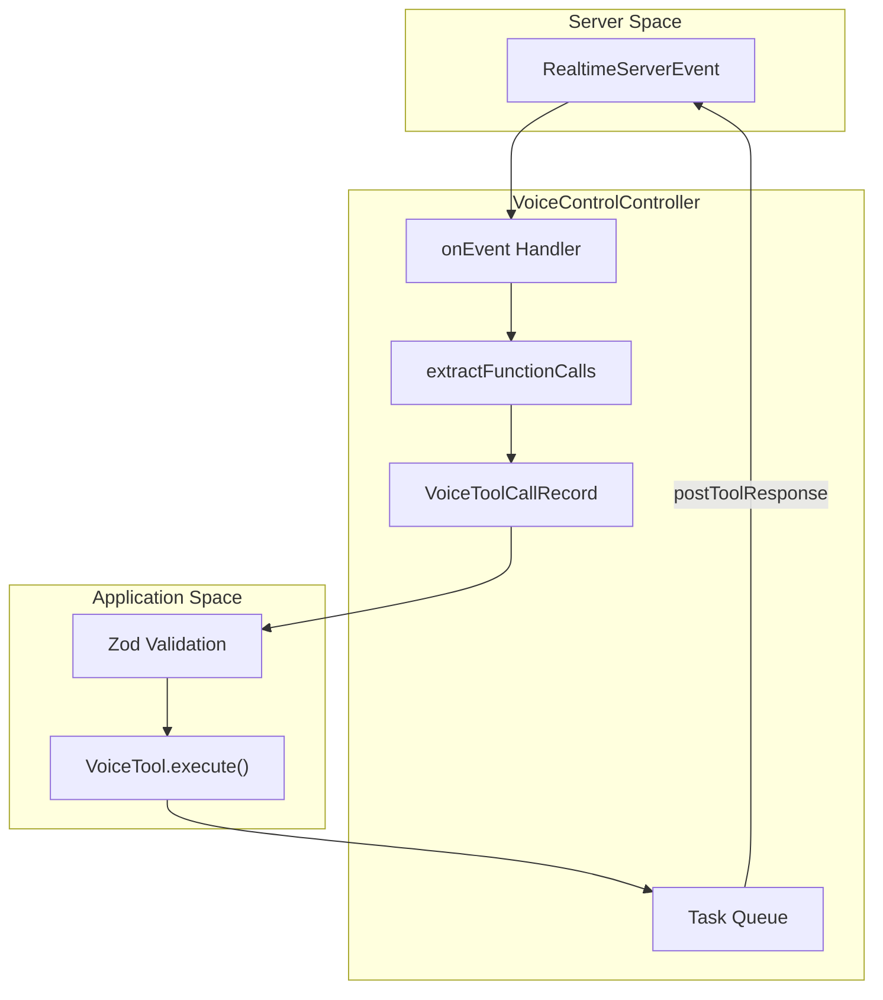
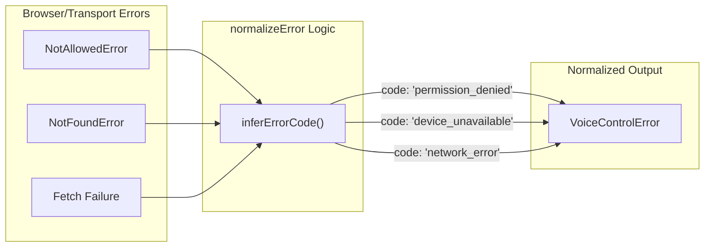

<!-- source: DeepWiki mcp.deepwiki.com · repo openai/realtime-voice-component · page 2.1 VoiceControlController Internals · fetched 2026-10-26 -->

# VoiceControlController Internals

Relevant source files

The following files were used as context for generating this wiki page:

- [docs/api/functions/createVoiceControlController.md](docs/api/functions/createVoiceControlController.md)
- [docs/api/type-aliases/UseVoiceControlInput.md](docs/api/type-aliases/UseVoiceControlInput.md)
- [docs/api/type-aliases/UseVoiceControlOptions.md](docs/api/type-aliases/UseVoiceControlOptions.md)
- [docs/api/type-aliases/VoiceControlRealtimeSessionOptions.md](docs/api/type-aliases/VoiceControlRealtimeSessionOptions.md)
- [docs/api/type-aliases/VoiceControlRealtimeSessionPatch.md](docs/api/type-aliases/VoiceControlRealtimeSessionPatch.md)
- [docs/api/type-aliases/VoiceControlResolvedSessionConfig.md](docs/api/type-aliases/VoiceControlResolvedSessionConfig.md)
- [src/internal/session.ts](src/internal/session.ts)
- [src/voiceControlController.ts](src/voiceControlController.ts)

The `createVoiceControlController` function is the core factory responsible for instantiating the stateful runtime that manages the OpenAI Realtime session. It orchestrates the lifecycle of the connection, handles tool execution, manages the internal task queue, and normalizes errors from various subsystems.

### Implementation Overview

The controller is designed as a singleton-like state machine that bridges the gap between the React UI layer and the low-level `RealtimeTransport`. It maintains a `VoiceControlSnapshot` and notifies subscribers of changes using a pattern compatible with React's `useSyncExternalStore`.

#### Configuration and Initialization
When `createVoiceControlController` is called, it initializes the internal state with default values and resolves the initial session configuration.

*   **Default Model**: `gpt-realtime-1.5` `[src/voiceControlController.ts:23-23]()`
*   **Default Instructions**: A system prompt optimized for UI control and brief responses `[src/voiceControlController.ts:24-25]()`.
*   **Task Queue**: An internal promise-based queue ensures that session operations (connect, disconnect, configure) are processed sequentially to prevent race conditions during transport state transitions.

### Authentication Resolution

The controller supports three distinct authentication patterns via the `auth` property in `UseVoiceControlOptions` `[docs/api/type-aliases/UseVoiceControlOptions.md:29-44]()`. The resolution logic is handled in `resolveClientSecret` `[src/voiceControlController.ts:253-257]()`.

| Pattern | Code Entity | Behavior |
| :--- | :--- | :--- |
| **Session Endpoint** | `sessionEndpoint` | POSTs to a backend proxy to receive a full session object. |
| **Token Endpoint** | `tokenEndpoint` | Fetches an ephemeral client secret from a specialized endpoint. |
| **Secret Callback** | `getClientSecret` | Invokes a user-provided async function to retrieve the secret. |

### Tool Execution Pipeline

The tool execution pipeline is the most complex part of the controller. It manages the transition from a model-generated `function_call` to a validated result.

1.  **Discovery**: The controller listens for `response.done` events from the server `[src/voiceControlController.ts:162-172]()`.
2.  **Parsing**: It extracts items where `type === "function_call"` `[src/voiceControlController.ts:183-189]()`.
3.  **Execution**: For each tool call, it finds the matching `VoiceTool` defined in the configuration.
4.  **Recording**: A `VoiceToolCallRecord` is created with a `status` of `executing` `[src/voiceControlController.ts:36-46]()`.
5.  **Post-Tool Response**: If `postToolResponse` is enabled in options `[docs/api/type-aliases/UseVoiceControlOptions.md:202-206]()`, the controller automatically sends a `response.create` event to the server after the tool execution finishes, allowing the model to acknowledge the tool's output.

#### Tool Pipeline Flow
The following diagram illustrates the flow from a server event to a completed tool execution within the `VoiceControlController`.

**Diagram: Tool Call Execution Pipeline**

Sources: `[src/voiceControlController.ts:149-222]()`, `[src/voiceControlController.ts:28-46]()`, `[docs/api/type-aliases/UseVoiceControlOptions.md:202-206]()`

### Error Normalization

The controller implements a robust error normalization strategy to map diverse failure modes (WebRTC, Permissions, API) into a consistent `VoiceControlError` type.

*   **Insecure Context**: Triggered when `NotAllowedError` occurs outside of HTTPS or localhost `[src/voiceControlController.ts:84-88]()`.
*   **Device Unavailable**: Maps `NotFoundError` or `NotReadableError` from `getUserMedia` `[src/voiceControlController.ts:90-96]()`.
*   **Network Error**: Specific mapping for fetch failures during client secret resolution `[src/voiceControlController.ts:118-120]()`.

**Diagram: Error Normalization Mapping**

Sources: `[src/voiceControlController.ts:72-123]()`, `[src/voiceControlController.ts:125-143]()`

### Lifecycle: Configure and Destroy

The controller manages its lifecycle through `configure()` and `destroy()` methods, ensuring that resources like microphone streams and data channels are properly released.

#### Configure / Patching
The `configure()` method accepts a `VoiceControlRealtimeSessionPatch` `[docs/api/type-aliases/VoiceControlRealtimeSessionPatch.md:5-8]()`. This allows updating session parameters (like `instructions` or `voice`) without reconnecting the underlying WebRTC transport.
*   **Payload Generation**: The `buildRealtimeSessionPayload` function converts the internal `TransportSessionConfig` into the specific JSON structure required by the OpenAI Realtime API `[src/internal/session.ts:202-225]()`.
*   **Session Updates**: If the transport is active, `configure()` triggers a `session.update` event across the data channel `[src/internal/session.ts:227-227]()`.

#### Destroy
The `destroy()` method is terminal. It:
1.  Aborts any pending tasks in the queue.
2.  Calls `transport.disconnect()`.
3.  Clears all event listeners and subscribers.
4.  Sets the final state to `idle`.

### State Derivation
The controller derives the user-facing `status` from several internal flags: `activity`, `connected`, and `capturing`.

| Internal Activity | Connected | Capturing | Resulting Status |
| :--- | :--- | :--- | :--- |
| `error` | Any | Any | `error` |
| `connecting` | Any | Any | `connecting` |
| Any | `false` | Any | `idle` |
| `processing` | `true` | Any | `processing` |
| Any | `true` | `true` | `listening` |

Sources: `[src/voiceControlController.ts:224-251]()`

---

