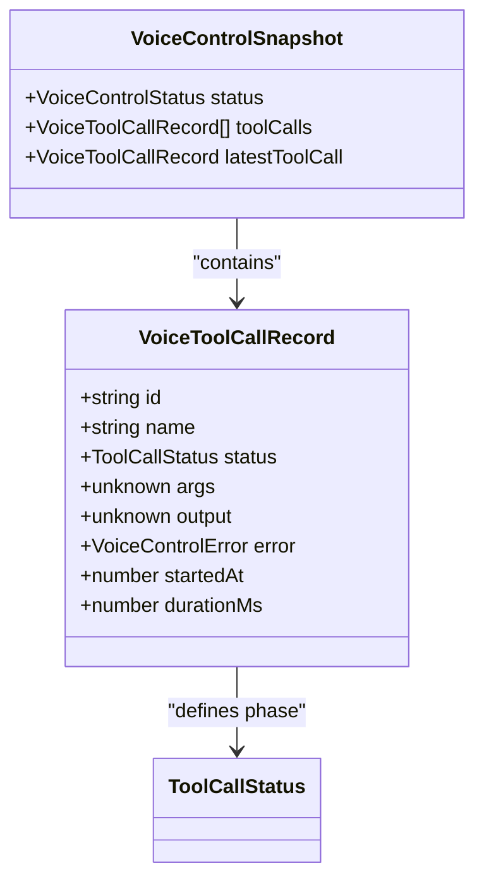

<!-- source: DeepWiki mcp.deepwiki.com · repo openai/realtime-voice-component · page 2.2 State Model & Snapshot · fetched 2026-10-26 -->

# State Model & Snapshot

<details>
<summary>Relevant source files</summary>

The following files were used as context for generating this wiki page:

- [docs/api-reference.md](docs/api-reference.md)
- [docs/api/type-aliases/UseVoiceControlReturn.md](docs/api/type-aliases/UseVoiceControlReturn.md)
- [docs/api/type-aliases/VoiceControlActivity.md](docs/api/type-aliases/VoiceControlActivity.md)
- [docs/api/type-aliases/VoiceControlController.md](docs/api/type-aliases/VoiceControlController.md)
- [docs/api/type-aliases/VoiceControlSnapshot.md](docs/api/type-aliases/VoiceControlSnapshot.md)
- [docs/api/type-aliases/VoiceControlStatus.md](docs/api/type-aliases/VoiceControlStatus.md)
- [docs/api/type-aliases/VoiceToolCallRecord.md](docs/api/type-aliases/VoiceToolCallRecord.md)
- [docs/controller-runtime.md](docs/controller-runtime.md)
- [src/types.ts](src/types.ts)
- [src/useVoiceControl.ts](src/useVoiceControl.ts)

</details>


The `VoiceControlController` maintains a structured state model that represents the current status of the voice session, user activity, and tool execution history. This state is exposed as a read-only `VoiceControlSnapshot`, which React components consume via a subscription-based synchronization mechanism.

## State Architecture

The controller acts as the single source of truth. It uses an internal state object that is updated in response to transport events, tool execution results, and user interactions.

### VoiceControlSnapshot
The snapshot is a plain object representing the state of the controller at a specific point in time. It is retrieved via `controller.getSnapshot()` [docs/api/type-aliases/VoiceControlController.md:41-43]().

| Property | Type | Description |
| :--- | :--- | :--- |
| `status` | `VoiceControlStatus` | The high-level connectivity and readiness state. |
| `activity` | `VoiceControlActivity` | Detailed real-time activity (listening, processing, etc.). |
| `connected` | `boolean` | Simplified flag for transport connection status. |
| `transcript` | `string` | The most recently assembled transcript text. |
| `toolCalls` | `VoiceToolCallRecord[]` | A history of tool executions in the current session. |
| `latestToolCall` | `VoiceToolCallRecord \| null` | The most recent tool call, regardless of status. |
| `sessionConfig` | `VoiceControlResolvedSessionConfig` | The active configuration resolved from options. |

**Sources:** [docs/api/type-aliases/VoiceControlSnapshot.md:5-66](), [docs/controller-runtime.md:47-58]()

### React Integration via `useSyncExternalStore`
To ensure efficient and tearing-free updates in React, the `useVoiceControl` hook utilizes the `useSyncExternalStore` primitive. It binds the controller's `subscribe` and `getSnapshot` methods to the React lifecycle [src/useVoiceControl.ts:58-58]().

1. **Subscription**: The controller maintains a set of listeners. When internal state changes, it iterates through these listeners to trigger a re-render in subscribed components [docs/api/type-aliases/VoiceControlController.md:49-53]().
2. **Snapshot**: React calls `getSnapshot` to determine if the state has changed since the last render.

**Sources:** [src/useVoiceControl.ts:56-58](), [docs/api/type-aliases/VoiceControlController.md:39-53]()

## Status & Activity State Machine

The controller distinguishes between "Status" (long-lived connectivity states) and "Activity" (transient interaction states).

### VoiceControlStatus
Represents the lifecycle of the connection [docs/api/type-aliases/VoiceControlStatus.md:8-8]().
*   `idle`: Initial state; no connection attempt made.
*   `connecting`: Transport is performing handshakes (SDP exchange).
*   `ready`: Connection established; session is active.
*   `listening`: Specifically indicates the microphone is active (VAD or PTT).
*   `processing`: Server is generating a response or executing tools.
*   `error`: A terminal or significant runtime error has occurred.

### VoiceControlActivity
Provides more granular detail about what the system is doing at any moment [docs/api/type-aliases/VoiceControlActivity.md:8-15]().
*   `executing`: Specifically used when a `VoiceTool` is currently running its `execute` callback [src/types.ts:154-154]().

### State Transition Mapping
The following diagram bridges the logical session flow to the code entities that manage these transitions.

**Diagram: Controller State Transitions**
```mermaid
stateDiagram-v2
    [*] --> "idle"
    "idle" --> "connecting" : "controller.connect()"
    "connecting" --> "ready" : "voice.transport.connected"
    "connecting" --> "error" : "onError / network_error"
    
    state "Session Active" <<rect>> {
        "ready" --> "listening" : "voice.capture.started"
        "listening" --> "processing" : "voice.capture.stopped / VAD"
        "processing" --> "executing" : "voice.tool.started"
        "executing" --> "processing" : "voice.tool.succeeded / failed"
        "processing" --> "ready" : "response.done"
    }
    
    "Session Active" --> "idle" : "controller.disconnect()"
    "Session Active" --> "error" : "VoiceControlError"
```
**Sources:** [src/types.ts:149-155](), [docs/api/type-aliases/VoiceControlStatus.md:8-8](), [docs/controller-runtime.md:93-97]()

## Tool Call Records

Every tool invocation initiated by the model is tracked as a `VoiceToolCallRecord`. These records are stored in the `toolCalls` array in the snapshot [docs/api/type-aliases/VoiceControlSnapshot.md:53-57]().

### Record Lifecycle
A record transitions through several statuses defined by `ToolCallStatus`: `"running"`, `"success"`, `"error"`, or `"skipped"` [src/types.ts:22-22]().

**Diagram: Tool Call Entity Mapping**


### Skipped State
If the model responds without selecting a tool while `outputMode` is set to `"tool-only"`, the controller emits a `voice.no_action` event and creates a record with the status `"skipped"` [docs/controller-runtime.md:110-113]().

**Sources:** [src/types.ts:179-191](), [docs/api/type-aliases/VoiceToolCallRecord.md:5-98](), [docs/controller-runtime.md:100-113]()

## Snapshot Persistence & Updates

The snapshot is updated through several internal mechanisms:
1.  **Transcript Assembly**: As `text_delta` or `audio_transcription` events arrive from the server, the `transcript` field is updated to reflect the current segment [docs/controller-runtime.md:57-58]().
2.  **Session Mutation**: Calling `updateInstructions()`, `updateTools()`, or `updateSession()` triggers a recalculation of the `sessionConfig` within the snapshot [docs/api/type-aliases/UseVoiceControlReturn.md:89-120]().
3.  **History Management**: The `toolCalls` array is bounded by `maxToolCallHistory` (defaulting to a fixed size). Users can manually clear this via `clearToolCalls()` [docs/api-reference.md:100-100](), [docs/controller-runtime.md:223-224]().

**Sources:** [docs/controller-runtime.md:57-69](), [docs/api/type-aliases/UseVoiceControlReturn.md:13-136](), [src/types.ts:262-272]()

---

