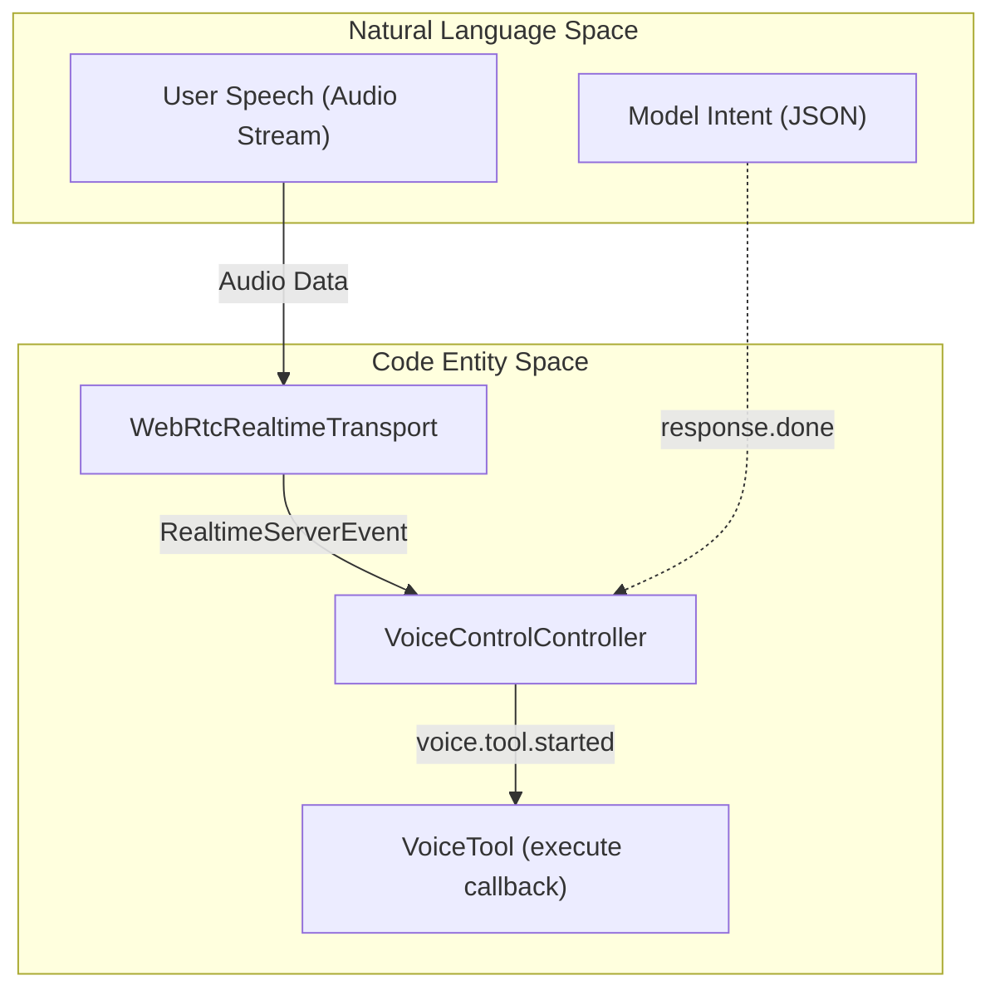
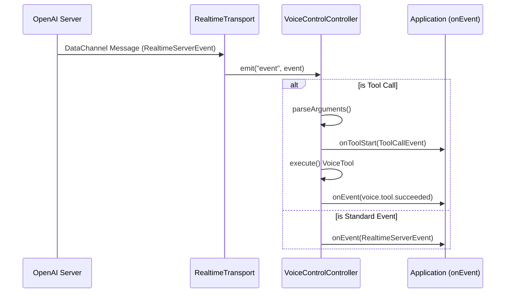
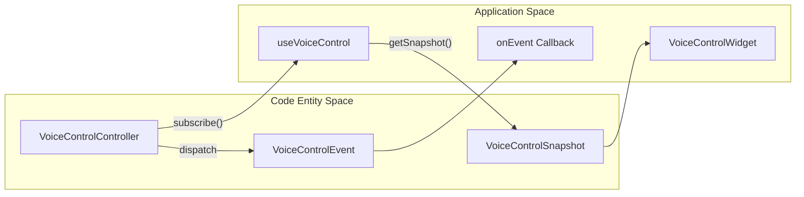

<!-- source: DeepWiki mcp.deepwiki.com · repo openai/realtime-voice-component · page 2.3 Event System · fetched 2026-10-26 -->

# Event System

Relevant source files

The following files were used as context for generating this wiki page:

- [docs/api/type-aliases/RealtimeClientEvent.md](docs/api/type-aliases/RealtimeClientEvent.md)
- [docs/api/type-aliases/RealtimeServerEvent.md](docs/api/type-aliases/RealtimeServerEvent.md)
- [docs/api/type-aliases/ToolCallErrorEvent.md](docs/api/type-aliases/ToolCallErrorEvent.md)
- [docs/api/type-aliases/ToolCallEvent.md](docs/api/type-aliases/ToolCallEvent.md)
- [docs/api/type-aliases/ToolCallResultEvent.md](docs/api/type-aliases/ToolCallResultEvent.md)
- [docs/api/type-aliases/ToolCallStatus.md](docs/api/type-aliases/ToolCallStatus.md)
- [docs/api/type-aliases/VoiceControlController.md](docs/api/type-aliases/VoiceControlController.md)
- [docs/api/type-aliases/VoiceControlEvent.md](docs/api/type-aliases/VoiceControlEvent.md)
- [src/types.ts](src/types.ts)

The Event System facilitates communication between the transport layer (WebRTC), the central `VoiceControlController`, and the application layer. It categorizes interactions into server-originated messages, client-originated commands, and local lifecycle notifications.

## Event Types

The system relies on three primary event unions to manage the flow of data and state.

### VoiceControlEvent
The `VoiceControlEvent` is a union type used to notify the application of any significant occurrence during a session. It is the primary type passed to the `onEvent` callback in `UseVoiceControlOptions` [src/types.ts:211]().

| Type | Composition | Description |
| :--- | :--- | :--- |
| `VoiceControlLocalEvent` | Internal | Events generated by the controller or transport (e.g., connection status, tool lifecycle) [src/types.ts:201-209](). |
| `RealtimeServerEvent` | OpenAI API | Raw events received from the OpenAI Realtime API via the data channel [src/types.ts:17-20](). |

### RealtimeClientEvent
Events sent from the client to the server. These follow the OpenAI Realtime API specification for client-side events, such as `response.create` or `conversation.item.create` [src/types.ts:144-147]().

### Local Event Schema
Local events track the state of the voice interface and the execution of tools:
*   **Transport**: `voice.transport.connected`, `voice.transport.disconnected` [src/types.ts:202-203]().
*   **Capture**: `voice.capture.started`, `voice.capture.stopped` [src/types.ts:204-205]().
*   **Tools**: `voice.tool.started`, `voice.tool.succeeded`, `voice.tool.failed` [src/types.ts:207-209]().

## Event Flow Architecture

Events flow through a pipeline starting from the `RealtimeTransport`, moving into the `VoiceControlController` for processing (such as tool execution), and finally reaching the React hooks and UI components.

### Natural Language to Code Entity Mapping: Event Ingestion
This diagram illustrates how a natural language request from the user (via audio) results in code-level events.

**Sources:** [src/types.ts:17-20](), [src/types.ts:207-209](), [src/types.ts:225-230]().

### Event Processing Pipeline
When the transport receives a `RealtimeServerEvent`, the controller determines if it requires internal handling (like a `response.done` containing `function_call`) or if it should simply be broadcast to the application.

**Sources:** [src/types.ts:201-212](), [src/types.ts:232-236](), [docs/api/type-aliases/VoiceControlController.md:1-49]().

## Tool Execution Events

The tool system uses a specific set of event types to manage the asynchronous lifecycle of a tool call.

### Tool Lifecycle Events
1.  **`voice.tool.started`**: Emitted when the controller validates the model's arguments and begins execution. Contains `callId`, `name`, and `args` [src/types.ts:173-177, 207]().
2.  **`voice.tool.succeeded`**: Emitted after the `execute` function resolves. Includes the `output` [src/types.ts:193-195, 208]().
3.  **`voice.tool.failed`**: Emitted if validation fails or the `execute` function throws. Includes a `VoiceControlError` [src/types.ts:197-199, 209]().

### Tool Call Records
The controller maintains a `VoiceToolCallRecord` for every tool interaction, which is exposed in the `VoiceControlSnapshot`. This record tracks the `ToolCallStatus` ("running", "success", "error", or "skipped") [src/types.ts:22, 179-191]().

## Application Callbacks

The `useVoiceControl` hook (and the underlying controller) exposes specific handlers to react to these events without needing to filter the raw `onEvent` stream manually.

| Callback | Event Trigger | Data Provided |
| :--- | :--- | :--- |
| `onEvent` | Any `VoiceControlEvent` | `VoiceControlEvent` [src/types.ts:211]() |
| `onToolStart` | `voice.tool.started` | `ToolCallEvent` [src/types.ts:173-177]() |
| `onToolSuccess` | `voice.tool.succeeded` | `ToolCallResultEvent` [src/types.ts:193-195]() |
| `onToolError` | `voice.tool.failed` | `ToolCallErrorEvent` [src/types.ts:197-199]() |

### Data Flow: Code Entities to Application State
This diagram shows how events are transformed into application-level state updates.

**Sources:** [docs/api/type-aliases/VoiceControlController.md:39-53](), [src/types.ts:211]().

**Sources:**
*   [src/types.ts:17-212]()
*   [docs/api/type-aliases/VoiceControlEvent.md:1-10]()
*   [docs/api/type-aliases/VoiceControlController.md:1-70]()
*   [docs/api/type-aliases/ToolCallEvent.md:1-34]()
*   [docs/api/type-aliases/ToolCallResultEvent.md:1-18]()
*   [docs/api/type-aliases/ToolCallErrorEvent.md:1-18]()

---

