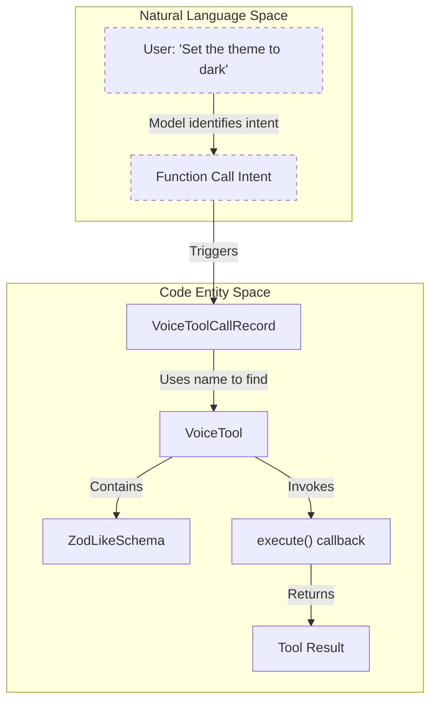
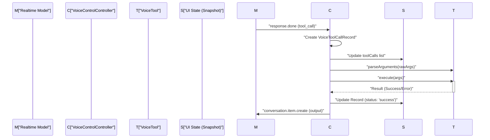

<!-- source: DeepWiki mcp.deepwiki.com · repo openai/realtime-voice-component · page 3 Tool System · fetched 2026-10-26 -->

# Tool System

Relevant source files

The following files were used as context for generating this wiki page:

- [docs/api/functions/defineVoiceTool.md](docs/api/functions/defineVoiceTool.md)
- [docs/api/type-aliases/UseVoiceControlReturn.md](docs/api/type-aliases/UseVoiceControlReturn.md)
- [docs/api/type-aliases/VoiceControlSnapshot.md](docs/api/type-aliases/VoiceControlSnapshot.md)
- [docs/api/type-aliases/VoiceTool.md](docs/api/type-aliases/VoiceTool.md)
- [docs/api/type-aliases/VoiceToolCallRecord.md](docs/api/type-aliases/VoiceToolCallRecord.md)
- [docs/api/type-aliases/VoiceToolDefinition.md](docs/api/type-aliases/VoiceToolDefinition.md)
- [src/defineVoiceTool.ts](src/defineVoiceTool.ts)
- [test/defineVoiceTool.test.ts](test/defineVoiceTool.test.ts)
- [test/voiceToolDefinition.typecheck.ts](test/voiceToolDefinition.typecheck.ts)

The Tool System provides a structured framework for defining, validating, and executing client-side functions initiated by the model. It bridges the gap between the model's natural language intent and the application's executable code, ensuring that arguments are strictly typed and results are reliably reported back to the session.

### System Overview

The system revolves around the concept of a `VoiceTool`, which encapsulates the metadata (name, description), the argument schema (Zod), and the execution logic. When the model triggers a tool call, the `VoiceControlController` manages the transition from a raw JSON string to a validated function call, tracking the progress via a `VoiceToolCallRecord`.

#### Conceptual Bridge: Natural Language to Code

The following diagram illustrates how natural language intents are transformed into executable code entities within the system.

**Model Intent to Code Entity Mapping**

Sources: [docs/api/type-aliases/VoiceTool.md:1-46](), [docs/api/type-aliases/VoiceToolCallRecord.md:1-98](), [src/defineVoiceTool.ts:13-25]()

---

### Core Components

The tool system is composed of three primary layers: definition, validation, and tracking.

| Component | Role | Code Entity |
| :--- | :--- | :--- |
| **Definition Factory** | Standardizes the creation of tools from Zod schemas. | `defineVoiceTool` |
| **Tool Interface** | The runtime object containing schemas and execution logic. | `VoiceTool` |
| **Call Tracking** | A reactive record of an active or historical tool invocation. | `VoiceToolCallRecord` |
| **Status State** | The lifecycle stage of a specific tool call (e.g., `calling`, `error`). | `ToolCallStatus` |

Sources: [src/defineVoiceTool.ts:4-26](), [docs/api/type-aliases/VoiceTool.md:5-9](), [docs/api/type-aliases/VoiceToolCallRecord.md:5-98]()

---

### Tool Definition & Validation

Tools must be defined using the `defineVoiceTool` factory. This utility enforces the use of **Zod schemas** for parameter definition, rejecting plain JSON schemas at both the type level and runtime [src/defineVoiceTool.ts:5-9]().

- **Schema Normalization**: The Zod schema is automatically converted into a JSON Schema compatible with the OpenAI Realtime API [src/defineVoiceTool.ts:11-21]().
- **Argument Parsing**: The tool includes a `parseArguments` method that uses the provided schema to safely transform raw strings from the model into typed objects [src/defineVoiceTool.ts:22-24]().

For a deep dive into the factory and type requirements, see **[defineVoiceTool & VoiceTool](#3.1)**.

Sources: [src/defineVoiceTool.ts:1-27](), [test/voiceToolDefinition.typecheck.ts:11-21]()

---

### Tool Call Lifecycle

The lifecycle of a tool call is managed by the controller and exposed to the UI through snapshots. This process ensures that the application can react to tool starts, successes, and failures in real-time.

**Execution Flow**

Sources: [docs/api/type-aliases/VoiceControlSnapshot.md:53-58](), [docs/api/type-aliases/VoiceToolCallRecord.md:93-97](), [src/defineVoiceTool.ts:22-24]()

Key lifecycle features include:
- **Tracking**: Every call is assigned a `sequence` and `id` within a `VoiceToolCallRecord` [docs/api/type-aliases/VoiceToolCallRecord.md:45-81]().
- **Performance**: The system tracks `startedAt`, `finishedAt`, and `durationMs` for every execution [docs/api/type-aliases/VoiceToolCallRecord.md:21-41]().
- **State Integration**: The latest tool call is always available via `latestToolCall` in the `VoiceControlSnapshot` [docs/api/type-aliases/VoiceControlSnapshot.md:29-33]().

For details on status transitions and post-tool behavior, see **[Tool Call Lifecycle](#3.2)**.

Sources: [docs/api/type-aliases/VoiceControlSnapshot.md:1-66](), [docs/api/type-aliases/VoiceToolCallRecord.md:1-98]()

---

### Sub-Pages

- **[defineVoiceTool & VoiceTool](#3.1)**: Detailed documentation on the tool factory, Zod integration, and the `execute` contract.
- **[Tool Call Lifecycle](#3.2)**: Comprehensive guide to how calls are tracked, validated, and reported back to the model.

---

