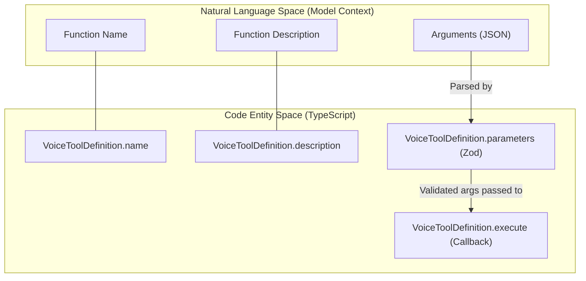
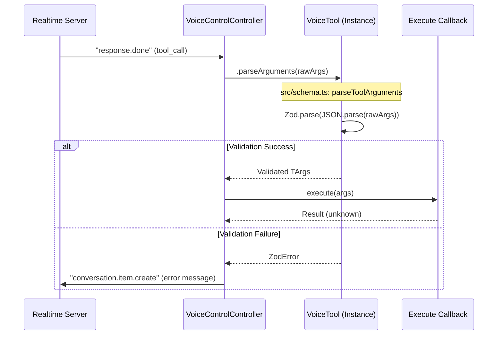

<!-- source: DeepWiki mcp.deepwiki.com · repo openai/realtime-voice-component · page 3.1 defineVoiceTool & VoiceTool · fetched 2026-10-26 -->

# defineVoiceTool & VoiceTool

Relevant source files

The following files were used as context for generating this wiki page:

- [docs/api/functions/defineVoiceTool.md](docs/api/functions/defineVoiceTool.md)
- [docs/api/type-aliases/JsonSchema.md](docs/api/type-aliases/JsonSchema.md)
- [docs/api/type-aliases/VoiceTool.md](docs/api/type-aliases/VoiceTool.md)
- [docs/api/type-aliases/VoiceToolDefinition.md](docs/api/type-aliases/VoiceToolDefinition.md)
- [src/defineVoiceTool.ts](src/defineVoiceTool.ts)
- [src/schema.ts](src/schema.ts)
- [test/defineVoiceTool.test.ts](test/defineVoiceTool.test.ts)
- [test/voiceToolDefinition.typecheck.ts](test/voiceToolDefinition.typecheck.ts)

The tool system in the `realtime-voice-component` library provides a type-safe bridge between the OpenAI Realtime API's JSON-based function calling and the application's TypeScript logic. The `defineVoiceTool` factory ensures that every tool is backed by a Zod schema, providing both runtime validation and automatic generation of the JSON Schema required by the model.

## Overview

Tools are defined using the `defineVoiceTool` factory function. This factory transforms a high-level `VoiceToolDefinition` into a `VoiceTool` object, which contains the metadata and methods necessary for the `VoiceControlController` to register and execute the tool during a session.

### Natural Language to Code Entity Mapping

The following diagram illustrates how natural language concepts used by the model map to specific code entities in the tool system.

"Natural Language Space to Code Entity Space"

**Sources:** [src/defineVoiceTool.ts:13-25](), [docs/api/type-aliases/VoiceToolDefinition.md:19-57]()

---

## defineVoiceTool Factory

The `defineVoiceTool` function is the primary entry point for creating tools. It performs two critical tasks:
1.  **Validation**: It enforces that the `parameters` property is a valid Zod schema [src/defineVoiceTool.ts:5-9]().
2.  **Normalization**: It converts the Zod schema into a plain `JsonSchema` object compatible with the OpenAI Realtime API [src/defineVoiceTool.ts:11-11]().

### Implementation Detail
The factory uses `normalizeToolSchema` from `src/schema.ts` to strip metadata (like `$schema` or `$ref`) that the OpenAI API does not support, ensuring a clean JSON Schema is sent to the server [src/schema.ts:13-29]().

**Sources:** [src/defineVoiceTool.ts:4-26](), [src/schema.ts:27-29]()

---

## Data Structures

### VoiceToolDefinition<TArgs>
This is the input type for `defineVoiceTool`. It defines the interface the developer must implement.

| Property | Type | Description |
| :--- | :--- | :--- |
| `name` | `string` | The unique name of the function. |
| `description` | `string` | A description used by the model to determine when to call the tool. |
| `parameters` | `ZodLikeSchema<TArgs>` | A Zod schema defining the expected arguments. |
| `execute` | `(args: TArgs) => Promise<unknown> \| unknown` | The implementation logic executed when the model calls the tool. |

**Sources:** [docs/api/type-aliases/VoiceToolDefinition.md:19-57]()

### VoiceTool<TArgs>
The resulting object returned by the factory. It extends the definition with runtime utilities.

| Property | Type | Description |
| :--- | :--- | :--- |
| `jsonSchema` | `JsonSchema` | The normalized JSON Schema generated from the Zod parameters. |
| `realtimeTool` | `RealtimeFunctionTool` | The object formatted specifically for the `session.update` event. |
| `parseArguments` | `(rawArgs: string) => TArgs` | A method that parses and validates a raw JSON string using the Zod schema. |

**Sources:** [docs/api/type-aliases/VoiceTool.md:13-38](), [src/defineVoiceTool.ts:13-25]()

---

## Zod Schema Requirements

The library strictly enforces the use of **Zod schemas** for tool parameters. Plain JSON objects are rejected at both the type level and runtime.

### Why Zod?
1.  **Type Safety**: `TArgs` is automatically inferred from the schema, ensuring the `execute` function receives correctly typed data.
2.  **Runtime Validation**: When the model provides `rawArgs` (a string), the library uses `schema.parse()` to ensure the data conforms to the expected shape before calling `execute` [src/schema.ts:31-34]().
3.  **Automatic Schema Generation**: Using `zod-to-json-schema`, the library generates the complex `JsonSchema` required by OpenAI without manual duplication [src/schema.ts:1-2]().

### Rejection of Plain JSON
If a plain JSON object is passed to `defineVoiceTool`, the function throws an error: `"Plain JSON Schema tool definitions are no longer supported. Pass a Zod schema to defineVoiceTool()."` [src/defineVoiceTool.ts:6-9]().

**Sources:** [src/defineVoiceTool.ts:5-9](), [test/voiceToolDefinition.typecheck.ts:20-21](), [test/defineVoiceTool.test.ts:28-51]()

---

## Tool Execution Flow

The following diagram shows the data flow from the moment a `RealtimeServerEvent` containing a tool call is received until the `execute` callback is triggered.

"Tool Execution and Validation Flow"

### The execute Callback Contract
The `execute` function can be synchronous or asynchronous [docs/api/type-aliases/VoiceToolDefinition.md:30-31](). Whatever value is returned (or resolved) from this function is automatically converted to a JSON string and sent back to the model via a `conversation.item.create` event with `type: "function_call_output"`.

**Sources:** [src/defineVoiceTool.ts:22-24](), [src/schema.ts:31-34](), [docs/api/type-aliases/VoiceToolDefinition.md:27-41]()

---

