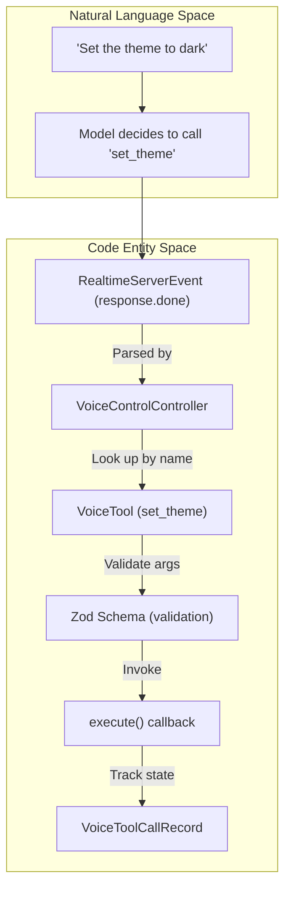
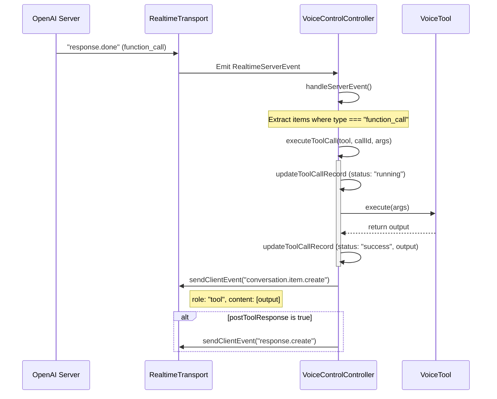

<!-- source: DeepWiki mcp.deepwiki.com · repo openai/realtime-voice-component · page 3.2 Tool Call Lifecycle · fetched 2026-10-26 -->

# Tool Call Lifecycle

Relevant source files

The following files were used as context for generating this wiki page:

- [docs/api/functions/createVoiceControlController.md](docs/api/functions/createVoiceControlController.md)
- [docs/api/type-aliases/ToolCallErrorEvent.md](docs/api/type-aliases/ToolCallErrorEvent.md)
- [docs/api/type-aliases/ToolCallEvent.md](docs/api/type-aliases/ToolCallEvent.md)
- [docs/api/type-aliases/ToolCallResultEvent.md](docs/api/type-aliases/ToolCallResultEvent.md)
- [docs/api/type-aliases/ToolCallStatus.md](docs/api/type-aliases/ToolCallStatus.md)
- [docs/api/type-aliases/UseVoiceControlReturn.md](docs/api/type-aliases/UseVoiceControlReturn.md)
- [docs/api/type-aliases/VoiceControlError.md](docs/api/type-aliases/VoiceControlError.md)
- [docs/api/type-aliases/VoiceControlErrorCode.md](docs/api/type-aliases/VoiceControlErrorCode.md)
- [docs/api/type-aliases/VoiceControlSnapshot.md](docs/api/type-aliases/VoiceControlSnapshot.md)
- [docs/api/type-aliases/VoiceToolCallRecord.md](docs/api/type-aliases/VoiceToolCallRecord.md)
- [src/voiceControlController.ts](src/voiceControlController.ts)

The tool call lifecycle manages the transition from a model-generated function call request to a local code execution and finally back to a model-consumable result. This process is managed by the `VoiceControlController` and involves argument validation, state tracking via `VoiceToolCallRecord`, and automatic response generation.

## High-Level Execution Flow

When the OpenAI Realtime API determines a tool should be called, it emits a `response.done` event containing `function_call` items. The controller intercepts these, matches them against registered `VoiceTool` definitions, and executes the associated logic.

### Natural Language to Code Entity Mapping

The following diagram illustrates how abstract model intentions are mapped to concrete code entities within the `realtime-voice-component` architecture.

**Model-to-Code Mapping**

**Sources:** [src/voiceControlController.ts:397-420](), [src/voiceControlController.ts:507-535]()

---

## Detailed Lifecycle Stages

### 1. Discovery and Validation
The lifecycle begins when the controller receives a `response.done` event from the transport layer. The controller iterates through the items to find those with `type: "function_call"`.

- **Matching**: The `name` provided by the model is matched against the `tools` array provided in the `VoiceControlController` configuration [src/voiceControlController.ts:405-410]().
- **Parsing**: Arguments arrive as a JSON string and are parsed into a JavaScript object [src/voiceControlController.ts:413-415]().
- **Validation**: The parsed arguments are validated against the tool's Zod schema. If validation fails, the lifecycle transitions immediately to an `error` status [src/voiceControlController.ts:510-520]().

### 2. Execution and Tracking
Once validated, the controller creates a `VoiceToolCallRecord` with a status of `"running"` and adds it to the `toolCalls` history [src/voiceControlController.ts:417-422]().

- **Invocation**: The `execute` function defined in the `VoiceTool` is called with the validated arguments [src/voiceControlController.ts:522-525]().
- **Status Transitions**: The `ToolCallStatus` moves from `running` to either `success` or `error` based on the outcome of the `execute` promise [docs/api/type-aliases/ToolCallStatus.md:8-9]().

### 3. Result Reporting and Post-Tool Behavior
After execution, the result (or error) must be reported back to the model so it can continue the conversation.

- **Reporting**: The controller sends a `conversation.item.create` event followed by a `response.create` event to the server [src/voiceControlController.ts:538-555]().
- **Post-Tool Response**: If the tool definition has `postToolResponse: true`, the controller automatically triggers a new model response to describe the outcome to the user [src/voiceControlController.ts:557-560]().

---

## State Tracking: VoiceToolCallRecord

The `VoiceToolCallRecord` is the primary data structure for monitoring tool activity. It is exposed to the UI via the `toolCalls` and `latestToolCall` properties of the `VoiceControlSnapshot`.

| Property | Type | Description |
| :--- | :--- | :--- |
| `id` | `string` | The unique `call_id` provided by the OpenAI API [docs/api/type-aliases/VoiceToolCallRecord.md:45-49](). |
| `status` | `ToolCallStatus` | `running`, `success`, `error`, or `skipped` [docs/api/type-aliases/ToolCallStatus.md:8-9](). |
| `args` | `unknown` | The validated arguments passed to the tool [docs/api/type-aliases/VoiceToolCallRecord.md:13-17](). |
| `output` | `unknown` | The value returned by the `execute` callback [docs/api/type-aliases/VoiceToolCallRecord.md:61-65](). |
| `durationMs` | `number` | Calculated time between `startedAt` and `finishedAt` [src/voiceControlController.ts:219-220](). |

**Sources:** [docs/api/type-aliases/VoiceToolCallRecord.md:5-98](), [src/voiceControlController.ts:203-222]()

---

## Implementation Sequence

The following sequence diagram details the function calls and event flow within `voiceControlController.ts` during a tool invocation.

**Internal Function Sequence**

**Sources:** [src/voiceControlController.ts:397-430](), [src/voiceControlController.ts:507-565](), [src/voiceControlController.ts:590-610]()

## Tool Call Status Transitions

The `ToolCallStatus` follows a strict state machine to ensure the UI can accurately reflect the model's progress.

1.  **`running`**: Set immediately before the `execute` callback is invoked [src/voiceControlController.ts:417-420]().
2.  **`success`**: Set if the `execute` promise resolves. The result is stored in the `output` field [src/voiceControlController.ts:526-530]().
3.  **`error`**: Set if the `execute` promise rejects or if argument validation fails. The error is normalized and stored in the `error` field [src/voiceControlController.ts:515-520](), [src/voiceControlController.ts:531-535]().
4.  **`skipped`**: Occurs if a tool call is received but the tool is no longer registered or the session is disconnected [src/voiceControlController.ts:408-411]().

**Sources:** [docs/api/type-aliases/ToolCallStatus.md:5-10](), [src/voiceControlController.ts:125-143]()

---

