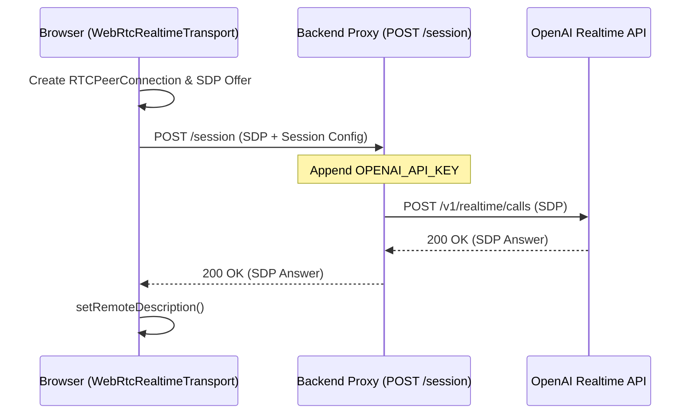

<!-- source: DeepWiki mcp.deepwiki.com · repo openai/realtime-voice-component · page 4 Transport Layer · fetched 2026-10-26 -->

# Transport Layer

<details>
<summary>Relevant source files</summary>

The following files were used as context for generating this wiki page:

- [demo/session-server.mjs](demo/session-server.mjs)
- [docs/authentication.md](docs/authentication.md)
- [src/transport/mockRealtimeTransport.ts](src/transport/mockRealtimeTransport.ts)
- [src/transport/types.ts](src/transport/types.ts)
- [src/transport/webRtcRealtimeTransport.ts](src/transport/webRtcRealtimeTransport.ts)

</details>


The Transport Layer is responsible for the low-level communication between the browser and the OpenAI Realtime API. It abstracts the complexities of WebRTC negotiation, audio stream management, and the JSON-based control channel into a unified interface used by the `VoiceControlController`.

## RealtimeTransport Abstraction

All transport implementations must adhere to the `RealtimeTransport` interface [src/transport/types.ts:53-63](). This interface ensures that the higher-level controller can manage sessions, capture audio, and exchange events without being coupled to a specific network implementation (e.g., WebRTC vs. WebSockets or Mocks).

### Core Responsibilities
*   **Connection Lifecycle**: Handling `connect` and `disconnect` logic, including authentication resolution [src/transport/types.ts:54-55]().
*   **Media Management**: Starting and stopping local microphone capture via `startCapture` and `stopCapture` [src/transport/types.ts:57-58]().
*   **Event Routing**: Passing `RealtimeServerEvent` objects from the network to the application and sending `RealtimeClientEvent` objects back [src/transport/types.ts:49,61]().
*   **Session Updates**: Synchronizing the server-side session state with local configuration via `updateSession` [src/transport/types.ts:56]().

### Transport Entities
The following diagram illustrates how the `RealtimeTransport` interface bridges the gap between the application's intent and the physical network connection.

**Transport Layer Architecture**
```mermaid
graph TD
    subgraph "Controller Space"
        VCC["VoiceControlController"]
    end

    subgraph "Transport Abstraction Space"
        RT["<<interface>> RealtimeTransport"]
        WrtcRT["WebRtcRealtimeTransport"]
        MockRT["MockRealtimeTransport"]
    end

    subgraph "Browser/Network Space"
        PC["RTCPeerConnection"]
        DC["RTCDataChannel"]
        MS["MediaStream (Mic)"]
    end

    VCC -- "calls" --> RT
    RT <|-- WrtcRT
    RT <|-- MockRT
    WrtcRT -- "manages" --> PC
    WrtcRT -- "sends/receives" --> DC
    WrtcRT -- "captures" --> MS
```
Sources: [src/transport/types.ts:53-63](), [src/transport/webRtcRealtimeTransport.ts:237-251](), [src/transport/mockRealtimeTransport.ts:6-73]()

## WebRTC Implementation

The primary production implementation is `WebRtcRealtimeTransport` [src/transport/webRtcRealtimeTransport.ts:237](). It utilizes the WebRTC API to provide low-latency, bi-directional audio and data communication.

Key characteristics include:
*   **SDP Negotiation**: It generates a local Session Description Protocol (SDP) offer and expects a remote answer to establish the peer connection [src/transport/webRtcRealtimeTransport.ts:202-212]().
*   **Data Channel**: A dedicated `RTCDataChannel` named `oai-events` is used for sending and receiving JSON control messages [src/transport/webRtcRealtimeTransport.ts:8,118-122]().
*   **Audio Handling**: Manages a `MediaStreamTrack` for the microphone and an `HTMLAudioElement` for playing back the model's response [src/transport/webRtcRealtimeTransport.ts:7,9]().

For a deep dive into the negotiation sequence, audio track management, and timeout guards, see [WebRTC Transport](#4.1).

Sources: [src/transport/webRtcRealtimeTransport.ts:6-12](), [src/transport/webRtcRealtimeTransport.ts:237-251]()

## Authentication & Session Proxy

To securely connect to OpenAI without exposing API keys in the browser, the transport layer supports a session proxy pattern.

### The Proxy Flow
1.  The browser creates an ephemeral WebRTC offer.
2.  The transport sends this offer to a developer-managed `sessionEndpoint` [docs/authentication.md:7-13]().
3.  The backend proxy appends the `OPENAI_API_KEY` and forwards the request to OpenAI [demo/session-server.mjs:51-59]().
4.  The response (SDP answer) is returned to the browser to finalize the connection.

**Authentication Data Flow**

Sources: [docs/authentication.md:17-22](), [demo/session-server.mjs:51-73](), [src/transport/webRtcRealtimeTransport.ts:202-223]()

For details on implementing the proxy and alternative authentication patterns, see [Authentication & Session Proxy](#4.2).

## Error Handling and Timeouts

The transport layer includes robust error normalization and safety guards:
*   **Insecure Context Check**: Blocks connection attempts if the page is not served over HTTPS or localhost, as microphone access will fail [src/transport/webRtcRealtimeTransport.ts:253-261]().
*   **Data Channel Timeout**: Implements a `DATA_CHANNEL_OPEN_TIMEOUT_MS` (default 15 seconds) to prevent the application from hanging if the WebRTC handshake fails [src/transport/webRtcRealtimeTransport.ts:14,125-131]().
*   **Abort Signal Support**: Most asynchronous operations, including `connect`, accept an `AbortSignal` to allow the user to cancel connection attempts mid-flight [src/transport/webRtcRealtimeTransport.ts:48,53-57]().

Sources: [src/transport/webRtcRealtimeTransport.ts:14-57](), [src/transport/types.ts:48]()

---

