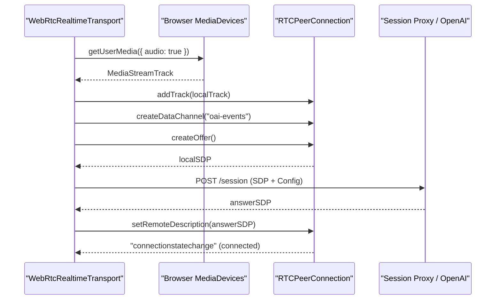
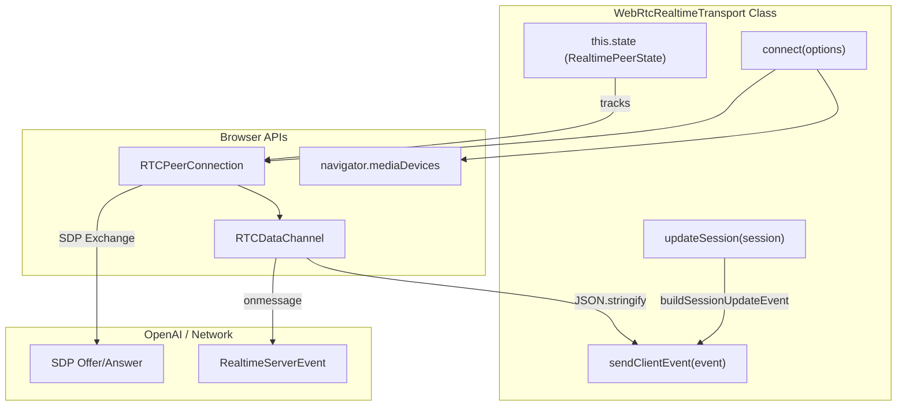

<!-- source: DeepWiki mcp.deepwiki.com · repo openai/realtime-voice-component · page 4.1 WebRTC Transport · fetched 2026-10-26 -->

# WebRTC Transport

Relevant source files

The following files were used as context for generating this wiki page:

- [demo/session-server.mjs](demo/session-server.mjs)
- [docs/api/type-aliases/RealtimeAudioConfig.md](docs/api/type-aliases/RealtimeAudioConfig.md)
- [docs/api/type-aliases/RealtimeAudioFormat.md](docs/api/type-aliases/RealtimeAudioFormat.md)
- [docs/api/type-aliases/RealtimeAudioInputConfig.md](docs/api/type-aliases/RealtimeAudioInputConfig.md)
- [docs/api/type-aliases/RealtimeAudioOutputConfig.md](docs/api/type-aliases/RealtimeAudioOutputConfig.md)
- [docs/api/type-aliases/RealtimeSemanticVadTurnDetection.md](docs/api/type-aliases/RealtimeSemanticVadTurnDetection.md)
- [docs/api/type-aliases/RealtimeServerVadTurnDetection.md](docs/api/type-aliases/RealtimeServerVadTurnDetection.md)
- [docs/api/type-aliases/RealtimeTurnDetection.md](docs/api/type-aliases/RealtimeTurnDetection.md)
- [docs/authentication.md](docs/authentication.md)
- [src/transport/mockRealtimeTransport.ts](src/transport/mockRealtimeTransport.ts)
- [src/transport/types.ts](src/transport/types.ts)
- [src/transport/webRtcRealtimeTransport.ts](src/transport/webRtcRealtimeTransport.ts)

The `WebRtcRealtimeTransport` class is the primary implementation of the `RealtimeTransport` interface, responsible for managing the low-level WebRTC connection between the browser and OpenAI's Realtime API. It handles SDP negotiation, media stream management, and the reliable delivery of control events via a dedicated data channel.

## Peer Connection Setup

The transport utilizes `RTCPeerConnection` to establish a peer-to-peer link. Because the OpenAI Realtime API requires a secure context, the transport performs a check for `window.isSecureContext` before initiating any connection logic [src/transport/webRtcRealtimeTransport.ts:253-261]().

The internal state is tracked via a `RealtimePeerState` object, which holds references to the peer connection, data channel, and audio elements [src/transport/webRtcRealtimeTransport.ts:6-12]().

### Connection Sequence

1.  **Media Acquisition**: The transport requests access to the user's microphone using `navigator.mediaDevices.getUserMedia` [src/transport/webRtcRealtimeTransport.ts:316-321]().
2.  **SDP Offer**: A local SDP offer is created. The transport adds the local audio track to the `RTCPeerConnection` before generating the offer [src/transport/webRtcRealtimeTransport.ts:333-345]().
3.  **Negotiation**: The SDP offer is sent to the backend (either via a session proxy or directly) to receive an answer SDP from OpenAI [src/transport/webRtcRealtimeTransport.ts:352-378]().
4.  **Remote Description**: The received answer is set as the remote description on the `RTCPeerConnection` [src/transport/webRtcRealtimeTransport.ts:380-381]().

### Data Flow: Connection Initialization

The following diagram illustrates the interaction between the transport and the browser APIs during setup.

**WebRTC Handshake Logic**

Sources: [src/transport/webRtcRealtimeTransport.ts:316-381](), [src/transport/webRtcRealtimeTransport.ts:202-223]()

## oai-events Data Channel

All control messages (JSON events) are sent through a `RTCDataChannel` named `oai-events` [src/transport/webRtcRealtimeTransport.ts:327]().

### DATA_CHANNEL_OPEN_TIMEOUT_MS Guard

To prevent the application from hanging indefinitely during poor network conditions, the transport implements a strict timeout of 15,000ms (`DATA_CHANNEL_OPEN_TIMEOUT_MS`) for the data channel to reach the `open` state [src/transport/webRtcRealtimeTransport.ts:14](). If the channel fails to open within this window, the connection attempt is rejected [src/transport/webRtcRealtimeTransport.ts:125-131]().

The `waitForDataChannelOpen` function manages this lifecycle, listening for `open`, `error`, and `close` events, as well as monitoring the parent `RTCPeerConnection.connectionState` [src/transport/webRtcRealtimeTransport.ts:118-200]().

## Audio Track Management

The transport manages two primary audio flows:
1.  **Input**: The `localTrack` acquired from the microphone is added to the peer connection to be streamed to OpenAI [src/transport/webRtcRealtimeTransport.ts:340-341]().
2.  **Output**: Remote audio tracks received from the peer connection are attached to a hidden `HTMLAudioElement` [src/transport/webRtcRealtimeTransport.ts:304-314]().

### Capture Modes

The transport supports two primary interaction patterns based on the session's `activationMode`:

| Mode | Behavior | Implementation |
| :--- | :--- | :--- |
| **VAD** | Voice Activity Detection (Server-side). The microphone is continuously streamed. | Managed by `server_vad` or `semantic_vad` config [docs/api/type-aliases/RealtimeAudioInputConfig.md:41-44](). |
| **Push-to-Talk** | Manual control over when the model listens. | `startCapture()` clears the buffer; `stopCapture()` commits the buffer and requests a response [src/transport/webRtcRealtimeTransport.ts:468-483](). |

Sources: [src/transport/webRtcRealtimeTransport.ts:468-483](), [docs/api/type-aliases/RealtimeServerVadTurnDetection.md:61-64](), [docs/api/type-aliases/RealtimeSemanticVadTurnDetection.md:37-41]()

## SDP Negotiation Sequence

The library supports multiple authentication patterns which change how the SDP is exchanged:

1.  **Session Proxy (Recommended)**: The transport sends a multipart `POST` request to a `sessionEndpoint`. This request includes the local `sdp` and the serialized `session` configuration [src/transport/webRtcRealtimeTransport.ts:202-223]().
2.  **Direct (Legacy)**: If an `authToken` is provided, the transport sends the raw SDP string directly to OpenAI's calls endpoint [src/transport/webRtcRealtimeTransport.ts:225-235]().

### Entity Mapping: Transport Internals

This diagram maps high-level transport concepts to specific code entities within `WebRtcRealtimeTransport`.

**Code Entity Mapping**

Sources: [src/transport/webRtcRealtimeTransport.ts:237-250](), [src/transport/webRtcRealtimeTransport.ts:457-466](), [src/transport/webRtcRealtimeTransport.ts:503-511]()

## Key Functions

### `connect(options: TransportConnectOptions)`
The entry point for establishing the session. It orchestrates media acquisition, peer connection creation, and SDP negotiation [src/transport/webRtcRealtimeTransport.ts:252-404]().

### `updateSession(session: TransportSessionConfig)`
Sends a `session.update` client event over the data channel to synchronize the model's instructions, tools, or audio settings without restarting the WebRTC connection [src/transport/webRtcRealtimeTransport.ts:457-466]().

### `disconnect()`
Performs a clean shutdown by stopping all media tracks, closing the data channel, and disposing of the `RTCPeerConnection` [src/transport/webRtcRealtimeTransport.ts:413-448]().

### `sendClientEvent(event: RealtimeClientEvent)`
Serializes and sends a JSON payload through the `oai-events` data channel [src/transport/webRtcRealtimeTransport.ts:503-511]().

Sources: [src/transport/webRtcRealtimeTransport.ts:252-511]()

---

