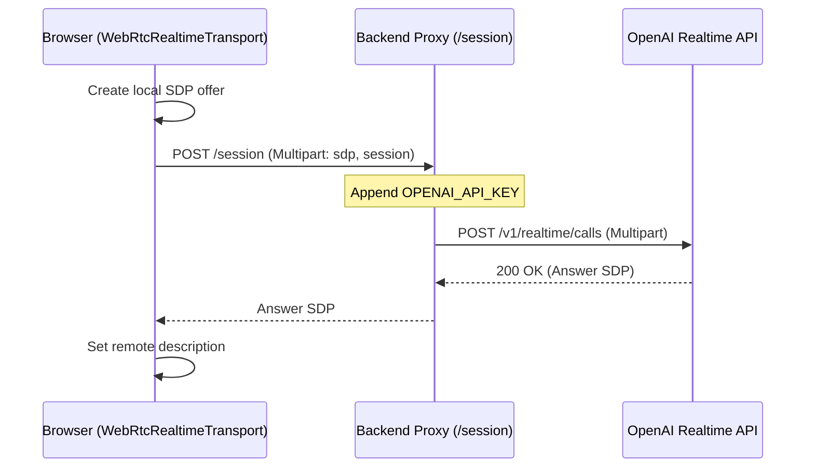
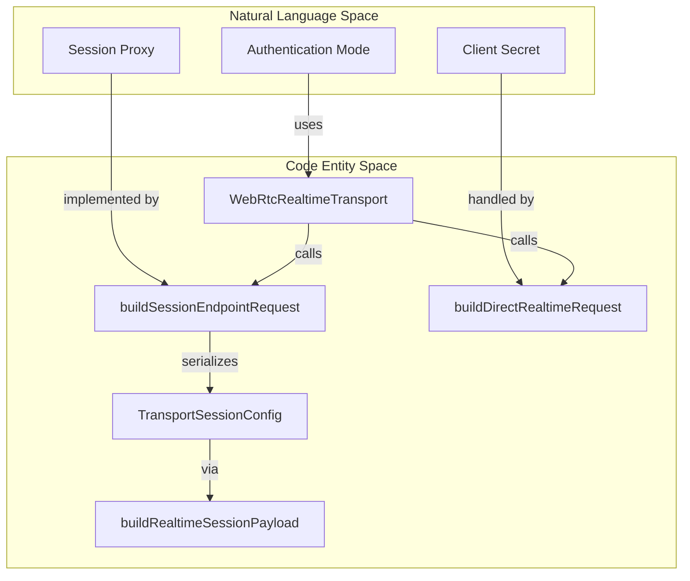

<!-- source: DeepWiki mcp.deepwiki.com · repo openai/realtime-voice-component · page 4.2 Authentication & Session Proxy · fetched 2026-10-26 -->

# Authentication & Session Proxy

<details>
<summary>Relevant source files</summary>

The following files were used as context for generating this wiki page:

- [LLM.txt](LLM.txt)
- [README.md](README.md)
- [demo/session-server.mjs](demo/session-server.mjs)
- [docs/authentication.md](docs/authentication.md)
- [docs/getting-started.md](docs/getting-started.md)
- [docs/integrating-with-an-existing-app.md](docs/integrating-with-an-existing-app.md)
- [src/transport/webRtcRealtimeTransport.ts](src/transport/webRtcRealtimeTransport.ts)

</details>


This page documents the authentication patterns and backend requirements for the `realtime-voice-component`. To maintain security, the library is designed to ensure that OpenAI API keys are never exposed in the browser [LLM.txt:12-12](). Instead, it relies on a session proxy or token exchange mechanism to establish WebRTC connections.

## Authentication Patterns

The library supports three authentication patterns, with `sessionEndpoint` being the canonical and recommended approach [docs/authentication.md:15-15]().

| Pattern | Configuration Key | Description |
| :--- | :--- | :--- |
| **Session Proxy** | `sessionEndpoint` | **Recommended.** The browser sends the WebRTC offer and session config to your backend, which forwards it to OpenAI [docs/authentication.md:7-22](). |
| **Token Proxy** | `tokenEndpoint` | Legacy. The browser fetches a short-lived client secret from your backend, then connects directly to OpenAI [docs/authentication.md:60-65](). |
| **Direct Secret** | `getClientSecret` | Legacy/Advanced. An async function provided by the app to resolve a client secret manually [docs/authentication.md:71-87](). |

### Data Flow: Session Proxy (Recommended)

The session proxy pattern allows the backend to intercept and potentially modify the session configuration before it reaches OpenAI [docs/authentication.md:34-36]().


**Sources:** [docs/authentication.md:17-22](), [src/transport/webRtcRealtimeTransport.ts:202-223]()

## Backend Implementation

The backend must implement a `POST /session` route that handles `multipart/form-data`. This endpoint acts as a relay between the client's `WebRtcRealtimeTransport` and the OpenAI Realtime API.

### Required Fields
The browser sends two primary fields in the multipart body [LLM.txt:43-47]():
1. `sdp`: The local WebRTC offer string generated by the browser.
2. `session`: A JSON-serialized string of the `TransportSessionConfig`, which includes model, voice, and tool definitions [src/transport/webRtcRealtimeTransport.ts:209-212]().

### Proxy Logic
The proxy should forward the request headers (specifically `Content-Type`) and the raw request body to OpenAI while adding the `Authorization` header with your server-side API key [README.md:152-170]().

**Reference Implementation (Node.js/Express style):**
[demo/session-server.mjs:50-73]()

```typescript
// Implementation informed by src/transport/webRtcRealtimeTransport.ts:202-223
app.post("/session", async (request, response) => {
  const contentType = request.header("content-type");

  const realtimeResponse = await fetch("https://api.openai.com/v1/realtime/calls", {
    method: "POST",
    headers: {
      Authorization: `Bearer ${process.env.OPENAI_API_KEY}`,
      ...(contentType ? { "Content-Type": contentType } : {}),
    },
    body: request, // Forwarding the stream
    duplex: "half",
  });

  response
    .status(realtimeResponse.status)
    .type(realtimeResponse.headers.get("content-type") ?? "application/sdp")
    .send(await realtimeResponse.text());
});
```
**Sources:** [README.md:153-170](), [LLM.txt:55-72](), [demo/session-server.mjs:50-73]()

## Technical Implementation Details

### Client-Side Request Construction
The `WebRtcRealtimeTransport` uses the `buildSessionEndpointRequest` helper to prepare the multipart payload [src/transport/webRtcRealtimeTransport.ts:202-208](). It specifically deletes the `Content-Type` header from any provided `sessionRequestInit` to allow the browser to automatically generate the correct multipart boundary [src/transport/webRtcRealtimeTransport.ts:213-214]().

### Legacy Client Secret Flow
If using `tokenEndpoint` or `getClientSecret`, the transport calls `buildDirectRealtimeRequest` [src/transport/webRtcRealtimeTransport.ts:225-235](). This sends the SDP as a raw `application/sdp` body directly to OpenAI using the retrieved client secret as a Bearer token [src/transport/webRtcRealtimeTransport.ts:229-232]().

### Mapping Code Entities to Auth Flow

The following diagram bridges the high-level authentication concepts to the specific functions and classes in the codebase.


**Sources:** [src/transport/webRtcRealtimeTransport.ts:202-250](), [src/transport/webRtcRealtimeTransport.ts:1-1]()

## Security Considerations

1. **Secure Contexts:** Voice control and microphone access require a "Secure Context" (HTTPS or localhost). The `WebRtcRealtimeTransport` checks `window.isSecureContext` and throws an `insecure_context` error if this requirement is not met [src/transport/webRtcRealtimeTransport.ts:253-261]().
2. **API Key Protection:** The standard OpenAI API key (`sk-...`) must never be passed to the `createVoiceControlController`. It should only exist on the backend [LLM.txt:12-12]().
3. **Multipart Integrity:** The backend should generally leave the incoming multipart body untouched unless specific session overrides are required for security or policy reasons [docs/authentication.md:34-36]().
4. **Request Customization:** If the backend requires additional authentication (e.g., session cookies), use the `sessionRequestInit` property in the `auth` configuration [docs/authentication.md:23-32]().

**Sources:** [src/transport/webRtcRealtimeTransport.ts:253-261](), [LLM.txt:12-12](), [docs/authentication.md:23-36]()

---

