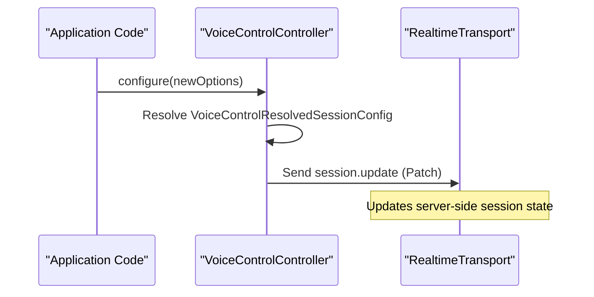

<!-- source: DeepWiki mcp.deepwiki.com · repo openai/realtime-voice-component · page 5 Session Configuration · fetched 2026-10-26 -->

# Session Configuration

<details>
<summary>Relevant source files</summary>

The following files were used as context for generating this wiki page:

- [docs/api/type-aliases/VoiceControlController.md](docs/api/type-aliases/VoiceControlController.md)
- [docs/api/type-aliases/VoiceControlRealtimeSessionOptions.md](docs/api/type-aliases/VoiceControlRealtimeSessionOptions.md)
- [docs/api/type-aliases/VoiceControlRealtimeSessionPatch.md](docs/api/type-aliases/VoiceControlRealtimeSessionPatch.md)
- [docs/api/type-aliases/VoiceControlResolvedSessionConfig.md](docs/api/type-aliases/VoiceControlResolvedSessionConfig.md)
- [src/types.ts](src/types.ts)

</details>


The session configuration system manages the parameters sent to the OpenAI Realtime API to define model behavior, audio processing, and tool availability. Configuration flows from the high-level `UseVoiceControlOptions` provided by the developer, through a resolution process, into a `VoiceControlResolvedSessionConfig` used to initialize or update the transport session.

## Configuration Flow

Configuration is not static; it can be updated during an active session via the `VoiceControlController.configure()` method [docs/api/type-aliases/VoiceControlController.md:13-16](). When options change, the controller determines if a "patch" can be sent to the server or if a more significant state change is required.

### Data Transformation Pipeline

The following diagram illustrates how user-provided options are transformed into the internal resolved configuration.

**Configuration Resolution Diagram**
```mermaid
graph TD
  subgraph "Natural Language Space"
    "A"["Developer Intent (e.g. 'Use GPT-4o with Alloy voice')"]
  end

  subgraph "Code Entity Space"
    "B"["UseVoiceControlOptions"]
    "C"["VoiceControlRealtimeSessionOptions"]
    "D"["VoiceControlResolvedSessionConfig"]
    "E"["session.update (Server Event)"]

    "B" -->|"Contains"| "C"
    "C" -->|"Resolved by Controller"| "D"
    "D" -->|"Diffed/Patched"| "E"
  end

  "A" -.-> "B"
```
Sources: [src/types.ts:238-248](), [src/types.ts:262-272](), [docs/api/type-aliases/VoiceControlController.md:13-16]()

## Key Configuration Entities

| Entity | Role | Key File |
| :--- | :--- | :--- |
| `VoiceControlRealtimeSessionOptions` | Optional parameters provided by the user to customize the session (audio, prompt, tools). | [src/types.ts:238-248]() |
| `VoiceControlResolvedSessionConfig` | The final, flattened configuration object used by the transport layer. | [src/types.ts:262-272]() |
| `VoiceControlRealtimeSessionPatch` | A partial configuration object used to update an active session without reconnecting. | [src/types.ts:250-260]() |

## Session Patching

The system supports live updates to the session configuration via `VoiceControlRealtimeSessionPatch`. This allows developers to change instructions, toggle tools, or adjust audio settings (like output voice) while the connection remains open.

**Live Patching Flow**

Sources: [src/types.ts:250-260](), [docs/api/type-aliases/VoiceControlController.md:13-16]()

## Audio Configuration
The `audio` property within the session options controls both input (capture) and output (playback) behavior. This includes selecting audio formats like `pcm16` or `g711_ulaw`, configuring noise reduction, and setting transcription models.

For details, see [Audio Configuration](#5.1).

## Model, Voice & Session Options
Beyond audio, the session configuration defines the core identity of the interaction. This includes:
* **Model Selection**: Choosing between models like `gpt-realtime` or `gpt-realtime-mini` [src/types.ts:28-30]().
* **Voice Selection**: Selecting the persona (e.g., `alloy`, `shimmer`, `echo`) [src/types.ts:34-46]().
* **Turn Detection**: Configuring `server_vad` (Voice Activity Detection) or semantic-based detection [src/types.ts:92-94]().
* **Instructions**: The system prompt that governs model behavior.

For details, see [Model, Voice & Session Options](#5.2).

---

