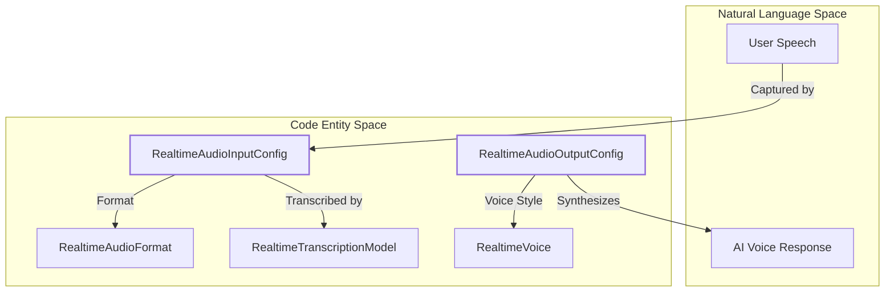
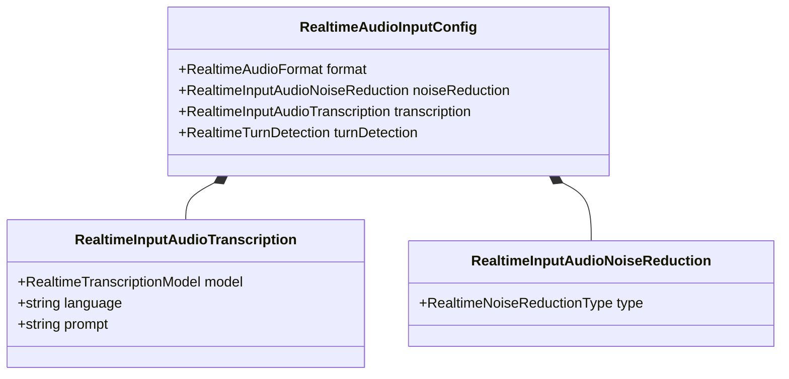

<!-- source: DeepWiki mcp.deepwiki.com · repo openai/realtime-voice-component · page 5.1 Audio Configuration · fetched 2026-10-26 -->

# Audio Configuration

<details>
<summary>Relevant source files</summary>

The following files were used as context for generating this wiki page:

- [docs/api/type-aliases/RealtimeAudioConfig.md](docs/api/type-aliases/RealtimeAudioConfig.md)
- [docs/api/type-aliases/RealtimeAudioFormat.md](docs/api/type-aliases/RealtimeAudioFormat.md)
- [docs/api/type-aliases/RealtimeAudioInputConfig.md](docs/api/type-aliases/RealtimeAudioInputConfig.md)
- [docs/api/type-aliases/RealtimeAudioOutputConfig.md](docs/api/type-aliases/RealtimeAudioOutputConfig.md)
- [docs/api/type-aliases/RealtimeInputAudioNoiseReduction.md](docs/api/type-aliases/RealtimeInputAudioNoiseReduction.md)
- [docs/api/type-aliases/RealtimeInputAudioTranscription.md](docs/api/type-aliases/RealtimeInputAudioTranscription.md)
- [docs/api/type-aliases/RealtimeNoiseReductionType.md](docs/api/type-aliases/RealtimeNoiseReductionType.md)
- [docs/api/type-aliases/RealtimePrompt.md](docs/api/type-aliases/RealtimePrompt.md)
- [docs/api/type-aliases/VoiceControlController.md](docs/api/type-aliases/VoiceControlController.md)
- [src/types.ts](src/types.ts)

</details>


The audio configuration system defines how the Realtime API handles audio ingestion, processing, and generation. Configuration is managed through the `RealtimeAudioConfig` object, which is split into `input` and `output` specifications. These settings control everything from low-level codecs to high-level features like noise reduction and transcription models.

### Data Flow Overview

Audio configuration originates in the `UseVoiceControlOptions` passed to the controller. The `VoiceControlController` resolves these options into a `VoiceControlResolvedSessionConfig`, which is then communicated to the OpenAI Realtime API via the transport layer.

**Audio Configuration Mapping**

Sources: [src/types.ts:96-112](), [docs/api/type-aliases/RealtimeAudioConfig.md:5-26]()

---

## Audio Formats

The system supports three primary audio formats for both input and output. These are defined by the `RealtimeAudioFormat` type.

| Format | Description |
| :--- | :--- |
| `pcm16` | Raw 16-bit Pulse Code Modulation. High quality, uncompressed. |
| `g711_ulaw` | G.711 μ-law companding. Standard for North American telephony. |
| `g711_alaw` | G.711 A-law companding. Standard for European/International telephony. |

Sources: [src/types.ts:32-32](), [docs/api/type-aliases/RealtimeAudioFormat.md:8-8]()

---

## Input Configuration

`RealtimeAudioInputConfig` governs how the client's microphone data is processed by the server.

### Noise Reduction
Noise reduction can be configured using `RealtimeInputAudioNoiseReduction`. It supports two specific environments via `RealtimeNoiseReductionType`:
- `near_field`: Optimized for close-range microphones (e.g., headsets).
- `far_field`: Optimized for distant microphones (e.g., smart speakers or laptop mics in a room).

### Transcription
To enable server-side transcription of the user's input (necessary for tool calling and text-based logs), the `transcription` property must be configured.

| Property | Type | Description |
| :--- | :--- | :--- |
| `model` | `RealtimeTranscriptionModel` | The model used to convert speech to text (e.g., `whisper-1`). |
| `language` | `string` | Optional ISO language code for the transcription. |
| `prompt` | `string` | Optional prompt to guide the transcription model's style or vocabulary. |

**Audio Input Entity Relation**

Sources: [src/types.ts:48-56](), [src/types.ts:65-73](), [src/types.ts:96-101](), [docs/api/type-aliases/RealtimeInputAudioTranscription.md:10-34]()

---

## Output Configuration

`RealtimeAudioOutputConfig` defines the characteristics of the voice generated by the model.

### Voice Selection
The `voice` property accepts `RealtimeVoice`, which includes several built-in personalities:
- **High-pitched/Expressive**: `alloy`, `coral`, `shimmer`
- **Neutral/Deep**: `ash`, `echo`, `sage`
- **Newer Models**: `ballad`, `cedar`, `marin`, `verse`

### Playback Speed
The `speed` property allows for dynamic adjustment of the output speech rate. It typically ranges from `0.6` to `1.2`, where `1.0` is the default natural speed.

**Output Configuration Summary**
| Option | Code Identifier | Supported Values (Examples) |
| :--- | :--- | :--- |
| Format | `format` | `pcm16`, `g711_ulaw` |
| Voice | `voice` | `alloy`, `ash`, `echo`, `shimmer` |
| Speed | `speed` | `number` (e.g., `1.0`) |

Sources: [src/types.ts:34-46](), [src/types.ts:103-107](), [docs/api/type-aliases/RealtimeAudioOutputConfig.md:10-34]()

---

## Implementation in Controller

The `VoiceControlController` manages the lifecycle of these configurations. When `configure(options)` is called, the controller merges the provided `audio` settings into the session state.

1. **Initialization**: Options are passed to `useVoiceControl` or the standalone `createVoiceControlController`.
2. **Resolution**: The controller resolves the `RealtimeAudioConfig` within the `VoiceControlResolvedSessionConfig`.
3. **Session Update**: If the session is already active, the controller sends a `session.update` event to the transport layer to apply patches (e.g., changing the voice mid-conversation).

```ts
// Example of an audio configuration patch via the controller
controller.configure({
  audio: {
    output: {
      voice: "shimmer",
      speed: 1.1
    }
  }
});
```

Sources: [docs/api/type-aliases/VoiceControlController.md:13-27](), [src/types.ts:238-268](), [src/types.ts:250-260]()

---

