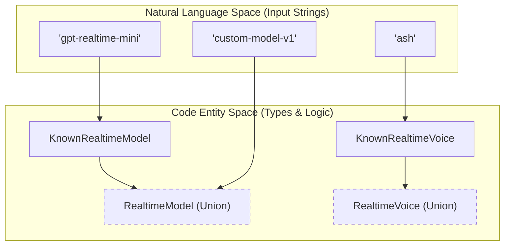
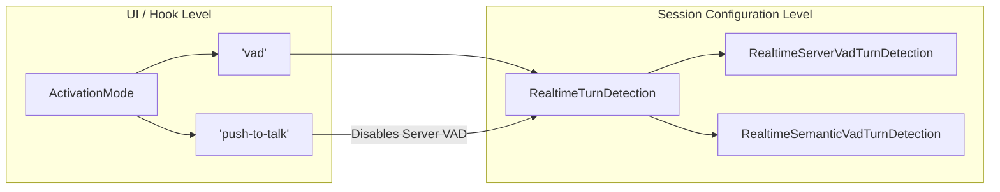

<!-- source: DeepWiki mcp.deepwiki.com · repo openai/realtime-voice-component · page 5.2 Model, Voice & Session Options · fetched 2026-10-26 -->

# Model, Voice & Session Options

Relevant source files

The following files were used as context for generating this wiki page:

- [docs/api/type-aliases/ActivationMode.md](docs/api/type-aliases/ActivationMode.md)
- [docs/api/type-aliases/KnownRealtimeModel.md](docs/api/type-aliases/KnownRealtimeModel.md)
- [docs/api/type-aliases/KnownRealtimeTranscriptionModel.md](docs/api/type-aliases/KnownRealtimeTranscriptionModel.md)
- [docs/api/type-aliases/KnownRealtimeVoice.md](docs/api/type-aliases/KnownRealtimeVoice.md)
- [docs/api/type-aliases/OutputMode.md](docs/api/type-aliases/OutputMode.md)
- [docs/api/type-aliases/RealtimeModel.md](docs/api/type-aliases/RealtimeModel.md)
- [docs/api/type-aliases/RealtimeSemanticVadTurnDetection.md](docs/api/type-aliases/RealtimeSemanticVadTurnDetection.md)
- [docs/api/type-aliases/RealtimeServerVadTurnDetection.md](docs/api/type-aliases/RealtimeServerVadTurnDetection.md)
- [docs/api/type-aliases/RealtimeSessionInclude.md](docs/api/type-aliases/RealtimeSessionInclude.md)
- [docs/api/type-aliases/RealtimeToolChoice.md](docs/api/type-aliases/RealtimeToolChoice.md)
- [docs/api/type-aliases/RealtimeTracing.md](docs/api/type-aliases/RealtimeTracing.md)
- [docs/api/type-aliases/RealtimeTranscriptionModel.md](docs/api/type-aliases/RealtimeTranscriptionModel.md)
- [docs/api/type-aliases/RealtimeTruncation.md](docs/api/type-aliases/RealtimeTruncation.md)
- [docs/api/type-aliases/RealtimeTurnDetection.md](docs/api/type-aliases/RealtimeTurnDetection.md)
- [docs/api/type-aliases/RealtimeVoice.md](docs/api/type-aliases/RealtimeVoice.md)

This page details the configuration options for the OpenAI Realtime session, specifically focusing on model selection, voice profiles, turn detection strategies, and session management features like tracing and truncation.

## Model Selection

The system uses a flexible typing pattern to allow for both standard OpenAI models and future or custom model strings.

### RealtimeModel and KnownRealtimeModel
The `RealtimeModel` type is defined as a union of `KnownRealtimeModel` and a generic string object [docs/api/type-aliases/RealtimeModel.md:5-9](). This allows the IDE to provide autocomplete for standard models while still accepting any valid string for experimental or fine-tuned models.

Standard models currently supported in the `KnownRealtimeModel` type include:
- `gpt-realtime`
- `gpt-realtime-1.5`
- `gpt-realtime-mini`
[docs/api/type-aliases/KnownRealtimeModel.md:8-8]()

### Transcription Models
For converting user audio into text (input transcription), a separate `RealtimeTranscriptionModel` is used [docs/api/type-aliases/RealtimeTranscriptionModel.md:5-9]().
Standard options include:
- `gpt-4o-transcribe`
- `gpt-4o-mini-transcribe`
- `whisper-1`
[docs/api/type-aliases/KnownRealtimeTranscriptionModel.md:8-8]()

## Voice Options

The `RealtimeVoice` type follows the same extensibility pattern as models [docs/api/type-aliases/RealtimeVoice.md:5-9](). 

### Known Voices
The `KnownRealtimeVoice` type includes the following predefined voice profiles:
- **Neutral/Balanced**: `alloy`, `ash`
- **Deep/Resonant**: `echo`, `ballad`
- **Soft/Lyrical**: `coral`, `sage`, `shimmer`
- **Other**: `cedar`, `marin`, `verse`
[docs/api/type-aliases/KnownRealtimeVoice.md:8-18]()

## Turn Detection (VAD)

Turn detection determines how the server decides the user has finished speaking and when the model should respond. This is configured via the `RealtimeTurnDetection` union [docs/api/type-aliases/RealtimeTurnDetection.md:5-8]().

### Server VAD (`server_vad`)
Standard volume-based detection. The server monitors audio levels and silence duration to trigger a response.

| Property | Type | Description |
| :--- | :--- | :--- |
| `type` | `"server_vad"` | Identifier for the detection mode [docs/api/type-aliases/RealtimeServerVadTurnDetection.md:61-64](). |
| `threshold` | `number` | The activation threshold for speech detection [docs/api/type-aliases/RealtimeServerVadTurnDetection.md:53-57](). |
| `silenceDurationMs` | `number` | How long to wait after speech stops before committing the turn [docs/api/type-aliases/RealtimeServerVadTurnDetection.md:45-49](). |
| `prefixPaddingMs` | `number` | Audio to include before the detected speech [docs/api/type-aliases/RealtimeServerVadTurnDetection.md:37-41](). |
| `createResponse` | `boolean` | Whether to automatically start a model response after detection [docs/api/type-aliases/RealtimeServerVadTurnDetection.md:13-17](). |

### Semantic VAD (`semantic_vad`)
Advanced detection that uses natural language understanding to determine if a user's thought is complete, rather than just relying on silence.

| Property | Type | Description |
| :--- | :--- | :--- |
| `type` | `"semantic_vad"` | Identifier for the detection mode [docs/api/type-aliases/RealtimeSemanticVadTurnDetection.md:37-40](). |
| `eagerness` | `"low" \| "medium" \| "high" \| "auto"` | Controls how quickly the model interrupts or responds [docs/api/type-aliases/RealtimeSemanticVadTurnDetection.md:21-25](). |
| `interruptResponse` | `boolean` | If true, new speech will truncate the current model output [docs/api/type-aliases/RealtimeSemanticVadTurnDetection.md:29-33](). |

## Session Management

### Tracing
The `RealtimeTracing` option allows for debugging and observability of the session. It can be set to `"auto"` or a detailed object [docs/api/type-aliases/RealtimeTracing.md:5-15]().

**Tracing Object Properties:**
- `groupId`: Identifier for a group of related sessions.
- `workflowName`: Name of the specific application workflow.
- `metadata`: A record of key-value pairs for custom tracking.
[docs/api/type-aliases/RealtimeTracing.md:10-14]()

### Truncation
`RealtimeTruncation` manages how the session context is handled when it exceeds limit. This is critical for long-running conversations [docs/api/type-aliases/RealtimeTruncation.md:5-16]().

- `"auto"`: Default server behavior.
- `"disabled"`: No automatic truncation.
- `retention_ratio`: A specific object where `retentionRatio` (number) defines how much of the previous context to keep when the buffer is full [docs/api/type-aliases/RealtimeTruncation.md:11-15]().

## Data Flow & Extensibility

The following diagram illustrates how the `Known*` extensibility pattern bridges natural language configuration strings to the TypeScript entities used in the controller.

### Configuration Entity Mapping

**Sources:** [docs/api/type-aliases/RealtimeModel.md:5-9](), [docs/api/type-aliases/RealtimeVoice.md:5-9](), [docs/api/type-aliases/KnownRealtimeModel.md:5-9](), [docs/api/type-aliases/KnownRealtimeVoice.md:5-19]()

### Turn Detection Resolution
This diagram shows how the `ActivationMode` selected in the UI/Hook maps to the underlying `RealtimeTurnDetection` configuration sent to the transport.

**Sources:** [docs/api/type-aliases/ActivationMode.md:5-9](), [docs/api/type-aliases/RealtimeTurnDetection.md:5-9](), [docs/api/type-aliases/RealtimeServerVadTurnDetection.md:5-66](), [docs/api/type-aliases/RealtimeSemanticVadTurnDetection.md:5-42]()

---

