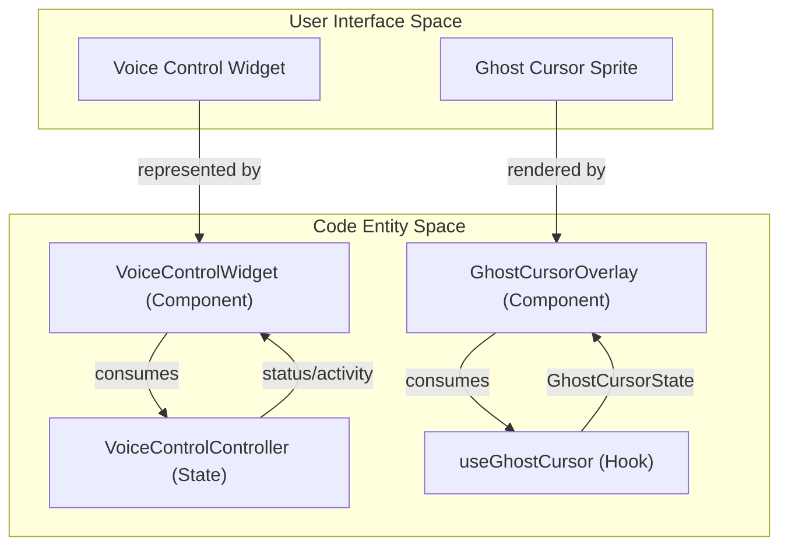
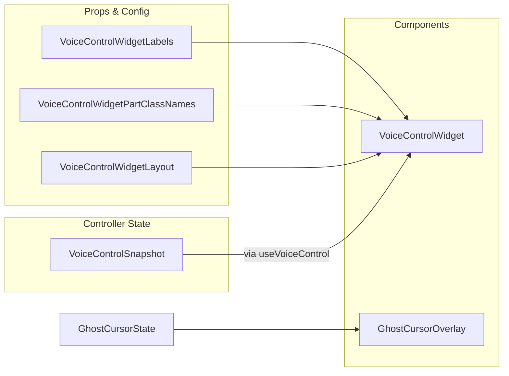

<!-- source: DeepWiki mcp.deepwiki.com · repo openai/realtime-voice-component · page 6 UI Components · fetched 2026-10-26 -->

# UI Components

Relevant source files

The following files were used as context for generating this wiki page:

- [docs/api/functions/GhostCursorOverlay.md](docs/api/functions/GhostCursorOverlay.md)
- [docs/api/functions/VoiceControlWidget.md](docs/api/functions/VoiceControlWidget.md)
- [docs/api/functions/useVoiceControl.md](docs/api/functions/useVoiceControl.md)
- [docs/api/type-aliases/GhostCursorOverlayProps.md](docs/api/type-aliases/GhostCursorOverlayProps.md)
- [docs/api/type-aliases/VoiceControlWidgetCorner.md](docs/api/type-aliases/VoiceControlWidgetCorner.md)
- [docs/api/type-aliases/VoiceControlWidgetLabels.md](docs/api/type-aliases/VoiceControlWidgetLabels.md)
- [docs/api/type-aliases/VoiceControlWidgetLayout.md](docs/api/type-aliases/VoiceControlWidgetLayout.md)
- [docs/api/type-aliases/VoiceControlWidgetPart.md](docs/api/type-aliases/VoiceControlWidgetPart.md)
- [docs/api/type-aliases/VoiceControlWidgetPartClassNames.md](docs/api/type-aliases/VoiceControlWidgetPartClassNames.md)
- [docs/api/type-aliases/VoiceControlWidgetProps.md](docs/api/type-aliases/VoiceControlWidgetProps.md)
- [src/components/GhostCursorOverlay.tsx](src/components/GhostCursorOverlay.tsx)

The `realtime-voice-component` library provides two primary React components designed to facilitate user interaction with the voice controller and provide visual feedback for tool executions. These components bridge the gap between the headless `VoiceControlController` and the end-user interface.

### Component Architecture

The UI layer is decoupled from the core logic. While the `VoiceControlController` manages the state machine and transport, these components consume that state to render interactive elements.

| Component | Role | Primary State Source |
| :--- | :--- | :--- |
| `VoiceControlWidget` | Main control interface for toggling sessions and viewing status. | `VoiceControlController` |
| `GhostCursorOverlay` | Visual animation system for tool-driven UI interactions. | `useGhostCursor` hook |

---

## VoiceControlWidget

The `VoiceControlWidget` is the standard entry point for users. It provides a visual representation of the current connection status (e.g., "disconnected", "connecting", "listening") and exposes actions to start or stop the voice session.

### Layout and Behavior
The widget supports two primary layout modes defined by `VoiceControlWidgetLayout`:
*   **Floating**: A draggable, corner-snapping button that persists its position via `localStorage`. It is typically rendered in a portal to stay above application content [docs/api/type-aliases/VoiceControlWidgetLayout.md:8-8]().
*   **Inline**: A static component that can be embedded directly within a page's layout or sidebar [docs/api/type-aliases/VoiceControlWidgetLayout.md:8-8]().

### Customization
Developers can deeply customize the widget through:
*   **Styling**: The `partClassNames` prop allows targeting specific internal elements like the `launcher`, `status-indicator`, or `drag-handle` using the `VoiceControlWidgetPart` keys [docs/api/type-aliases/VoiceControlWidgetPartClassNames.md:8-8]().
*   **Localization**: Labels for different states can be overridden via the `labels` prop [docs/api/type-aliases/VoiceControlWidgetLabels.md:8-26]().
*   **Responsiveness**: The `mobileBreakpoint` and `mobileLayout` props allow the widget to switch from "floating" to "inline" (or vice-versa) based on screen width [docs/api/type-aliases/VoiceControlWidgetProps.md:17-18]().

For detailed API documentation, layout configuration, and styling guides, see **[VoiceControlWidget](#6.1)**.

**Sources:**
* [docs/api/functions/VoiceControlWidget.md:5-20]()
* [docs/api/type-aliases/VoiceControlWidgetProps.md:8-26]()
* [docs/api/type-aliases/VoiceControlWidgetPart.md:8-20]()

---

## Ghost Cursor Overlay

The `GhostCursorOverlay` is a specialized visual component used to guide the user's attention during tool executions. When the model triggers a tool that interacts with a specific UI element (e.g., "clicking" a button or "filling" a field), the ghost cursor animates from its current position to the target element.

### Visual System
The component renders a "main" cursor and optional "satellite" sprites [src/components/GhostCursorOverlay.tsx:35-41](). It utilizes CSS variables to handle high-performance animations, including:
*   **Phases**: Transitions through `hidden`, `traveling`, and `arrived` states [src/components/GhostCursorOverlay.tsx:12-12]().
*   **Easing**: Supports "expressive" vs "standard" easing curves for natural movement [src/components/GhostCursorOverlay.tsx:18-21]().
*   **Positioning**: Dynamic X/Y coordinate mapping based on DOM element resolution [src/components/GhostCursorOverlay.tsx:22-23]().

### Integration
The overlay is typically used in conjunction with the `useGhostCursor` hook, which manages the queue of interaction targets and calculates travel durations.

For documentation on target resolution, satellite sprites, and interaction dismissal, see **[Ghost Cursor Overlay](#6.2)**.

**Sources:**
* [src/components/GhostCursorOverlay.tsx:6-43]()
* [docs/api/type-aliases/GhostCursorOverlayProps.md:5-26]()

---

## Component Relationship Diagram

The following diagram illustrates how the UI components interact with the underlying controller and the DOM.

### UI to Code Entity Mapping
"This diagram maps user-facing UI elements to their corresponding code definitions and props."

**Sources:**
* [docs/api/functions/VoiceControlWidget.md:8-15]()
* [docs/api/type-aliases/GhostCursorOverlayProps.md:21-25]()
* [src/components/GhostCursorOverlay.tsx:6-6]()

### Data Flow and Prop Mapping
"This diagram shows how configuration and state flow into the UI components."

**Sources:**
* [docs/api/type-aliases/VoiceControlWidgetProps.md:8-26]()
* [docs/api/functions/useVoiceControl.md:10-53]()
* [docs/api/type-aliases/GhostCursorOverlayProps.md:21-25]()

---

