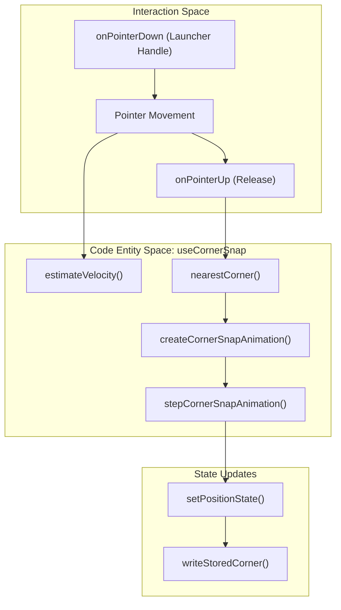
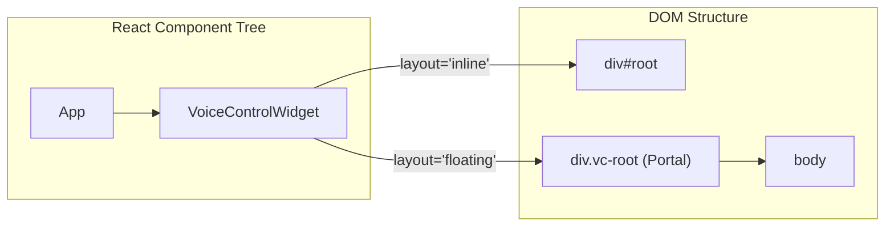

<!-- source: DeepWiki mcp.deepwiki.com · repo openai/realtime-voice-component · page 6.1 VoiceControlWidget · fetched 2026-10-26 -->

# VoiceControlWidget

Relevant source files

The following files were used as context for generating this wiki page:

- [docs/api/type-aliases/VoiceControlWidgetCorner.md](docs/api/type-aliases/VoiceControlWidgetCorner.md)
- [docs/api/type-aliases/VoiceControlWidgetLabels.md](docs/api/type-aliases/VoiceControlWidgetLabels.md)
- [docs/api/type-aliases/VoiceControlWidgetLayout.md](docs/api/type-aliases/VoiceControlWidgetLayout.md)
- [docs/api/type-aliases/VoiceControlWidgetPart.md](docs/api/type-aliases/VoiceControlWidgetPart.md)
- [docs/api/type-aliases/VoiceControlWidgetPartClassNames.md](docs/api/type-aliases/VoiceControlWidgetPartClassNames.md)
- [docs/api/type-aliases/VoiceControlWidgetProps.md](docs/api/type-aliases/VoiceControlWidgetProps.md)
- [docs/widget-and-cursor.md](docs/widget-and-cursor.md)
- [src/components/VoiceControlWidget.tsx](src/components/VoiceControlWidget.tsx)
- [src/internal/cornerSnap.ts](src/internal/cornerSnap.ts)
- [src/internal/storage.ts](src/internal/storage.ts)
- [src/internal/useCornerSnap.ts](src/internal/useCornerSnap.ts)
- [src/styles.css](src/styles.css)

The `VoiceControlWidget` is a pre-built React component that provides a standardized launcher interface for the realtime voice system. It handles the visual representation of connection states, user interactions for starting/stopping sessions, and complex UI behaviors like viewport-aware dragging and corner snapping.

### Layout Modes

The widget supports two primary layout modes via the `layout` and `mobileLayout` props [docs/api/type-aliases/VoiceControlWidgetProps.md:16-18]():

1.  **Floating**: The default mode where the widget is positioned absolutely/fixed relative to the viewport. It supports dragging and snapping [docs/widget-and-cursor.md:38-42]().
2.  **Inline**: The widget behaves as a standard block element within the document flow, losing its fixed positioning and drag capabilities [src/styles.css:41-47]().

The widget automatically switches between these modes based on the `mobileBreakpoint` (default: 640px) [src/components/VoiceControlWidget.tsx:28](). This is managed by the `useViewportMatch` hook, which utilizes `window.matchMedia` and `useSyncExternalStore` for performant updates [src/components/VoiceControlWidget.tsx:71-112]().

### Visual States

The widget maps the internal controller state to a `LauncherVisualState` to drive CSS data attributes and icons [src/components/VoiceControlWidget.tsx:67-239]().

| Visual State | Controller Status / Activity | Description |
| :--- | :--- | :--- |
| `idle` | `disconnected` | Initial state, ready to connect. |
| `connecting` | `connecting` | Establishing WebRTC/Socket connection. |
| `listening` | `listening` | Microphone is active and capturing audio. |
| `busy` | `processing` / `executing` | Model is thinking or a tool is running. |
| `live` | `connected` (and idle) | Connection active, waiting for user speech. |
| `error` | `error` | Connection or runtime failure. |

**Sources:** [src/components/VoiceControlWidget.tsx:213-239](), [src/styles.css:90-123]()

---

### Corner Snapping and Drag Physics

The `useCornerSnap` hook implements a sophisticated physics-based dragging system for the `floating` layout [src/internal/useCornerSnap.ts:182-191]().

#### Data Flow: Drag to Snap
Title: Drag and Snap Lifecycle

**Sources:** [src/internal/useCornerSnap.ts:150-180](), [src/internal/cornerSnap.ts:76-104](), [src/internal/cornerSnap.ts:140-170]()

#### Implementation Details
*   **Thresholding**: Dragging only activates after moving more than 6px to prevent accidental triggers during clicks [src/internal/useCornerSnap.ts:32]().
*   **Velocity Estimation**: The system tracks the last 20 pointer samples over a 100ms lookback window to calculate release velocity [src/internal/useCornerSnap.ts:33-34]().
*   **Spring Physics**: Upon release, `createCornerSnapAnimation` uses dual-spring physics. `spring1` handles the momentum decay (where the widget "would" land), and `spring2` pulls it toward the `nearestCorner` [src/internal/cornerSnap.ts:140-170]().
*   **Viewport Clamping**: The `clampPositionToViewport` utility ensures the widget never drifts off-screen, accounting for a configurable `snapInset` [src/internal/cornerSnap.ts:59-74]().

---

### Position Persistence

The widget persists its last snapped corner in `localStorage` to maintain UI consistency across page reloads [src/internal/useCornerSnap.ts:58]().

*   **Versioning**: Keys are versioned (e.g., `v1`) to prevent collisions with legacy schemas [src/internal/useCornerSnap.ts:29-30]().
*   **Best-effort**: Storage operations are wrapped in try-catch blocks to ensure the widget remains functional even if `localStorage` is blocked by the browser [src/internal/storage.ts:17-29]().
*   **Keys**: The default key format is `voice-control-corner:v1:{widgetId}` [src/internal/useCornerSnap.ts:64-66]().

**Sources:** [src/internal/useCornerSnap.ts:72-99](), [src/internal/storage.ts:1-33]()

---

### Styling and Customization

The widget uses a "Part" system for granular styling without requiring deep CSS selectors.

#### partClassNames System
The `partClassNames` prop accepts a partial mapping of `VoiceControlWidgetPart` keys to CSS class names [docs/api/type-aliases/VoiceControlWidgetPartClassNames.md:8-9]().

| Part Name | Description | Default Class |
| :--- | :--- | :--- |
| `root` | The top-level container | `vc-root` |
| `launcher` | The button group container | `vc-launcher` |
| `launcher-action` | The primary microphone button | `vc-launcher-action` |
| `launcher-handle` | The drag handle (if enabled) | `vc-launcher-handle` |
| `launcher-toast` | The error notification popup | `vc-launcher-toast` |

**Sources:** [src/components/VoiceControlWidget.tsx:42-54](), [docs/api/type-aliases/VoiceControlWidgetPart.md:8-21]()

#### CSS Variables
The default `styles.css` uses CSS variables for easy theming [src/styles.css:1-32]():
*   `--vc-bg`: Background color (default: `#ffffff`).
*   `--vc-launcher-live-bg`: Background when the session is active.
*   `--vc-z-index`: Defaults to `60` to stay above standard UI.

---

### Rendering and Portals

When in `floating` mode, the widget utilizes `createPortal` to attach itself to `document.body` [src/components/VoiceControlWidget.tsx:437-440]().

Title: Widget Portal Architecture

**Sources:** [src/components/VoiceControlWidget.tsx:431-450](), [docs/widget-and-cursor.md:46-49]()

This portal approach prevents the widget from being clipped by `overflow: hidden` on parent containers and ensures that fixed positioning is relative to the viewport [docs/widget-and-cursor.md:46-49]().

### Localization
Labels can be customized via the `labels` prop [src/components/VoiceControlWidget.tsx:38-41](). This includes the main launcher text and the screen-reader status updates [docs/api/type-aliases/VoiceControlWidgetLabels.md:8-26](). Screen-reader specific text is handled via the `.vc-sr-only` class to maintain accessibility while keeping the visual UI compact [src/styles.css:234-244]().

---

