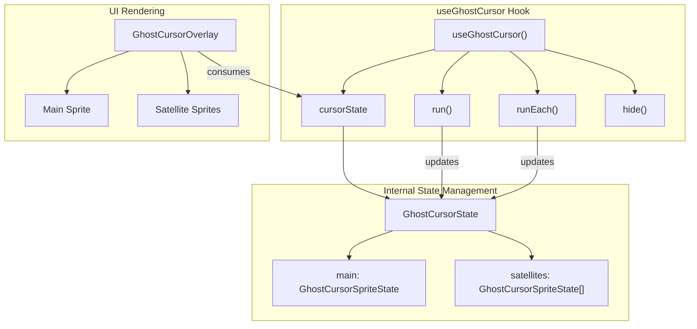
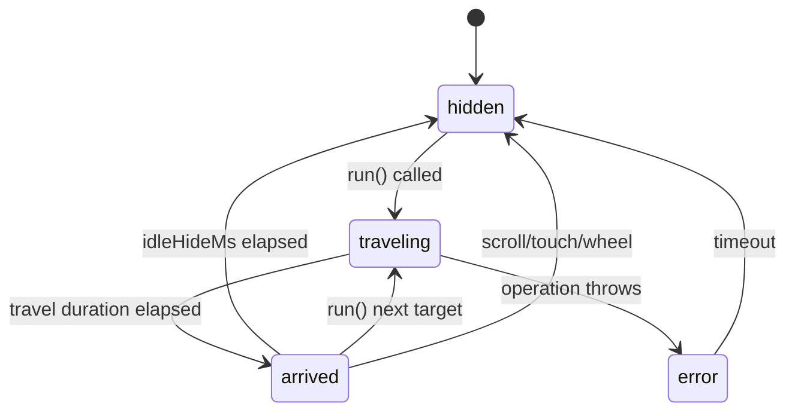

<!-- source: DeepWiki mcp.deepwiki.com · repo openai/realtime-voice-component · page 6.2 Ghost Cursor Overlay · fetched 2026-10-26 -->

# Ghost Cursor Overlay

<details>
<summary>Relevant source files</summary>

The following files were used as context for generating this wiki page:

- [docs/api/functions/GhostCursorOverlay.md](docs/api/functions/GhostCursorOverlay.md)
- [docs/api/functions/useGhostCursor.md](docs/api/functions/useGhostCursor.md)
- [docs/api/type-aliases/GhostCursorEasing.md](docs/api/type-aliases/GhostCursorEasing.md)
- [docs/api/type-aliases/GhostCursorMotionOptions.md](docs/api/type-aliases/GhostCursorMotionOptions.md)
- [docs/api/type-aliases/GhostCursorOrigin.md](docs/api/type-aliases/GhostCursorOrigin.md)
- [docs/api/type-aliases/GhostCursorOverlayProps.md](docs/api/type-aliases/GhostCursorOverlayProps.md)
- [docs/api/type-aliases/GhostCursorPhase.md](docs/api/type-aliases/GhostCursorPhase.md)
- [docs/api/type-aliases/GhostCursorPoint.md](docs/api/type-aliases/GhostCursorPoint.md)
- [docs/api/type-aliases/GhostCursorSpriteState.md](docs/api/type-aliases/GhostCursorSpriteState.md)
- [docs/api/type-aliases/GhostCursorState.md](docs/api/type-aliases/GhostCursorState.md)
- [docs/api/type-aliases/GhostCursorTarget.md](docs/api/type-aliases/GhostCursorTarget.md)
- [docs/api/type-aliases/UseGhostCursorOptions.md](docs/api/type-aliases/UseGhostCursorOptions.md)
- [docs/api/type-aliases/UseGhostCursorReturn.md](docs/api/type-aliases/UseGhostCursorReturn.md)
- [docs/widget-and-cursor.md](docs/widget-and-cursor.md)
- [src/components/GhostCursorOverlay.tsx](src/components/GhostCursorOverlay.tsx)
- [src/useGhostCursor.ts](src/useGhostCursor.ts)

</details>


The Ghost Cursor system provides visual confirmation of AI-driven actions by animating a virtual pointer to UI elements. It is a non-functional overlay; it does not simulate clicks or automate the browser. Instead, it follows the real state changes performed by your application's tool execution logic to provide user feedback [docs/widget-and-cursor.md:80-82]().

The system consists of two primary parts:
1.  **`useGhostCursor`**: A hook that manages the cursor state machine, travel calculations, and batch processing [src/useGhostCursor.ts:171-175]().
2.  **`GhostCursorOverlay`**: A React component that renders the `GhostCursorState` provided by the hook [src/components/GhostCursorOverlay.tsx:8-10]().

## System Architecture

The following diagram illustrates the relationship between the React hook, the state management logic, and the visual overlay.

### Ghost Cursor Entity Mapping

**Sources:** [src/useGhostCursor.ts:171-186](), [docs/api/type-aliases/GhostCursorState.md:1-26](), [docs/api/type-aliases/UseGhostCursorReturn.md:1-102]()

## Target Resolution

The cursor targets a `GhostCursorTarget` object, which can contain an `HTMLElement`, a specific `GhostCursorPoint` `{x, y}`, or both [docs/api/type-aliases/GhostCursorTarget.md:1-34]().

- **Element Resolution**: If an element is provided, the hook calculates its center point using `getBoundingClientRect()` [src/useGhostCursor.ts:78-93]().
- **Text Inputs**: For `HTMLInputElement` or `HTMLTextAreaElement`, the cursor targets the beginning of the text area (approx. 18% width) rather than the center to mimic natural typing focus [src/useGhostCursor.ts:82-87]().
- **Viewport Fallback**: If no target is resolvable, the cursor defaults to a point in the bottom-right of the viewport [src/useGhostCursor.ts:67-76]().

**Sources:** [src/useGhostCursor.ts:67-108](), [docs/api/type-aliases/GhostCursorPoint.md:1-26]()

## Movement and Phases

The cursor operates through a lifecycle of phases defined in `GhostCursorPhase`: `hidden`, `traveling`, `arrived`, and `error` [docs/api/type-aliases/GhostCursorPhase.md:1-10]().

### Travel Duration Calculation
Travel time is dynamic based on the Euclidean distance between the origin and destination.
- **Standard Travel**: Clamped between 320ms and 560ms [src/useGhostCursor.ts:17-18, 123-126]().
- **Fast Batch Travel**: Used during `runEach()` sequences, clamped between 130ms and 220ms [src/useGhostCursor.ts:23-24, 128-135]().

### Phase Transition Logic

**Sources:** [src/useGhostCursor.ts:17-26, 123-135](), [docs/api/type-aliases/GhostCursorPhase.md:1-10](), [docs/widget-and-cursor.md:101-101]()

## Key Functions

### `run()`
Executes a single operation. It scrolls the target into view if necessary, animates the cursor to the target, and then executes the provided callback [docs/api/type-aliases/UseGhostCursorReturn.md:33-61]().

### `runEach()`
Processes an array of items (e.g., multiple form fields). It uses "Satellite" sprites to show multiple points of interest simultaneously if the batch is large [docs/api/type-aliases/UseGhostCursorReturn.md:65-102]().
- **Batch Scrolling**: Calculates a centroid for all elements in the batch and scrolls to the element closest to that centroid to minimize layout shifts [src/useGhostCursor.ts:137-169]().
- **Satellite Sprites**: When processing batches, the main cursor moves to the current item while satellites may persist at previous locations to show history [docs/api/type-aliases/GhostCursorState.md:21-25]().

### Interaction Dismissal
The cursor is automatically hidden to avoid interfering with user intent if any of the following occur:
- User scrolls the page [src/useGhostCursor.ts:236, 266]().
- User touches the screen [src/useGhostCursor.ts:267]().
- User uses the mouse wheel [src/useGhostCursor.ts:268]().
- The `idleHideMs` (default 5000ms) timer expires [src/useGhostCursor.ts:20, 227-230]().

**Sources:** [src/useGhostCursor.ts:137-169, 201-236, 266-268](), [docs/api/type-aliases/UseGhostCursorReturn.md:33-102]()

## Accessibility and Motion

### Reduced Motion Support
The hook detects the `(prefers-reduced-motion: reduce)` media query. If enabled:
- The `traveling` phase is skipped [docs/widget-and-cursor.md:100-100]().
- The cursor jumps immediately to the `arrived` state [src/useGhostCursor.ts:193]().
- Visual feedback is limited to a pulse at the target location [docs/widget-and-cursor.md:100-100]().

### CSS Variables
The `GhostCursorOverlay` component uses CSS variables to drive animations, allowing for performant transitions:
- `--vc-ghost-cursor-x` / `--vc-ghost-cursor-y`: Current position [src/components/GhostCursorOverlay.tsx:28-29]().
- `--vc-ghost-cursor-duration`: Transition time for the current movement [src/components/GhostCursorOverlay.tsx:30]().
- `--vc-ghost-cursor-easing`: Easing function (e.g., `ease-out`, `smooth`) [src/components/GhostCursorOverlay.tsx:31]().

**Sources:** [src/useGhostCursor.ts:193](), [src/components/GhostCursorOverlay.tsx:25-35](), [docs/widget-and-cursor.md:100-100]()

## Usage Example

```typescript
const { run, cursorState } = useGhostCursor();

// In a tool execution:
await run(
  { element: document.getElementById("submit-btn") },
  async () => {
    await submitForm();
  },
  { easing: "smooth", from: "previous" }
);
```

**Sources:** [docs/api/type-aliases/UseGhostCursorReturn.md:33-61](), [docs/widget-and-cursor.md:98-98]()

---

