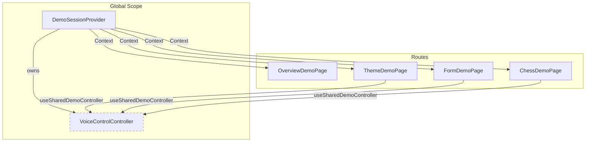
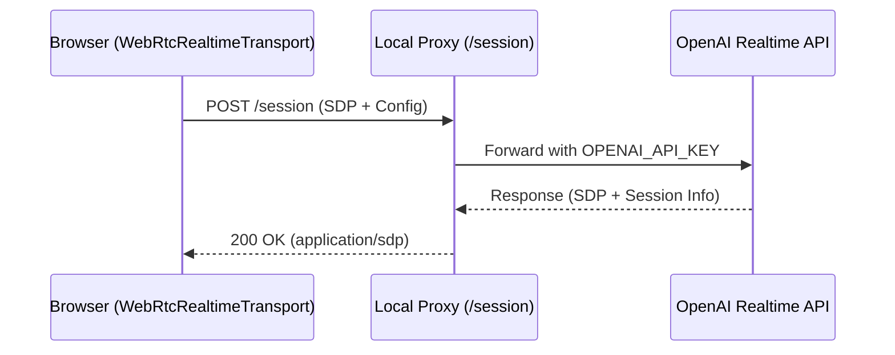

<!-- source: DeepWiki mcp.deepwiki.com · repo openai/realtime-voice-component · page 7 Demo Application · fetched 2026-10-26 -->

# Demo Application

Relevant source files

The following files were used as context for generating this wiki page:

- [demo/AGENTS.md](demo/AGENTS.md)
- [demo/index.html](demo/index.html)
- [demo/src/App.tsx](demo/src/App.tsx)
- [demo/src/demos/overview/index.tsx](demo/src/demos/overview/index.tsx)
- [demo/src/demos/shared/primitives.tsx](demo/src/demos/shared/primitives.tsx)
- [demo/src/demos/shared/session.tsx](demo/src/demos/shared/session.tsx)
- [demo/src/main.tsx](demo/src/main.tsx)
- [demo/vite.config.ts](demo/vite.config.ts)
- [docs/README.md](docs/README.md)
- [docs/demo-architecture.md](docs/demo-architecture.md)
- [test/serverImportSmoke.test.ts](test/serverImportSmoke.test.ts)
- [vitest.config.ts](vitest.config.ts)

The Demo Application serves as a reference implementation for the `realtime-voice-component` package. It demonstrates how to build a voice-driven interface using a shared-controller pattern that persists across route changes while swapping toolsets and instructions dynamically.

## Shared Controller Pattern

The application is built around the `DemoSessionProvider`, which manages a single `VoiceControlController` instance for the entire lifecycle of the app [demo/src/demos/shared/session.tsx:48-57](). This pattern prevents redundant initialization and allows the voice session to remain stable or gracefully transition as the user navigates between different demo routes [docs/demo-architecture.md:23-40]().

### Session Orchestration

The `useSharedDemoController` hook is the primary interface for individual routes to interact with the global controller [demo/src/demos/shared/session.tsx:77-117](). When a user switches routes:
1. The previous session is disconnected [demo/src/demos/shared/session.tsx:96]().
2. Tool-call history is cleared to prevent context leakage between demos [demo/src/demos/shared/session.tsx:97]().
3. The controller is reconfigured with route-specific `instructions` and `tools` using `controller.configure()` [demo/src/demos/shared/session.tsx:100]().
4. If the widget was already active, it automatically reconnects with the new configuration [demo/src/demos/shared/session.tsx:102-104]().

### Demo Application Component Hierarchy

The following diagram maps the relationship between the shared provider, the controller, and the specific demo routes.

**Demo Component & Controller Relationship**

Sources: [demo/src/App.tsx:10-25](), [demo/src/demos/shared/session.tsx:16-19](), [docs/demo-architecture.md:9-17]()

## Demo Routes

The application features four primary routes, each highlighting different capabilities of the voice runtime.

| Route | Purpose | Key Features |
| :--- | :--- | :--- |
| **Overview** | Reference | High-level introduction and code snippets for installation and server-side proxy setup [demo/src/demos/overview/index.tsx:28-100](). |
| **Theme Demo** | State Sync | Demonstrates simple tool execution (`set_theme`) and syncing UI state back to the model [docs/demo-architecture.md:42-56](). |
| **Form Demo** | Workflow | Shows multi-step data entry with validation and `postToolResponse` follow-ups [docs/demo-architecture.md:58-76](). |
| **Chess Demo** | Complex Logic | Integrates a chess engine with voice-controlled moves and visual board state [demo/src/App.tsx:8](). |

For technical details on specific implementations, see the following child pages:
*   For Theme and Form implementations, see **[Theme & Form Demos](#7.1)**.
*   For the Chess engine integration, see **[Chess Demo](#7.2)**.

Sources: [demo/src/demos/shared/primitives.tsx:45-50](), [docs/demo-architecture.md:9-15](), [demo/AGENTS.md:7-9]()

## Shared Infrastructure

The demos utilize a set of shared primitives and a centralized authentication flow to minimize boilerplate.

### Server-Side Proxy
The demo uses the unified `/session` flow. The client sends SDP and session configuration to a local proxy, which forwards the request to OpenAI with the necessary `Authorization` headers [docs/demo-architecture.md:28-31](). This ensures the API key is never exposed to the client.

**Authentication & Session Flow**

Sources: [demo/src/demos/overview/index.tsx:78-98](), [demo/vite.config.ts:30-34](), [docs/demo-architecture.md:28-31]()

### Wake Word Layer
While not part of the core package, the demo includes an optional wake-word activation layer using Picovoice Porcupine. This demonstrates how to hand off microphone control from a background listener to the WebRTC transport [docs/demo-architecture.md:79-88]().

For details on the wake-word implementation, see **[Wake Word Activation](#7.3)**.

Sources: [demo/src/demos/shared/primitives.tsx:89-123](), [docs/demo-architecture.md:77-88]()

---

