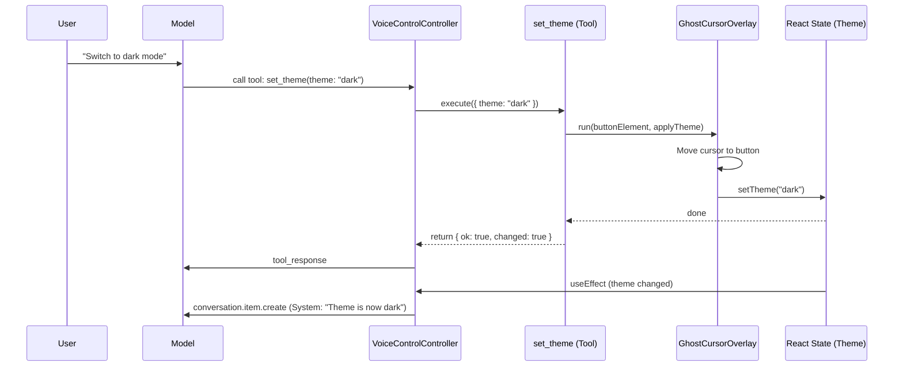
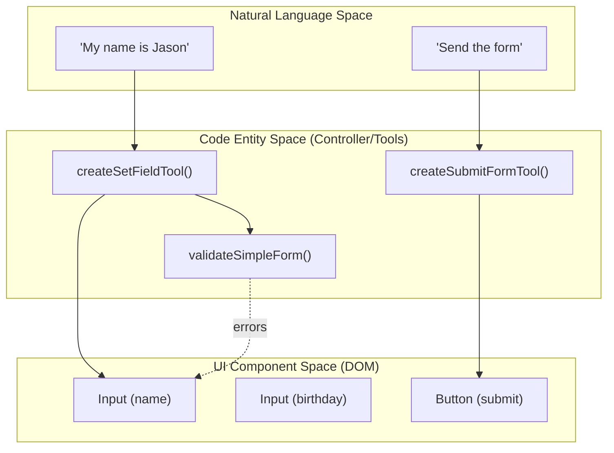

<!-- source: DeepWiki mcp.deepwiki.com · repo openai/realtime-voice-component · page 7.1 Theme & Form Demos · fetched 2026-10-26 -->

# Theme & Form Demos

Relevant source files

The following files were used as context for generating this wiki page:

- [demo/src/components/ui/checkbox.tsx](demo/src/components/ui/checkbox.tsx)
- [demo/src/components/ui/field.tsx](demo/src/components/ui/field.tsx)
- [demo/src/components/ui/input.tsx](demo/src/components/ui/input.tsx)
- [demo/src/components/ui/label.tsx](demo/src/components/ui/label.tsx)
- [demo/src/components/ui/separator.tsx](demo/src/components/ui/separator.tsx)
- [demo/src/components/ui/textarea.tsx](demo/src/components/ui/textarea.tsx)
- [demo/src/demos/form/config.ts](demo/src/demos/form/config.ts)
- [demo/src/demos/form/controller.ts](demo/src/demos/form/controller.ts)
- [demo/src/demos/form/tools.ts](demo/src/demos/form/tools.ts)
- [demo/src/demos/shared/tools.ts](demo/src/demos/shared/tools.ts)
- [demo/src/demos/theme/config.ts](demo/src/demos/theme/config.ts)
- [demo/src/demos/theme/controller.ts](demo/src/demos/theme/controller.ts)
- [demo/src/demos/theme/index.tsx](demo/src/demos/theme/index.tsx)
- [demo/src/demos/theme/tools.ts](demo/src/demos/theme/tools.ts)

The Theme and Form demos serve as reference implementations for integrating voice control into standard web interfaces. They demonstrate the **Voice Adapter Pattern**, where voice tools act as a bridge between the model's natural language intent and the application's React state and DOM elements.

## Theme Demo

The Theme demo illustrates a minimal tool surface focused on global state synchronization and visual feedback using the ghost cursor. It highlights how to keep the model aware of the current UI state without requiring constant re-transcription.

### State Sync Pattern
To prevent the model from attempting to set a theme that is already active, the demo uses a state synchronization pattern [demo/src/demos/theme/controller.ts:60-78](). When the React `theme` state changes, a `conversation.item.create` event is sent to the model via the `controller.sendClientEvent` method [demo/src/demos/theme/controller.ts:65-77](). This injects a system message into the conversation context [demo/src/demos/theme/config.ts:20-26](), ensuring the model's "mental model" of the app matches reality.

### Ghost Cursor Integration
The `set_theme` tool uses the `runCursor` function from `useGhostCursor` to provide visual continuity [demo/src/demos/theme/tools.ts:13-33]().
1.  **Targeting**: The tool receives a `getThemeButton` callback to locate the DOM element for the requested theme [demo/src/demos/theme/controller.ts:35]().
2.  **Execution**: The cursor travels to the button and pulses while the `setTheme` state update is applied [demo/src/demos/theme/index.ts:32-34]().

### Theme Demo Data Flow
Title: Theme Tool Execution Flow

**Sources:** [demo/src/demos/theme/index.tsx:24-41](), [demo/src/demos/theme/controller.ts:21-58](), [demo/src/demos/theme/config.ts:20-26]()

---

## Form Demo

The Form demo demonstrates a complex multi-step interaction involving field validation, partial state reporting, and automated tool sequencing.

### Tool Suite
The form is controlled by three primary tools defined in `demo/src/demos/form/tools.ts`:
*   **`set_field`**: Updates a specific field (name, birthday, etc.) [demo/src/demos/form/tools.ts:129-167](). It includes internal normalization, such as converting "yes/no" voice input to boolean values for checkboxes [demo/src/demos/form/tools.ts:63-80]().
*   **`get_unfilled_fields`**: Returns a snapshot of which fields are missing or invalid [demo/src/demos/form/tools.ts:169-178](). This allows the model to ask targeted follow-up questions like "I still need your birthday" [demo/src/demos/form/config.ts:111-151]().
*   **`submit_form`**: Triggers the final submission logic [demo/src/demos/form/tools.ts:180-205]().

### App-Side Validation
Validation logic is decoupled from the tools and resides in the configuration layer [demo/src/demos/form/config.ts:153-176](). The `set_field` tool uses a `prepareFieldUpdate` helper to validate formats (e.g., YYYY-MM-DD for birthdays) before attempting to update the UI [demo/src/demos/form/tools.ts:82-127](). If validation fails, the tool returns an error, which the model then communicates to the user.

### postToolResponse Pattern
Unlike the Theme demo, the Form demo sets `postToolResponse: true` in its controller configuration [demo/src/demos/form/controller.ts:82]().
*   **Behavior**: When a tool finishes, the controller automatically requests a new response from the model.
*   **Purpose**: This enables "chaining." If a user says "Set my name to Jason and my birthday to Jan 1st," the model can call `set_field` for the name, receive the result, and immediately call `set_field` for the birthday in a single fluid interaction without the user speaking again.

### Form Entity Mapping
Title: Form Demo Code-to-UI Mapping

**Sources:** [demo/src/demos/form/tools.ts:129-205](), [demo/src/demos/form/config.ts:153-176](), [demo/src/components/ui/input.tsx:5-21]()

---

## The Voice Adapter Pattern

Both demos implement a "Voice Adapter" via the `use*DemoVoiceController` hooks. This pattern separates the high-level voice logic from the low-level UI implementation.

| Feature | Theme Demo Implementation | Form Demo Implementation |
| :--- | :--- | :--- |
| **Tool Definition** | `createSetThemeTool` [demo/src/demos/theme/tools.ts:5]() | `createSetFieldTool`, `createSubmitFormTool` [demo/src/demos/form/tools.ts:129,180]() |
| **State Sync** | Manual via `useEffect` + `sendClientEvent` [demo/src/demos/theme/controller.ts:60]() | Context-aware via `get_unfilled_fields` tool [demo/src/demos/form/tools.ts:169]() |
| **Response Loop** | `postToolResponse: false` [demo/src/demos/theme/controller.ts:56]() | `postToolResponse: true` [demo/src/demos/form/controller.ts:82]() |
| **Cursor Logic** | Moves to toggle buttons [demo/src/demos/theme/index.ts:27]() | Moves to inputs and submit button [demo/src/demos/form/controller.ts:23-24]() |

### Implementation Detail: Tool Creation
Tools are created using factory functions (e.g., `createSetFieldTool`) that accept "capabilities" as arguments [demo/src/demos/form/tools.ts:18-25](). This allows the tools to remain agnostic of the specific React component structure, interacting only through provided callbacks like `getFieldElement` or `applyFieldUpdate`.

**Sources:** [demo/src/demos/theme/controller.ts:21-58](), [demo/src/demos/form/controller.ts:32-89](), [demo/src/demos/form/tools.ts:1-206]()

---

