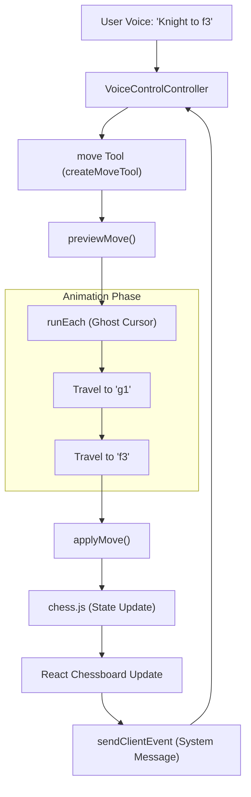
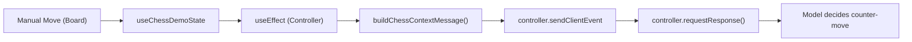

<!-- source: DeepWiki mcp.deepwiki.com · repo openai/realtime-voice-component · page 7.2 Chess Demo · fetched 2026-10-26 -->

# Chess Demo

Relevant source files

The following files were used as context for generating this wiki page:

- [demo/src/demos/chess/config.ts](demo/src/demos/chess/config.ts)
- [demo/src/demos/chess/controller.ts](demo/src/demos/chess/controller.ts)
- [demo/src/demos/chess/engine.ts](demo/src/demos/chess/engine.ts)
- [demo/src/demos/chess/index.tsx](demo/src/demos/chess/index.tsx)
- [demo/src/demos/chess/state.ts](demo/src/demos/chess/state.ts)
- [demo/src/demos/chess/tools.ts](demo/src/demos/chess/tools.ts)
- [demo/src/demos/form/index.tsx](demo/src/demos/form/index.tsx)

The Chess Demo demonstrates a complex integration between a voice-controlled AI, a third-party UI component (`react-chessboard`), and a local chess engine. It showcases advanced state management, multi-step cursor animations, and "Auto-Reply" patterns where the AI reacts to manual user interactions on the board.

## Architectural Overview

The demo is built on three primary pillars:
1.  **State Management**: A custom hook `useChessDemoState` [demo/src/demos/chess/state.ts:291-303]() that wraps `chess.js` to manage the game logic, move validation, and history.
2.  **Voice Controller**: The `useChessDemoVoiceController` [demo/src/demos/chess/controller.ts:53-68]() hook which bridges the application state to the `VoiceControlController`.
3.  **Engine Integration**: A local chess engine integration [demo/src/demos/chess/engine.ts:33-87]() providing move recommendations.

### Data Flow: Natural Language to Board Action

The following diagram illustrates how a user's spoken command (e.g., "Move my knight to f3") is transformed into a validated move and UI animation.

**Move Execution Pipeline**

Sources: [demo/src/demos/chess/controller.ts:97-103](), [demo/src/demos/chess/tools.ts:103-162](), [demo/src/demos/chess/state.ts:294-297]()

## State & Engine Integration

The demo uses `chess.js` for move validation and FEN (Forsyth-Edwards Notation) generation. The `useChessDemoState` hook maintains a `ChessDemoState` object [demo/src/demos/chess/state.ts:91-99]() which includes the current FEN, turn, history, and active hints.

### Engine Recommendations
The demo integrates `js-chess-engine` via `getBestMoveForFen` [demo/src/demos/chess/engine.ts:33-87](). This allows the AI to "think" about the board by calling the `get_best_move` tool [demo/src/demos/chess/tools.ts:201-210](), which returns a `ChessEngineRecommendation` [demo/src/demos/chess/engine.ts:4-15]().

## Voice Tools

The chess demo defines a specific set of tools using `defineVoiceTool` to allow the model to interact with the board and game state.

| Tool Name | Purpose | Implementation |
| :--- | :--- | :--- |
| `move` | Plays a move using SAN (e.g., "e4") or coordinates. | `createMoveTool` [demo/src/demos/chess/tools.ts:91-164]() |
| `show_hint` | Highlights legal moves from a specific square. | `createShowHintTool` [demo/src/demos/chess/tools.ts:166-189]() |
| `get_board_state` | Returns current FEN, turn, and status to the model. | `createGetBoardStateTool` [demo/src/demos/chess/tools.ts:191-199]() |
| `get_best_move` | Consults the engine for the strongest move. | `createGetBestMoveTool` [demo/src/demos/chess/tools.ts:201-210]() |
| `undo_move` | Reverts the last move in the history. | `createUndoMoveTool` [demo/src/demos/chess/tools.ts:213-226]() |
| `reset_board` | Restarts the game to the initial position. | `createResetBoardTool` [demo/src/demos/chess/tools.ts:228-242]() |

Sources: [demo/src/demos/chess/tools.ts:1-242]()

## Auto-Reply & Context Sync

A key feature of the Chess Demo is the ability for the AI to react to moves made manually by the user on the board (drag-and-drop).

### System Context Messages
Whenever the board state changes (move, undo, or reset), the `useChessDemoVoiceController` sends a system message to the model [demo/src/demos/chess/controller.ts:162-189](). This message is built using `buildChessContextMessage` [demo/src/demos/chess/config.ts:56-106](), providing the model with:
*   The move played (in SAN).
*   The source of the move (`board` vs `tool`).
*   The new FEN and game status (Check, Checkmate, etc.).

### Response Triggering
If the move source is `board` (manual user move), the controller calls `controller.requestResponse()` [demo/src/demos/chess/controller.ts:187-188](). This prompts the model to evaluate the new position and potentially play a counter-move if the user has requested "auto-reply" mode in the conversation instructions [demo/src/demos/chess/config.ts:22-25]().

**Context Sync Logic**

Sources: [demo/src/demos/chess/controller.ts:162-189](), [demo/src/demos/chess/config.ts:56-74]()

## Cursor Animations

The Chess Demo utilizes `useGhostCursor` to provide visual feedback for AI actions. 

### Square Targeting
The `getSquareElement` function [demo/src/demos/chess/controller.ts:179-180]() uses a selector `[data-square="${square}"]` to find the specific DOM element within the `react-chessboard` component.

### Multi-Square Sequences
For the `move` tool, the demo uses the `runEach` pattern [demo/src/demos/chess/tools.ts:117-144](). If a move involves a "from" and "to" square, the ghost cursor:
1.  Travels to the `from` square.
2.  Travels to the `to` square.
3.  Executes the `applyMove` callback only after the final travel segment is complete [demo/src/demos/chess/tools.ts:133-139]().

Sources: [demo/src/demos/chess/tools.ts:117-144](), [demo/src/demos/chess/controller.ts:178-180]()

---

