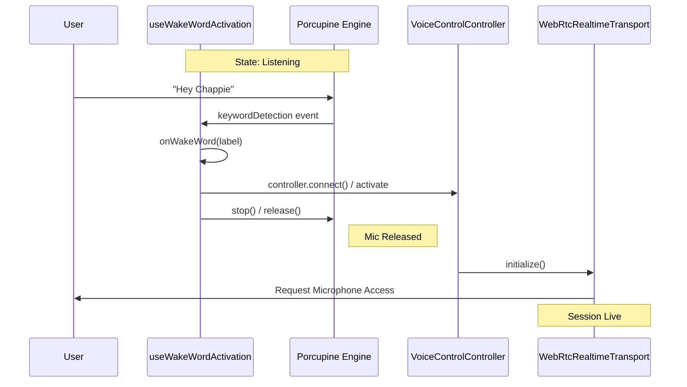
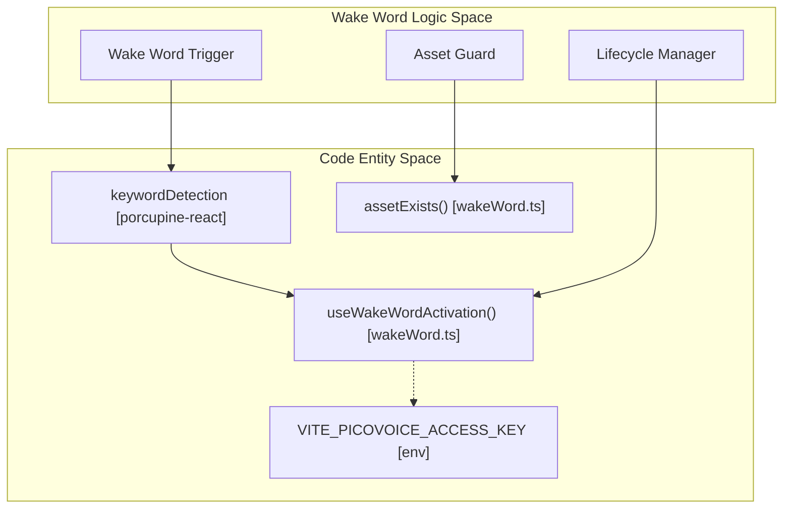

<!-- source: DeepWiki mcp.deepwiki.com · repo openai/realtime-voice-component · page 7.3 Wake Word Activation · fetched 2026-10-26 -->

# Wake Word Activation

<details>
<summary>Relevant source files</summary>

The following files were used as context for generating this wiki page:

- [demo/AGENTS.md](demo/AGENTS.md)
- [demo/src/demos/overview/index.tsx](demo/src/demos/overview/index.tsx)
- [demo/src/demos/shared/wakeWord.ts](demo/src/demos/shared/wakeWord.ts)
- [docs/README.md](docs/README.md)
- [docs/demo-architecture.md](docs/demo-architecture.md)
- [test/useWakeWordActivation.test.tsx](test/useWakeWordActivation.test.tsx)

</details>


Wake-word activation is an optional interaction layer that allows the voice assistant to be triggered by a specific phrase (e.g., "Hey Chappie") rather than manual button interaction. This functionality is intentionally excluded from the core package to keep the runtime lightweight and avoid heavy dependencies like WASM-based audio processors [docs/demo-architecture.md:79-88](). Instead, the demo application demonstrates how to layer this capability on top of the `VoiceControlController` using the Picovoice Porcupine engine [demo/src/demos/shared/wakeWord.ts:3-10]().

## Overview and Purpose

The wake-word system acts as a "pre-activation" gate. It monitors the microphone in a low-power state while the main voice widget is idle. Once the keyword is detected, it programmatically activates the controller.

Key architectural principles include:
- **Separation of Concerns**: The core package remains agnostic of how it is activated [docs/demo-architecture.md:88-89]().
- **Microphone Handoff**: Because only one system can own the microphone capture at a time in most browser environments, the wake-word engine must explicitly release the microphone before the WebRTC transport begins its session [demo/src/demos/shared/wakeWord.ts:227-230]().
- **Asset Validation**: Since wake-word engines often require large external model files (`.ppn`, `.pv`), the system includes a robust check to ensure these assets are hosted and accessible before attempting initialization [demo/src/demos/shared/wakeWord.ts:65-93]().

## The useWakeWordActivation Hook

The `useWakeWordActivation` hook manages the lifecycle of the Porcupine worker, asset fetching, and the handoff logic.

### Implementation Details

The hook utilizes `usePorcupine` from `@picovoice/porcupine-react` [demo/src/demos/shared/wakeWord.ts:109-110](). It follows a strict state machine to transition from checking assets to active listening.

| State | Description |
| :--- | :--- |
| `checking` | Verifying if `.ppn` and `.pv` files exist on the server via `HEAD` or `GET` requests [demo/src/demos/shared/wakeWord.ts:65-93](). |
| `loading` | Initializing the Porcupine engine with the provided Access Key [demo/src/demos/shared/wakeWord.ts:162-171](). |
| `ready` | Actively listening for the keyword "Hey Chappie" [demo/src/demos/shared/wakeWord.ts:252-254](). |
| `unavailable` | Assets are missing or the Picovoice Access Key is not configured [demo/src/demos/shared/wakeWord.ts:244-248](). |

### Microphone Control Flow

A critical part of the implementation is ensuring the wake-word engine stops as soon as the widget is activated to prevent `NotReadableError` in the WebRTC layer [test/useWakeWordActivation.test.tsx:68-78]().



**Sources:** [demo/src/demos/shared/wakeWord.ts:227-231](), [test/useWakeWordActivation.test.tsx:68-78](), [docs/demo-architecture.md:82-87]().

## Technical Data Flow

The hook monitors the `keywordDetection` state provided by the Porcupine runtime. When a detection occurs, it triggers the `onWakeWord` callback provided by the consumer [demo/src/demos/shared/wakeWord.ts:220-221]().

### Code Entity Mapping

The following diagram maps the logical wake-word concepts to the specific code entities in the demo implementation.



**Sources:** [demo/src/demos/shared/wakeWord.ts:95-110](), [demo/src/demos/shared/wakeWord.ts:65-66](), [demo/src/demos/shared/wakeWord.ts:100-101]().

## Key Functions and Logic

### Asset Verification
Before initializing the WASM worker, the hook verifies that the keyword file (`.ppn`) and model parameters (`.pv`) are available at the expected public paths [demo/src/demos/shared/wakeWord.ts:5-7](). It explicitly checks that the response is not an HTML fallback (common in SPA routing) by inspecting the `content-type` header [demo/src/demos/shared/wakeWord.ts:61-63]().

### Activation Constraints
The system respects a `canActivateWidget` flag. If the widget is already active or in a state where it cannot be engaged, the wake-word engine is stopped to save resources [demo/src/demos/shared/wakeWord.ts:186-191](). This prevents "stale" detections from triggering the assistant if the user manually closed it moments prior [test/useWakeWordActivation.test.tsx:91-111]().

### Cooldown Mechanism
To prevent rapid-fire re-activations, a `DETECTION_COOLDOWN_MS` (default 3000ms) is enforced between successful detections [demo/src/demos/shared/wakeWord.ts:8](), [demo/src/demos/shared/wakeWord.ts:214-219]().

## Integration Example

In the demo application, the wake-word hook is integrated within the `DemoSessionProvider` to provide global activation capabilities across different demo routes.

```typescript
// Conceptual usage in the demo
useWakeWordActivation({
  enabled: isWakeWordEnabled,
  canActivateWidget: controller.status === "idle",
  onWakeWord: (label) => {
    if (controller.status === "idle") {
      controller.connect();
      return true; // Successfully handled
    }
    return false;
  },
});
```

**Sources:** [demo/src/demos/shared/wakeWord.ts:95-99](), [docs/demo-architecture.md:16-21]().

---

