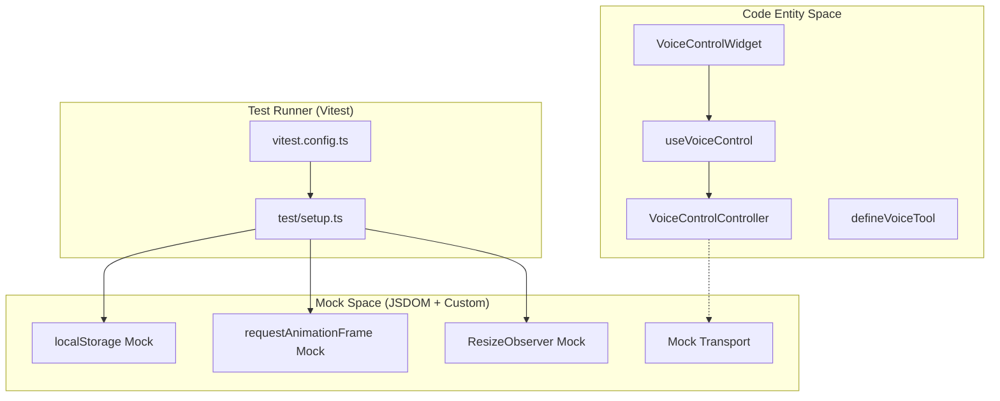
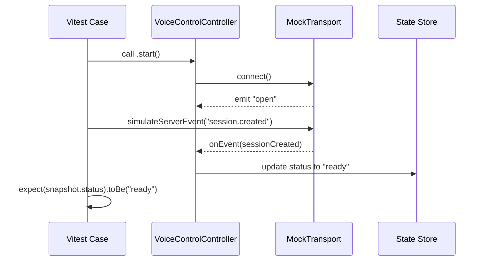

<!-- source: DeepWiki mcp.deepwiki.com · repo openai/realtime-voice-component · page 8 Testing · fetched 2026-10-26 -->

# Testing

Relevant source files

The following files were used as context for generating this wiki page:

- [demo/components.json](demo/components.json)
- [demo/src/App.tsx](demo/src/App.tsx)
- [demo/tsconfig.json](demo/tsconfig.json)
- [demo/vite.config.ts](demo/vite.config.ts)
- [test/serverImportSmoke.test.ts](test/serverImportSmoke.test.ts)
- [test/setup.ts](test/setup.ts)
- [test/vite-env.d.ts](test/vite-env.d.ts)
- [tsconfig.base.json](tsconfig.base.json)
- [tsconfig.json](tsconfig.json)
- [vitest.config.ts](vitest.config.ts)

The `realtime-voice-component` test suite is designed to ensure the reliability of the voice controller, the accuracy of tool definitions, and the stability of UI components across different environments. The infrastructure leverages **Vitest** with a **JSDOM** environment to simulate browser behavior, supplemented by custom mocks for Web APIs not natively supported in JSDOM.

## Test Infrastructure

The testing environment is configured in `vitest.config.ts` [vitest.config.ts:1-27](). It defines a comprehensive setup that includes:

*   **Environment**: Uses `jsdom` for React component and hook testing [vitest.config.ts:15-15]().
*   **Path Aliasing**: Configures `@/*` to point to the demo source and maps the package name to the local source for integration testing [vitest.config.ts:7-12]().
*   **Coverage**: Uses the `v8` provider to track coverage across all source files, excluding type definitions and the demo application [vitest.config.ts:18-24]().
*   **Global Mocks**: The `test/setup.ts` file polyfills several browser APIs missing in JSDOM, including `localStorage` [test/setup.ts:5-35](), `matchMedia` [test/setup.ts:37-53](), `requestAnimationFrame` [test/setup.ts:55-67](), and `ResizeObserver` [test/setup.ts:69-85]().

### Test Architecture Overview

The following diagram illustrates how the test suite interacts with the codebase entities and the simulated browser environment.

**Test System Mapping**

Sources: [vitest.config.ts:1-27](), [test/setup.ts:1-90]()

## Categories of Tests

The suite is divided into three primary categories to balance granular verification with high-level integration safety.

### 1. Unit & Integration Tests
These tests focus on the logical correctness of individual units and their interactions. They utilize a **Mock Transport** to simulate OpenAI Realtime Server events without making actual network requests. Key areas include:
*   **Controller Logic**: Verifying state transitions and task queue processing.
*   **Hooks**: Testing `useVoiceControl` and `useGhostCursor` lifecycle events.
*   **Utilities**: Math-heavy logic like `cornerSnap` and tool validation in `defineVoiceTool`.

For details, see [Unit & Integration Tests](#8.1).

### 2. Type-Check Tests
Because the library relies heavily on TypeScript for tool schema validation and session options, the suite includes `.typecheck.ts` files. These do not execute at runtime; instead, they use the TypeScript compiler to ensure that invalid configurations (e.g., passing a plain JSON schema instead of a Zod schema to `defineVoiceTool`) result in compile-time errors.

For details, see [Type-Check & Smoke Tests](#8.2).

### 3. Smoke & Environment Tests
These tests ensure the library behaves correctly in specific environments:
*   **Server Import Smoke Test**: Verifies that the package can be imported in a Node.js environment (SSR) without crashing due to missing browser globals like `window` or `navigator` [test/serverImportSmoke.test.ts:5-14]().
*   **Demo App Integration**: A high-level test that renders the main `App` component [demo/src/App.tsx:10-25]() to ensure all routes and providers are wired correctly.

For details, see [Type-Check & Smoke Tests](#8.2).

## Test Data Flow

The following diagram shows how a test case interacts with the system, specifically highlighting the "Mock Transport" which bridges the gap between the Controller and the simulated Realtime API.

**Mock Transport Interaction**

Sources: [test/serverImportSmoke.test.ts:1-15](), [vitest.config.ts:14-25]()

## Summary Table of Test Files

| Category | Key Files | Purpose |
| :--- | :--- | :--- |
| **Infrastructure** | `vitest.config.ts`, `test/setup.ts` | Environment config and Web API polyfills. |
| **Logic/Hooks** | `test/**/*.test.ts(x)` | Unit tests for hooks, components, and controller. |
| **Type Safety** | `test/**/*.typecheck.ts` | Static analysis of Zod schemas and options. |
| **SSR Safety** | `test/serverImportSmoke.test.ts` | Ensures Node.js compatibility for SSR. |
| **Demo App** | `test/demoApp.test.tsx` | Integration test for the reference implementation. |

Sources: [vitest.config.ts:16-17](), [test/serverImportSmoke.test.ts:5-14](), [test/setup.ts:1-90]()

---

