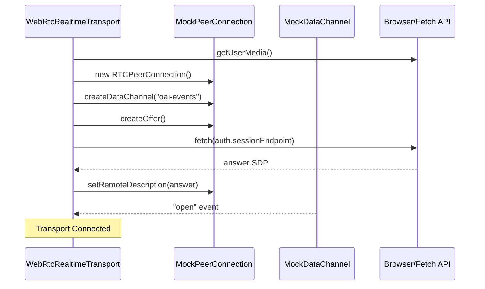
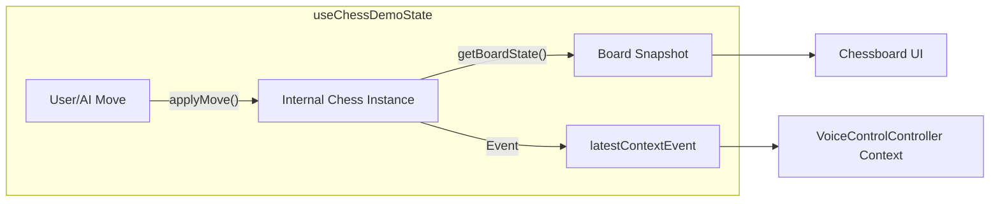

<!-- source: DeepWiki mcp.deepwiki.com · repo openai/realtime-voice-component · page 8.1 Unit & Integration Tests · fetched 2026-10-26 -->

# Unit & Integration Tests

<details>
<summary>Relevant source files</summary>

The following files were used as context for generating this wiki page:

- [src/defineVoiceTool.ts](src/defineVoiceTool.ts)
- [src/transport/mockRealtimeTransport.ts](src/transport/mockRealtimeTransport.ts)
- [src/transport/types.ts](src/transport/types.ts)
- [test/chessDemoState.test.tsx](test/chessDemoState.test.tsx)
- [test/cornerSnap.test.ts](test/cornerSnap.test.ts)
- [test/defineVoiceTool.test.ts](test/defineVoiceTool.test.ts)
- [test/useGhostCursor.test.tsx](test/useGhostCursor.test.tsx)
- [test/useVoiceControl.test.tsx](test/useVoiceControl.test.tsx)
- [test/voiceToolDefinition.typecheck.ts](test/voiceToolDefinition.typecheck.ts)
- [test/webRtcRealtimeTransport.test.ts](test/webRtcRealtimeTransport.test.ts)

</details>


This page documents the testing infrastructure and patterns used to ensure the reliability of the `realtime-voice-component` library. The test suite covers core hooks, transport implementations, UI utility logic, and demo application state.

## Overview of Testing Strategy

The codebase utilizes **Vitest** for unit and integration testing. Tests are categorized into:
1.  **Hook & State Tests**: Validating `useVoiceControl` and `useGhostCursor` using `@testing-library/react`.
2.  **Transport Tests**: Verifying the `WebRtcRealtimeTransport` against mocked browser WebRTC APIs.
3.  **Utility Tests**: Ensuring pure logic like `cornerSnap` and `defineVoiceTool` behaves correctly.
4.  **Integration Tests**: Mocking the OpenAI Realtime Server events to test the full lifecycle of tool calls and session updates.

### Mock Transport Usage
To test high-level hooks without network dependencies, the `MockRealtimeTransport` class is used. It implements the `RealtimeTransport` interface and allows tests to inspect sent client events and manually emit server events.

**Mock Transport Data Flow**
```mermaid
graph TD
    subgraph "Test Environment"
        [Test_Case] -- "emitServerEvent()" --> M["MockRealtimeTransport"]
        M -- "onServerEvent()" --> C["VoiceControlController"]
        C -- "sendClientEvent()" --> M
        M -- "inspect sentClientEvents" --> [Test_Case]
    end
```
Sources: `[src/transport/mockRealtimeTransport.ts:6-73]()`, `[test/useVoiceControl.test.tsx:231-250]()`

---

## Core Hook Testing (`useVoiceControl`)

The `useVoiceControl.test.tsx` file contains comprehensive integration tests for the primary entry point of the library. It uses a `HookHarness` to mount the hook and interact with a `MockRealtimeTransport`.

### Key Scenarios Tested
*   **Connection Lifecycle**: Verifying transitions from `disconnected` to `connecting` and `connected`.
*   **Session Updates**: Ensuring `updateInstructions` and `updateSession` trigger the correct `session.update` client events.
*   **Tool Call Pipeline**: Mocking `response.output_item.done` events from the server and verifying that the `execute` function of a `VoiceTool` is called with parsed arguments.
*   **Deduplication**: Confirming that the same `call_id` does not trigger multiple executions.

| Feature | Verification Method |
| :--- | :--- |
| **Tool Execution** | `vi.fn()` spy on the `execute` callback of `defineVoiceTool`. |
| **Transcript Sync** | Checking `controller.transcript` after `conversation.item.created`. |
| **Event Callbacks** | Ensuring `onEvent` and `onToolStart` hooks are triggered. |

Sources: `[test/useVoiceControl.test.tsx:64-159]()`, `[test/useVoiceControl.test.tsx:230-260]()`

---

## WebRTC Transport Testing

Testing `WebRtcRealtimeTransport` requires mocking global browser APIs including `RTCPeerConnection`, `navigator.mediaDevices.getUserMedia`, and `fetch`.

### Setup and Cleanup
The `setupTransportTest` function stubs these globals to track calls to `createDataChannel`, `setLocalDescription`, and `addTrack`.

**WebRTC Connection Sequence**

Sources: `[test/webRtcRealtimeTransport.test.ts:68-101]()`, `[test/webRtcRealtimeTransport.test.ts:113-131]()`

### Error Handling Tests
Tests ensure that if the data channel fails to open within `DATA_CHANNEL_OPEN_TIMEOUT_MS` (15 seconds), the transport rejects the connection and stops all media tracks.
Sources: `[test/webRtcRealtimeTransport.test.ts:183-200]()`, `[test/webRtcRealtimeTransport.test.ts:205-221]()`

---

## UI Logic & Animation Tests

### Ghost Cursor (`useGhostCursor`)
Tests for the ghost cursor focus on the coordinate math and phase transitions (`hidden` -> `traveling` -> `arrived`).
*   **Reduced Motion**: Verifies that when `prefers-reduced-motion` is active, the cursor jumps immediately to the destination without the 1.2s travel time.
*   **Element Targeting**: Uses `getBoundingClientRect` mocks to ensure the cursor calculates the center of a DOM element correctly.
*   **Interaction Dismissal**: Confirms that a `scroll` event on the window hides the active cursor.

Sources: `[test/useGhostCursor.test.tsx:93-110]()`, `[test/useGhostCursor.test.tsx:112-150]()`, `[test/useGhostCursor.test.tsx:152-180]()`

### Corner Snapping (`cornerSnap`)
The `clampPositionToViewport` utility is tested to ensure the `VoiceControlWidget` stays within screen boundaries, accounting for padding and widget dimensions.
Sources: `[test/cornerSnap.test.ts:6-32]()`

---

## Tool Definition & Schema Validation

The `defineVoiceTool` utility is tested to enforce the requirement of **Zod** schemas.

| Test Case | Expectation |
| :--- | :--- |
| **Zod Normalization** | Converts Zod object to JSON Schema for OpenAI wire format. |
| **Argument Parsing** | `tool.parseArguments()` correctly handles JSON strings and returns typed objects. |
| **Legacy Rejection** | Throws an error if a plain JSON object is passed instead of a Zod schema. |

Sources: `[src/defineVoiceTool.ts:4-26]()`, `[test/defineVoiceTool.test.ts:7-51]()`

---

## Demo State Integration

The Chess demo logic is tested in `chessDemoState.test.tsx` using `renderHook`. This validates the complex state machine governing:
1.  **Move Application**: Ensuring `applyMove` updates the FEN string and turn.
2.  **Illegal Moves**: Verifying that invalid moves are rejected without mutating the board.
3.  **Context Events**: Checking that moves generate `latestContextEvent` payloads used to provide the LLM with current game state.

**Chess State Flow**

Sources: `[test/chessDemoState.test.tsx:9-29]()`, `[test/chessDemoState.test.tsx:31-119]()`

---

