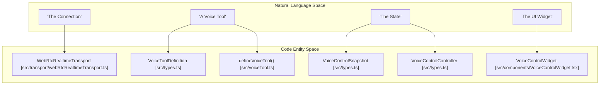

<!-- source: DeepWiki mcp.deepwiki.com · repo openai/realtime-voice-component · page 9 Glossary · fetched 2026-10-26 -->

# Glossary

<details>
<summary>Relevant source files</summary>

The following files were used as context for generating this wiki page:

- [LLM.txt](LLM.txt)
- [README.md](README.md)
- [demo/session-server.mjs](demo/session-server.mjs)
- [docs/api/functions/createVoiceControlController.md](docs/api/functions/createVoiceControlController.md)
- [docs/api/type-aliases/ActivationMode.md](docs/api/type-aliases/ActivationMode.md)
- [docs/api/type-aliases/GhostCursorTarget.md](docs/api/type-aliases/GhostCursorTarget.md)
- [docs/api/type-aliases/KnownRealtimeModel.md](docs/api/type-aliases/KnownRealtimeModel.md)
- [docs/api/type-aliases/KnownRealtimeTranscriptionModel.md](docs/api/type-aliases/KnownRealtimeTranscriptionModel.md)
- [docs/api/type-aliases/KnownRealtimeVoice.md](docs/api/type-aliases/KnownRealtimeVoice.md)
- [docs/api/type-aliases/OutputMode.md](docs/api/type-aliases/OutputMode.md)
- [docs/api/type-aliases/RealtimeModel.md](docs/api/type-aliases/RealtimeModel.md)
- [docs/api/type-aliases/RealtimeTracing.md](docs/api/type-aliases/RealtimeTracing.md)
- [docs/api/type-aliases/RealtimeTranscriptionModel.md](docs/api/type-aliases/RealtimeTranscriptionModel.md)
- [docs/api/type-aliases/RealtimeTruncation.md](docs/api/type-aliases/RealtimeTruncation.md)
- [docs/api/type-aliases/RealtimeVoice.md](docs/api/type-aliases/RealtimeVoice.md)
- [docs/api/type-aliases/UseGhostCursorReturn.md](docs/api/type-aliases/UseGhostCursorReturn.md)
- [docs/api/type-aliases/UseVoiceControlReturn.md](docs/api/type-aliases/UseVoiceControlReturn.md)
- [docs/api/type-aliases/VoiceControlActivity.md](docs/api/type-aliases/VoiceControlActivity.md)
- [docs/api/type-aliases/VoiceControlController.md](docs/api/type-aliases/VoiceControlController.md)
- [docs/api/type-aliases/VoiceControlRealtimeSessionOptions.md](docs/api/type-aliases/VoiceControlRealtimeSessionOptions.md)
- [docs/api/type-aliases/VoiceControlRealtimeSessionPatch.md](docs/api/type-aliases/VoiceControlRealtimeSessionPatch.md)
- [docs/api/type-aliases/VoiceControlResolvedSessionConfig.md](docs/api/type-aliases/VoiceControlResolvedSessionConfig.md)
- [docs/api/type-aliases/VoiceControlSnapshot.md](docs/api/type-aliases/VoiceControlSnapshot.md)
- [docs/api/type-aliases/VoiceControlStatus.md](docs/api/type-aliases/VoiceControlStatus.md)
- [docs/api/type-aliases/VoiceToolCallRecord.md](docs/api/type-aliases/VoiceToolCallRecord.md)
- [docs/authentication.md](docs/authentication.md)
- [docs/getting-started.md](docs/getting-started.md)
- [docs/integrating-with-an-existing-app.md](docs/integrating-with-an-existing-app.md)
- [src/transport/webRtcRealtimeTransport.ts](src/transport/webRtcRealtimeTransport.ts)
- [src/types.ts](src/types.ts)
- [src/useGhostCursor.ts](src/useGhostCursor.ts)
- [src/voiceControlController.ts](src/voiceControlController.ts)

</details>


This page provides definitions for the domain-specific terminology, architectural concepts, and type definitions used throughout the `realtime-voice-component` codebase.

## Core Domain Terms

| Term | Definition | Code Reference |
| :--- | :--- | :--- |
| **Activation Mode** | Determines how the microphone is triggered. `vad` (Voice Activity Detection) uses server-side logic to detect speech, while `push-to-talk` requires manual user toggling. | [src/types.ts:24-24]() |
| **Output Mode** | Controls the modality of the assistant's response. Options include `audio`, `text`, `text+audio`, or `tool-only` (where no verbal/textual response is generated). | [src/types.ts:26-26]() |
| **Tool Call** | A request from the OpenAI model to execute a specific function defined in the client application. | [src/types.ts:173-177]() |
| **Session Proxy** | A backend endpoint that forwards WebRTC SDP and session configuration to OpenAI to avoid exposing API keys in the browser. | [README.md:152-171]() |
| **Ghost Cursor** | A visual overlay that simulates a "cursor" moving to UI elements to provide feedback when a voice tool acts upon the interface. | [docs/integrating-with-an-existing-app.md:166-168]() |

### Natural Language to Code Entity Mapping
The following diagram maps high-level system concepts to the specific TypeScript entities and functions that implement them.

**System Concept Mapping**

Sources: [src/types.ts:11-19]() [src/types.ts:225-230]() [src/transport/webRtcRealtimeTransport.ts:237-237]()

## State and Activity Definitions

The system distinguishes between **Status** (the high-level connectivity state) and **Activity** (what the controller is doing at a granular level).

### VoiceControlStatus
High-level state used primarily for UI rendering and logical branching in hooks.
*   `idle`: No session active.
*   `connecting`: Negotiating WebRTC and SDP.
*   `ready`: Connected but not currently capturing audio (in push-to-talk).
*   `listening`: Actively streaming audio to the server.
*   `processing`: Server is generating a response.
*   `error`: A terminal or recoverable error state.

Sources: [docs/api/type-aliases/VoiceControlStatus.md:8-8]() [src/voiceControlController.ts:224-251]()

### VoiceControlActivity
Granular internal states tracked by the `VoiceControlController`.
*   `executing`: Specifically indicates that an asynchronous tool `execute` callback is currently running.

Sources: [src/types.ts:149-155]()

**Activity State Machine Transitions**
```mermaid
stateDiagram-v2
    [*] --> "idle"
    "idle" --> "connecting" : "controller.connect()"
    "connecting" --> "listening" : "VAD enabled"
    "connecting" --> "ready" : "Push-to-talk"
    "listening" --> "processing" : "Server VAD triggers"
    "processing" --> "executing" : "Tool call received"
    "executing" --> "processing" : "Tool finished"
    "processing" --> "listening" : "Response done"
    "error" --> "idle" : "controller.disconnect()"
```
Sources: [src/voiceControlController.ts:224-251]()

## Tooling Concepts

### VoiceTool
A `VoiceTool` is the runtime extension of a `VoiceToolDefinition`. It bridges the gap between a Zod schema and the JSON Schema required by the OpenAI Realtime API.

*   **`parameters`**: A `ZodLikeSchema` used for runtime validation of arguments sent by the model [src/types.ts:220-223]().
*   **`execute`**: The application-defined logic that runs when the model calls the tool [src/types.ts:229-229]().
*   **`jsonSchema`**: The auto-generated JSON Schema derived from the Zod definition for the model's benefit [src/types.ts:233-233]().

### Tool Call Lifecycle
1.  **Discovery**: Server sends `response.done` with a `function_call` item.
2.  **Validation**: Controller uses `tool.parameters.parse()` to validate model-provided arguments [src/types.ts:235-235]().
3.  **Execution**: The `execute()` callback is invoked.
4.  **Reporting**: The result (or error) is sent back via `conversation.item.create` with `role: "tool"` [src/voiceControlController.ts:141-143]().

Sources: [src/types.ts:225-236]() [src/voiceControlController.ts:183-189]()

## Transport and Session

### RealtimeTransport
An interface defining the contract for sending and receiving events. The primary implementation is `WebRtcRealtimeTransport`.
*   **Data Channel**: The `oai-events` RTCDataChannel used for JSON event exchange [src/transport/webRtcRealtimeTransport.ts:8-8]().
*   **SDP Negotiation**: The process of exchanging Session Description Protocol strings between the browser and OpenAI via the Session Proxy [src/transport/webRtcRealtimeTransport.ts:202-223]().

### Session Configuration
*   **`instructions`**: The system prompt that governs assistant behavior [src/types.ts:264-264]().
*   **`turnDetection`**: Configuration for Server VAD, including `threshold`, `prefixPaddingMs`, and `silenceDurationMs` [src/types.ts:75-83]().
*   **`interruptResponse`**: A critical setting for `tool-only` modes; if `false`, new user speech will not cancel an in-flight tool execution [README.md:95-98]().

Sources: [src/types.ts:75-94]() [src/transport/webRtcRealtimeTransport.ts:237-250]() [src/voiceControlController.ts:24-25]()

## Error Codes
Specific error identifiers used to normalize browser, network, and API failures.
*   **`insecure_context`**: Thrown when trying to access the microphone on a non-HTTPS/non-localhost origin [src/types.ts:160-160]().
*   **`device_unavailable`**: The microphone is missing or busy [src/types.ts:159-159]().
*   **`media_timeout`**: Timed out waiting for the WebRTC data channel or audio track [src/types.ts:163-163]().

Sources: [src/types.ts:157-165]() [src/voiceControlController.ts:72-123]()