# Page: Overview

# Overview

<details>
<summary>Relevant source files</summary>

The following files were used as context for generating this wiki page:

- [LLM.txt](LLM.txt)
- [README.md](README.md)
- [demo/AGENTS.md](demo/AGENTS.md)
- [demo/src/demos/overview/index.tsx](demo/src/demos/overview/index.tsx)
- [docs/README.md](docs/README.md)
- [docs/architecture-choices.md](docs/architecture-choices.md)
- [docs/demo-architecture.md](docs/demo-architecture.md)
- [docs/getting-started.md](docs/getting-started.md)
- [docs/integrating-with-an-existing-app.md](docs/integrating-with-an-existing-app.md)
- [package.json](package.json)
- [src/index.ts](src/index.ts)

</details>


The `realtime-voice-component` is a React-based reference implementation for adding voice-driven controls to web applications using the **OpenAI Realtime API**. It is designed specifically for "tool-constrained" UIs where the AI assistant performs narrow, app-defined actions rather than general-purpose automation [README.md:1-28]().

The package provides a high-level state machine to manage WebRTC connections, audio capture, and tool execution, allowing developers to focus on mapping voice commands to existing application logic [README.md:114-124]().

### Key Problems Solved
*   **Complex State Management**: Orchestrates the transition between idle, listening, thinking, and executing states [src/index.ts:55-63]().
*   **Tool Execution Pipeline**: Handles the discovery, validation (via Zod), and reporting of tool calls back to the model [README.md:74-75]().
*   **WebRTC Complexity**: Abstracts SDP negotiation and data channel management through a specialized transport layer [docs/README.md:24-31]().
*   **UI Feedback**: Provides a pre-built launcher widget and a "ghost cursor" system for visual confirmation of AI actions [README.md:30-38]().

---

## System Architecture

The system is organized into five functional layers that bridge the gap between user speech and application state changes.

### Conceptual Flow: Speech to Action
This diagram illustrates how user intent flows from the `RealtimeTransport` through the `VoiceControlController` to trigger application-specific tools.

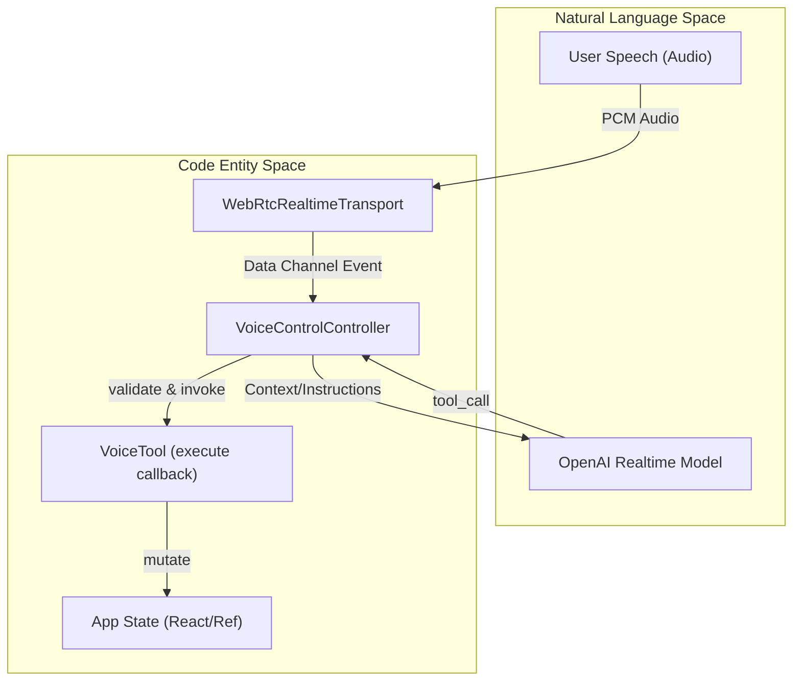
**Sources:** [README.md:74-82](), [docs/README.md:24-31](), [src/index.ts:1-73]()

---

## Major Subsystems

### 1. Core Controller & Hook
The `VoiceControlController` is the central runtime. Created via `createVoiceControlController`, it manages the session lifecycle, transport, and transcript assembly [README.md:76-77](). React components bind to this logic using the `useVoiceControl` hook [src/index.ts:5-8]().
*   For details, see [Core Controller & Hook](#2).

### 2. Tool System
Tools are defined using `defineVoiceTool`, which requires a **Zod schema** for parameter validation [README.md:74-75](). This ensures that the model only sends arguments that match your application's expected types [LLM.txt:101-127]().
*   For details, see [Tool System](#3).

### 3. Transport & Auth
The library uses WebRTC for low-latency audio. The recommended integration uses a `/session` backend proxy to securely handle SDP negotiation and API keys [LLM.txt:38-72]().
*   For details, see [Transport Layer](#4).

### 4. UI Components
The package includes two main visual elements:
*   `VoiceControlWidget`: A floating or inline launcher UI [README.md:80]().
*   `GhostCursorOverlay`: A helper that animates a "cursor" to elements on the screen to provide visual feedback for tool executions [README.md:81-82]().
*   For details, see [UI Components](#6).

---

## Integration Patterns

The library supports two primary architectural shapes depending on whether the voice session is localized to a single view or shared across the entire application.

### Component Relationship Diagram
This diagram shows how the `VoiceControlController` acts as the bridge between the React UI and the underlying Realtime session.

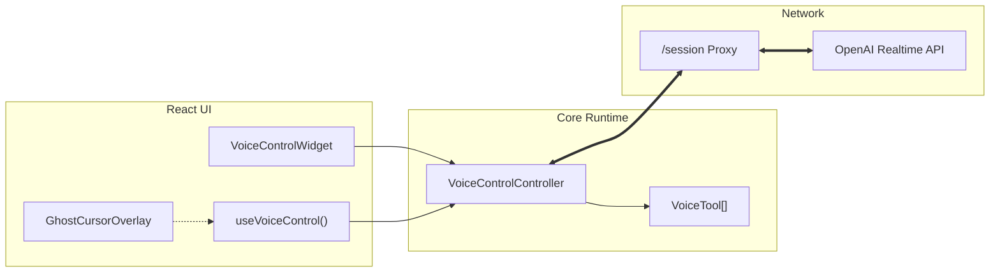
**Sources:** [docs/integrating-with-an-existing-app.md:11-56](), [docs/getting-started.md:72-118]()

### Architectural Choices
*   **Packaged Widget**: Best for fast integration with a standardized launcher [docs/architecture-choices.md:12-19]().
*   **Headless Controller**: Best for custom UI or sessions that must survive route changes [docs/architecture-choices.md:20-26]().
*   **App-Owned Wrapper**: A recommended pattern where a small adapter layer sits between the tools and your real handlers to maintain a single source of truth [docs/integrating-with-an-existing-app.md:11-27]().

For details, see [Architecture Choices](#1.2) and [Getting Started](#1.1).

---

## Demo Reference
The repository includes a `demo/` application that serves as a teaching surface for:
*   **Theme Switching**: Minimal tool integration [demo/src/demos/overview/index.tsx:41-71]().
*   **Form Filling**: Multi-step structured data collection [docs/demo-architecture.md:58-75]().
*   **Chess**: Complex state synchronization and shared controller usage [docs/demo-architecture.md:9-14]().

**Sources:** [README.md:52-61](), [demo/AGENTS.md:1-10]()

---

# Page: Getting Started

# Getting Started

<details>
<summary>Relevant source files</summary>

The following files were used as context for generating this wiki page:

- [LLM.txt](LLM.txt)
- [README.md](README.md)
- [demo/.env.example](demo/.env.example)
- [demo/dev.mjs](demo/dev.mjs)
- [demo/session-server.mjs](demo/session-server.mjs)
- [docs/authentication.md](docs/authentication.md)
- [docs/getting-started.md](docs/getting-started.md)
- [docs/integrating-with-an-existing-app.md](docs/integrating-with-an-existing-app.md)
- [src/transport/webRtcRealtimeTransport.ts](src/transport/webRtcRealtimeTransport.ts)

</details>


This page provides a step-by-step guide for installing the `realtime-voice-component` package, setting up a secure backend session proxy, and wiring your first voice-controlled tool.

The package is designed for React applications where the UI remains the source of truth, and the voice assistant is restricted to a narrow set of app-defined actions [README.md:17-24]().

## Installation

The package is currently distributed as a reference implementation and should be installed from a local checkout of the repository [README.md:10-15]().

1.  **Add the dependency**: Install the package from your local path along with `zod` for tool schema validation [LLM.txt:28-30]().
    ```bash
    npm add ../path/to/realtime-voice-component zod
    ```
2.  **Import Styles**: If using the `VoiceControlWidget` or `GhostCursorOverlay`, import the required CSS in your client-side entry point [LLM.txt:32-36]().
    ```ts
    import "realtime-voice-component/styles.css";
    ```

**Sources:** [README.md:10-15](), [LLM.txt:28-36]()

## Backend Session Proxy Setup

To maintain security, the browser must never hold a long-lived OpenAI API key. Instead, the client sends a WebRTC SDP offer and session configuration to your backend, which proxies the request to OpenAI [docs/authentication.md:3-5]().

### Data Flow: Session Initialization

The following diagram illustrates the flow from the browser through your backend to the OpenAI Realtime API.

**Session Initialization Flow**
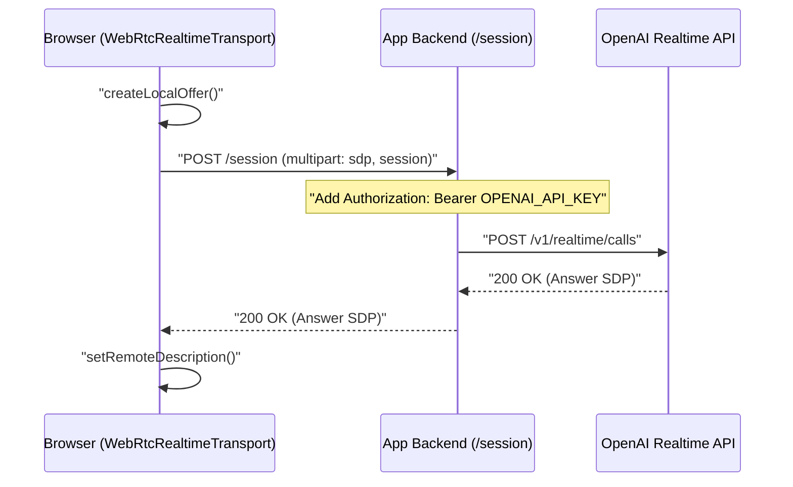

### Implementation Example (Node.js/Express)
Your backend should forward the multipart body to `POST https://api.openai.com/v1/realtime/calls` and return the answer SDP [LLM.txt:48-52]().

```ts
app.post("/session", async (request, response) => {
  const contentType = request.header("content-type");

  const realtimeResponse = await fetch("https://api.openai.com/v1/realtime/calls", {
    method: "POST",
    headers: {
      Authorization: `Bearer ${process.env.OPENAI_API_KEY}`,
      ...(contentType ? { "Content-Type": contentType } : {}),
    },
    body: request,
    duplex: "half",
  });

  response
    .status(realtimeResponse.status)
    .type(realtimeResponse.headers.get("content-type") ?? "application/sdp")
    .send(await realtimeResponse.text());
});
```

**Sources:** [docs/authentication.md:3-5](), [docs/authentication.md:37-58](), [LLM.txt:48-52](), [src/transport/webRtcRealtimeTransport.ts:202-223]()

## Wiring Your First Voice Tool

To integrate voice controls, you must define a tool using `defineVoiceTool` and initialize a `VoiceControlController` [LLM.txt:80-89]().

### 1. Define the Tool
Tools require a `name`, `description`, and a `zod` schema for parameters. The `execute` callback is where your application logic lives [LLM.txt:102-127]().

### 2. Create the Controller
The `createVoiceControlController` manages the WebRTC connection and the tool execution pipeline [LLM.txt:129-137]().

### Code Entity Mapping: Tool Execution
The diagram below shows how high-level voice commands map to specific code entities during a tool call.

**Voice to Code Execution Map**
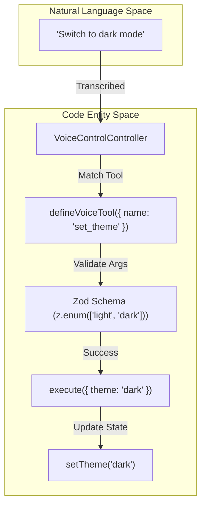

### Minimal Integration Example
```tsx
import { useState, useMemo } from "react";
import { z } from "zod";
import { createVoiceControlController, defineVoiceTool, VoiceControlWidget } from "realtime-voice-component";

export function App() {
  const [theme, setTheme] = useState("light");

  const controller = useMemo(() => {
    const setThemeTool = defineVoiceTool({
      name: "set_theme",
      description: "Set the UI theme.",
      parameters: z.object({ theme: z.enum(["light", "dark"]) }),
      async execute({ theme }) {
        setTheme(theme);
        return { ok: true };
      }
    });

    return createVoiceControlController({
      auth: { sessionEndpoint: "/session" },
      outputMode: "tool-only",
      tools: [setThemeTool]
    });
  }, []);

  return <VoiceControlWidget controller={controller} />;
}
```

**Sources:** [LLM.txt:80-137](), [docs/getting-started.md:76-118](), [src/transport/webRtcRealtimeTransport.ts:237-250]()

## Recommended Defaults

For the best experience in a browser-based UI, follow these default settings:

| Setting | Recommended Value | Reason |
| :--- | :--- | :--- |
| `outputMode` | `"tool-only"` | Focuses the model on acting rather than chatting [LLM.txt:16]() |
| `activationMode` | `"vad"` | Voice Activity Detection is standard for launcher widgets [LLM.txt:20]() |
| `turnDetection` | `server_vad` | Reliable server-side silence detection [README.md:95-102]() |
| `interruptResponse` | `false` | Prevents new speech from canceling in-flight tool calls [README.md:110]() |

**Sources:** [README.md:93-112](), [LLM.txt:14-25](), [docs/getting-started.md:120-132]()

---

# Page: Architecture Choices

# Architecture Choices

<details>
<summary>Relevant source files</summary>

The following files were used as context for generating this wiki page:

- [README.md](README.md)
- [demo/AGENTS.md](demo/AGENTS.md)
- [demo/src/demos/overview/index.tsx](demo/src/demos/overview/index.tsx)
- [docs/README.md](docs/README.md)
- [docs/architecture-choices.md](docs/architecture-choices.md)
- [docs/demo-architecture.md](docs/demo-architecture.md)
- [docs/integrating-with-an-existing-app.md](docs/integrating-with-an-existing-app.md)

</details>


This page outlines the primary integration patterns and architectural philosophies of the `realtime-voice-component` package. Choosing the correct integration shape early ensures that the voice session lifecycle aligns with your application's routing and state management requirements.

## Integration Shapes: Packaged vs. Headless

The package provides two main entry points depending on the level of UI control required: the **Packaged Widget** and the **Headless Controller**.

### 1. Packaged Widget (`VoiceControlWidget`)
The `VoiceControlWidget` is a high-level React component that includes a launcher UI, status indicators, and built-in drag/snap physics [docs/architecture-choices.md:12-18]().

*   **When to use:** Use this for the fastest integration path where a floating or inline "voice bubble" is acceptable. It is ideal for apps where one or two narrow tools are sufficient for the voice experience [docs/architecture-choices.md:12-18]().
*   **Implementation:** It wraps the `useVoiceControl` hook internally but can also accept an external `controller` instance [README.md:72-82]().

### 2. Headless Controller (`createVoiceControlController`)
The headless approach separates the voice runtime logic from the UI. You use `createVoiceControlController` to manage the session and `useVoiceControl` to bind your custom UI to the controller's state [docs/architecture-choices.md:20-26]().

*   **When to use:** Use this when you have existing custom UI controls (e.g., a custom microphone button), require push-to-talk (PTT) behavior, or need the voice session to survive layout/route changes [docs/architecture-choices.md:20-26]().
*   **Implementation:** You manually instantiate the controller and pass it to the hook or components [docs/integrating-with-an-existing-app.md:90-96]().

### Architecture Shape Comparison

| Feature | Packaged Widget | Headless Controller |
| :--- | :--- | :--- |
| **Primary Class/Hook** | `VoiceControlWidget` | `createVoiceControlController` |
| **UI Ownership** | Package-owned (opinionated) | App-owned (custom) |
| **State Access** | Internal | Via `useVoiceControl` hook |
| **Lifecycle** | Tied to component mount | Managed by app/provider |
| **Best For** | Rapid prototyping, VAD launchers | Production-grade custom UI, complex routing |

**Sources:** [docs/architecture-choices.md:3-26](), [README.md:72-82]()

---

## Ownership Patterns

The relationship between the controller and the React component tree determines how the voice session behaves during navigation.

### Single-View Ownership
In this pattern, the controller is created inside a specific screen component. When the user navigates away, the controller is destroyed, and the session ends [docs/integrating-with-an-existing-app.md:73-101]().

**Data Flow: Single-View**
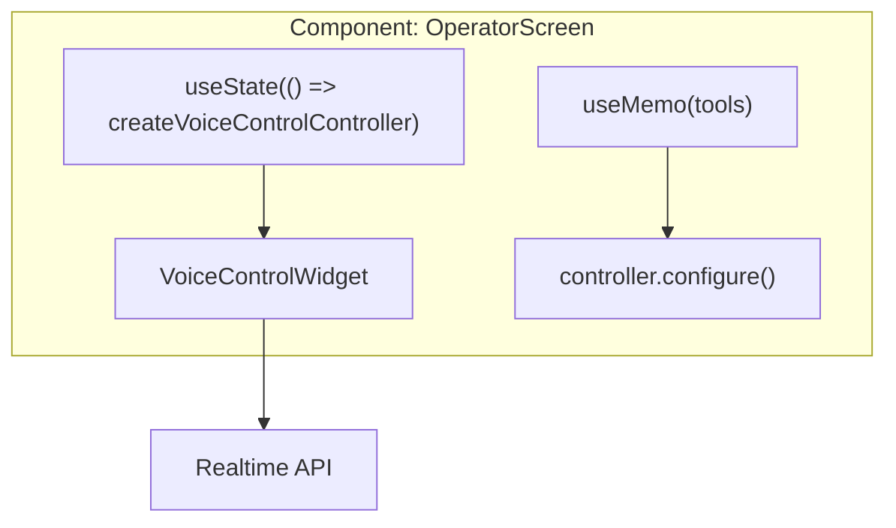
**Sources:** [docs/integrating-with-an-existing-app.md:73-101]()

### Shared-Controller Pattern
For multi-route applications, the controller is hoisted into a `Provider` (e.g., `DemoSessionProvider` in the demo app). This allows the same voice session to persist while the user switches tabs or scenes [docs/demo-architecture.md:23-41](), [docs/integrating-with-an-existing-app.md:102-146]().

**Data Flow: Shared Provider**
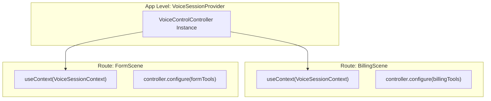
**Sources:** [docs/demo-architecture.md:23-41](), [docs/integrating-with-an-existing-app.md:102-146]()

---

## Philosophy of Narrow Browser Tools

The package is designed for **App-Owned Tools**. This means tools should be narrow, predictable, and act as bridges to existing application logic rather than containing business logic themselves [README.md:114-125](), [docs/architecture-choices.md:27-41]().

### The Voice Adapter Wrapper
The recommended pattern is to create a "Voice Adapter" or wrapper. This wrapper exposes stable methods to the `execute` callback of a tool defined via `defineVoiceTool` [docs/integrating-with-an-existing-app.md:11-27]().

*   **Avoid:** Passing raw React setters (like `setPrompt`) directly into tools, as they may lead to stale closures if not handled carefully [README.md:212-215]().
*   **Prefer:** Using a `useRef` to hold the latest app state and providing a `getState()` method to the tool [docs/integrating-with-an-existing-app.md:171-206]().

**System Entity Mapping: Tool Execution**
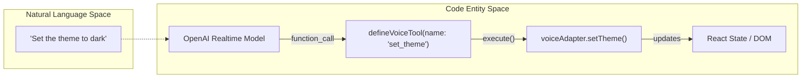
**Sources:** [README.md:173-215](), [docs/integrating-with-an-existing-app.md:151-224](), [demo/src/demos/overview/index.tsx:49-59]()

---

## Wake Word Integration

Wake-word activation (e.g., "Hey Assistant") is explicitly **not** part of the core runtime. It is treated as a separate layer that manages microphone ownership [docs/architecture-choices.md:55-66]().

1.  **Idle State:** The wake-word engine (e.g., Porcupine) owns the microphone [docs/demo-architecture.md:79-88]().
2.  **Activation:** Once the wake word is detected, the engine releases the microphone.
3.  **Handoff:** The `VoiceControlController` is triggered to start, taking over the microphone for the WebRTC session [docs/demo-architecture.md:79-88]().

**Sources:** [docs/architecture-choices.md:55-66](), [docs/demo-architecture.md:79-88]()

---

## When to Use Other Libraries

| Requirement | Recommendation |
| :--- | :--- |
| **React UI + Browser Tools** | Use `realtime-voice-component` (this package) |
| **Custom Audio/Non-React** | Use raw OpenAI Realtime SDK/WebRTC [README.md:39-44]() |
| **Agent Orchestration/MCP** | Use `openai-agents-js` [README.md:45-51]() |
| **Server-side Agents** | Use `openai-agents-js` [docs/architecture-choices.md:67-73]() |

**Sources:** [README.md:30-51](), [docs/architecture-choices.md:67-73]()

---

# Page: Core Controller & Hook

# Core Controller & Hook

<details>
<summary>Relevant source files</summary>

The following files were used as context for generating this wiki page:

- [docs/api-reference.md](docs/api-reference.md)
- [docs/api/functions/createVoiceControlController.md](docs/api/functions/createVoiceControlController.md)
- [docs/api/type-aliases/UseVoiceControlInput.md](docs/api/type-aliases/UseVoiceControlInput.md)
- [docs/api/type-aliases/UseVoiceControlOptions.md](docs/api/type-aliases/UseVoiceControlOptions.md)
- [docs/controller-runtime.md](docs/controller-runtime.md)
- [src/useVoiceControl.ts](src/useVoiceControl.ts)
- [src/voiceControlController.ts](src/voiceControlController.ts)

</details>


The `VoiceControlController` is the central runtime engine of the `realtime-voice-component` library. It manages the lifecycle of the OpenAI Realtime session, coordinates the transport layer, executes tool calls, and maintains a consistent state snapshot. The `useVoiceControl` hook provides the primary React interface to this controller, allowing for both automatic lifecycle management and shared controller patterns.

## The Runtime Architecture

The architecture is designed to decouple the React UI from the complex state machine of the voice session. The `VoiceControlController` acts as a headless state manager that can exist independently of the React component tree.

### High-Level Component Interaction
This diagram shows how the `useVoiceControl` hook bridges the React rendering cycle with the persistent `VoiceControlController` instance.

**Diagram: Hook to Controller Binding**
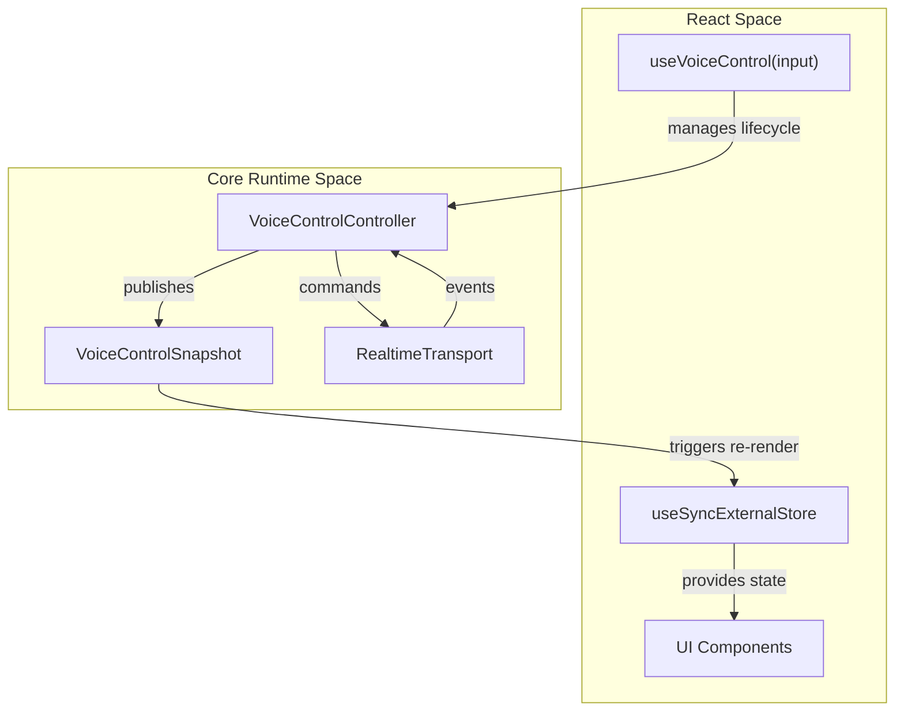
**Sources:** [src/useVoiceControl.ts:16-81](), [src/voiceControlController.ts:224-251]()

## VoiceControlController

The controller is created via `createVoiceControlController(options)` [src/voiceControlController.ts:253](). It is responsible for:
- **Session Management**: Handling `connect()` and `disconnect()` [src/controller-runtime.md:62]().
- **Tool Execution**: Orchestrating the flow from a server `function_call` to the local `execute()` implementation [src/controller-runtime.md:100-109]().
- **State Normalization**: Converting raw server events into a simplified `VoiceControlSnapshot` [src/voiceControlController.ts:224-251]().
- **Configuration**: Dynamically updating `instructions`, `tools`, and `session` parameters without restarting the connection [src/controller-runtime.md:187-193]().

For a deep dive into the task queue and tool pipeline, see [VoiceControlController Internals](#2.1).

## useVoiceControl Hook

The `useVoiceControl` hook is the primary entry point for React applications. It supports two distinct ownership models:

| Model | Input Type | Behavior |
| :--- | :--- | :--- |
| **Hook-Owned** | `UseVoiceControlOptions` | The hook creates the controller on mount and calls `.destroy()` on unmount. |
| **App-Owned** | `VoiceControlController` | The app creates the controller externally (e.g., in a Provider). The hook merely subscribes to it. |

**Sources:** [src/useVoiceControl.ts:16-28](), [src/controller-runtime.md:28-43]()

### Integration Patterns
The hook uses `useSyncExternalStore` to ensure that React components stay in sync with the controller's internal state [src/useVoiceControl.ts:58]().

**Diagram: Entity Mapping**
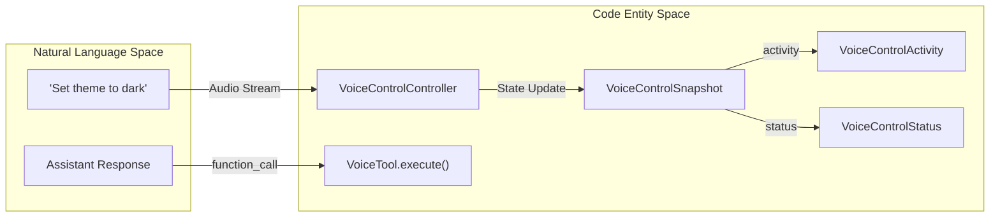
**Sources:** [src/voiceControlController.ts:224-251](), [src/types.ts:1-20]()

## State and Events

The controller maintains a read-only snapshot of the current session state. This includes the connection status, current activity (e.g., "speaking", "thinking"), and a history of tool calls.

- **Status & Activity**: Tracks the high-level state machine (e.g., `idle` -> `connecting` -> `listening`). For details, see [State Model & Snapshot](#2.2).
- **Event Flow**: All events (local and server-side) flow through a unified event system. For details, see [Event System](#2.3).

## Key API Summary

### Methods
The controller (and the object returned by the hook) exposes several methods to control the session:
- `connect()` / `disconnect()`: Manages the WebRTC connection [src/controller-runtime.md:62]().
- `startCapture()` / `stopCapture()`: Manages microphone state for push-to-talk or manual control [src/controller-runtime.md:63]().
- `updateInstructions(text)`: Updates the system prompt [src/controller-runtime.md:64]().
- `updateTools(tools)`: Swaps the available toolset [src/controller-runtime.md:65]().

### Configuration Options
Key options provided to `createVoiceControlController` or `useVoiceControl`:
- `auth`: Authentication configuration (session endpoint or token) [docs/api/type-aliases/UseVoiceControlOptions.md:29-44]().
- `outputMode`: Determines if the assistant replies with `audio`, `text`, or `tool-only` [docs/api-reference.md:67-75]().
- `activationMode`: `vad` (Voice Activity Detection) or `push-to-talk` [docs/api/type-aliases/UseVoiceControlOptions.md:13-17]().

**Sources:** [src/voiceControlController.ts:253](), [docs/api-reference.md:24-58](), [docs/controller-runtime.md:45-70]()

---

# Page: VoiceControlController Internals

# VoiceControlController Internals

<details>
<summary>Relevant source files</summary>

The following files were used as context for generating this wiki page:

- [docs/api/functions/createVoiceControlController.md](docs/api/functions/createVoiceControlController.md)
- [docs/api/type-aliases/UseVoiceControlInput.md](docs/api/type-aliases/UseVoiceControlInput.md)
- [docs/api/type-aliases/UseVoiceControlOptions.md](docs/api/type-aliases/UseVoiceControlOptions.md)
- [docs/api/type-aliases/VoiceControlRealtimeSessionOptions.md](docs/api/type-aliases/VoiceControlRealtimeSessionOptions.md)
- [docs/api/type-aliases/VoiceControlRealtimeSessionPatch.md](docs/api/type-aliases/VoiceControlRealtimeSessionPatch.md)
- [docs/api/type-aliases/VoiceControlResolvedSessionConfig.md](docs/api/type-aliases/VoiceControlResolvedSessionConfig.md)
- [src/internal/session.ts](src/internal/session.ts)
- [src/voiceControlController.ts](src/voiceControlController.ts)

</details>


The `createVoiceControlController` function is the core factory responsible for instantiating the stateful runtime that manages the OpenAI Realtime session. It orchestrates the lifecycle of the connection, handles tool execution, manages the internal task queue, and normalizes errors from various subsystems.

### Implementation Overview

The controller is designed as a singleton-like state machine that bridges the gap between the React UI layer and the low-level `RealtimeTransport`. It maintains a `VoiceControlSnapshot` and notifies subscribers of changes using a pattern compatible with React's `useSyncExternalStore`.

#### Configuration and Initialization
When `createVoiceControlController` is called, it initializes the internal state with default values and resolves the initial session configuration.

*   **Default Model**: `gpt-realtime-1.5` `[src/voiceControlController.ts:23-23]()`
*   **Default Instructions**: A system prompt optimized for UI control and brief responses `[src/voiceControlController.ts:24-25]()`.
*   **Task Queue**: An internal promise-based queue ensures that session operations (connect, disconnect, configure) are processed sequentially to prevent race conditions during transport state transitions.

### Authentication Resolution

The controller supports three distinct authentication patterns via the `auth` property in `UseVoiceControlOptions` `[docs/api/type-aliases/UseVoiceControlOptions.md:29-44]()`. The resolution logic is handled in `resolveClientSecret` `[src/voiceControlController.ts:253-257]()`.

| Pattern | Code Entity | Behavior |
| :--- | :--- | :--- |
| **Session Endpoint** | `sessionEndpoint` | POSTs to a backend proxy to receive a full session object. |
| **Token Endpoint** | `tokenEndpoint` | Fetches an ephemeral client secret from a specialized endpoint. |
| **Secret Callback** | `getClientSecret` | Invokes a user-provided async function to retrieve the secret. |

### Tool Execution Pipeline

The tool execution pipeline is the most complex part of the controller. It manages the transition from a model-generated `function_call` to a validated result.

1.  **Discovery**: The controller listens for `response.done` events from the server `[src/voiceControlController.ts:162-172]()`.
2.  **Parsing**: It extracts items where `type === "function_call"` `[src/voiceControlController.ts:183-189]()`.
3.  **Execution**: For each tool call, it finds the matching `VoiceTool` defined in the configuration.
4.  **Recording**: A `VoiceToolCallRecord` is created with a `status` of `executing` `[src/voiceControlController.ts:36-46]()`.
5.  **Post-Tool Response**: If `postToolResponse` is enabled in options `[docs/api/type-aliases/UseVoiceControlOptions.md:202-206]()`, the controller automatically sends a `response.create` event to the server after the tool execution finishes, allowing the model to acknowledge the tool's output.

#### Tool Pipeline Flow
The following diagram illustrates the flow from a server event to a completed tool execution within the `VoiceControlController`.

**Diagram: Tool Call Execution Pipeline**
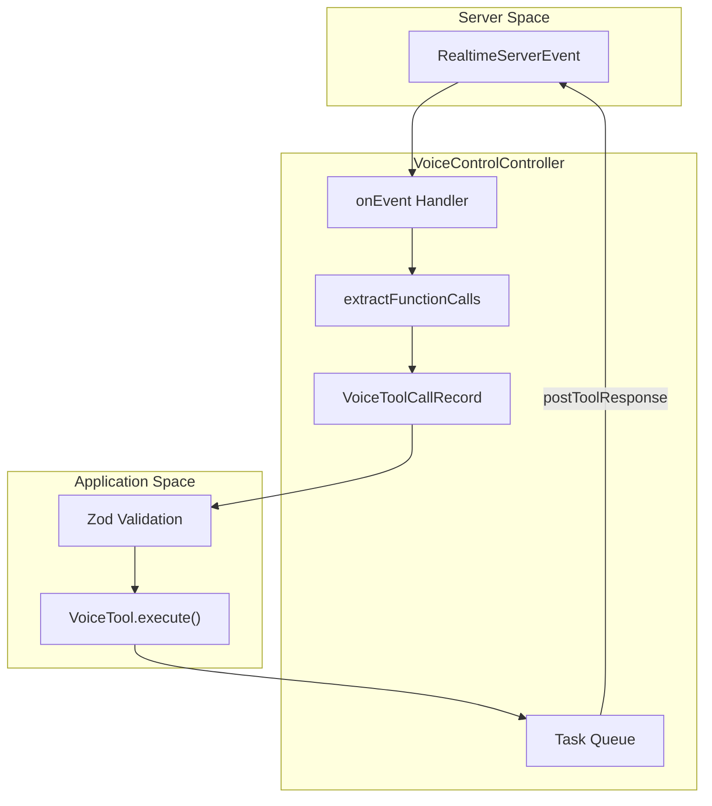
Sources: `[src/voiceControlController.ts:149-222]()`, `[src/voiceControlController.ts:28-46]()`, `[docs/api/type-aliases/UseVoiceControlOptions.md:202-206]()`

### Error Normalization

The controller implements a robust error normalization strategy to map diverse failure modes (WebRTC, Permissions, API) into a consistent `VoiceControlError` type.

*   **Insecure Context**: Triggered when `NotAllowedError` occurs outside of HTTPS or localhost `[src/voiceControlController.ts:84-88]()`.
*   **Device Unavailable**: Maps `NotFoundError` or `NotReadableError` from `getUserMedia` `[src/voiceControlController.ts:90-96]()`.
*   **Network Error**: Specific mapping for fetch failures during client secret resolution `[src/voiceControlController.ts:118-120]()`.

**Diagram: Error Normalization Mapping**
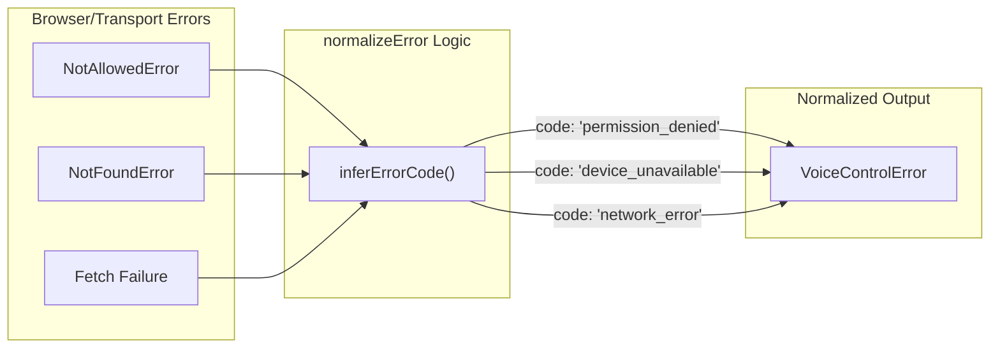
Sources: `[src/voiceControlController.ts:72-123]()`, `[src/voiceControlController.ts:125-143]()`

### Lifecycle: Configure and Destroy

The controller manages its lifecycle through `configure()` and `destroy()` methods, ensuring that resources like microphone streams and data channels are properly released.

#### Configure / Patching
The `configure()` method accepts a `VoiceControlRealtimeSessionPatch` `[docs/api/type-aliases/VoiceControlRealtimeSessionPatch.md:5-8]()`. This allows updating session parameters (like `instructions` or `voice`) without reconnecting the underlying WebRTC transport.
*   **Payload Generation**: The `buildRealtimeSessionPayload` function converts the internal `TransportSessionConfig` into the specific JSON structure required by the OpenAI Realtime API `[src/internal/session.ts:202-225]()`.
*   **Session Updates**: If the transport is active, `configure()` triggers a `session.update` event across the data channel `[src/internal/session.ts:227-227]()`.

#### Destroy
The `destroy()` method is terminal. It:
1.  Aborts any pending tasks in the queue.
2.  Calls `transport.disconnect()`.
3.  Clears all event listeners and subscribers.
4.  Sets the final state to `idle`.

### State Derivation
The controller derives the user-facing `status` from several internal flags: `activity`, `connected`, and `capturing`.

| Internal Activity | Connected | Capturing | Resulting Status |
| :--- | :--- | :--- | :--- |
| `error` | Any | Any | `error` |
| `connecting` | Any | Any | `connecting` |
| Any | `false` | Any | `idle` |
| `processing` | `true` | Any | `processing` |
| Any | `true` | `true` | `listening` |

Sources: `[src/voiceControlController.ts:224-251]()`

---

# Page: State Model & Snapshot

# State Model & Snapshot

<details>
<summary>Relevant source files</summary>

The following files were used as context for generating this wiki page:

- [docs/api-reference.md](docs/api-reference.md)
- [docs/api/type-aliases/UseVoiceControlReturn.md](docs/api/type-aliases/UseVoiceControlReturn.md)
- [docs/api/type-aliases/VoiceControlActivity.md](docs/api/type-aliases/VoiceControlActivity.md)
- [docs/api/type-aliases/VoiceControlController.md](docs/api/type-aliases/VoiceControlController.md)
- [docs/api/type-aliases/VoiceControlSnapshot.md](docs/api/type-aliases/VoiceControlSnapshot.md)
- [docs/api/type-aliases/VoiceControlStatus.md](docs/api/type-aliases/VoiceControlStatus.md)
- [docs/api/type-aliases/VoiceToolCallRecord.md](docs/api/type-aliases/VoiceToolCallRecord.md)
- [docs/controller-runtime.md](docs/controller-runtime.md)
- [src/types.ts](src/types.ts)
- [src/useVoiceControl.ts](src/useVoiceControl.ts)

</details>


The `VoiceControlController` maintains a structured state model that represents the current status of the voice session, user activity, and tool execution history. This state is exposed as a read-only `VoiceControlSnapshot`, which React components consume via a subscription-based synchronization mechanism.

## State Architecture

The controller acts as the single source of truth. It uses an internal state object that is updated in response to transport events, tool execution results, and user interactions.

### VoiceControlSnapshot
The snapshot is a plain object representing the state of the controller at a specific point in time. It is retrieved via `controller.getSnapshot()` [docs/api/type-aliases/VoiceControlController.md:41-43]().

| Property | Type | Description |
| :--- | :--- | :--- |
| `status` | `VoiceControlStatus` | The high-level connectivity and readiness state. |
| `activity` | `VoiceControlActivity` | Detailed real-time activity (listening, processing, etc.). |
| `connected` | `boolean` | Simplified flag for transport connection status. |
| `transcript` | `string` | The most recently assembled transcript text. |
| `toolCalls` | `VoiceToolCallRecord[]` | A history of tool executions in the current session. |
| `latestToolCall` | `VoiceToolCallRecord \| null` | The most recent tool call, regardless of status. |
| `sessionConfig` | `VoiceControlResolvedSessionConfig` | The active configuration resolved from options. |

**Sources:** [docs/api/type-aliases/VoiceControlSnapshot.md:5-66](), [docs/controller-runtime.md:47-58]()

### React Integration via `useSyncExternalStore`
To ensure efficient and tearing-free updates in React, the `useVoiceControl` hook utilizes the `useSyncExternalStore` primitive. It binds the controller's `subscribe` and `getSnapshot` methods to the React lifecycle [src/useVoiceControl.ts:58-58]().

1. **Subscription**: The controller maintains a set of listeners. When internal state changes, it iterates through these listeners to trigger a re-render in subscribed components [docs/api/type-aliases/VoiceControlController.md:49-53]().
2. **Snapshot**: React calls `getSnapshot` to determine if the state has changed since the last render.

**Sources:** [src/useVoiceControl.ts:56-58](), [docs/api/type-aliases/VoiceControlController.md:39-53]()

## Status & Activity State Machine

The controller distinguishes between "Status" (long-lived connectivity states) and "Activity" (transient interaction states).

### VoiceControlStatus
Represents the lifecycle of the connection [docs/api/type-aliases/VoiceControlStatus.md:8-8]().
*   `idle`: Initial state; no connection attempt made.
*   `connecting`: Transport is performing handshakes (SDP exchange).
*   `ready`: Connection established; session is active.
*   `listening`: Specifically indicates the microphone is active (VAD or PTT).
*   `processing`: Server is generating a response or executing tools.
*   `error`: A terminal or significant runtime error has occurred.

### VoiceControlActivity
Provides more granular detail about what the system is doing at any moment [docs/api/type-aliases/VoiceControlActivity.md:8-15]().
*   `executing`: Specifically used when a `VoiceTool` is currently running its `execute` callback [src/types.ts:154-154]().

### State Transition Mapping
The following diagram bridges the logical session flow to the code entities that manage these transitions.

**Diagram: Controller State Transitions**
```mermaid
stateDiagram-v2
    [*] --> "idle"
    "idle" --> "connecting" : "controller.connect()"
    "connecting" --> "ready" : "voice.transport.connected"
    "connecting" --> "error" : "onError / network_error"
    
    state "Session Active" <<rect>> {
        "ready" --> "listening" : "voice.capture.started"
        "listening" --> "processing" : "voice.capture.stopped / VAD"
        "processing" --> "executing" : "voice.tool.started"
        "executing" --> "processing" : "voice.tool.succeeded / failed"
        "processing" --> "ready" : "response.done"
    }
    
    "Session Active" --> "idle" : "controller.disconnect()"
    "Session Active" --> "error" : "VoiceControlError"
```
**Sources:** [src/types.ts:149-155](), [docs/api/type-aliases/VoiceControlStatus.md:8-8](), [docs/controller-runtime.md:93-97]()

## Tool Call Records

Every tool invocation initiated by the model is tracked as a `VoiceToolCallRecord`. These records are stored in the `toolCalls` array in the snapshot [docs/api/type-aliases/VoiceControlSnapshot.md:53-57]().

### Record Lifecycle
A record transitions through several statuses defined by `ToolCallStatus`: `"running"`, `"success"`, `"error"`, or `"skipped"` [src/types.ts:22-22]().

**Diagram: Tool Call Entity Mapping**
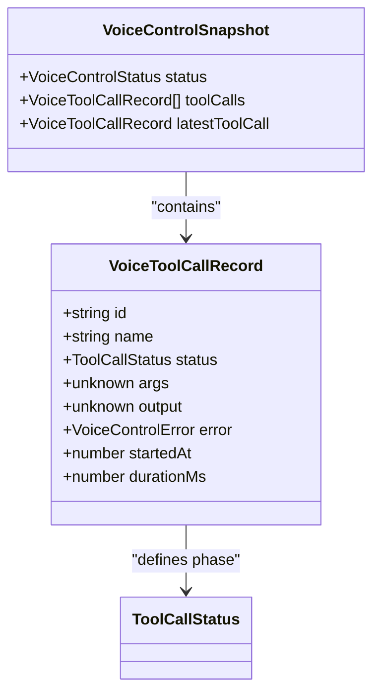

### Skipped State
If the model responds without selecting a tool while `outputMode` is set to `"tool-only"`, the controller emits a `voice.no_action` event and creates a record with the status `"skipped"` [docs/controller-runtime.md:110-113]().

**Sources:** [src/types.ts:179-191](), [docs/api/type-aliases/VoiceToolCallRecord.md:5-98](), [docs/controller-runtime.md:100-113]()

## Snapshot Persistence & Updates

The snapshot is updated through several internal mechanisms:
1.  **Transcript Assembly**: As `text_delta` or `audio_transcription` events arrive from the server, the `transcript` field is updated to reflect the current segment [docs/controller-runtime.md:57-58]().
2.  **Session Mutation**: Calling `updateInstructions()`, `updateTools()`, or `updateSession()` triggers a recalculation of the `sessionConfig` within the snapshot [docs/api/type-aliases/UseVoiceControlReturn.md:89-120]().
3.  **History Management**: The `toolCalls` array is bounded by `maxToolCallHistory` (defaulting to a fixed size). Users can manually clear this via `clearToolCalls()` [docs/api-reference.md:100-100](), [docs/controller-runtime.md:223-224]().

**Sources:** [docs/controller-runtime.md:57-69](), [docs/api/type-aliases/UseVoiceControlReturn.md:13-136](), [src/types.ts:262-272]()

---

# Page: Event System

# Event System

<details>
<summary>Relevant source files</summary>

The following files were used as context for generating this wiki page:

- [docs/api/type-aliases/RealtimeClientEvent.md](docs/api/type-aliases/RealtimeClientEvent.md)
- [docs/api/type-aliases/RealtimeServerEvent.md](docs/api/type-aliases/RealtimeServerEvent.md)
- [docs/api/type-aliases/ToolCallErrorEvent.md](docs/api/type-aliases/ToolCallErrorEvent.md)
- [docs/api/type-aliases/ToolCallEvent.md](docs/api/type-aliases/ToolCallEvent.md)
- [docs/api/type-aliases/ToolCallResultEvent.md](docs/api/type-aliases/ToolCallResultEvent.md)
- [docs/api/type-aliases/ToolCallStatus.md](docs/api/type-aliases/ToolCallStatus.md)
- [docs/api/type-aliases/VoiceControlController.md](docs/api/type-aliases/VoiceControlController.md)
- [docs/api/type-aliases/VoiceControlEvent.md](docs/api/type-aliases/VoiceControlEvent.md)
- [src/types.ts](src/types.ts)

</details>


The Event System facilitates communication between the transport layer (WebRTC), the central `VoiceControlController`, and the application layer. It categorizes interactions into server-originated messages, client-originated commands, and local lifecycle notifications.

## Event Types

The system relies on three primary event unions to manage the flow of data and state.

### VoiceControlEvent
The `VoiceControlEvent` is a union type used to notify the application of any significant occurrence during a session. It is the primary type passed to the `onEvent` callback in `UseVoiceControlOptions` [src/types.ts:211]().

| Type | Composition | Description |
| :--- | :--- | :--- |
| `VoiceControlLocalEvent` | Internal | Events generated by the controller or transport (e.g., connection status, tool lifecycle) [src/types.ts:201-209](). |
| `RealtimeServerEvent` | OpenAI API | Raw events received from the OpenAI Realtime API via the data channel [src/types.ts:17-20](). |

### RealtimeClientEvent
Events sent from the client to the server. These follow the OpenAI Realtime API specification for client-side events, such as `response.create` or `conversation.item.create` [src/types.ts:144-147]().

### Local Event Schema
Local events track the state of the voice interface and the execution of tools:
*   **Transport**: `voice.transport.connected`, `voice.transport.disconnected` [src/types.ts:202-203]().
*   **Capture**: `voice.capture.started`, `voice.capture.stopped` [src/types.ts:204-205]().
*   **Tools**: `voice.tool.started`, `voice.tool.succeeded`, `voice.tool.failed` [src/types.ts:207-209]().

## Event Flow Architecture

Events flow through a pipeline starting from the `RealtimeTransport`, moving into the `VoiceControlController` for processing (such as tool execution), and finally reaching the React hooks and UI components.

### Natural Language to Code Entity Mapping: Event Ingestion
This diagram illustrates how a natural language request from the user (via audio) results in code-level events.

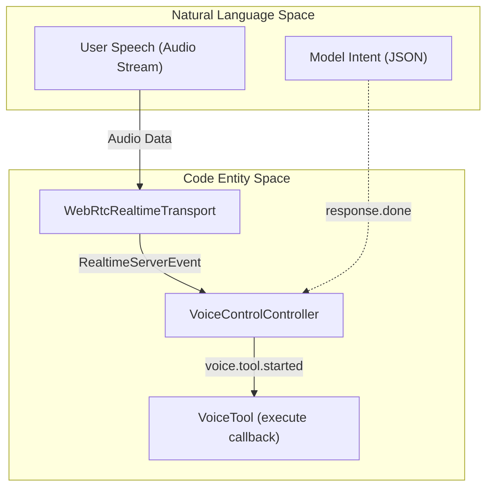
**Sources:** [src/types.ts:17-20](), [src/types.ts:207-209](), [src/types.ts:225-230]().

### Event Processing Pipeline
When the transport receives a `RealtimeServerEvent`, the controller determines if it requires internal handling (like a `response.done` containing `function_call`) or if it should simply be broadcast to the application.

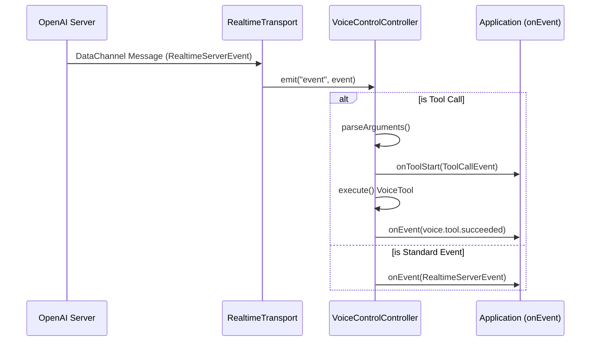
**Sources:** [src/types.ts:201-212](), [src/types.ts:232-236](), [docs/api/type-aliases/VoiceControlController.md:1-49]().

## Tool Execution Events

The tool system uses a specific set of event types to manage the asynchronous lifecycle of a tool call.

### Tool Lifecycle Events
1.  **`voice.tool.started`**: Emitted when the controller validates the model's arguments and begins execution. Contains `callId`, `name`, and `args` [src/types.ts:173-177, 207]().
2.  **`voice.tool.succeeded`**: Emitted after the `execute` function resolves. Includes the `output` [src/types.ts:193-195, 208]().
3.  **`voice.tool.failed`**: Emitted if validation fails or the `execute` function throws. Includes a `VoiceControlError` [src/types.ts:197-199, 209]().

### Tool Call Records
The controller maintains a `VoiceToolCallRecord` for every tool interaction, which is exposed in the `VoiceControlSnapshot`. This record tracks the `ToolCallStatus` ("running", "success", "error", or "skipped") [src/types.ts:22, 179-191]().

## Application Callbacks

The `useVoiceControl` hook (and the underlying controller) exposes specific handlers to react to these events without needing to filter the raw `onEvent` stream manually.

| Callback | Event Trigger | Data Provided |
| :--- | :--- | :--- |
| `onEvent` | Any `VoiceControlEvent` | `VoiceControlEvent` [src/types.ts:211]() |
| `onToolStart` | `voice.tool.started` | `ToolCallEvent` [src/types.ts:173-177]() |
| `onToolSuccess` | `voice.tool.succeeded` | `ToolCallResultEvent` [src/types.ts:193-195]() |
| `onToolError` | `voice.tool.failed` | `ToolCallErrorEvent` [src/types.ts:197-199]() |

### Data Flow: Code Entities to Application State
This diagram shows how events are transformed into application-level state updates.

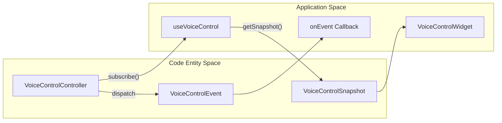
**Sources:** [docs/api/type-aliases/VoiceControlController.md:39-53](), [src/types.ts:211]().

**Sources:**
*   [src/types.ts:17-212]()
*   [docs/api/type-aliases/VoiceControlEvent.md:1-10]()
*   [docs/api/type-aliases/VoiceControlController.md:1-70]()
*   [docs/api/type-aliases/ToolCallEvent.md:1-34]()
*   [docs/api/type-aliases/ToolCallResultEvent.md:1-18]()
*   [docs/api/type-aliases/ToolCallErrorEvent.md:1-18]()

---

# Page: Tool System

# Tool System

<details>
<summary>Relevant source files</summary>

The following files were used as context for generating this wiki page:

- [docs/api/functions/defineVoiceTool.md](docs/api/functions/defineVoiceTool.md)
- [docs/api/type-aliases/UseVoiceControlReturn.md](docs/api/type-aliases/UseVoiceControlReturn.md)
- [docs/api/type-aliases/VoiceControlSnapshot.md](docs/api/type-aliases/VoiceControlSnapshot.md)
- [docs/api/type-aliases/VoiceTool.md](docs/api/type-aliases/VoiceTool.md)
- [docs/api/type-aliases/VoiceToolCallRecord.md](docs/api/type-aliases/VoiceToolCallRecord.md)
- [docs/api/type-aliases/VoiceToolDefinition.md](docs/api/type-aliases/VoiceToolDefinition.md)
- [src/defineVoiceTool.ts](src/defineVoiceTool.ts)
- [test/defineVoiceTool.test.ts](test/defineVoiceTool.test.ts)
- [test/voiceToolDefinition.typecheck.ts](test/voiceToolDefinition.typecheck.ts)

</details>


The Tool System provides a structured framework for defining, validating, and executing client-side functions initiated by the model. It bridges the gap between the model's natural language intent and the application's executable code, ensuring that arguments are strictly typed and results are reliably reported back to the session.

### System Overview

The system revolves around the concept of a `VoiceTool`, which encapsulates the metadata (name, description), the argument schema (Zod), and the execution logic. When the model triggers a tool call, the `VoiceControlController` manages the transition from a raw JSON string to a validated function call, tracking the progress via a `VoiceToolCallRecord`.

#### Conceptual Bridge: Natural Language to Code

The following diagram illustrates how natural language intents are transformed into executable code entities within the system.

**Model Intent to Code Entity Mapping**
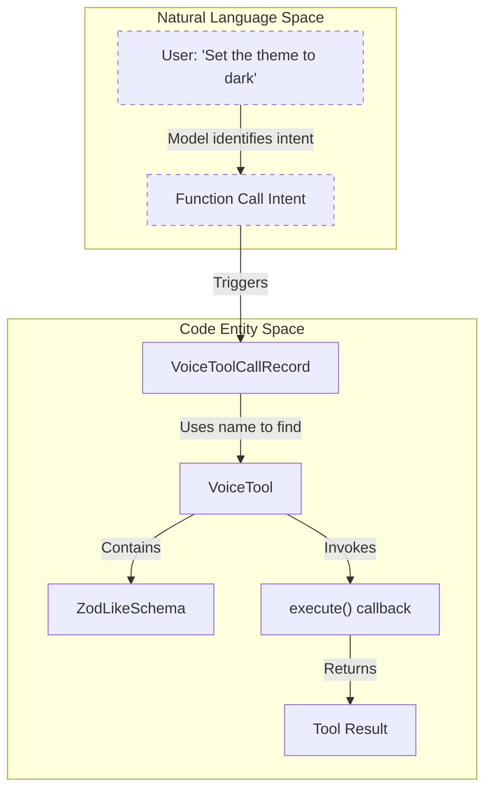
Sources: [docs/api/type-aliases/VoiceTool.md:1-46](), [docs/api/type-aliases/VoiceToolCallRecord.md:1-98](), [src/defineVoiceTool.ts:13-25]()

---

### Core Components

The tool system is composed of three primary layers: definition, validation, and tracking.

| Component | Role | Code Entity |
| :--- | :--- | :--- |
| **Definition Factory** | Standardizes the creation of tools from Zod schemas. | `defineVoiceTool` |
| **Tool Interface** | The runtime object containing schemas and execution logic. | `VoiceTool` |
| **Call Tracking** | A reactive record of an active or historical tool invocation. | `VoiceToolCallRecord` |
| **Status State** | The lifecycle stage of a specific tool call (e.g., `calling`, `error`). | `ToolCallStatus` |

Sources: [src/defineVoiceTool.ts:4-26](), [docs/api/type-aliases/VoiceTool.md:5-9](), [docs/api/type-aliases/VoiceToolCallRecord.md:5-98]()

---

### Tool Definition & Validation

Tools must be defined using the `defineVoiceTool` factory. This utility enforces the use of **Zod schemas** for parameter definition, rejecting plain JSON schemas at both the type level and runtime [src/defineVoiceTool.ts:5-9]().

- **Schema Normalization**: The Zod schema is automatically converted into a JSON Schema compatible with the OpenAI Realtime API [src/defineVoiceTool.ts:11-21]().
- **Argument Parsing**: The tool includes a `parseArguments` method that uses the provided schema to safely transform raw strings from the model into typed objects [src/defineVoiceTool.ts:22-24]().

For a deep dive into the factory and type requirements, see **[defineVoiceTool & VoiceTool](#3.1)**.

Sources: [src/defineVoiceTool.ts:1-27](), [test/voiceToolDefinition.typecheck.ts:11-21]()

---

### Tool Call Lifecycle

The lifecycle of a tool call is managed by the controller and exposed to the UI through snapshots. This process ensures that the application can react to tool starts, successes, and failures in real-time.

**Execution Flow**
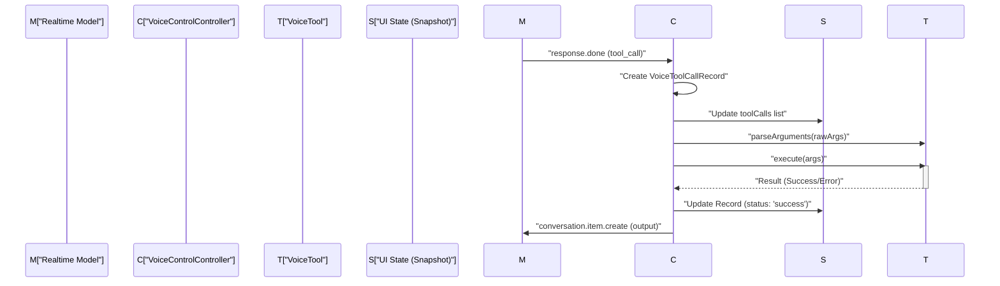
Sources: [docs/api/type-aliases/VoiceControlSnapshot.md:53-58](), [docs/api/type-aliases/VoiceToolCallRecord.md:93-97](), [src/defineVoiceTool.ts:22-24]()

Key lifecycle features include:
- **Tracking**: Every call is assigned a `sequence` and `id` within a `VoiceToolCallRecord` [docs/api/type-aliases/VoiceToolCallRecord.md:45-81]().
- **Performance**: The system tracks `startedAt`, `finishedAt`, and `durationMs` for every execution [docs/api/type-aliases/VoiceToolCallRecord.md:21-41]().
- **State Integration**: The latest tool call is always available via `latestToolCall` in the `VoiceControlSnapshot` [docs/api/type-aliases/VoiceControlSnapshot.md:29-33]().

For details on status transitions and post-tool behavior, see **[Tool Call Lifecycle](#3.2)**.

Sources: [docs/api/type-aliases/VoiceControlSnapshot.md:1-66](), [docs/api/type-aliases/VoiceToolCallRecord.md:1-98]()

---

### Sub-Pages

- **[defineVoiceTool & VoiceTool](#3.1)**: Detailed documentation on the tool factory, Zod integration, and the `execute` contract.
- **[Tool Call Lifecycle](#3.2)**: Comprehensive guide to how calls are tracked, validated, and reported back to the model.

---

# Page: defineVoiceTool & VoiceTool

# defineVoiceTool & VoiceTool

<details>
<summary>Relevant source files</summary>

The following files were used as context for generating this wiki page:

- [docs/api/functions/defineVoiceTool.md](docs/api/functions/defineVoiceTool.md)
- [docs/api/type-aliases/JsonSchema.md](docs/api/type-aliases/JsonSchema.md)
- [docs/api/type-aliases/VoiceTool.md](docs/api/type-aliases/VoiceTool.md)
- [docs/api/type-aliases/VoiceToolDefinition.md](docs/api/type-aliases/VoiceToolDefinition.md)
- [src/defineVoiceTool.ts](src/defineVoiceTool.ts)
- [src/schema.ts](src/schema.ts)
- [test/defineVoiceTool.test.ts](test/defineVoiceTool.test.ts)
- [test/voiceToolDefinition.typecheck.ts](test/voiceToolDefinition.typecheck.ts)

</details>


The tool system in the `realtime-voice-component` library provides a type-safe bridge between the OpenAI Realtime API's JSON-based function calling and the application's TypeScript logic. The `defineVoiceTool` factory ensures that every tool is backed by a Zod schema, providing both runtime validation and automatic generation of the JSON Schema required by the model.

## Overview

Tools are defined using the `defineVoiceTool` factory function. This factory transforms a high-level `VoiceToolDefinition` into a `VoiceTool` object, which contains the metadata and methods necessary for the `VoiceControlController` to register and execute the tool during a session.

### Natural Language to Code Entity Mapping

The following diagram illustrates how natural language concepts used by the model map to specific code entities in the tool system.

"Natural Language Space to Code Entity Space"
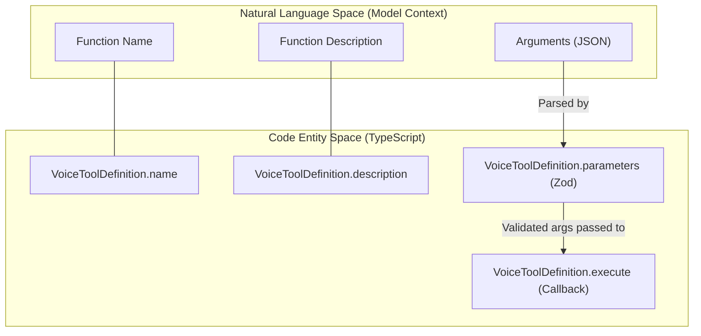

**Sources:** [src/defineVoiceTool.ts:13-25](), [docs/api/type-aliases/VoiceToolDefinition.md:19-57]()

---

## defineVoiceTool Factory

The `defineVoiceTool` function is the primary entry point for creating tools. It performs two critical tasks:
1.  **Validation**: It enforces that the `parameters` property is a valid Zod schema [src/defineVoiceTool.ts:5-9]().
2.  **Normalization**: It converts the Zod schema into a plain `JsonSchema` object compatible with the OpenAI Realtime API [src/defineVoiceTool.ts:11-11]().

### Implementation Detail
The factory uses `normalizeToolSchema` from `src/schema.ts` to strip metadata (like `$schema` or `$ref`) that the OpenAI API does not support, ensuring a clean JSON Schema is sent to the server [src/schema.ts:13-29]().

**Sources:** [src/defineVoiceTool.ts:4-26](), [src/schema.ts:27-29]()

---

## Data Structures

### VoiceToolDefinition<TArgs>
This is the input type for `defineVoiceTool`. It defines the interface the developer must implement.

| Property | Type | Description |
| :--- | :--- | :--- |
| `name` | `string` | The unique name of the function. |
| `description` | `string` | A description used by the model to determine when to call the tool. |
| `parameters` | `ZodLikeSchema<TArgs>` | A Zod schema defining the expected arguments. |
| `execute` | `(args: TArgs) => Promise<unknown> \| unknown` | The implementation logic executed when the model calls the tool. |

**Sources:** [docs/api/type-aliases/VoiceToolDefinition.md:19-57]()

### VoiceTool<TArgs>
The resulting object returned by the factory. It extends the definition with runtime utilities.

| Property | Type | Description |
| :--- | :--- | :--- |
| `jsonSchema` | `JsonSchema` | The normalized JSON Schema generated from the Zod parameters. |
| `realtimeTool` | `RealtimeFunctionTool` | The object formatted specifically for the `session.update` event. |
| `parseArguments` | `(rawArgs: string) => TArgs` | A method that parses and validates a raw JSON string using the Zod schema. |

**Sources:** [docs/api/type-aliases/VoiceTool.md:13-38](), [src/defineVoiceTool.ts:13-25]()

---

## Zod Schema Requirements

The library strictly enforces the use of **Zod schemas** for tool parameters. Plain JSON objects are rejected at both the type level and runtime.

### Why Zod?
1.  **Type Safety**: `TArgs` is automatically inferred from the schema, ensuring the `execute` function receives correctly typed data.
2.  **Runtime Validation**: When the model provides `rawArgs` (a string), the library uses `schema.parse()` to ensure the data conforms to the expected shape before calling `execute` [src/schema.ts:31-34]().
3.  **Automatic Schema Generation**: Using `zod-to-json-schema`, the library generates the complex `JsonSchema` required by OpenAI without manual duplication [src/schema.ts:1-2]().

### Rejection of Plain JSON
If a plain JSON object is passed to `defineVoiceTool`, the function throws an error: `"Plain JSON Schema tool definitions are no longer supported. Pass a Zod schema to defineVoiceTool()."` [src/defineVoiceTool.ts:6-9]().

**Sources:** [src/defineVoiceTool.ts:5-9](), [test/voiceToolDefinition.typecheck.ts:20-21](), [test/defineVoiceTool.test.ts:28-51]()

---

## Tool Execution Flow

The following diagram shows the data flow from the moment a `RealtimeServerEvent` containing a tool call is received until the `execute` callback is triggered.

"Tool Execution and Validation Flow"
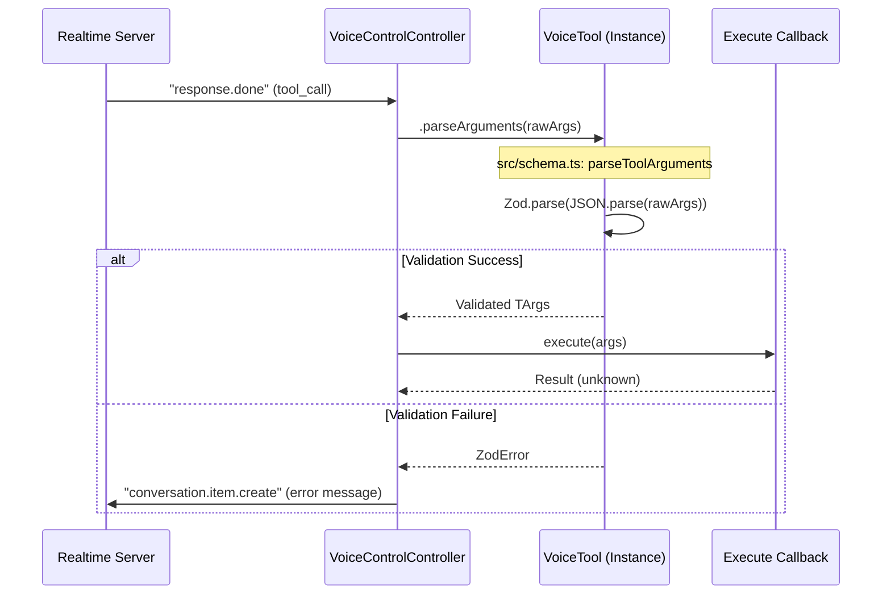

### The execute Callback Contract
The `execute` function can be synchronous or asynchronous [docs/api/type-aliases/VoiceToolDefinition.md:30-31](). Whatever value is returned (or resolved) from this function is automatically converted to a JSON string and sent back to the model via a `conversation.item.create` event with `type: "function_call_output"`.

**Sources:** [src/defineVoiceTool.ts:22-24](), [src/schema.ts:31-34](), [docs/api/type-aliases/VoiceToolDefinition.md:27-41]()

---

# Page: Tool Call Lifecycle

# Tool Call Lifecycle

<details>
<summary>Relevant source files</summary>

The following files were used as context for generating this wiki page:

- [docs/api/functions/createVoiceControlController.md](docs/api/functions/createVoiceControlController.md)
- [docs/api/type-aliases/ToolCallErrorEvent.md](docs/api/type-aliases/ToolCallErrorEvent.md)
- [docs/api/type-aliases/ToolCallEvent.md](docs/api/type-aliases/ToolCallEvent.md)
- [docs/api/type-aliases/ToolCallResultEvent.md](docs/api/type-aliases/ToolCallResultEvent.md)
- [docs/api/type-aliases/ToolCallStatus.md](docs/api/type-aliases/ToolCallStatus.md)
- [docs/api/type-aliases/UseVoiceControlReturn.md](docs/api/type-aliases/UseVoiceControlReturn.md)
- [docs/api/type-aliases/VoiceControlError.md](docs/api/type-aliases/VoiceControlError.md)
- [docs/api/type-aliases/VoiceControlErrorCode.md](docs/api/type-aliases/VoiceControlErrorCode.md)
- [docs/api/type-aliases/VoiceControlSnapshot.md](docs/api/type-aliases/VoiceControlSnapshot.md)
- [docs/api/type-aliases/VoiceToolCallRecord.md](docs/api/type-aliases/VoiceToolCallRecord.md)
- [src/voiceControlController.ts](src/voiceControlController.ts)

</details>


The tool call lifecycle manages the transition from a model-generated function call request to a local code execution and finally back to a model-consumable result. This process is managed by the `VoiceControlController` and involves argument validation, state tracking via `VoiceToolCallRecord`, and automatic response generation.

## High-Level Execution Flow

When the OpenAI Realtime API determines a tool should be called, it emits a `response.done` event containing `function_call` items. The controller intercepts these, matches them against registered `VoiceTool` definitions, and executes the associated logic.

### Natural Language to Code Entity Mapping

The following diagram illustrates how abstract model intentions are mapped to concrete code entities within the `realtime-voice-component` architecture.

**Model-to-Code Mapping**
```mermaid
graph TD
    subgraph "Natural Language Space"
        UserIntent["'Set the theme to dark'"]
        ModelDecision["Model decides to call 'set_theme'"]
    end

    subgraph "Code Entity Space"
        RT_Event["RealtimeServerEvent (response.done)"]
        VCC["VoiceControlController"]
        VT["VoiceTool (set_theme)"]
        ZodSchema["Zod Schema (validation)"]
        ExecuteCB["execute() callback"]
        Record["VoiceToolCallRecord"]
    end

    UserIntent --> ModelDecision
    ModelDecision --> RT_Event
    RT_Event -- "Parsed by" --> VCC
    VCC -- "Look up by name" --> VT
    VT -- "Validate args" --> ZodSchema
    ZodSchema -- "Invoke" --> ExecuteCB
    ExecuteCB -- "Track state" --> Record
```
**Sources:** [src/voiceControlController.ts:397-420](), [src/voiceControlController.ts:507-535]()

---

## Detailed Lifecycle Stages

### 1. Discovery and Validation
The lifecycle begins when the controller receives a `response.done` event from the transport layer. The controller iterates through the items to find those with `type: "function_call"`.

- **Matching**: The `name` provided by the model is matched against the `tools` array provided in the `VoiceControlController` configuration [src/voiceControlController.ts:405-410]().
- **Parsing**: Arguments arrive as a JSON string and are parsed into a JavaScript object [src/voiceControlController.ts:413-415]().
- **Validation**: The parsed arguments are validated against the tool's Zod schema. If validation fails, the lifecycle transitions immediately to an `error` status [src/voiceControlController.ts:510-520]().

### 2. Execution and Tracking
Once validated, the controller creates a `VoiceToolCallRecord` with a status of `"running"` and adds it to the `toolCalls` history [src/voiceControlController.ts:417-422]().

- **Invocation**: The `execute` function defined in the `VoiceTool` is called with the validated arguments [src/voiceControlController.ts:522-525]().
- **Status Transitions**: The `ToolCallStatus` moves from `running` to either `success` or `error` based on the outcome of the `execute` promise [docs/api/type-aliases/ToolCallStatus.md:8-9]().

### 3. Result Reporting and Post-Tool Behavior
After execution, the result (or error) must be reported back to the model so it can continue the conversation.

- **Reporting**: The controller sends a `conversation.item.create` event followed by a `response.create` event to the server [src/voiceControlController.ts:538-555]().
- **Post-Tool Response**: If the tool definition has `postToolResponse: true`, the controller automatically triggers a new model response to describe the outcome to the user [src/voiceControlController.ts:557-560]().

---

## State Tracking: VoiceToolCallRecord

The `VoiceToolCallRecord` is the primary data structure for monitoring tool activity. It is exposed to the UI via the `toolCalls` and `latestToolCall` properties of the `VoiceControlSnapshot`.

| Property | Type | Description |
| :--- | :--- | :--- |
| `id` | `string` | The unique `call_id` provided by the OpenAI API [docs/api/type-aliases/VoiceToolCallRecord.md:45-49](). |
| `status` | `ToolCallStatus` | `running`, `success`, `error`, or `skipped` [docs/api/type-aliases/ToolCallStatus.md:8-9](). |
| `args` | `unknown` | The validated arguments passed to the tool [docs/api/type-aliases/VoiceToolCallRecord.md:13-17](). |
| `output` | `unknown` | The value returned by the `execute` callback [docs/api/type-aliases/VoiceToolCallRecord.md:61-65](). |
| `durationMs` | `number` | Calculated time between `startedAt` and `finishedAt` [src/voiceControlController.ts:219-220](). |

**Sources:** [docs/api/type-aliases/VoiceToolCallRecord.md:5-98](), [src/voiceControlController.ts:203-222]()

---

## Implementation Sequence

The following sequence diagram details the function calls and event flow within `voiceControlController.ts` during a tool invocation.

**Internal Function Sequence**
```mermaid
sequenceDiagram
    participant S as OpenAI Server
    participant T as RealtimeTransport
    participant C as VoiceControlController
    participant VT as VoiceTool

    S->>T: "response.done" (function_call)
    T->>C: Emit RealtimeServerEvent
    C->>C: handleServerEvent()
    Note over C: Extract items where type === "function_call"
    C->>C: executeToolCall(tool, callId, args)
    
    activate C
    C->>C: updateToolCallRecord (status: "running")
    C->>VT: execute(args)
    VT-->>C: return output
    C->>C: updateToolCallRecord (status: "success", output)
    deactivate C

    C->>T: sendClientEvent("conversation.item.create")
    Note right of T: role: "tool", content: [output]
    
    alt postToolResponse is true
        C->>T: sendClientEvent("response.create")
    end
```
**Sources:** [src/voiceControlController.ts:397-430](), [src/voiceControlController.ts:507-565](), [src/voiceControlController.ts:590-610]()

## Tool Call Status Transitions

The `ToolCallStatus` follows a strict state machine to ensure the UI can accurately reflect the model's progress.

1.  **`running`**: Set immediately before the `execute` callback is invoked [src/voiceControlController.ts:417-420]().
2.  **`success`**: Set if the `execute` promise resolves. The result is stored in the `output` field [src/voiceControlController.ts:526-530]().
3.  **`error`**: Set if the `execute` promise rejects or if argument validation fails. The error is normalized and stored in the `error` field [src/voiceControlController.ts:515-520](), [src/voiceControlController.ts:531-535]().
4.  **`skipped`**: Occurs if a tool call is received but the tool is no longer registered or the session is disconnected [src/voiceControlController.ts:408-411]().

**Sources:** [docs/api/type-aliases/ToolCallStatus.md:5-10](), [src/voiceControlController.ts:125-143]()

---

# Page: Transport Layer

# Transport Layer

<details>
<summary>Relevant source files</summary>

The following files were used as context for generating this wiki page:

- [demo/session-server.mjs](demo/session-server.mjs)
- [docs/authentication.md](docs/authentication.md)
- [src/transport/mockRealtimeTransport.ts](src/transport/mockRealtimeTransport.ts)
- [src/transport/types.ts](src/transport/types.ts)
- [src/transport/webRtcRealtimeTransport.ts](src/transport/webRtcRealtimeTransport.ts)

</details>


The Transport Layer is responsible for the low-level communication between the browser and the OpenAI Realtime API. It abstracts the complexities of WebRTC negotiation, audio stream management, and the JSON-based control channel into a unified interface used by the `VoiceControlController`.

## RealtimeTransport Abstraction

All transport implementations must adhere to the `RealtimeTransport` interface [src/transport/types.ts:53-63](). This interface ensures that the higher-level controller can manage sessions, capture audio, and exchange events without being coupled to a specific network implementation (e.g., WebRTC vs. WebSockets or Mocks).

### Core Responsibilities
*   **Connection Lifecycle**: Handling `connect` and `disconnect` logic, including authentication resolution [src/transport/types.ts:54-55]().
*   **Media Management**: Starting and stopping local microphone capture via `startCapture` and `stopCapture` [src/transport/types.ts:57-58]().
*   **Event Routing**: Passing `RealtimeServerEvent` objects from the network to the application and sending `RealtimeClientEvent` objects back [src/transport/types.ts:49,61]().
*   **Session Updates**: Synchronizing the server-side session state with local configuration via `updateSession` [src/transport/types.ts:56]().

### Transport Entities
The following diagram illustrates how the `RealtimeTransport` interface bridges the gap between the application's intent and the physical network connection.

**Transport Layer Architecture**
```mermaid
graph TD
    subgraph "Controller Space"
        VCC["VoiceControlController"]
    end

    subgraph "Transport Abstraction Space"
        RT["<<interface>> RealtimeTransport"]
        WrtcRT["WebRtcRealtimeTransport"]
        MockRT["MockRealtimeTransport"]
    end

    subgraph "Browser/Network Space"
        PC["RTCPeerConnection"]
        DC["RTCDataChannel"]
        MS["MediaStream (Mic)"]
    end

    VCC -- "calls" --> RT
    RT <|-- WrtcRT
    RT <|-- MockRT
    WrtcRT -- "manages" --> PC
    WrtcRT -- "sends/receives" --> DC
    WrtcRT -- "captures" --> MS
```
Sources: [src/transport/types.ts:53-63](), [src/transport/webRtcRealtimeTransport.ts:237-251](), [src/transport/mockRealtimeTransport.ts:6-73]()

## WebRTC Implementation

The primary production implementation is `WebRtcRealtimeTransport` [src/transport/webRtcRealtimeTransport.ts:237](). It utilizes the WebRTC API to provide low-latency, bi-directional audio and data communication.

Key characteristics include:
*   **SDP Negotiation**: It generates a local Session Description Protocol (SDP) offer and expects a remote answer to establish the peer connection [src/transport/webRtcRealtimeTransport.ts:202-212]().
*   **Data Channel**: A dedicated `RTCDataChannel` named `oai-events` is used for sending and receiving JSON control messages [src/transport/webRtcRealtimeTransport.ts:8,118-122]().
*   **Audio Handling**: Manages a `MediaStreamTrack` for the microphone and an `HTMLAudioElement` for playing back the model's response [src/transport/webRtcRealtimeTransport.ts:7,9]().

For a deep dive into the negotiation sequence, audio track management, and timeout guards, see [WebRTC Transport](#4.1).

Sources: [src/transport/webRtcRealtimeTransport.ts:6-12](), [src/transport/webRtcRealtimeTransport.ts:237-251]()

## Authentication & Session Proxy

To securely connect to OpenAI without exposing API keys in the browser, the transport layer supports a session proxy pattern.

### The Proxy Flow
1.  The browser creates an ephemeral WebRTC offer.
2.  The transport sends this offer to a developer-managed `sessionEndpoint` [docs/authentication.md:7-13]().
3.  The backend proxy appends the `OPENAI_API_KEY` and forwards the request to OpenAI [demo/session-server.mjs:51-59]().
4.  The response (SDP answer) is returned to the browser to finalize the connection.

**Authentication Data Flow**
```mermaid
sequenceDiagram
    participant B as Browser (WebRtcRealtimeTransport)
    participant P as Backend Proxy (POST /session)
    participant O as OpenAI Realtime API

    B->>B: Create RTCPeerConnection & SDP Offer
    B->>P: POST /session (SDP + Session Config)
    Note over P: Append OPENAI_API_KEY
    P->>O: POST /v1/realtime/calls (SDP)
    O-->>P: 200 OK (SDP Answer)
    P-->>B: 200 OK (SDP Answer)
    B->>B: setRemoteDescription()
```
Sources: [docs/authentication.md:17-22](), [demo/session-server.mjs:51-73](), [src/transport/webRtcRealtimeTransport.ts:202-223]()

For details on implementing the proxy and alternative authentication patterns, see [Authentication & Session Proxy](#4.2).

## Error Handling and Timeouts

The transport layer includes robust error normalization and safety guards:
*   **Insecure Context Check**: Blocks connection attempts if the page is not served over HTTPS or localhost, as microphone access will fail [src/transport/webRtcRealtimeTransport.ts:253-261]().
*   **Data Channel Timeout**: Implements a `DATA_CHANNEL_OPEN_TIMEOUT_MS` (default 15 seconds) to prevent the application from hanging if the WebRTC handshake fails [src/transport/webRtcRealtimeTransport.ts:14,125-131]().
*   **Abort Signal Support**: Most asynchronous operations, including `connect`, accept an `AbortSignal` to allow the user to cancel connection attempts mid-flight [src/transport/webRtcRealtimeTransport.ts:48,53-57]().

Sources: [src/transport/webRtcRealtimeTransport.ts:14-57](), [src/transport/types.ts:48]()

---

# Page: WebRTC Transport

# WebRTC Transport

<details>
<summary>Relevant source files</summary>

The following files were used as context for generating this wiki page:

- [demo/session-server.mjs](demo/session-server.mjs)
- [docs/api/type-aliases/RealtimeAudioConfig.md](docs/api/type-aliases/RealtimeAudioConfig.md)
- [docs/api/type-aliases/RealtimeAudioFormat.md](docs/api/type-aliases/RealtimeAudioFormat.md)
- [docs/api/type-aliases/RealtimeAudioInputConfig.md](docs/api/type-aliases/RealtimeAudioInputConfig.md)
- [docs/api/type-aliases/RealtimeAudioOutputConfig.md](docs/api/type-aliases/RealtimeAudioOutputConfig.md)
- [docs/api/type-aliases/RealtimeSemanticVadTurnDetection.md](docs/api/type-aliases/RealtimeSemanticVadTurnDetection.md)
- [docs/api/type-aliases/RealtimeServerVadTurnDetection.md](docs/api/type-aliases/RealtimeServerVadTurnDetection.md)
- [docs/api/type-aliases/RealtimeTurnDetection.md](docs/api/type-aliases/RealtimeTurnDetection.md)
- [docs/authentication.md](docs/authentication.md)
- [src/transport/mockRealtimeTransport.ts](src/transport/mockRealtimeTransport.ts)
- [src/transport/types.ts](src/transport/types.ts)
- [src/transport/webRtcRealtimeTransport.ts](src/transport/webRtcRealtimeTransport.ts)

</details>


The `WebRtcRealtimeTransport` class is the primary implementation of the `RealtimeTransport` interface, responsible for managing the low-level WebRTC connection between the browser and OpenAI's Realtime API. It handles SDP negotiation, media stream management, and the reliable delivery of control events via a dedicated data channel.

## Peer Connection Setup

The transport utilizes `RTCPeerConnection` to establish a peer-to-peer link. Because the OpenAI Realtime API requires a secure context, the transport performs a check for `window.isSecureContext` before initiating any connection logic [src/transport/webRtcRealtimeTransport.ts:253-261]().

The internal state is tracked via a `RealtimePeerState` object, which holds references to the peer connection, data channel, and audio elements [src/transport/webRtcRealtimeTransport.ts:6-12]().

### Connection Sequence

1.  **Media Acquisition**: The transport requests access to the user's microphone using `navigator.mediaDevices.getUserMedia` [src/transport/webRtcRealtimeTransport.ts:316-321]().
2.  **SDP Offer**: A local SDP offer is created. The transport adds the local audio track to the `RTCPeerConnection` before generating the offer [src/transport/webRtcRealtimeTransport.ts:333-345]().
3.  **Negotiation**: The SDP offer is sent to the backend (either via a session proxy or directly) to receive an answer SDP from OpenAI [src/transport/webRtcRealtimeTransport.ts:352-378]().
4.  **Remote Description**: The received answer is set as the remote description on the `RTCPeerConnection` [src/transport/webRtcRealtimeTransport.ts:380-381]().

### Data Flow: Connection Initialization

The following diagram illustrates the interaction between the transport and the browser APIs during setup.

**WebRTC Handshake Logic**
```mermaid
sequenceDiagram
    participant W as "WebRtcRealtimeTransport"
    participant B as "Browser MediaDevices"
    participant PC as "RTCPeerConnection"
    participant S as "Session Proxy / OpenAI"

    W->>B: getUserMedia({ audio: true })
    B-->>W: MediaStreamTrack
    W->>PC: addTrack(localTrack)
    W->>PC: createDataChannel("oai-events")
    W->>PC: createOffer()
    PC-->>W: localSDP
    W->>S: POST /session (SDP + Config)
    S-->>W: answerSDP
    W->>PC: setRemoteDescription(answerSDP)
    PC-->>W: "connectionstatechange" (connected)
```
Sources: [src/transport/webRtcRealtimeTransport.ts:316-381](), [src/transport/webRtcRealtimeTransport.ts:202-223]()

## oai-events Data Channel

All control messages (JSON events) are sent through a `RTCDataChannel` named `oai-events` [src/transport/webRtcRealtimeTransport.ts:327]().

### DATA_CHANNEL_OPEN_TIMEOUT_MS Guard

To prevent the application from hanging indefinitely during poor network conditions, the transport implements a strict timeout of 15,000ms (`DATA_CHANNEL_OPEN_TIMEOUT_MS`) for the data channel to reach the `open` state [src/transport/webRtcRealtimeTransport.ts:14](). If the channel fails to open within this window, the connection attempt is rejected [src/transport/webRtcRealtimeTransport.ts:125-131]().

The `waitForDataChannelOpen` function manages this lifecycle, listening for `open`, `error`, and `close` events, as well as monitoring the parent `RTCPeerConnection.connectionState` [src/transport/webRtcRealtimeTransport.ts:118-200]().

## Audio Track Management

The transport manages two primary audio flows:
1.  **Input**: The `localTrack` acquired from the microphone is added to the peer connection to be streamed to OpenAI [src/transport/webRtcRealtimeTransport.ts:340-341]().
2.  **Output**: Remote audio tracks received from the peer connection are attached to a hidden `HTMLAudioElement` [src/transport/webRtcRealtimeTransport.ts:304-314]().

### Capture Modes

The transport supports two primary interaction patterns based on the session's `activationMode`:

| Mode | Behavior | Implementation |
| :--- | :--- | :--- |
| **VAD** | Voice Activity Detection (Server-side). The microphone is continuously streamed. | Managed by `server_vad` or `semantic_vad` config [docs/api/type-aliases/RealtimeAudioInputConfig.md:41-44](). |
| **Push-to-Talk** | Manual control over when the model listens. | `startCapture()` clears the buffer; `stopCapture()` commits the buffer and requests a response [src/transport/webRtcRealtimeTransport.ts:468-483](). |

Sources: [src/transport/webRtcRealtimeTransport.ts:468-483](), [docs/api/type-aliases/RealtimeServerVadTurnDetection.md:61-64](), [docs/api/type-aliases/RealtimeSemanticVadTurnDetection.md:37-41]()

## SDP Negotiation Sequence

The library supports multiple authentication patterns which change how the SDP is exchanged:

1.  **Session Proxy (Recommended)**: The transport sends a multipart `POST` request to a `sessionEndpoint`. This request includes the local `sdp` and the serialized `session` configuration [src/transport/webRtcRealtimeTransport.ts:202-223]().
2.  **Direct (Legacy)**: If an `authToken` is provided, the transport sends the raw SDP string directly to OpenAI's calls endpoint [src/transport/webRtcRealtimeTransport.ts:225-235]().

### Entity Mapping: Transport Internals

This diagram maps high-level transport concepts to specific code entities within `WebRtcRealtimeTransport`.

**Code Entity Mapping**
```mermaid
graph TD
    subgraph "WebRtcRealtimeTransport Class"
        State["this.state (RealtimePeerState)"]
        Conn["connect(options)"]
        Update["updateSession(session)"]
        Send["sendClientEvent(event)"]
    end

    subgraph "Browser APIs"
        PC["RTCPeerConnection"]
        DC["RTCDataChannel"]
        Media["navigator.mediaDevices"]
    end

    subgraph "OpenAI / Network"
        SDP["SDP Offer/Answer"]
        Events["RealtimeServerEvent"]
    end

    Conn --> Media
    Conn --> PC
    PC --> DC
    DC -- "JSON.stringify" --> Send
    Update -- "buildSessionUpdateEvent" --> Send
    State -- "tracks" --> PC
    PC -- "SDP Exchange" --> SDP
    DC -- "onmessage" --> Events
```
Sources: [src/transport/webRtcRealtimeTransport.ts:237-250](), [src/transport/webRtcRealtimeTransport.ts:457-466](), [src/transport/webRtcRealtimeTransport.ts:503-511]()

## Key Functions

### `connect(options: TransportConnectOptions)`
The entry point for establishing the session. It orchestrates media acquisition, peer connection creation, and SDP negotiation [src/transport/webRtcRealtimeTransport.ts:252-404]().

### `updateSession(session: TransportSessionConfig)`
Sends a `session.update` client event over the data channel to synchronize the model's instructions, tools, or audio settings without restarting the WebRTC connection [src/transport/webRtcRealtimeTransport.ts:457-466]().

### `disconnect()`
Performs a clean shutdown by stopping all media tracks, closing the data channel, and disposing of the `RTCPeerConnection` [src/transport/webRtcRealtimeTransport.ts:413-448]().

### `sendClientEvent(event: RealtimeClientEvent)`
Serializes and sends a JSON payload through the `oai-events` data channel [src/transport/webRtcRealtimeTransport.ts:503-511]().

Sources: [src/transport/webRtcRealtimeTransport.ts:252-511]()

---

# Page: Authentication & Session Proxy

# Authentication & Session Proxy

<details>
<summary>Relevant source files</summary>

The following files were used as context for generating this wiki page:

- [LLM.txt](LLM.txt)
- [README.md](README.md)
- [demo/session-server.mjs](demo/session-server.mjs)
- [docs/authentication.md](docs/authentication.md)
- [docs/getting-started.md](docs/getting-started.md)
- [docs/integrating-with-an-existing-app.md](docs/integrating-with-an-existing-app.md)
- [src/transport/webRtcRealtimeTransport.ts](src/transport/webRtcRealtimeTransport.ts)

</details>


This page documents the authentication patterns and backend requirements for the `realtime-voice-component`. To maintain security, the library is designed to ensure that OpenAI API keys are never exposed in the browser [LLM.txt:12-12](). Instead, it relies on a session proxy or token exchange mechanism to establish WebRTC connections.

## Authentication Patterns

The library supports three authentication patterns, with `sessionEndpoint` being the canonical and recommended approach [docs/authentication.md:15-15]().

| Pattern | Configuration Key | Description |
| :--- | :--- | :--- |
| **Session Proxy** | `sessionEndpoint` | **Recommended.** The browser sends the WebRTC offer and session config to your backend, which forwards it to OpenAI [docs/authentication.md:7-22](). |
| **Token Proxy** | `tokenEndpoint` | Legacy. The browser fetches a short-lived client secret from your backend, then connects directly to OpenAI [docs/authentication.md:60-65](). |
| **Direct Secret** | `getClientSecret` | Legacy/Advanced. An async function provided by the app to resolve a client secret manually [docs/authentication.md:71-87](). |

### Data Flow: Session Proxy (Recommended)

The session proxy pattern allows the backend to intercept and potentially modify the session configuration before it reaches OpenAI [docs/authentication.md:34-36]().

```mermaid
sequenceDiagram
    participant B as Browser (WebRtcRealtimeTransport)
    participant P as Backend Proxy (/session)
    participant O as OpenAI Realtime API

    B->>B: Create local SDP offer
    B->>P: POST /session (Multipart: sdp, session)
    Note over P: Append OPENAI_API_KEY
    P->>O: POST /v1/realtime/calls (Multipart)
    O-->>P: 200 OK (Answer SDP)
    P-->>B: Answer SDP
    B->>B: Set remote description
```
**Sources:** [docs/authentication.md:17-22](), [src/transport/webRtcRealtimeTransport.ts:202-223]()

## Backend Implementation

The backend must implement a `POST /session` route that handles `multipart/form-data`. This endpoint acts as a relay between the client's `WebRtcRealtimeTransport` and the OpenAI Realtime API.

### Required Fields
The browser sends two primary fields in the multipart body [LLM.txt:43-47]():
1. `sdp`: The local WebRTC offer string generated by the browser.
2. `session`: A JSON-serialized string of the `TransportSessionConfig`, which includes model, voice, and tool definitions [src/transport/webRtcRealtimeTransport.ts:209-212]().

### Proxy Logic
The proxy should forward the request headers (specifically `Content-Type`) and the raw request body to OpenAI while adding the `Authorization` header with your server-side API key [README.md:152-170]().

**Reference Implementation (Node.js/Express style):**
[demo/session-server.mjs:50-73]()

```typescript
// Implementation informed by src/transport/webRtcRealtimeTransport.ts:202-223
app.post("/session", async (request, response) => {
  const contentType = request.header("content-type");

  const realtimeResponse = await fetch("https://api.openai.com/v1/realtime/calls", {
    method: "POST",
    headers: {
      Authorization: `Bearer ${process.env.OPENAI_API_KEY}`,
      ...(contentType ? { "Content-Type": contentType } : {}),
    },
    body: request, // Forwarding the stream
    duplex: "half",
  });

  response
    .status(realtimeResponse.status)
    .type(realtimeResponse.headers.get("content-type") ?? "application/sdp")
    .send(await realtimeResponse.text());
});
```
**Sources:** [README.md:153-170](), [LLM.txt:55-72](), [demo/session-server.mjs:50-73]()

## Technical Implementation Details

### Client-Side Request Construction
The `WebRtcRealtimeTransport` uses the `buildSessionEndpointRequest` helper to prepare the multipart payload [src/transport/webRtcRealtimeTransport.ts:202-208](). It specifically deletes the `Content-Type` header from any provided `sessionRequestInit` to allow the browser to automatically generate the correct multipart boundary [src/transport/webRtcRealtimeTransport.ts:213-214]().

### Legacy Client Secret Flow
If using `tokenEndpoint` or `getClientSecret`, the transport calls `buildDirectRealtimeRequest` [src/transport/webRtcRealtimeTransport.ts:225-235](). This sends the SDP as a raw `application/sdp` body directly to OpenAI using the retrieved client secret as a Bearer token [src/transport/webRtcRealtimeTransport.ts:229-232]().

### Mapping Code Entities to Auth Flow

The following diagram bridges the high-level authentication concepts to the specific functions and classes in the codebase.

```mermaid
graph TD
    subgraph "Natural Language Space"
        AuthMode["Authentication Mode"]
        Proxy["Session Proxy"]
        Secret["Client Secret"]
    end

    subgraph "Code Entity Space"
        WRT["WebRtcRealtimeTransport"]
        BSER["buildSessionEndpointRequest"]
        BDRR["buildDirectRealtimeRequest"]
        TSC["TransportSessionConfig"]
        BRSP["buildRealtimeSessionPayload"]
    end

    AuthMode -- "uses" --> WRT
    Proxy -- "implemented by" --> BSER
    Secret -- "handled by" --> BDRR
    BSER -- "serializes" --> TSC
    TSC -- "via" --> BRSP
    WRT -- "calls" --> BSER
    WRT -- "calls" --> BDRR
```
**Sources:** [src/transport/webRtcRealtimeTransport.ts:202-250](), [src/transport/webRtcRealtimeTransport.ts:1-1]()

## Security Considerations

1. **Secure Contexts:** Voice control and microphone access require a "Secure Context" (HTTPS or localhost). The `WebRtcRealtimeTransport` checks `window.isSecureContext` and throws an `insecure_context` error if this requirement is not met [src/transport/webRtcRealtimeTransport.ts:253-261]().
2. **API Key Protection:** The standard OpenAI API key (`sk-...`) must never be passed to the `createVoiceControlController`. It should only exist on the backend [LLM.txt:12-12]().
3. **Multipart Integrity:** The backend should generally leave the incoming multipart body untouched unless specific session overrides are required for security or policy reasons [docs/authentication.md:34-36]().
4. **Request Customization:** If the backend requires additional authentication (e.g., session cookies), use the `sessionRequestInit` property in the `auth` configuration [docs/authentication.md:23-32]().

**Sources:** [src/transport/webRtcRealtimeTransport.ts:253-261](), [LLM.txt:12-12](), [docs/authentication.md:23-36]()

---

# Page: Session Configuration

# Session Configuration

<details>
<summary>Relevant source files</summary>

The following files were used as context for generating this wiki page:

- [docs/api/type-aliases/VoiceControlController.md](docs/api/type-aliases/VoiceControlController.md)
- [docs/api/type-aliases/VoiceControlRealtimeSessionOptions.md](docs/api/type-aliases/VoiceControlRealtimeSessionOptions.md)
- [docs/api/type-aliases/VoiceControlRealtimeSessionPatch.md](docs/api/type-aliases/VoiceControlRealtimeSessionPatch.md)
- [docs/api/type-aliases/VoiceControlResolvedSessionConfig.md](docs/api/type-aliases/VoiceControlResolvedSessionConfig.md)
- [src/types.ts](src/types.ts)

</details>


The session configuration system manages the parameters sent to the OpenAI Realtime API to define model behavior, audio processing, and tool availability. Configuration flows from the high-level `UseVoiceControlOptions` provided by the developer, through a resolution process, into a `VoiceControlResolvedSessionConfig` used to initialize or update the transport session.

## Configuration Flow

Configuration is not static; it can be updated during an active session via the `VoiceControlController.configure()` method [docs/api/type-aliases/VoiceControlController.md:13-16](). When options change, the controller determines if a "patch" can be sent to the server or if a more significant state change is required.

### Data Transformation Pipeline

The following diagram illustrates how user-provided options are transformed into the internal resolved configuration.

**Configuration Resolution Diagram**
```mermaid
graph TD
  subgraph "Natural Language Space"
    "A"["Developer Intent (e.g. 'Use GPT-4o with Alloy voice')"]
  end

  subgraph "Code Entity Space"
    "B"["UseVoiceControlOptions"]
    "C"["VoiceControlRealtimeSessionOptions"]
    "D"["VoiceControlResolvedSessionConfig"]
    "E"["session.update (Server Event)"]

    "B" -->|"Contains"| "C"
    "C" -->|"Resolved by Controller"| "D"
    "D" -->|"Diffed/Patched"| "E"
  end

  "A" -.-> "B"
```
Sources: [src/types.ts:238-248](), [src/types.ts:262-272](), [docs/api/type-aliases/VoiceControlController.md:13-16]()

## Key Configuration Entities

| Entity | Role | Key File |
| :--- | :--- | :--- |
| `VoiceControlRealtimeSessionOptions` | Optional parameters provided by the user to customize the session (audio, prompt, tools). | [src/types.ts:238-248]() |
| `VoiceControlResolvedSessionConfig` | The final, flattened configuration object used by the transport layer. | [src/types.ts:262-272]() |
| `VoiceControlRealtimeSessionPatch` | A partial configuration object used to update an active session without reconnecting. | [src/types.ts:250-260]() |

## Session Patching

The system supports live updates to the session configuration via `VoiceControlRealtimeSessionPatch`. This allows developers to change instructions, toggle tools, or adjust audio settings (like output voice) while the connection remains open.

**Live Patching Flow**
```mermaid
sequenceDiagram
    participant App as "Application Code"
    participant Ctrl as "VoiceControlController"
    participant Transport as "RealtimeTransport"

    App->>Ctrl: configure(newOptions)
    Ctrl->>Ctrl: Resolve VoiceControlResolvedSessionConfig
    Ctrl->>Transport: Send session.update (Patch)
    Note over Transport: Updates server-side session state
```
Sources: [src/types.ts:250-260](), [docs/api/type-aliases/VoiceControlController.md:13-16]()

## Audio Configuration
The `audio` property within the session options controls both input (capture) and output (playback) behavior. This includes selecting audio formats like `pcm16` or `g711_ulaw`, configuring noise reduction, and setting transcription models.

For details, see [Audio Configuration](#5.1).

## Model, Voice & Session Options
Beyond audio, the session configuration defines the core identity of the interaction. This includes:
* **Model Selection**: Choosing between models like `gpt-realtime` or `gpt-realtime-mini` [src/types.ts:28-30]().
* **Voice Selection**: Selecting the persona (e.g., `alloy`, `shimmer`, `echo`) [src/types.ts:34-46]().
* **Turn Detection**: Configuring `server_vad` (Voice Activity Detection) or semantic-based detection [src/types.ts:92-94]().
* **Instructions**: The system prompt that governs model behavior.

For details, see [Model, Voice & Session Options](#5.2).

---

# Page: Audio Configuration

# Audio Configuration

<details>
<summary>Relevant source files</summary>

The following files were used as context for generating this wiki page:

- [docs/api/type-aliases/RealtimeAudioConfig.md](docs/api/type-aliases/RealtimeAudioConfig.md)
- [docs/api/type-aliases/RealtimeAudioFormat.md](docs/api/type-aliases/RealtimeAudioFormat.md)
- [docs/api/type-aliases/RealtimeAudioInputConfig.md](docs/api/type-aliases/RealtimeAudioInputConfig.md)
- [docs/api/type-aliases/RealtimeAudioOutputConfig.md](docs/api/type-aliases/RealtimeAudioOutputConfig.md)
- [docs/api/type-aliases/RealtimeInputAudioNoiseReduction.md](docs/api/type-aliases/RealtimeInputAudioNoiseReduction.md)
- [docs/api/type-aliases/RealtimeInputAudioTranscription.md](docs/api/type-aliases/RealtimeInputAudioTranscription.md)
- [docs/api/type-aliases/RealtimeNoiseReductionType.md](docs/api/type-aliases/RealtimeNoiseReductionType.md)
- [docs/api/type-aliases/RealtimePrompt.md](docs/api/type-aliases/RealtimePrompt.md)
- [docs/api/type-aliases/VoiceControlController.md](docs/api/type-aliases/VoiceControlController.md)
- [src/types.ts](src/types.ts)

</details>


The audio configuration system defines how the Realtime API handles audio ingestion, processing, and generation. Configuration is managed through the `RealtimeAudioConfig` object, which is split into `input` and `output` specifications. These settings control everything from low-level codecs to high-level features like noise reduction and transcription models.

### Data Flow Overview

Audio configuration originates in the `UseVoiceControlOptions` passed to the controller. The `VoiceControlController` resolves these options into a `VoiceControlResolvedSessionConfig`, which is then communicated to the OpenAI Realtime API via the transport layer.

**Audio Configuration Mapping**
```mermaid
graph TD
  subgraph "Natural Language Space"
    A["User Speech"]
    B["AI Voice Response"]
  end

  subgraph "Code Entity Space"
    direction TB
    C["RealtimeAudioInputConfig"]
    D["RealtimeAudioOutputConfig"]
    E["RealtimeAudioFormat"]
    F["RealtimeTranscriptionModel"]
    G["RealtimeVoice"]
  end

  A -->|"Captured by"| C
  C -->|"Format"| E
  C -->|"Transcribed by"| F
  D -->|"Voice Style"| G
  D -->|"Synthesizes"| B
  
  style C stroke-width:2px
  style D stroke-width:2px
```
Sources: [src/types.ts:96-112](), [docs/api/type-aliases/RealtimeAudioConfig.md:5-26]()

---

## Audio Formats

The system supports three primary audio formats for both input and output. These are defined by the `RealtimeAudioFormat` type.

| Format | Description |
| :--- | :--- |
| `pcm16` | Raw 16-bit Pulse Code Modulation. High quality, uncompressed. |
| `g711_ulaw` | G.711 μ-law companding. Standard for North American telephony. |
| `g711_alaw` | G.711 A-law companding. Standard for European/International telephony. |

Sources: [src/types.ts:32-32](), [docs/api/type-aliases/RealtimeAudioFormat.md:8-8]()

---

## Input Configuration

`RealtimeAudioInputConfig` governs how the client's microphone data is processed by the server.

### Noise Reduction
Noise reduction can be configured using `RealtimeInputAudioNoiseReduction`. It supports two specific environments via `RealtimeNoiseReductionType`:
- `near_field`: Optimized for close-range microphones (e.g., headsets).
- `far_field`: Optimized for distant microphones (e.g., smart speakers or laptop mics in a room).

### Transcription
To enable server-side transcription of the user's input (necessary for tool calling and text-based logs), the `transcription` property must be configured.

| Property | Type | Description |
| :--- | :--- | :--- |
| `model` | `RealtimeTranscriptionModel` | The model used to convert speech to text (e.g., `whisper-1`). |
| `language` | `string` | Optional ISO language code for the transcription. |
| `prompt` | `string` | Optional prompt to guide the transcription model's style or vocabulary. |

**Audio Input Entity Relation**
```mermaid
classDiagram
    class RealtimeAudioInputConfig {
        +RealtimeAudioFormat format
        +RealtimeInputAudioNoiseReduction noiseReduction
        +RealtimeInputAudioTranscription transcription
        +RealtimeTurnDetection turnDetection
    }
    class RealtimeInputAudioTranscription {
        +RealtimeTranscriptionModel model
        +string language
        +string prompt
    }
    class RealtimeInputAudioNoiseReduction {
        +RealtimeNoiseReductionType type
    }
    RealtimeAudioInputConfig *-- RealtimeInputAudioTranscription
    RealtimeAudioInputConfig *-- RealtimeInputAudioNoiseReduction
```
Sources: [src/types.ts:48-56](), [src/types.ts:65-73](), [src/types.ts:96-101](), [docs/api/type-aliases/RealtimeInputAudioTranscription.md:10-34]()

---

## Output Configuration

`RealtimeAudioOutputConfig` defines the characteristics of the voice generated by the model.

### Voice Selection
The `voice` property accepts `RealtimeVoice`, which includes several built-in personalities:
- **High-pitched/Expressive**: `alloy`, `coral`, `shimmer`
- **Neutral/Deep**: `ash`, `echo`, `sage`
- **Newer Models**: `ballad`, `cedar`, `marin`, `verse`

### Playback Speed
The `speed` property allows for dynamic adjustment of the output speech rate. It typically ranges from `0.6` to `1.2`, where `1.0` is the default natural speed.

**Output Configuration Summary**
| Option | Code Identifier | Supported Values (Examples) |
| :--- | :--- | :--- |
| Format | `format` | `pcm16`, `g711_ulaw` |
| Voice | `voice` | `alloy`, `ash`, `echo`, `shimmer` |
| Speed | `speed` | `number` (e.g., `1.0`) |

Sources: [src/types.ts:34-46](), [src/types.ts:103-107](), [docs/api/type-aliases/RealtimeAudioOutputConfig.md:10-34]()

---

## Implementation in Controller

The `VoiceControlController` manages the lifecycle of these configurations. When `configure(options)` is called, the controller merges the provided `audio` settings into the session state.

1. **Initialization**: Options are passed to `useVoiceControl` or the standalone `createVoiceControlController`.
2. **Resolution**: The controller resolves the `RealtimeAudioConfig` within the `VoiceControlResolvedSessionConfig`.
3. **Session Update**: If the session is already active, the controller sends a `session.update` event to the transport layer to apply patches (e.g., changing the voice mid-conversation).

```ts
// Example of an audio configuration patch via the controller
controller.configure({
  audio: {
    output: {
      voice: "shimmer",
      speed: 1.1
    }
  }
});
```

Sources: [docs/api/type-aliases/VoiceControlController.md:13-27](), [src/types.ts:238-268](), [src/types.ts:250-260]()

---

# Page: Model, Voice & Session Options

# Model, Voice & Session Options

<details>
<summary>Relevant source files</summary>

The following files were used as context for generating this wiki page:

- [docs/api/type-aliases/ActivationMode.md](docs/api/type-aliases/ActivationMode.md)
- [docs/api/type-aliases/KnownRealtimeModel.md](docs/api/type-aliases/KnownRealtimeModel.md)
- [docs/api/type-aliases/KnownRealtimeTranscriptionModel.md](docs/api/type-aliases/KnownRealtimeTranscriptionModel.md)
- [docs/api/type-aliases/KnownRealtimeVoice.md](docs/api/type-aliases/KnownRealtimeVoice.md)
- [docs/api/type-aliases/OutputMode.md](docs/api/type-aliases/OutputMode.md)
- [docs/api/type-aliases/RealtimeModel.md](docs/api/type-aliases/RealtimeModel.md)
- [docs/api/type-aliases/RealtimeSemanticVadTurnDetection.md](docs/api/type-aliases/RealtimeSemanticVadTurnDetection.md)
- [docs/api/type-aliases/RealtimeServerVadTurnDetection.md](docs/api/type-aliases/RealtimeServerVadTurnDetection.md)
- [docs/api/type-aliases/RealtimeSessionInclude.md](docs/api/type-aliases/RealtimeSessionInclude.md)
- [docs/api/type-aliases/RealtimeToolChoice.md](docs/api/type-aliases/RealtimeToolChoice.md)
- [docs/api/type-aliases/RealtimeTracing.md](docs/api/type-aliases/RealtimeTracing.md)
- [docs/api/type-aliases/RealtimeTranscriptionModel.md](docs/api/type-aliases/RealtimeTranscriptionModel.md)
- [docs/api/type-aliases/RealtimeTruncation.md](docs/api/type-aliases/RealtimeTruncation.md)
- [docs/api/type-aliases/RealtimeTurnDetection.md](docs/api/type-aliases/RealtimeTurnDetection.md)
- [docs/api/type-aliases/RealtimeVoice.md](docs/api/type-aliases/RealtimeVoice.md)

</details>


This page details the configuration options for the OpenAI Realtime session, specifically focusing on model selection, voice profiles, turn detection strategies, and session management features like tracing and truncation.

## Model Selection

The system uses a flexible typing pattern to allow for both standard OpenAI models and future or custom model strings.

### RealtimeModel and KnownRealtimeModel
The `RealtimeModel` type is defined as a union of `KnownRealtimeModel` and a generic string object [docs/api/type-aliases/RealtimeModel.md:5-9](). This allows the IDE to provide autocomplete for standard models while still accepting any valid string for experimental or fine-tuned models.

Standard models currently supported in the `KnownRealtimeModel` type include:
- `gpt-realtime`
- `gpt-realtime-1.5`
- `gpt-realtime-mini`
[docs/api/type-aliases/KnownRealtimeModel.md:8-8]()

### Transcription Models
For converting user audio into text (input transcription), a separate `RealtimeTranscriptionModel` is used [docs/api/type-aliases/RealtimeTranscriptionModel.md:5-9]().
Standard options include:
- `gpt-4o-transcribe`
- `gpt-4o-mini-transcribe`
- `whisper-1`
[docs/api/type-aliases/KnownRealtimeTranscriptionModel.md:8-8]()

## Voice Options

The `RealtimeVoice` type follows the same extensibility pattern as models [docs/api/type-aliases/RealtimeVoice.md:5-9](). 

### Known Voices
The `KnownRealtimeVoice` type includes the following predefined voice profiles:
- **Neutral/Balanced**: `alloy`, `ash`
- **Deep/Resonant**: `echo`, `ballad`
- **Soft/Lyrical**: `coral`, `sage`, `shimmer`
- **Other**: `cedar`, `marin`, `verse`
[docs/api/type-aliases/KnownRealtimeVoice.md:8-18]()

## Turn Detection (VAD)

Turn detection determines how the server decides the user has finished speaking and when the model should respond. This is configured via the `RealtimeTurnDetection` union [docs/api/type-aliases/RealtimeTurnDetection.md:5-8]().

### Server VAD (`server_vad`)
Standard volume-based detection. The server monitors audio levels and silence duration to trigger a response.

| Property | Type | Description |
| :--- | :--- | :--- |
| `type` | `"server_vad"` | Identifier for the detection mode [docs/api/type-aliases/RealtimeServerVadTurnDetection.md:61-64](). |
| `threshold` | `number` | The activation threshold for speech detection [docs/api/type-aliases/RealtimeServerVadTurnDetection.md:53-57](). |
| `silenceDurationMs` | `number` | How long to wait after speech stops before committing the turn [docs/api/type-aliases/RealtimeServerVadTurnDetection.md:45-49](). |
| `prefixPaddingMs` | `number` | Audio to include before the detected speech [docs/api/type-aliases/RealtimeServerVadTurnDetection.md:37-41](). |
| `createResponse` | `boolean` | Whether to automatically start a model response after detection [docs/api/type-aliases/RealtimeServerVadTurnDetection.md:13-17](). |

### Semantic VAD (`semantic_vad`)
Advanced detection that uses natural language understanding to determine if a user's thought is complete, rather than just relying on silence.

| Property | Type | Description |
| :--- | :--- | :--- |
| `type` | `"semantic_vad"` | Identifier for the detection mode [docs/api/type-aliases/RealtimeSemanticVadTurnDetection.md:37-40](). |
| `eagerness` | `"low" \| "medium" \| "high" \| "auto"` | Controls how quickly the model interrupts or responds [docs/api/type-aliases/RealtimeSemanticVadTurnDetection.md:21-25](). |
| `interruptResponse` | `boolean` | If true, new speech will truncate the current model output [docs/api/type-aliases/RealtimeSemanticVadTurnDetection.md:29-33](). |

## Session Management

### Tracing
The `RealtimeTracing` option allows for debugging and observability of the session. It can be set to `"auto"` or a detailed object [docs/api/type-aliases/RealtimeTracing.md:5-15]().

**Tracing Object Properties:**
- `groupId`: Identifier for a group of related sessions.
- `workflowName`: Name of the specific application workflow.
- `metadata`: A record of key-value pairs for custom tracking.
[docs/api/type-aliases/RealtimeTracing.md:10-14]()

### Truncation
`RealtimeTruncation` manages how the session context is handled when it exceeds limit. This is critical for long-running conversations [docs/api/type-aliases/RealtimeTruncation.md:5-16]().

- `"auto"`: Default server behavior.
- `"disabled"`: No automatic truncation.
- `retention_ratio`: A specific object where `retentionRatio` (number) defines how much of the previous context to keep when the buffer is full [docs/api/type-aliases/RealtimeTruncation.md:11-15]().

## Data Flow & Extensibility

The following diagram illustrates how the `Known*` extensibility pattern bridges natural language configuration strings to the TypeScript entities used in the controller.

### Configuration Entity Mapping
```mermaid
graph TD
    subgraph "Natural Language Space (Input Strings)"
        S1["'gpt-realtime-mini'"]
        S2["'ash'"]
        S3["'custom-model-v1'"]
    end

    subgraph "Code Entity Space (Types & Logic)"
        T1["KnownRealtimeModel"]
        T2["KnownRealtimeVoice"]
        T3["RealtimeModel (Union)"]
        T4["RealtimeVoice (Union)"]
    end

    S1 --> T1
    S2 --> T2
    T1 --> T3
    T2 --> T4
    S3 --> T3
    
    style T3 stroke-dasharray: 5 5
    style T4 stroke-dasharray: 5 5
```
**Sources:** [docs/api/type-aliases/RealtimeModel.md:5-9](), [docs/api/type-aliases/RealtimeVoice.md:5-9](), [docs/api/type-aliases/KnownRealtimeModel.md:5-9](), [docs/api/type-aliases/KnownRealtimeVoice.md:5-19]()

### Turn Detection Resolution
This diagram shows how the `ActivationMode` selected in the UI/Hook maps to the underlying `RealtimeTurnDetection` configuration sent to the transport.

```mermaid
graph LR
    subgraph "UI / Hook Level"
        AM["ActivationMode"]
        PTT["'push-to-talk'"]
        VAD["'vad'"]
    end

    subgraph "Session Configuration Level"
        RTD["RealtimeTurnDetection"]
        SVAD["RealtimeServerVadTurnDetection"]
        SEMVAD["RealtimeSemanticVadTurnDetection"]
    end

    AM --> PTT
    AM --> VAD
    
    VAD --> RTD
    RTD --> SVAD
    RTD --> SEMVAD
    
    PTT -- "Disables Server VAD" --> RTD
```
**Sources:** [docs/api/type-aliases/ActivationMode.md:5-9](), [docs/api/type-aliases/RealtimeTurnDetection.md:5-9](), [docs/api/type-aliases/RealtimeServerVadTurnDetection.md:5-66](), [docs/api/type-aliases/RealtimeSemanticVadTurnDetection.md:5-42]()

---

# Page: UI Components

# UI Components

<details>
<summary>Relevant source files</summary>

The following files were used as context for generating this wiki page:

- [docs/api/functions/GhostCursorOverlay.md](docs/api/functions/GhostCursorOverlay.md)
- [docs/api/functions/VoiceControlWidget.md](docs/api/functions/VoiceControlWidget.md)
- [docs/api/functions/useVoiceControl.md](docs/api/functions/useVoiceControl.md)
- [docs/api/type-aliases/GhostCursorOverlayProps.md](docs/api/type-aliases/GhostCursorOverlayProps.md)
- [docs/api/type-aliases/VoiceControlWidgetCorner.md](docs/api/type-aliases/VoiceControlWidgetCorner.md)
- [docs/api/type-aliases/VoiceControlWidgetLabels.md](docs/api/type-aliases/VoiceControlWidgetLabels.md)
- [docs/api/type-aliases/VoiceControlWidgetLayout.md](docs/api/type-aliases/VoiceControlWidgetLayout.md)
- [docs/api/type-aliases/VoiceControlWidgetPart.md](docs/api/type-aliases/VoiceControlWidgetPart.md)
- [docs/api/type-aliases/VoiceControlWidgetPartClassNames.md](docs/api/type-aliases/VoiceControlWidgetPartClassNames.md)
- [docs/api/type-aliases/VoiceControlWidgetProps.md](docs/api/type-aliases/VoiceControlWidgetProps.md)
- [src/components/GhostCursorOverlay.tsx](src/components/GhostCursorOverlay.tsx)

</details>


The `realtime-voice-component` library provides two primary React components designed to facilitate user interaction with the voice controller and provide visual feedback for tool executions. These components bridge the gap between the headless `VoiceControlController` and the end-user interface.

### Component Architecture

The UI layer is decoupled from the core logic. While the `VoiceControlController` manages the state machine and transport, these components consume that state to render interactive elements.

| Component | Role | Primary State Source |
| :--- | :--- | :--- |
| `VoiceControlWidget` | Main control interface for toggling sessions and viewing status. | `VoiceControlController` |
| `GhostCursorOverlay` | Visual animation system for tool-driven UI interactions. | `useGhostCursor` hook |

---

## VoiceControlWidget

The `VoiceControlWidget` is the standard entry point for users. It provides a visual representation of the current connection status (e.g., "disconnected", "connecting", "listening") and exposes actions to start or stop the voice session.

### Layout and Behavior
The widget supports two primary layout modes defined by `VoiceControlWidgetLayout`:
*   **Floating**: A draggable, corner-snapping button that persists its position via `localStorage`. It is typically rendered in a portal to stay above application content [docs/api/type-aliases/VoiceControlWidgetLayout.md:8-8]().
*   **Inline**: A static component that can be embedded directly within a page's layout or sidebar [docs/api/type-aliases/VoiceControlWidgetLayout.md:8-8]().

### Customization
Developers can deeply customize the widget through:
*   **Styling**: The `partClassNames` prop allows targeting specific internal elements like the `launcher`, `status-indicator`, or `drag-handle` using the `VoiceControlWidgetPart` keys [docs/api/type-aliases/VoiceControlWidgetPartClassNames.md:8-8]().
*   **Localization**: Labels for different states can be overridden via the `labels` prop [docs/api/type-aliases/VoiceControlWidgetLabels.md:8-26]().
*   **Responsiveness**: The `mobileBreakpoint` and `mobileLayout` props allow the widget to switch from "floating" to "inline" (or vice-versa) based on screen width [docs/api/type-aliases/VoiceControlWidgetProps.md:17-18]().

For detailed API documentation, layout configuration, and styling guides, see **[VoiceControlWidget](#6.1)**.

**Sources:**
* [docs/api/functions/VoiceControlWidget.md:5-20]()
* [docs/api/type-aliases/VoiceControlWidgetProps.md:8-26]()
* [docs/api/type-aliases/VoiceControlWidgetPart.md:8-20]()

---

## Ghost Cursor Overlay

The `GhostCursorOverlay` is a specialized visual component used to guide the user's attention during tool executions. When the model triggers a tool that interacts with a specific UI element (e.g., "clicking" a button or "filling" a field), the ghost cursor animates from its current position to the target element.

### Visual System
The component renders a "main" cursor and optional "satellite" sprites [src/components/GhostCursorOverlay.tsx:35-41](). It utilizes CSS variables to handle high-performance animations, including:
*   **Phases**: Transitions through `hidden`, `traveling`, and `arrived` states [src/components/GhostCursorOverlay.tsx:12-12]().
*   **Easing**: Supports "expressive" vs "standard" easing curves for natural movement [src/components/GhostCursorOverlay.tsx:18-21]().
*   **Positioning**: Dynamic X/Y coordinate mapping based on DOM element resolution [src/components/GhostCursorOverlay.tsx:22-23]().

### Integration
The overlay is typically used in conjunction with the `useGhostCursor` hook, which manages the queue of interaction targets and calculates travel durations.

For documentation on target resolution, satellite sprites, and interaction dismissal, see **[Ghost Cursor Overlay](#6.2)**.

**Sources:**
* [src/components/GhostCursorOverlay.tsx:6-43]()
* [docs/api/type-aliases/GhostCursorOverlayProps.md:5-26]()

---

## Component Relationship Diagram

The following diagram illustrates how the UI components interact with the underlying controller and the DOM.

### UI to Code Entity Mapping
"This diagram maps user-facing UI elements to their corresponding code definitions and props."

```mermaid
graph TD
    subgraph "User Interface Space"
        W_UI["Voice Control Widget"]
        GC_UI["Ghost Cursor Sprite"]
    end

    subgraph "Code Entity Space"
        VCW["VoiceControlWidget (Component)"]
        GCO["GhostCursorOverlay (Component)"]
        VCC["VoiceControlController (State)"]
        UGC["useGhostCursor (Hook)"]
        
        VCW -- "consumes" --> VCC
        GCO -- "consumes" --> UGC
    end

    W_UI -- "represented by" --> VCW
    GC_UI -- "rendered by" --> GCO

    VCC -- "status/activity" --> VCW
    UGC -- "GhostCursorState" --> GCO
```
**Sources:**
* [docs/api/functions/VoiceControlWidget.md:8-15]()
* [docs/api/type-aliases/GhostCursorOverlayProps.md:21-25]()
* [src/components/GhostCursorOverlay.tsx:6-6]()

### Data Flow and Prop Mapping
"This diagram shows how configuration and state flow into the UI components."

```mermaid
graph LR
    subgraph "Props & Config"
        direction TB
        LBL["VoiceControlWidgetLabels"]
        PCN["VoiceControlWidgetPartClassNames"]
        LAY["VoiceControlWidgetLayout"]
    end

    subgraph "Components"
        WIDGET["VoiceControlWidget"]
        GHOST["GhostCursorOverlay"]
    end

    subgraph "Controller State"
        SNAP["VoiceControlSnapshot"]
    end

    LBL --> WIDGET
    PCN --> WIDGET
    LAY --> WIDGET
    SNAP -- "via useVoiceControl" --> WIDGET
    
    GHOST_STATE["GhostCursorState"] --> GHOST
```
**Sources:**
* [docs/api/type-aliases/VoiceControlWidgetProps.md:8-26]()
* [docs/api/functions/useVoiceControl.md:10-53]()
* [docs/api/type-aliases/GhostCursorOverlayProps.md:21-25]()

---

# Page: VoiceControlWidget

# VoiceControlWidget

<details>
<summary>Relevant source files</summary>

The following files were used as context for generating this wiki page:

- [docs/api/type-aliases/VoiceControlWidgetCorner.md](docs/api/type-aliases/VoiceControlWidgetCorner.md)
- [docs/api/type-aliases/VoiceControlWidgetLabels.md](docs/api/type-aliases/VoiceControlWidgetLabels.md)
- [docs/api/type-aliases/VoiceControlWidgetLayout.md](docs/api/type-aliases/VoiceControlWidgetLayout.md)
- [docs/api/type-aliases/VoiceControlWidgetPart.md](docs/api/type-aliases/VoiceControlWidgetPart.md)
- [docs/api/type-aliases/VoiceControlWidgetPartClassNames.md](docs/api/type-aliases/VoiceControlWidgetPartClassNames.md)
- [docs/api/type-aliases/VoiceControlWidgetProps.md](docs/api/type-aliases/VoiceControlWidgetProps.md)
- [docs/widget-and-cursor.md](docs/widget-and-cursor.md)
- [src/components/VoiceControlWidget.tsx](src/components/VoiceControlWidget.tsx)
- [src/internal/cornerSnap.ts](src/internal/cornerSnap.ts)
- [src/internal/storage.ts](src/internal/storage.ts)
- [src/internal/useCornerSnap.ts](src/internal/useCornerSnap.ts)
- [src/styles.css](src/styles.css)

</details>


The `VoiceControlWidget` is a pre-built React component that provides a standardized launcher interface for the realtime voice system. It handles the visual representation of connection states, user interactions for starting/stopping sessions, and complex UI behaviors like viewport-aware dragging and corner snapping.

### Layout Modes

The widget supports two primary layout modes via the `layout` and `mobileLayout` props [docs/api/type-aliases/VoiceControlWidgetProps.md:16-18]():

1.  **Floating**: The default mode where the widget is positioned absolutely/fixed relative to the viewport. It supports dragging and snapping [docs/widget-and-cursor.md:38-42]().
2.  **Inline**: The widget behaves as a standard block element within the document flow, losing its fixed positioning and drag capabilities [src/styles.css:41-47]().

The widget automatically switches between these modes based on the `mobileBreakpoint` (default: 640px) [src/components/VoiceControlWidget.tsx:28](). This is managed by the `useViewportMatch` hook, which utilizes `window.matchMedia` and `useSyncExternalStore` for performant updates [src/components/VoiceControlWidget.tsx:71-112]().

### Visual States

The widget maps the internal controller state to a `LauncherVisualState` to drive CSS data attributes and icons [src/components/VoiceControlWidget.tsx:67-239]().

| Visual State | Controller Status / Activity | Description |
| :--- | :--- | :--- |
| `idle` | `disconnected` | Initial state, ready to connect. |
| `connecting` | `connecting` | Establishing WebRTC/Socket connection. |
| `listening` | `listening` | Microphone is active and capturing audio. |
| `busy` | `processing` / `executing` | Model is thinking or a tool is running. |
| `live` | `connected` (and idle) | Connection active, waiting for user speech. |
| `error` | `error` | Connection or runtime failure. |

**Sources:** [src/components/VoiceControlWidget.tsx:213-239](), [src/styles.css:90-123]()

---

### Corner Snapping and Drag Physics

The `useCornerSnap` hook implements a sophisticated physics-based dragging system for the `floating` layout [src/internal/useCornerSnap.ts:182-191]().

#### Data Flow: Drag to Snap
Title: Drag and Snap Lifecycle
```mermaid
graph TD
    subgraph "Interaction Space"
        A["onPointerDown (Launcher Handle)"] --> B["Pointer Movement"]
        B --> C["onPointerUp (Release)"]
    end

    subgraph "Code Entity Space: useCornerSnap"
        B --> D["estimateVelocity()"]
        C --> E["nearestCorner()"]
        E --> F["createCornerSnapAnimation()"]
        F --> G["stepCornerSnapAnimation()"]
    end

    subgraph "State Updates"
        G --> H["setPositionState()"]
        H --> I["writeStoredCorner()"]
    end
```
**Sources:** [src/internal/useCornerSnap.ts:150-180](), [src/internal/cornerSnap.ts:76-104](), [src/internal/cornerSnap.ts:140-170]()

#### Implementation Details
*   **Thresholding**: Dragging only activates after moving more than 6px to prevent accidental triggers during clicks [src/internal/useCornerSnap.ts:32]().
*   **Velocity Estimation**: The system tracks the last 20 pointer samples over a 100ms lookback window to calculate release velocity [src/internal/useCornerSnap.ts:33-34]().
*   **Spring Physics**: Upon release, `createCornerSnapAnimation` uses dual-spring physics. `spring1` handles the momentum decay (where the widget "would" land), and `spring2` pulls it toward the `nearestCorner` [src/internal/cornerSnap.ts:140-170]().
*   **Viewport Clamping**: The `clampPositionToViewport` utility ensures the widget never drifts off-screen, accounting for a configurable `snapInset` [src/internal/cornerSnap.ts:59-74]().

---

### Position Persistence

The widget persists its last snapped corner in `localStorage` to maintain UI consistency across page reloads [src/internal/useCornerSnap.ts:58]().

*   **Versioning**: Keys are versioned (e.g., `v1`) to prevent collisions with legacy schemas [src/internal/useCornerSnap.ts:29-30]().
*   **Best-effort**: Storage operations are wrapped in try-catch blocks to ensure the widget remains functional even if `localStorage` is blocked by the browser [src/internal/storage.ts:17-29]().
*   **Keys**: The default key format is `voice-control-corner:v1:{widgetId}` [src/internal/useCornerSnap.ts:64-66]().

**Sources:** [src/internal/useCornerSnap.ts:72-99](), [src/internal/storage.ts:1-33]()

---

### Styling and Customization

The widget uses a "Part" system for granular styling without requiring deep CSS selectors.

#### partClassNames System
The `partClassNames` prop accepts a partial mapping of `VoiceControlWidgetPart` keys to CSS class names [docs/api/type-aliases/VoiceControlWidgetPartClassNames.md:8-9]().

| Part Name | Description | Default Class |
| :--- | :--- | :--- |
| `root` | The top-level container | `vc-root` |
| `launcher` | The button group container | `vc-launcher` |
| `launcher-action` | The primary microphone button | `vc-launcher-action` |
| `launcher-handle` | The drag handle (if enabled) | `vc-launcher-handle` |
| `launcher-toast` | The error notification popup | `vc-launcher-toast` |

**Sources:** [src/components/VoiceControlWidget.tsx:42-54](), [docs/api/type-aliases/VoiceControlWidgetPart.md:8-21]()

#### CSS Variables
The default `styles.css` uses CSS variables for easy theming [src/styles.css:1-32]():
*   `--vc-bg`: Background color (default: `#ffffff`).
*   `--vc-launcher-live-bg`: Background when the session is active.
*   `--vc-z-index`: Defaults to `60` to stay above standard UI.

---

### Rendering and Portals

When in `floating` mode, the widget utilizes `createPortal` to attach itself to `document.body` [src/components/VoiceControlWidget.tsx:437-440]().

Title: Widget Portal Architecture
```mermaid
graph LR
    subgraph "React Component Tree"
        A["App"] --> B["VoiceControlWidget"]
    end

    subgraph "DOM Structure"
        C["div#root"]
        D["body"]
        B -- "layout='inline'" --> C
        B -- "layout='floating'" --> E["div.vc-root (Portal)"]
        E --> D
    end
```
**Sources:** [src/components/VoiceControlWidget.tsx:431-450](), [docs/widget-and-cursor.md:46-49]()

This portal approach prevents the widget from being clipped by `overflow: hidden` on parent containers and ensures that fixed positioning is relative to the viewport [docs/widget-and-cursor.md:46-49]().

### Localization
Labels can be customized via the `labels` prop [src/components/VoiceControlWidget.tsx:38-41](). This includes the main launcher text and the screen-reader status updates [docs/api/type-aliases/VoiceControlWidgetLabels.md:8-26](). Screen-reader specific text is handled via the `.vc-sr-only` class to maintain accessibility while keeping the visual UI compact [src/styles.css:234-244]().

---

# Page: Ghost Cursor Overlay

# Ghost Cursor Overlay

<details>
<summary>Relevant source files</summary>

The following files were used as context for generating this wiki page:

- [docs/api/functions/GhostCursorOverlay.md](docs/api/functions/GhostCursorOverlay.md)
- [docs/api/functions/useGhostCursor.md](docs/api/functions/useGhostCursor.md)
- [docs/api/type-aliases/GhostCursorEasing.md](docs/api/type-aliases/GhostCursorEasing.md)
- [docs/api/type-aliases/GhostCursorMotionOptions.md](docs/api/type-aliases/GhostCursorMotionOptions.md)
- [docs/api/type-aliases/GhostCursorOrigin.md](docs/api/type-aliases/GhostCursorOrigin.md)
- [docs/api/type-aliases/GhostCursorOverlayProps.md](docs/api/type-aliases/GhostCursorOverlayProps.md)
- [docs/api/type-aliases/GhostCursorPhase.md](docs/api/type-aliases/GhostCursorPhase.md)
- [docs/api/type-aliases/GhostCursorPoint.md](docs/api/type-aliases/GhostCursorPoint.md)
- [docs/api/type-aliases/GhostCursorSpriteState.md](docs/api/type-aliases/GhostCursorSpriteState.md)
- [docs/api/type-aliases/GhostCursorState.md](docs/api/type-aliases/GhostCursorState.md)
- [docs/api/type-aliases/GhostCursorTarget.md](docs/api/type-aliases/GhostCursorTarget.md)
- [docs/api/type-aliases/UseGhostCursorOptions.md](docs/api/type-aliases/UseGhostCursorOptions.md)
- [docs/api/type-aliases/UseGhostCursorReturn.md](docs/api/type-aliases/UseGhostCursorReturn.md)
- [docs/widget-and-cursor.md](docs/widget-and-cursor.md)
- [src/components/GhostCursorOverlay.tsx](src/components/GhostCursorOverlay.tsx)
- [src/useGhostCursor.ts](src/useGhostCursor.ts)

</details>


The Ghost Cursor system provides visual confirmation of AI-driven actions by animating a virtual pointer to UI elements. It is a non-functional overlay; it does not simulate clicks or automate the browser. Instead, it follows the real state changes performed by your application's tool execution logic to provide user feedback [docs/widget-and-cursor.md:80-82]().

The system consists of two primary parts:
1.  **`useGhostCursor`**: A hook that manages the cursor state machine, travel calculations, and batch processing [src/useGhostCursor.ts:171-175]().
2.  **`GhostCursorOverlay`**: A React component that renders the `GhostCursorState` provided by the hook [src/components/GhostCursorOverlay.tsx:8-10]().

## System Architecture

The following diagram illustrates the relationship between the React hook, the state management logic, and the visual overlay.

### Ghost Cursor Entity Mapping
```mermaid
graph TD
    subgraph "useGhostCursor Hook"
        A["useGhostCursor()"] --> B["cursorState"]
        A --> C["run()"]
        A --> D["runEach()"]
        A --> E["hide()"]
    end

    subgraph "Internal State Management"
        B --> F["GhostCursorState"]
        F --> G["main: GhostCursorSpriteState"]
        F --> H["satellites: GhostCursorSpriteState[]"]
    end

    subgraph "UI Rendering"
        I["GhostCursorOverlay"] -- "consumes" --> B
        I --> J["Main Sprite"]
        I --> K["Satellite Sprites"]
    end

    C -- "updates" --> F
    D -- "updates" --> F
```
**Sources:** [src/useGhostCursor.ts:171-186](), [docs/api/type-aliases/GhostCursorState.md:1-26](), [docs/api/type-aliases/UseGhostCursorReturn.md:1-102]()

## Target Resolution

The cursor targets a `GhostCursorTarget` object, which can contain an `HTMLElement`, a specific `GhostCursorPoint` `{x, y}`, or both [docs/api/type-aliases/GhostCursorTarget.md:1-34]().

- **Element Resolution**: If an element is provided, the hook calculates its center point using `getBoundingClientRect()` [src/useGhostCursor.ts:78-93]().
- **Text Inputs**: For `HTMLInputElement` or `HTMLTextAreaElement`, the cursor targets the beginning of the text area (approx. 18% width) rather than the center to mimic natural typing focus [src/useGhostCursor.ts:82-87]().
- **Viewport Fallback**: If no target is resolvable, the cursor defaults to a point in the bottom-right of the viewport [src/useGhostCursor.ts:67-76]().

**Sources:** [src/useGhostCursor.ts:67-108](), [docs/api/type-aliases/GhostCursorPoint.md:1-26]()

## Movement and Phases

The cursor operates through a lifecycle of phases defined in `GhostCursorPhase`: `hidden`, `traveling`, `arrived`, and `error` [docs/api/type-aliases/GhostCursorPhase.md:1-10]().

### Travel Duration Calculation
Travel time is dynamic based on the Euclidean distance between the origin and destination.
- **Standard Travel**: Clamped between 320ms and 560ms [src/useGhostCursor.ts:17-18, 123-126]().
- **Fast Batch Travel**: Used during `runEach()` sequences, clamped between 130ms and 220ms [src/useGhostCursor.ts:23-24, 128-135]().

### Phase Transition Logic
```mermaid
stateDiagram-v2
    [*] --> hidden
    hidden --> traveling : run() called
    traveling --> arrived : travel duration elapsed
    arrived --> hidden : idleHideMs elapsed
    arrived --> traveling : run() next target
    traveling --> error : operation throws
    error --> hidden : timeout
    arrived --> hidden : scroll/touch/wheel
```
**Sources:** [src/useGhostCursor.ts:17-26, 123-135](), [docs/api/type-aliases/GhostCursorPhase.md:1-10](), [docs/widget-and-cursor.md:101-101]()

## Key Functions

### `run()`
Executes a single operation. It scrolls the target into view if necessary, animates the cursor to the target, and then executes the provided callback [docs/api/type-aliases/UseGhostCursorReturn.md:33-61]().

### `runEach()`
Processes an array of items (e.g., multiple form fields). It uses "Satellite" sprites to show multiple points of interest simultaneously if the batch is large [docs/api/type-aliases/UseGhostCursorReturn.md:65-102]().
- **Batch Scrolling**: Calculates a centroid for all elements in the batch and scrolls to the element closest to that centroid to minimize layout shifts [src/useGhostCursor.ts:137-169]().
- **Satellite Sprites**: When processing batches, the main cursor moves to the current item while satellites may persist at previous locations to show history [docs/api/type-aliases/GhostCursorState.md:21-25]().

### Interaction Dismissal
The cursor is automatically hidden to avoid interfering with user intent if any of the following occur:
- User scrolls the page [src/useGhostCursor.ts:236, 266]().
- User touches the screen [src/useGhostCursor.ts:267]().
- User uses the mouse wheel [src/useGhostCursor.ts:268]().
- The `idleHideMs` (default 5000ms) timer expires [src/useGhostCursor.ts:20, 227-230]().

**Sources:** [src/useGhostCursor.ts:137-169, 201-236, 266-268](), [docs/api/type-aliases/UseGhostCursorReturn.md:33-102]()

## Accessibility and Motion

### Reduced Motion Support
The hook detects the `(prefers-reduced-motion: reduce)` media query. If enabled:
- The `traveling` phase is skipped [docs/widget-and-cursor.md:100-100]().
- The cursor jumps immediately to the `arrived` state [src/useGhostCursor.ts:193]().
- Visual feedback is limited to a pulse at the target location [docs/widget-and-cursor.md:100-100]().

### CSS Variables
The `GhostCursorOverlay` component uses CSS variables to drive animations, allowing for performant transitions:
- `--vc-ghost-cursor-x` / `--vc-ghost-cursor-y`: Current position [src/components/GhostCursorOverlay.tsx:28-29]().
- `--vc-ghost-cursor-duration`: Transition time for the current movement [src/components/GhostCursorOverlay.tsx:30]().
- `--vc-ghost-cursor-easing`: Easing function (e.g., `ease-out`, `smooth`) [src/components/GhostCursorOverlay.tsx:31]().

**Sources:** [src/useGhostCursor.ts:193](), [src/components/GhostCursorOverlay.tsx:25-35](), [docs/widget-and-cursor.md:100-100]()

## Usage Example

```typescript
const { run, cursorState } = useGhostCursor();

// In a tool execution:
await run(
  { element: document.getElementById("submit-btn") },
  async () => {
    await submitForm();
  },
  { easing: "smooth", from: "previous" }
);
```

**Sources:** [docs/api/type-aliases/UseGhostCursorReturn.md:33-61](), [docs/widget-and-cursor.md:98-98]()

---

# Page: Demo Application

# Demo Application

<details>
<summary>Relevant source files</summary>

The following files were used as context for generating this wiki page:

- [demo/AGENTS.md](demo/AGENTS.md)
- [demo/index.html](demo/index.html)
- [demo/src/App.tsx](demo/src/App.tsx)
- [demo/src/demos/overview/index.tsx](demo/src/demos/overview/index.tsx)
- [demo/src/demos/shared/primitives.tsx](demo/src/demos/shared/primitives.tsx)
- [demo/src/demos/shared/session.tsx](demo/src/demos/shared/session.tsx)
- [demo/src/main.tsx](demo/src/main.tsx)
- [demo/vite.config.ts](demo/vite.config.ts)
- [docs/README.md](docs/README.md)
- [docs/demo-architecture.md](docs/demo-architecture.md)
- [test/serverImportSmoke.test.ts](test/serverImportSmoke.test.ts)
- [vitest.config.ts](vitest.config.ts)

</details>


The Demo Application serves as a reference implementation for the `realtime-voice-component` package. It demonstrates how to build a voice-driven interface using a shared-controller pattern that persists across route changes while swapping toolsets and instructions dynamically.

## Shared Controller Pattern

The application is built around the `DemoSessionProvider`, which manages a single `VoiceControlController` instance for the entire lifecycle of the app [demo/src/demos/shared/session.tsx:48-57](). This pattern prevents redundant initialization and allows the voice session to remain stable or gracefully transition as the user navigates between different demo routes [docs/demo-architecture.md:23-40]().

### Session Orchestration

The `useSharedDemoController` hook is the primary interface for individual routes to interact with the global controller [demo/src/demos/shared/session.tsx:77-117](). When a user switches routes:
1. The previous session is disconnected [demo/src/demos/shared/session.tsx:96]().
2. Tool-call history is cleared to prevent context leakage between demos [demo/src/demos/shared/session.tsx:97]().
3. The controller is reconfigured with route-specific `instructions` and `tools` using `controller.configure()` [demo/src/demos/shared/session.tsx:100]().
4. If the widget was already active, it automatically reconnects with the new configuration [demo/src/demos/shared/session.tsx:102-104]().

### Demo Application Component Hierarchy

The following diagram maps the relationship between the shared provider, the controller, and the specific demo routes.

**Demo Component & Controller Relationship**
```mermaid
graph TD
    subgraph "Global Scope"
        A["DemoSessionProvider"] -- "owns" --> B["VoiceControlController"]
    end

    subgraph "Routes"
        C["OverviewDemoPage"]
        D["ThemeDemoPage"]
        E["FormDemoPage"]
        F["ChessDemoPage"]
    end

    A -- "Context" --> C
    A -- "Context" --> D
    A -- "Context" --> E
    A -- "Context" --> F

    D -- "useSharedDemoController" --> B
    E -- "useSharedDemoController" --> B
    F -- "useSharedDemoController" --> B

    style B stroke-dasharray: 5 5
```
Sources: [demo/src/App.tsx:10-25](), [demo/src/demos/shared/session.tsx:16-19](), [docs/demo-architecture.md:9-17]()

## Demo Routes

The application features four primary routes, each highlighting different capabilities of the voice runtime.

| Route | Purpose | Key Features |
| :--- | :--- | :--- |
| **Overview** | Reference | High-level introduction and code snippets for installation and server-side proxy setup [demo/src/demos/overview/index.tsx:28-100](). |
| **Theme Demo** | State Sync | Demonstrates simple tool execution (`set_theme`) and syncing UI state back to the model [docs/demo-architecture.md:42-56](). |
| **Form Demo** | Workflow | Shows multi-step data entry with validation and `postToolResponse` follow-ups [docs/demo-architecture.md:58-76](). |
| **Chess Demo** | Complex Logic | Integrates a chess engine with voice-controlled moves and visual board state [demo/src/App.tsx:8](). |

For technical details on specific implementations, see the following child pages:
*   For Theme and Form implementations, see **[Theme & Form Demos](#7.1)**.
*   For the Chess engine integration, see **[Chess Demo](#7.2)**.

Sources: [demo/src/demos/shared/primitives.tsx:45-50](), [docs/demo-architecture.md:9-15](), [demo/AGENTS.md:7-9]()

## Shared Infrastructure

The demos utilize a set of shared primitives and a centralized authentication flow to minimize boilerplate.

### Server-Side Proxy
The demo uses the unified `/session` flow. The client sends SDP and session configuration to a local proxy, which forwards the request to OpenAI with the necessary `Authorization` headers [docs/demo-architecture.md:28-31](). This ensures the API key is never exposed to the client.

**Authentication & Session Flow**
```mermaid
sequenceDiagram
    participant B as Browser (WebRtcRealtimeTransport)
    participant P as Local Proxy (/session)
    participant O as OpenAI Realtime API

    B->>P: POST /session (SDP + Config)
    P->>O: Forward with OPENAI_API_KEY
    O-->>P: Response (SDP + Session Info)
    P-->>B: 200 OK (application/sdp)
```
Sources: [demo/src/demos/overview/index.tsx:78-98](), [demo/vite.config.ts:30-34](), [docs/demo-architecture.md:28-31]()

### Wake Word Layer
While not part of the core package, the demo includes an optional wake-word activation layer using Picovoice Porcupine. This demonstrates how to hand off microphone control from a background listener to the WebRTC transport [docs/demo-architecture.md:79-88]().

For details on the wake-word implementation, see **[Wake Word Activation](#7.3)**.

Sources: [demo/src/demos/shared/primitives.tsx:89-123](), [docs/demo-architecture.md:77-88]()

---

# Page: Theme & Form Demos

# Theme & Form Demos

<details>
<summary>Relevant source files</summary>

The following files were used as context for generating this wiki page:

- [demo/src/components/ui/checkbox.tsx](demo/src/components/ui/checkbox.tsx)
- [demo/src/components/ui/field.tsx](demo/src/components/ui/field.tsx)
- [demo/src/components/ui/input.tsx](demo/src/components/ui/input.tsx)
- [demo/src/components/ui/label.tsx](demo/src/components/ui/label.tsx)
- [demo/src/components/ui/separator.tsx](demo/src/components/ui/separator.tsx)
- [demo/src/components/ui/textarea.tsx](demo/src/components/ui/textarea.tsx)
- [demo/src/demos/form/config.ts](demo/src/demos/form/config.ts)
- [demo/src/demos/form/controller.ts](demo/src/demos/form/controller.ts)
- [demo/src/demos/form/tools.ts](demo/src/demos/form/tools.ts)
- [demo/src/demos/shared/tools.ts](demo/src/demos/shared/tools.ts)
- [demo/src/demos/theme/config.ts](demo/src/demos/theme/config.ts)
- [demo/src/demos/theme/controller.ts](demo/src/demos/theme/controller.ts)
- [demo/src/demos/theme/index.tsx](demo/src/demos/theme/index.tsx)
- [demo/src/demos/theme/tools.ts](demo/src/demos/theme/tools.ts)

</details>


The Theme and Form demos serve as reference implementations for integrating voice control into standard web interfaces. They demonstrate the **Voice Adapter Pattern**, where voice tools act as a bridge between the model's natural language intent and the application's React state and DOM elements.

## Theme Demo

The Theme demo illustrates a minimal tool surface focused on global state synchronization and visual feedback using the ghost cursor. It highlights how to keep the model aware of the current UI state without requiring constant re-transcription.

### State Sync Pattern
To prevent the model from attempting to set a theme that is already active, the demo uses a state synchronization pattern [demo/src/demos/theme/controller.ts:60-78](). When the React `theme` state changes, a `conversation.item.create` event is sent to the model via the `controller.sendClientEvent` method [demo/src/demos/theme/controller.ts:65-77](). This injects a system message into the conversation context [demo/src/demos/theme/config.ts:20-26](), ensuring the model's "mental model" of the app matches reality.

### Ghost Cursor Integration
The `set_theme` tool uses the `runCursor` function from `useGhostCursor` to provide visual continuity [demo/src/demos/theme/tools.ts:13-33]().
1.  **Targeting**: The tool receives a `getThemeButton` callback to locate the DOM element for the requested theme [demo/src/demos/theme/controller.ts:35]().
2.  **Execution**: The cursor travels to the button and pulses while the `setTheme` state update is applied [demo/src/demos/theme/index.ts:32-34]().

### Theme Demo Data Flow
Title: Theme Tool Execution Flow
```mermaid
sequenceDiagram
    participant U as User
    participant M as Model
    participant C as VoiceControlController
    participant T as set_theme (Tool)
    participant GC as GhostCursorOverlay
    participant S as React State (Theme)

    U->>M: "Switch to dark mode"
    M->>C: call tool: set_theme(theme: "dark")
    C->>T: execute({ theme: "dark" })
    T->>GC: run(buttonElement, applyTheme)
    GC->>GC: Move cursor to button
    GC->>S: setTheme("dark")
    S-->>T: done
    T-->>C: return { ok: true, changed: true }
    C->>M: tool_response
    S->>C: useEffect (theme changed)
    C->>M: conversation.item.create (System: "Theme is now dark")
```
**Sources:** [demo/src/demos/theme/index.tsx:24-41](), [demo/src/demos/theme/controller.ts:21-58](), [demo/src/demos/theme/config.ts:20-26]()

---

## Form Demo

The Form demo demonstrates a complex multi-step interaction involving field validation, partial state reporting, and automated tool sequencing.

### Tool Suite
The form is controlled by three primary tools defined in `demo/src/demos/form/tools.ts`:
*   **`set_field`**: Updates a specific field (name, birthday, etc.) [demo/src/demos/form/tools.ts:129-167](). It includes internal normalization, such as converting "yes/no" voice input to boolean values for checkboxes [demo/src/demos/form/tools.ts:63-80]().
*   **`get_unfilled_fields`**: Returns a snapshot of which fields are missing or invalid [demo/src/demos/form/tools.ts:169-178](). This allows the model to ask targeted follow-up questions like "I still need your birthday" [demo/src/demos/form/config.ts:111-151]().
*   **`submit_form`**: Triggers the final submission logic [demo/src/demos/form/tools.ts:180-205]().

### App-Side Validation
Validation logic is decoupled from the tools and resides in the configuration layer [demo/src/demos/form/config.ts:153-176](). The `set_field` tool uses a `prepareFieldUpdate` helper to validate formats (e.g., YYYY-MM-DD for birthdays) before attempting to update the UI [demo/src/demos/form/tools.ts:82-127](). If validation fails, the tool returns an error, which the model then communicates to the user.

### postToolResponse Pattern
Unlike the Theme demo, the Form demo sets `postToolResponse: true` in its controller configuration [demo/src/demos/form/controller.ts:82]().
*   **Behavior**: When a tool finishes, the controller automatically requests a new response from the model.
*   **Purpose**: This enables "chaining." If a user says "Set my name to Jason and my birthday to Jan 1st," the model can call `set_field` for the name, receive the result, and immediately call `set_field` for the birthday in a single fluid interaction without the user speaking again.

### Form Entity Mapping
Title: Form Demo Code-to-UI Mapping
```mermaid
graph TD
    subgraph "Natural Language Space"
        Input["'My name is Jason'"]
        Submit["'Send the form'"]
    end

    subgraph "Code Entity Space (Controller/Tools)"
        SFT["createSetFieldTool()"]
        STT["createSubmitFormTool()"]
        VAL["validateSimpleForm()"]
    end

    subgraph "UI Component Space (DOM)"
        NAME["Input (name)"]
        BDAY["Input (birthday)"]
        BTN["Button (submit)"]
    end

    Input --> SFT
    Submit --> STT
    SFT --> NAME
    SFT --> VAL
    STT --> BTN
    VAL -.->|errors| NAME
```
**Sources:** [demo/src/demos/form/tools.ts:129-205](), [demo/src/demos/form/config.ts:153-176](), [demo/src/components/ui/input.tsx:5-21]()

---

## The Voice Adapter Pattern

Both demos implement a "Voice Adapter" via the `use*DemoVoiceController` hooks. This pattern separates the high-level voice logic from the low-level UI implementation.

| Feature | Theme Demo Implementation | Form Demo Implementation |
| :--- | :--- | :--- |
| **Tool Definition** | `createSetThemeTool` [demo/src/demos/theme/tools.ts:5]() | `createSetFieldTool`, `createSubmitFormTool` [demo/src/demos/form/tools.ts:129,180]() |
| **State Sync** | Manual via `useEffect` + `sendClientEvent` [demo/src/demos/theme/controller.ts:60]() | Context-aware via `get_unfilled_fields` tool [demo/src/demos/form/tools.ts:169]() |
| **Response Loop** | `postToolResponse: false` [demo/src/demos/theme/controller.ts:56]() | `postToolResponse: true` [demo/src/demos/form/controller.ts:82]() |
| **Cursor Logic** | Moves to toggle buttons [demo/src/demos/theme/index.ts:27]() | Moves to inputs and submit button [demo/src/demos/form/controller.ts:23-24]() |

### Implementation Detail: Tool Creation
Tools are created using factory functions (e.g., `createSetFieldTool`) that accept "capabilities" as arguments [demo/src/demos/form/tools.ts:18-25](). This allows the tools to remain agnostic of the specific React component structure, interacting only through provided callbacks like `getFieldElement` or `applyFieldUpdate`.

**Sources:** [demo/src/demos/theme/controller.ts:21-58](), [demo/src/demos/form/controller.ts:32-89](), [demo/src/demos/form/tools.ts:1-206]()

---

# Page: Chess Demo

# Chess Demo

<details>
<summary>Relevant source files</summary>

The following files were used as context for generating this wiki page:

- [demo/src/demos/chess/config.ts](demo/src/demos/chess/config.ts)
- [demo/src/demos/chess/controller.ts](demo/src/demos/chess/controller.ts)
- [demo/src/demos/chess/engine.ts](demo/src/demos/chess/engine.ts)
- [demo/src/demos/chess/index.tsx](demo/src/demos/chess/index.tsx)
- [demo/src/demos/chess/state.ts](demo/src/demos/chess/state.ts)
- [demo/src/demos/chess/tools.ts](demo/src/demos/chess/tools.ts)
- [demo/src/demos/form/index.tsx](demo/src/demos/form/index.tsx)

</details>


The Chess Demo demonstrates a complex integration between a voice-controlled AI, a third-party UI component (`react-chessboard`), and a local chess engine. It showcases advanced state management, multi-step cursor animations, and "Auto-Reply" patterns where the AI reacts to manual user interactions on the board.

## Architectural Overview

The demo is built on three primary pillars:
1.  **State Management**: A custom hook `useChessDemoState` [demo/src/demos/chess/state.ts:291-303]() that wraps `chess.js` to manage the game logic, move validation, and history.
2.  **Voice Controller**: The `useChessDemoVoiceController` [demo/src/demos/chess/controller.ts:53-68]() hook which bridges the application state to the `VoiceControlController`.
3.  **Engine Integration**: A local chess engine integration [demo/src/demos/chess/engine.ts:33-87]() providing move recommendations.

### Data Flow: Natural Language to Board Action

The following diagram illustrates how a user's spoken command (e.g., "Move my knight to f3") is transformed into a validated move and UI animation.

**Move Execution Pipeline**
```mermaid
graph TD
    User["User Voice: 'Knight to f3'"] --> VCC["VoiceControlController"]
    VCC --> Tool["move Tool (createMoveTool)"]
    Tool --> Preview["previewMove()"]
    Preview --> RunEach["runEach (Ghost Cursor)"]
    
    subgraph "Animation Phase"
        RunEach --> Move1["Travel to 'g1'"]
        Move1 --> Move2["Travel to 'f3'"]
    end
    
    Move2 --> Apply["applyMove()"]
    Apply --> ChessJS["chess.js (State Update)"]
    ChessJS --> UI["React Chessboard Update"]
    UI --> Context["sendClientEvent (System Message)"]
    Context --> VCC
```
Sources: [demo/src/demos/chess/controller.ts:97-103](), [demo/src/demos/chess/tools.ts:103-162](), [demo/src/demos/chess/state.ts:294-297]()

## State & Engine Integration

The demo uses `chess.js` for move validation and FEN (Forsyth-Edwards Notation) generation. The `useChessDemoState` hook maintains a `ChessDemoState` object [demo/src/demos/chess/state.ts:91-99]() which includes the current FEN, turn, history, and active hints.

### Engine Recommendations
The demo integrates `js-chess-engine` via `getBestMoveForFen` [demo/src/demos/chess/engine.ts:33-87](). This allows the AI to "think" about the board by calling the `get_best_move` tool [demo/src/demos/chess/tools.ts:201-210](), which returns a `ChessEngineRecommendation` [demo/src/demos/chess/engine.ts:4-15]().

## Voice Tools

The chess demo defines a specific set of tools using `defineVoiceTool` to allow the model to interact with the board and game state.

| Tool Name | Purpose | Implementation |
| :--- | :--- | :--- |
| `move` | Plays a move using SAN (e.g., "e4") or coordinates. | `createMoveTool` [demo/src/demos/chess/tools.ts:91-164]() |
| `show_hint` | Highlights legal moves from a specific square. | `createShowHintTool` [demo/src/demos/chess/tools.ts:166-189]() |
| `get_board_state` | Returns current FEN, turn, and status to the model. | `createGetBoardStateTool` [demo/src/demos/chess/tools.ts:191-199]() |
| `get_best_move` | Consults the engine for the strongest move. | `createGetBestMoveTool` [demo/src/demos/chess/tools.ts:201-210]() |
| `undo_move` | Reverts the last move in the history. | `createUndoMoveTool` [demo/src/demos/chess/tools.ts:213-226]() |
| `reset_board` | Restarts the game to the initial position. | `createResetBoardTool` [demo/src/demos/chess/tools.ts:228-242]() |

Sources: [demo/src/demos/chess/tools.ts:1-242]()

## Auto-Reply & Context Sync

A key feature of the Chess Demo is the ability for the AI to react to moves made manually by the user on the board (drag-and-drop).

### System Context Messages
Whenever the board state changes (move, undo, or reset), the `useChessDemoVoiceController` sends a system message to the model [demo/src/demos/chess/controller.ts:162-189](). This message is built using `buildChessContextMessage` [demo/src/demos/chess/config.ts:56-106](), providing the model with:
*   The move played (in SAN).
*   The source of the move (`board` vs `tool`).
*   The new FEN and game status (Check, Checkmate, etc.).

### Response Triggering
If the move source is `board` (manual user move), the controller calls `controller.requestResponse()` [demo/src/demos/chess/controller.ts:187-188](). This prompts the model to evaluate the new position and potentially play a counter-move if the user has requested "auto-reply" mode in the conversation instructions [demo/src/demos/chess/config.ts:22-25]().

**Context Sync Logic**
```mermaid
graph LR
    Board["Manual Move (Board)"] --> State["useChessDemoState"]
    State --> Effect["useEffect (Controller)"]
    Effect --> Build["buildChessContextMessage()"]
    Build --> Send["controller.sendClientEvent"]
    Send --> Request["controller.requestResponse()"]
    Request --> Model["Model decides counter-move"]
```
Sources: [demo/src/demos/chess/controller.ts:162-189](), [demo/src/demos/chess/config.ts:56-74]()

## Cursor Animations

The Chess Demo utilizes `useGhostCursor` to provide visual feedback for AI actions. 

### Square Targeting
The `getSquareElement` function [demo/src/demos/chess/controller.ts:179-180]() uses a selector `[data-square="${square}"]` to find the specific DOM element within the `react-chessboard` component.

### Multi-Square Sequences
For the `move` tool, the demo uses the `runEach` pattern [demo/src/demos/chess/tools.ts:117-144](). If a move involves a "from" and "to" square, the ghost cursor:
1.  Travels to the `from` square.
2.  Travels to the `to` square.
3.  Executes the `applyMove` callback only after the final travel segment is complete [demo/src/demos/chess/tools.ts:133-139]().

Sources: [demo/src/demos/chess/tools.ts:117-144](), [demo/src/demos/chess/controller.ts:178-180]()

---

# Page: Wake Word Activation

# Wake Word Activation

<details>
<summary>Relevant source files</summary>

The following files were used as context for generating this wiki page:

- [demo/AGENTS.md](demo/AGENTS.md)
- [demo/src/demos/overview/index.tsx](demo/src/demos/overview/index.tsx)
- [demo/src/demos/shared/wakeWord.ts](demo/src/demos/shared/wakeWord.ts)
- [docs/README.md](docs/README.md)
- [docs/demo-architecture.md](docs/demo-architecture.md)
- [test/useWakeWordActivation.test.tsx](test/useWakeWordActivation.test.tsx)

</details>


Wake-word activation is an optional interaction layer that allows the voice assistant to be triggered by a specific phrase (e.g., "Hey Chappie") rather than manual button interaction. This functionality is intentionally excluded from the core package to keep the runtime lightweight and avoid heavy dependencies like WASM-based audio processors [docs/demo-architecture.md:79-88](). Instead, the demo application demonstrates how to layer this capability on top of the `VoiceControlController` using the Picovoice Porcupine engine [demo/src/demos/shared/wakeWord.ts:3-10]().

## Overview and Purpose

The wake-word system acts as a "pre-activation" gate. It monitors the microphone in a low-power state while the main voice widget is idle. Once the keyword is detected, it programmatically activates the controller.

Key architectural principles include:
- **Separation of Concerns**: The core package remains agnostic of how it is activated [docs/demo-architecture.md:88-89]().
- **Microphone Handoff**: Because only one system can own the microphone capture at a time in most browser environments, the wake-word engine must explicitly release the microphone before the WebRTC transport begins its session [demo/src/demos/shared/wakeWord.ts:227-230]().
- **Asset Validation**: Since wake-word engines often require large external model files (`.ppn`, `.pv`), the system includes a robust check to ensure these assets are hosted and accessible before attempting initialization [demo/src/demos/shared/wakeWord.ts:65-93]().

## The useWakeWordActivation Hook

The `useWakeWordActivation` hook manages the lifecycle of the Porcupine worker, asset fetching, and the handoff logic.

### Implementation Details

The hook utilizes `usePorcupine` from `@picovoice/porcupine-react` [demo/src/demos/shared/wakeWord.ts:109-110](). It follows a strict state machine to transition from checking assets to active listening.

| State | Description |
| :--- | :--- |
| `checking` | Verifying if `.ppn` and `.pv` files exist on the server via `HEAD` or `GET` requests [demo/src/demos/shared/wakeWord.ts:65-93](). |
| `loading` | Initializing the Porcupine engine with the provided Access Key [demo/src/demos/shared/wakeWord.ts:162-171](). |
| `ready` | Actively listening for the keyword "Hey Chappie" [demo/src/demos/shared/wakeWord.ts:252-254](). |
| `unavailable` | Assets are missing or the Picovoice Access Key is not configured [demo/src/demos/shared/wakeWord.ts:244-248](). |

### Microphone Control Flow

A critical part of the implementation is ensuring the wake-word engine stops as soon as the widget is activated to prevent `NotReadableError` in the WebRTC layer [test/useWakeWordActivation.test.tsx:68-78]().

```mermaid
sequenceDiagram
    participant U as User
    participant W as useWakeWordActivation
    participant P as Porcupine Engine
    participant C as VoiceControlController
    participant T as WebRtcRealtimeTransport

    Note over W,P: State: Listening
    U->>P: "Hey Chappie"
    P->>W: keywordDetection event
    W->>W: onWakeWord(label)
    W->>C: controller.connect() / activate
    W->>P: stop() / release()
    Note right of P: Mic Released
    C->>T: initialize()
    T->>U: Request Microphone Access
    Note over T: Session Live
```

**Sources:** [demo/src/demos/shared/wakeWord.ts:227-231](), [test/useWakeWordActivation.test.tsx:68-78](), [docs/demo-architecture.md:82-87]().

## Technical Data Flow

The hook monitors the `keywordDetection` state provided by the Porcupine runtime. When a detection occurs, it triggers the `onWakeWord` callback provided by the consumer [demo/src/demos/shared/wakeWord.ts:220-221]().

### Code Entity Mapping

The following diagram maps the logical wake-word concepts to the specific code entities in the demo implementation.

```mermaid
graph TD
    subgraph "Wake Word Logic Space"
        Trigger["Wake Word Trigger"]
        Manager["Lifecycle Manager"]
        Guard["Asset Guard"]
    end

    subgraph "Code Entity Space"
        Hook["useWakeWordActivation() [wakeWord.ts]"]
        Detect["keywordDetection [porcupine-react]"]
        AssetCheck["assetExists() [wakeWord.ts]"]
        Config["VITE_PICOVOICE_ACCESS_KEY [env]"]
    end

    Trigger --> Detect
    Detect --> Hook
    Manager --> Hook
    Guard --> AssetCheck
    Hook -.-> Config
```

**Sources:** [demo/src/demos/shared/wakeWord.ts:95-110](), [demo/src/demos/shared/wakeWord.ts:65-66](), [demo/src/demos/shared/wakeWord.ts:100-101]().

## Key Functions and Logic

### Asset Verification
Before initializing the WASM worker, the hook verifies that the keyword file (`.ppn`) and model parameters (`.pv`) are available at the expected public paths [demo/src/demos/shared/wakeWord.ts:5-7](). It explicitly checks that the response is not an HTML fallback (common in SPA routing) by inspecting the `content-type` header [demo/src/demos/shared/wakeWord.ts:61-63]().

### Activation Constraints
The system respects a `canActivateWidget` flag. If the widget is already active or in a state where it cannot be engaged, the wake-word engine is stopped to save resources [demo/src/demos/shared/wakeWord.ts:186-191](). This prevents "stale" detections from triggering the assistant if the user manually closed it moments prior [test/useWakeWordActivation.test.tsx:91-111]().

### Cooldown Mechanism
To prevent rapid-fire re-activations, a `DETECTION_COOLDOWN_MS` (default 3000ms) is enforced between successful detections [demo/src/demos/shared/wakeWord.ts:8](), [demo/src/demos/shared/wakeWord.ts:214-219]().

## Integration Example

In the demo application, the wake-word hook is integrated within the `DemoSessionProvider` to provide global activation capabilities across different demo routes.

```typescript
// Conceptual usage in the demo
useWakeWordActivation({
  enabled: isWakeWordEnabled,
  canActivateWidget: controller.status === "idle",
  onWakeWord: (label) => {
    if (controller.status === "idle") {
      controller.connect();
      return true; // Successfully handled
    }
    return false;
  },
});
```

**Sources:** [demo/src/demos/shared/wakeWord.ts:95-99](), [docs/demo-architecture.md:16-21]().

---

# Page: Testing

# Testing

<details>
<summary>Relevant source files</summary>

The following files were used as context for generating this wiki page:

- [demo/components.json](demo/components.json)
- [demo/src/App.tsx](demo/src/App.tsx)
- [demo/tsconfig.json](demo/tsconfig.json)
- [demo/vite.config.ts](demo/vite.config.ts)
- [test/serverImportSmoke.test.ts](test/serverImportSmoke.test.ts)
- [test/setup.ts](test/setup.ts)
- [test/vite-env.d.ts](test/vite-env.d.ts)
- [tsconfig.base.json](tsconfig.base.json)
- [tsconfig.json](tsconfig.json)
- [vitest.config.ts](vitest.config.ts)

</details>


The `realtime-voice-component` test suite is designed to ensure the reliability of the voice controller, the accuracy of tool definitions, and the stability of UI components across different environments. The infrastructure leverages **Vitest** with a **JSDOM** environment to simulate browser behavior, supplemented by custom mocks for Web APIs not natively supported in JSDOM.

## Test Infrastructure

The testing environment is configured in `vitest.config.ts` [vitest.config.ts:1-27](). It defines a comprehensive setup that includes:

*   **Environment**: Uses `jsdom` for React component and hook testing [vitest.config.ts:15-15]().
*   **Path Aliasing**: Configures `@/*` to point to the demo source and maps the package name to the local source for integration testing [vitest.config.ts:7-12]().
*   **Coverage**: Uses the `v8` provider to track coverage across all source files, excluding type definitions and the demo application [vitest.config.ts:18-24]().
*   **Global Mocks**: The `test/setup.ts` file polyfills several browser APIs missing in JSDOM, including `localStorage` [test/setup.ts:5-35](), `matchMedia` [test/setup.ts:37-53](), `requestAnimationFrame` [test/setup.ts:55-67](), and `ResizeObserver` [test/setup.ts:69-85]().

### Test Architecture Overview

The following diagram illustrates how the test suite interacts with the codebase entities and the simulated browser environment.

**Test System Mapping**
```mermaid
graph TD
    subgraph "Test Runner (Vitest)"
        Config["vitest.config.ts"]
        Setup["test/setup.ts"]
    end

    subgraph "Code Entity Space"
        Controller["VoiceControlController"]
        Hook["useVoiceControl"]
        Widget["VoiceControlWidget"]
        Tools["defineVoiceTool"]
    end

    subgraph "Mock Space (JSDOM + Custom)"
        Storage["localStorage Mock"]
        RAF["requestAnimationFrame Mock"]
        RO["ResizeObserver Mock"]
        Transport["Mock Transport"]
    end

    Config --> Setup
    Setup --> Storage
    Setup --> RAF
    Setup --> RO
    
    Controller -.-> Transport
    Hook --> Controller
    Widget --> Hook
```
Sources: [vitest.config.ts:1-27](), [test/setup.ts:1-90]()

## Categories of Tests

The suite is divided into three primary categories to balance granular verification with high-level integration safety.

### 1. Unit & Integration Tests
These tests focus on the logical correctness of individual units and their interactions. They utilize a **Mock Transport** to simulate OpenAI Realtime Server events without making actual network requests. Key areas include:
*   **Controller Logic**: Verifying state transitions and task queue processing.
*   **Hooks**: Testing `useVoiceControl` and `useGhostCursor` lifecycle events.
*   **Utilities**: Math-heavy logic like `cornerSnap` and tool validation in `defineVoiceTool`.

For details, see [Unit & Integration Tests](#8.1).

### 2. Type-Check Tests
Because the library relies heavily on TypeScript for tool schema validation and session options, the suite includes `.typecheck.ts` files. These do not execute at runtime; instead, they use the TypeScript compiler to ensure that invalid configurations (e.g., passing a plain JSON schema instead of a Zod schema to `defineVoiceTool`) result in compile-time errors.

For details, see [Type-Check & Smoke Tests](#8.2).

### 3. Smoke & Environment Tests
These tests ensure the library behaves correctly in specific environments:
*   **Server Import Smoke Test**: Verifies that the package can be imported in a Node.js environment (SSR) without crashing due to missing browser globals like `window` or `navigator` [test/serverImportSmoke.test.ts:5-14]().
*   **Demo App Integration**: A high-level test that renders the main `App` component [demo/src/App.tsx:10-25]() to ensure all routes and providers are wired correctly.

For details, see [Type-Check & Smoke Tests](#8.2).

## Test Data Flow

The following diagram shows how a test case interacts with the system, specifically highlighting the "Mock Transport" which bridges the gap between the Controller and the simulated Realtime API.

**Mock Transport Interaction**
```mermaid
sequenceDiagram
    participant T as Vitest Case
    participant C as VoiceControlController
    participant M as MockTransport
    participant S as State Store

    T->>C: call .start()
    C->>M: connect()
    M-->>C: emit "open"
    T->>M: simulateServerEvent("session.created")
    M-->>C: onEvent(sessionCreated)
    C->>S: update status to "ready"
    T->>T: expect(snapshot.status).toBe("ready")
```
Sources: [test/serverImportSmoke.test.ts:1-15](), [vitest.config.ts:14-25]()

## Summary Table of Test Files

| Category | Key Files | Purpose |
| :--- | :--- | :--- |
| **Infrastructure** | `vitest.config.ts`, `test/setup.ts` | Environment config and Web API polyfills. |
| **Logic/Hooks** | `test/**/*.test.ts(x)` | Unit tests for hooks, components, and controller. |
| **Type Safety** | `test/**/*.typecheck.ts` | Static analysis of Zod schemas and options. |
| **SSR Safety** | `test/serverImportSmoke.test.ts` | Ensures Node.js compatibility for SSR. |
| **Demo App** | `test/demoApp.test.tsx` | Integration test for the reference implementation. |

Sources: [vitest.config.ts:16-17](), [test/serverImportSmoke.test.ts:5-14](), [test/setup.ts:1-90]()

---

# Page: Unit & Integration Tests

# Unit & Integration Tests

<details>
<summary>Relevant source files</summary>

The following files were used as context for generating this wiki page:

- [src/defineVoiceTool.ts](src/defineVoiceTool.ts)
- [src/transport/mockRealtimeTransport.ts](src/transport/mockRealtimeTransport.ts)
- [src/transport/types.ts](src/transport/types.ts)
- [test/chessDemoState.test.tsx](test/chessDemoState.test.tsx)
- [test/cornerSnap.test.ts](test/cornerSnap.test.ts)
- [test/defineVoiceTool.test.ts](test/defineVoiceTool.test.ts)
- [test/useGhostCursor.test.tsx](test/useGhostCursor.test.tsx)
- [test/useVoiceControl.test.tsx](test/useVoiceControl.test.tsx)
- [test/voiceToolDefinition.typecheck.ts](test/voiceToolDefinition.typecheck.ts)
- [test/webRtcRealtimeTransport.test.ts](test/webRtcRealtimeTransport.test.ts)

</details>


This page documents the testing infrastructure and patterns used to ensure the reliability of the `realtime-voice-component` library. The test suite covers core hooks, transport implementations, UI utility logic, and demo application state.

## Overview of Testing Strategy

The codebase utilizes **Vitest** for unit and integration testing. Tests are categorized into:
1.  **Hook & State Tests**: Validating `useVoiceControl` and `useGhostCursor` using `@testing-library/react`.
2.  **Transport Tests**: Verifying the `WebRtcRealtimeTransport` against mocked browser WebRTC APIs.
3.  **Utility Tests**: Ensuring pure logic like `cornerSnap` and `defineVoiceTool` behaves correctly.
4.  **Integration Tests**: Mocking the OpenAI Realtime Server events to test the full lifecycle of tool calls and session updates.

### Mock Transport Usage
To test high-level hooks without network dependencies, the `MockRealtimeTransport` class is used. It implements the `RealtimeTransport` interface and allows tests to inspect sent client events and manually emit server events.

**Mock Transport Data Flow**
```mermaid
graph TD
    subgraph "Test Environment"
        [Test_Case] -- "emitServerEvent()" --> M["MockRealtimeTransport"]
        M -- "onServerEvent()" --> C["VoiceControlController"]
        C -- "sendClientEvent()" --> M
        M -- "inspect sentClientEvents" --> [Test_Case]
    end
```
Sources: `[src/transport/mockRealtimeTransport.ts:6-73]()`, `[test/useVoiceControl.test.tsx:231-250]()`

---

## Core Hook Testing (`useVoiceControl`)

The `useVoiceControl.test.tsx` file contains comprehensive integration tests for the primary entry point of the library. It uses a `HookHarness` to mount the hook and interact with a `MockRealtimeTransport`.

### Key Scenarios Tested
*   **Connection Lifecycle**: Verifying transitions from `disconnected` to `connecting` and `connected`.
*   **Session Updates**: Ensuring `updateInstructions` and `updateSession` trigger the correct `session.update` client events.
*   **Tool Call Pipeline**: Mocking `response.output_item.done` events from the server and verifying that the `execute` function of a `VoiceTool` is called with parsed arguments.
*   **Deduplication**: Confirming that the same `call_id` does not trigger multiple executions.

| Feature | Verification Method |
| :--- | :--- |
| **Tool Execution** | `vi.fn()` spy on the `execute` callback of `defineVoiceTool`. |
| **Transcript Sync** | Checking `controller.transcript` after `conversation.item.created`. |
| **Event Callbacks** | Ensuring `onEvent` and `onToolStart` hooks are triggered. |

Sources: `[test/useVoiceControl.test.tsx:64-159]()`, `[test/useVoiceControl.test.tsx:230-260]()`

---

## WebRTC Transport Testing

Testing `WebRtcRealtimeTransport` requires mocking global browser APIs including `RTCPeerConnection`, `navigator.mediaDevices.getUserMedia`, and `fetch`.

### Setup and Cleanup
The `setupTransportTest` function stubs these globals to track calls to `createDataChannel`, `setLocalDescription`, and `addTrack`.

**WebRTC Connection Sequence**
```mermaid
sequenceDiagram
    participant T as WebRtcRealtimeTransport
    participant PC as MockPeerConnection
    participant DC as MockDataChannel
    participant API as Browser/Fetch API

    T->>API: getUserMedia()
    T->>PC: new RTCPeerConnection()
    T->>PC: createDataChannel("oai-events")
    T->>PC: createOffer()
    T->>API: fetch(auth.sessionEndpoint)
    API-->>T: answer SDP
    T->>PC: setRemoteDescription(answer)
    DC-->>T: "open" event
    Note over T: Transport Connected
```
Sources: `[test/webRtcRealtimeTransport.test.ts:68-101]()`, `[test/webRtcRealtimeTransport.test.ts:113-131]()`

### Error Handling Tests
Tests ensure that if the data channel fails to open within `DATA_CHANNEL_OPEN_TIMEOUT_MS` (15 seconds), the transport rejects the connection and stops all media tracks.
Sources: `[test/webRtcRealtimeTransport.test.ts:183-200]()`, `[test/webRtcRealtimeTransport.test.ts:205-221]()`

---

## UI Logic & Animation Tests

### Ghost Cursor (`useGhostCursor`)
Tests for the ghost cursor focus on the coordinate math and phase transitions (`hidden` -> `traveling` -> `arrived`).
*   **Reduced Motion**: Verifies that when `prefers-reduced-motion` is active, the cursor jumps immediately to the destination without the 1.2s travel time.
*   **Element Targeting**: Uses `getBoundingClientRect` mocks to ensure the cursor calculates the center of a DOM element correctly.
*   **Interaction Dismissal**: Confirms that a `scroll` event on the window hides the active cursor.

Sources: `[test/useGhostCursor.test.tsx:93-110]()`, `[test/useGhostCursor.test.tsx:112-150]()`, `[test/useGhostCursor.test.tsx:152-180]()`

### Corner Snapping (`cornerSnap`)
The `clampPositionToViewport` utility is tested to ensure the `VoiceControlWidget` stays within screen boundaries, accounting for padding and widget dimensions.
Sources: `[test/cornerSnap.test.ts:6-32]()`

---

## Tool Definition & Schema Validation

The `defineVoiceTool` utility is tested to enforce the requirement of **Zod** schemas.

| Test Case | Expectation |
| :--- | :--- |
| **Zod Normalization** | Converts Zod object to JSON Schema for OpenAI wire format. |
| **Argument Parsing** | `tool.parseArguments()` correctly handles JSON strings and returns typed objects. |
| **Legacy Rejection** | Throws an error if a plain JSON object is passed instead of a Zod schema. |

Sources: `[src/defineVoiceTool.ts:4-26]()`, `[test/defineVoiceTool.test.ts:7-51]()`

---

## Demo State Integration

The Chess demo logic is tested in `chessDemoState.test.tsx` using `renderHook`. This validates the complex state machine governing:
1.  **Move Application**: Ensuring `applyMove` updates the FEN string and turn.
2.  **Illegal Moves**: Verifying that invalid moves are rejected without mutating the board.
3.  **Context Events**: Checking that moves generate `latestContextEvent` payloads used to provide the LLM with current game state.

**Chess State Flow**
```mermaid
graph LR
    subgraph "useChessDemoState"
        S["Internal Chess Instance"] -- "getBoardState()" --> Snap["Board Snapshot"]
        U["User/AI Move"] -- "applyMove()" --> S
        S -- "Event" --> LC["latestContextEvent"]
    end
    Snap --> UI["Chessboard UI"]
    LC --> LLM["VoiceControlController Context"]
```
Sources: `[test/chessDemoState.test.tsx:9-29]()`, `[test/chessDemoState.test.tsx:31-119]()`

---

# Page: Type-Check & Smoke Tests

# Type-Check & Smoke Tests

<details>
<summary>Relevant source files</summary>

The following files were used as context for generating this wiki page:

- [demo/src/App.tsx](demo/src/App.tsx)
- [demo/vite.config.ts](demo/vite.config.ts)
- [test/demoApp.test.tsx](test/demoApp.test.tsx)
- [test/realtimeOptions.typecheck.ts](test/realtimeOptions.typecheck.ts)
- [test/serverImportSmoke.test.ts](test/serverImportSmoke.test.ts)
- [vitest.config.ts](vitest.config.ts)

</details>


This section covers the non-functional and integration-level tests that ensure the library maintains strict type safety, server-side compatibility, and overall application integrity. These tests complement the unit tests by verifying the boundaries between the library, the TypeScript compiler, and the demo environment.

## Type-Check Tests

The codebase includes dedicated TypeScript files that perform no runtime logic but serve as "type-only" tests. These files use the `satisfies` operator and `@ts-expect-error` directives to verify that the complex union types and generic interfaces in the library behave as expected.

### Realtime Options Validation
The file `test/realtimeOptions.typecheck.ts` validates the `UseVoiceControlOptions` and `VoiceControlWidgetProps` interfaces [test/realtimeOptions.typecheck.ts:1-5]().

Key verifications include:
*   **Authentication Patterns**: Ensures that both modern `sessionEndpoint` [test/realtimeOptions.typecheck.ts:7-10]() and legacy `getClientSecret` [test/realtimeOptions.typecheck.ts:56-59]() patterns are valid.
*   **Session Configuration**: Validates that nested objects like `audio.input.turnDetection` and `audio.output.voice` match the expected schema [test/realtimeOptions.typecheck.ts:31-39]().
*   **Tool Choice Constraints**: Uses `@ts-expect-error` to confirm that if `toolChoice.type` is set to `"function"`, a `name` property must be provided [test/realtimeOptions.typecheck.ts:104-107]().
*   **Widget Requirements**: Confirms that `VoiceControlWidget` now requires an explicit `controller` prop and cannot be instantiated with an empty object [test/realtimeOptions.typecheck.ts:113-122]().

### Tool Definition Validation
The library ensures that `defineVoiceTool` strictly enforces the relationship between the Zod schema and the `execute` callback arguments.

**Natural Language Space to Code Entity Space: Type Validation**

| Concept | Code Entity | Purpose |
| :--- | :--- | :--- |
| **Option Validator** | `UseVoiceControlOptions` | Validates session, audio, and auth config [test/realtimeOptions.typecheck.ts:52](). |
| **Prop Validator** | `VoiceControlWidgetProps` | Ensures UI components receive required controller [test/realtimeOptions.typecheck.ts:115](). |
| **Negative Test** | `@ts-expect-error` | Asserts that invalid configurations fail compilation [test/realtimeOptions.typecheck.ts:119](). |

**Sources:** [test/realtimeOptions.typecheck.ts:1-123]()

---

## Server Import Smoke Test

The `test/serverImportSmoke.test.ts` file uses the `@vitest-environment node` directive to ensure that the package entry point can be safely imported in a Node.js environment (e.g., during Server-Side Rendering) without triggering errors related to missing browser globals like `window` or `navigator` [test/serverImportSmoke.test.ts:1-6]().

It verifies that the core exports are available as functions even in a non-browser context:
*   `createVoiceControlController` [test/serverImportSmoke.test.ts:9]()
*   `defineVoiceTool` [test/serverImportSmoke.test.ts:10]()
*   `useVoiceControl` [test/serverImportSmoke.test.ts:11]()
*   `VoiceControlWidget` [test/serverImportSmoke.test.ts:12]()

**Sources:** [test/serverImportSmoke.test.ts:1-15]()

---

## Demo App Integration Test

The `test/demoApp.test.tsx` file provides a high-level integration test that renders the entire `App` component from the `/demo` directory [test/demoApp.test.tsx:4-5](). This test ensures that the various subsystems (Theme, Form, Chess) and the `DemoSessionProvider` work together correctly.

### Mocking Infrastructure
Because the demo app relies on WebRTC and external APIs, the test environment mocks several complex dependencies:
*   **Controller Mocking**: A `createMockController` function simulates the `VoiceControlController` state machine, including `connect`, `configure`, and `subscribe` logic [test/demoApp.test.tsx:96-143]().
*   **Ghost Cursor**: Mocks `ghostCursorRun` and `ghostCursorRunEach` to execute callbacks immediately, bypassing animation timers [test/demoApp.test.tsx:30-38]().
*   **Chessboard**: Mocks the `react-chessboard` component to provide a clickable button that simulates a piece drop, allowing for the testing of the chess engine logic without a full canvas implementation [test/demoApp.test.tsx:57-87]().

### Integration Flow

The following diagram illustrates how the integration test bridges the demo application components with the mocked library entities.

**Demo App Integration Architecture**

```mermaid
graph TD
    subgraph "Test Runner (Vitest/JSDOM)"
        [App_Component] --> [DemoSessionProvider]
        [DemoSessionProvider] --> [Mock_Controller]
        
        subgraph "Route Rendering"
            [App_Component] -- "/" --> [OverviewDemoPage]
            [App_Component] -- "/demo/chess" --> [ChessDemoPage]
        end
        
        [ChessDemoPage] --> [Mock_Chessboard]
        [Mock_Chessboard] -- "fireEvent.click" --> [onPieceDrop_Callback]
    end

    subgraph "Code Entity Space"
        [Mock_Controller] -- "implements" --> [VoiceControlController]
        [App_Component] -- "imports" --> [App_tsx]
        [Mock_Chessboard] -- "replaces" --> [react-chessboard]
    end
```

**Sources:** [test/demoApp.test.tsx:1-87](), [demo/src/App.tsx:10-25]()

---

## Test Configuration

The project uses `vitest.config.ts` to manage the testing environment. It includes specific aliases to resolve the demo app source and package internals during testing [vitest.config.ts:6-13]().

### Key Configuration Parameters
*   **Environment**: `jsdom` is used to provide a browser-like environment for React component testing [vitest.config.ts:15]().
*   **Coverage**: The configuration excludes the `demo/` and `test/` folders from coverage reports to focus strictly on the `src/` directory [vitest.config.ts:18-24]().
*   **Vite Alias**: The demo's `vite.config.ts` ensures that imports of `realtime-voice-component` within the demo app resolve directly to the local `src/index.ts` rather than the built `dist/` folder [demo/vite.config.ts:14-29]().

**Sources:** [vitest.config.ts:1-26](), [demo/vite.config.ts:1-39]()

---

# Page: Glossary

# Glossary

<details>
<summary>Relevant source files</summary>

The following files were used as context for generating this wiki page:

- [LLM.txt](LLM.txt)
- [README.md](README.md)
- [demo/session-server.mjs](demo/session-server.mjs)
- [docs/api/functions/createVoiceControlController.md](docs/api/functions/createVoiceControlController.md)
- [docs/api/type-aliases/ActivationMode.md](docs/api/type-aliases/ActivationMode.md)
- [docs/api/type-aliases/GhostCursorTarget.md](docs/api/type-aliases/GhostCursorTarget.md)
- [docs/api/type-aliases/KnownRealtimeModel.md](docs/api/type-aliases/KnownRealtimeModel.md)
- [docs/api/type-aliases/KnownRealtimeTranscriptionModel.md](docs/api/type-aliases/KnownRealtimeTranscriptionModel.md)
- [docs/api/type-aliases/KnownRealtimeVoice.md](docs/api/type-aliases/KnownRealtimeVoice.md)
- [docs/api/type-aliases/OutputMode.md](docs/api/type-aliases/OutputMode.md)
- [docs/api/type-aliases/RealtimeModel.md](docs/api/type-aliases/RealtimeModel.md)
- [docs/api/type-aliases/RealtimeTracing.md](docs/api/type-aliases/RealtimeTracing.md)
- [docs/api/type-aliases/RealtimeTranscriptionModel.md](docs/api/type-aliases/RealtimeTranscriptionModel.md)
- [docs/api/type-aliases/RealtimeTruncation.md](docs/api/type-aliases/RealtimeTruncation.md)
- [docs/api/type-aliases/RealtimeVoice.md](docs/api/type-aliases/RealtimeVoice.md)
- [docs/api/type-aliases/UseGhostCursorReturn.md](docs/api/type-aliases/UseGhostCursorReturn.md)
- [docs/api/type-aliases/UseVoiceControlReturn.md](docs/api/type-aliases/UseVoiceControlReturn.md)
- [docs/api/type-aliases/VoiceControlActivity.md](docs/api/type-aliases/VoiceControlActivity.md)
- [docs/api/type-aliases/VoiceControlController.md](docs/api/type-aliases/VoiceControlController.md)
- [docs/api/type-aliases/VoiceControlRealtimeSessionOptions.md](docs/api/type-aliases/VoiceControlRealtimeSessionOptions.md)
- [docs/api/type-aliases/VoiceControlRealtimeSessionPatch.md](docs/api/type-aliases/VoiceControlRealtimeSessionPatch.md)
- [docs/api/type-aliases/VoiceControlResolvedSessionConfig.md](docs/api/type-aliases/VoiceControlResolvedSessionConfig.md)
- [docs/api/type-aliases/VoiceControlSnapshot.md](docs/api/type-aliases/VoiceControlSnapshot.md)
- [docs/api/type-aliases/VoiceControlStatus.md](docs/api/type-aliases/VoiceControlStatus.md)
- [docs/api/type-aliases/VoiceToolCallRecord.md](docs/api/type-aliases/VoiceToolCallRecord.md)
- [docs/authentication.md](docs/authentication.md)
- [docs/getting-started.md](docs/getting-started.md)
- [docs/integrating-with-an-existing-app.md](docs/integrating-with-an-existing-app.md)
- [src/transport/webRtcRealtimeTransport.ts](src/transport/webRtcRealtimeTransport.ts)
- [src/types.ts](src/types.ts)
- [src/useGhostCursor.ts](src/useGhostCursor.ts)
- [src/voiceControlController.ts](src/voiceControlController.ts)

</details>


This page provides definitions for the domain-specific terminology, architectural concepts, and type definitions used throughout the `realtime-voice-component` codebase.

## Core Domain Terms

| Term | Definition | Code Reference |
| :--- | :--- | :--- |
| **Activation Mode** | Determines how the microphone is triggered. `vad` (Voice Activity Detection) uses server-side logic to detect speech, while `push-to-talk` requires manual user toggling. | [src/types.ts:24-24]() |
| **Output Mode** | Controls the modality of the assistant's response. Options include `audio`, `text`, `text+audio`, or `tool-only` (where no verbal/textual response is generated). | [src/types.ts:26-26]() |
| **Tool Call** | A request from the OpenAI model to execute a specific function defined in the client application. | [src/types.ts:173-177]() |
| **Session Proxy** | A backend endpoint that forwards WebRTC SDP and session configuration to OpenAI to avoid exposing API keys in the browser. | [README.md:152-171]() |
| **Ghost Cursor** | A visual overlay that simulates a "cursor" moving to UI elements to provide feedback when a voice tool acts upon the interface. | [docs/integrating-with-an-existing-app.md:166-168]() |

### Natural Language to Code Entity Mapping
The following diagram maps high-level system concepts to the specific TypeScript entities and functions that implement them.

**System Concept Mapping**
```mermaid
graph TD
    subgraph "Natural Language Space"
        A["'The Connection'"]
        B["'A Voice Tool'"]
        C["'The State'"]
        D["'The UI Widget'"]
    end

    subgraph "Code Entity Space"
        A --> Transport["WebRtcRealtimeTransport [src/transport/webRtcRealtimeTransport.ts]"]
        B --> ToolDef["VoiceToolDefinition [src/types.ts]"]
        B --> ToolFactory["defineVoiceTool() [src/voiceTool.ts]"]
        C --> Snapshot["VoiceControlSnapshot [src/types.ts]"]
        C --> Controller["VoiceControlController [src/types.ts]"]
        D --> Widget["VoiceControlWidget [src/components/VoiceControlWidget.tsx]"]
    end
```
Sources: [src/types.ts:11-19]() [src/types.ts:225-230]() [src/transport/webRtcRealtimeTransport.ts:237-237]()

## State and Activity Definitions

The system distinguishes between **Status** (the high-level connectivity state) and **Activity** (what the controller is doing at a granular level).

### VoiceControlStatus
High-level state used primarily for UI rendering and logical branching in hooks.
*   `idle`: No session active.
*   `connecting`: Negotiating WebRTC and SDP.
*   `ready`: Connected but not currently capturing audio (in push-to-talk).
*   `listening`: Actively streaming audio to the server.
*   `processing`: Server is generating a response.
*   `error`: A terminal or recoverable error state.

Sources: [docs/api/type-aliases/VoiceControlStatus.md:8-8]() [src/voiceControlController.ts:224-251]()

### VoiceControlActivity
Granular internal states tracked by the `VoiceControlController`.
*   `executing`: Specifically indicates that an asynchronous tool `execute` callback is currently running.

Sources: [src/types.ts:149-155]()

**Activity State Machine Transitions**
```mermaid
stateDiagram-v2
    [*] --> "idle"
    "idle" --> "connecting" : "controller.connect()"
    "connecting" --> "listening" : "VAD enabled"
    "connecting" --> "ready" : "Push-to-talk"
    "listening" --> "processing" : "Server VAD triggers"
    "processing" --> "executing" : "Tool call received"
    "executing" --> "processing" : "Tool finished"
    "processing" --> "listening" : "Response done"
    "error" --> "idle" : "controller.disconnect()"
```
Sources: [src/voiceControlController.ts:224-251]()

## Tooling Concepts

### VoiceTool
A `VoiceTool` is the runtime extension of a `VoiceToolDefinition`. It bridges the gap between a Zod schema and the JSON Schema required by the OpenAI Realtime API.

*   **`parameters`**: A `ZodLikeSchema` used for runtime validation of arguments sent by the model [src/types.ts:220-223]().
*   **`execute`**: The application-defined logic that runs when the model calls the tool [src/types.ts:229-229]().
*   **`jsonSchema`**: The auto-generated JSON Schema derived from the Zod definition for the model's benefit [src/types.ts:233-233]().

### Tool Call Lifecycle
1.  **Discovery**: Server sends `response.done` with a `function_call` item.
2.  **Validation**: Controller uses `tool.parameters.parse()` to validate model-provided arguments [src/types.ts:235-235]().
3.  **Execution**: The `execute()` callback is invoked.
4.  **Reporting**: The result (or error) is sent back via `conversation.item.create` with `role: "tool"` [src/voiceControlController.ts:141-143]().

Sources: [src/types.ts:225-236]() [src/voiceControlController.ts:183-189]()

## Transport and Session

### RealtimeTransport
An interface defining the contract for sending and receiving events. The primary implementation is `WebRtcRealtimeTransport`.
*   **Data Channel**: The `oai-events` RTCDataChannel used for JSON event exchange [src/transport/webRtcRealtimeTransport.ts:8-8]().
*   **SDP Negotiation**: The process of exchanging Session Description Protocol strings between the browser and OpenAI via the Session Proxy [src/transport/webRtcRealtimeTransport.ts:202-223]().

### Session Configuration
*   **`instructions`**: The system prompt that governs assistant behavior [src/types.ts:264-264]().
*   **`turnDetection`**: Configuration for Server VAD, including `threshold`, `prefixPaddingMs`, and `silenceDurationMs` [src/types.ts:75-83]().
*   **`interruptResponse`**: A critical setting for `tool-only` modes; if `false`, new user speech will not cancel an in-flight tool execution [README.md:95-98]().

Sources: [src/types.ts:75-94]() [src/transport/webRtcRealtimeTransport.ts:237-250]() [src/voiceControlController.ts:24-25]()

## Error Codes
Specific error identifiers used to normalize browser, network, and API failures.
*   **`insecure_context`**: Thrown when trying to access the microphone on a non-HTTPS/non-localhost origin [src/types.ts:160-160]().
*   **`device_unavailable`**: The microphone is missing or busy [src/types.ts:159-159]().
*   **`media_timeout`**: Timed out waiting for the WebRTC data channel or audio track [src/types.ts:163-163]().

Sources: [src/types.ts:157-165]() [src/voiceControlController.ts:72-123]()