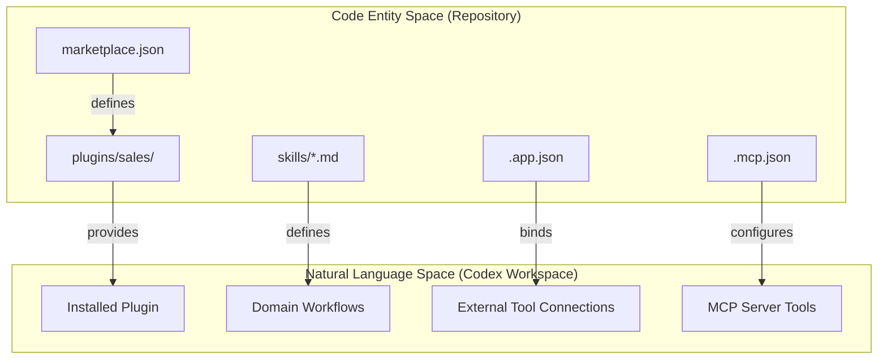
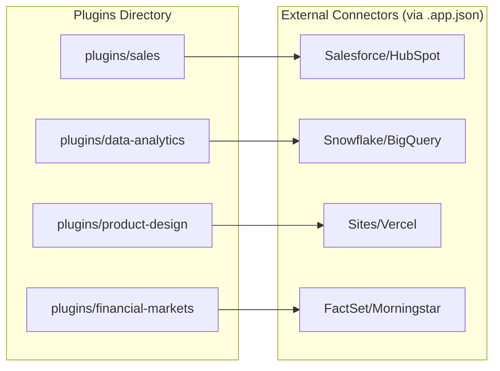

<!-- source: DeepWiki mcp.deepwiki.com · repo openai/role-specific-plugins · page 1 Overview · fetched 2026-10-26 -->

# Overview

Relevant source files

The following files were used as context for generating this wiki page:

- [.agents/plugins/marketplace.json](.agents/plugins/marketplace.json)
- [LICENSE](LICENSE)
- [README.md](README.md)
- [SECURITY.md](SECURITY.md)

The **Role-Specific Plugins** repository provides a collection of templates designed to customize Codex for specialized professional workflows. These plugins package domain-specific skills, connector bindings, and starter assets to streamline tasks for roles such as sales, data analytics, product design, and financial markets [README.md:1-9]().

Each plugin acts as a modular unit that can be installed into a Codex workspace to provide an AI agent with the context, tools, and instructions necessary to perform complex, multi-step industry workflows [README.md:3-9]().

## Repository Structure

The repository is organized by plugin, with a central marketplace manifest defining the available local sources.

### High-Level Layout
The root directory contains the plugin definitions and the marketplace registry.
- `.agents/plugins/marketplace.json`: The central registry defining the plugin names and their local paths [ .agents/plugins/marketplace.json:1-56]().
- `plugins/`: Contains the individual plugin directories [README.md:29-33]().

### Plugin Directory Convention
Each plugin follows a standard internal structure to ensure compatibility with the Codex platform:

| File/Folder | Purpose |
| :--- | :--- |
| `.codex-plugin/plugin.json` | Plugin manifest and display metadata [README.md:40](). |
| `.app.json` | Registry for app and connector bindings [README.md:41](). |
| `.mcp.json` | Model Context Protocol (MCP) server configuration [README.md:42](). |
| `skills/` | Markdown files containing workflow instructions and domain context [README.md:43](). |
| `assets/` | Supporting icons, templates, and binary examples [README.md:44](). |

### Code-to-Workspace Mapping
The following diagram illustrates how the code entities in the repository map to the functional components within a Codex environment.

**Diagram: Repository Entity Mapping**

Sources: [.agents/plugins/marketplace.json:1-56](), [README.md:36-46]()

## Included Plugins

The repository currently includes four primary plugins, each targeting a specific professional domain:

| Plugin | Core Functionality | Primary Connectors |
| :--- | :--- | :--- |
| **Sales** | Meeting prep, follow-ups, pipeline review, and deal strategy. | Salesforce, HubSpot, Slack, ZoomInfo [README.md:19](). |
| **Data Analytics** | Data visualization, metric diagnostics, and dashboard building. | Snowflake, Databricks, BigQuery, Mixpanel [README.md:20](). |
| **Product Design** | Prototyping, UI critiques, and spec generation. | Sites [README.md:21](). |
| **Financial Markets** | Earnings analysis, valuation modeling, and investment memos. | FactSet, LSEG, Daloopa, Bloomberg [README.md:22](). |

**Diagram: Plugin Dependency and Connector Flow**

Sources: [README.md:15-22](), [.agents/plugins/marketplace.json:6-55]()

## Getting Started

To use these plugins, you must clone the repository and configure the connector bindings. Many plugins use placeholder IDs in their `.app.json` files (e.g., `REPLACE_WITH_SALESFORCE_APP_OR_CONNECTOR_ID`) which must be updated to match the IDs in your specific workspace [README.md:48-61]().

1. **Clone & Explore**: Review the `plugins/` directory to select the role relevant to your team.
2. **Configure Bindings**: Edit the `.app.json` within your chosen plugin to replace placeholder IDs with your workspace's connector IDs [README.md:63-70]().
3. **Install**: Load the plugin into your Codex environment via the local source path defined in `marketplace.json`.

For detailed setup instructions, including how to handle portable vs. non-portable connector bindings, see **[Getting Started & Configuration](#1.1)**.

For a deep dive into how the `plugin.json` manifest and the `skills/` directory interact to create the user experience, see **[Plugin Framework & Manifest Structure](#1.2)**.

Sources: [README.md:48-78](), [.agents/plugins/marketplace.json:1-56]()

---

