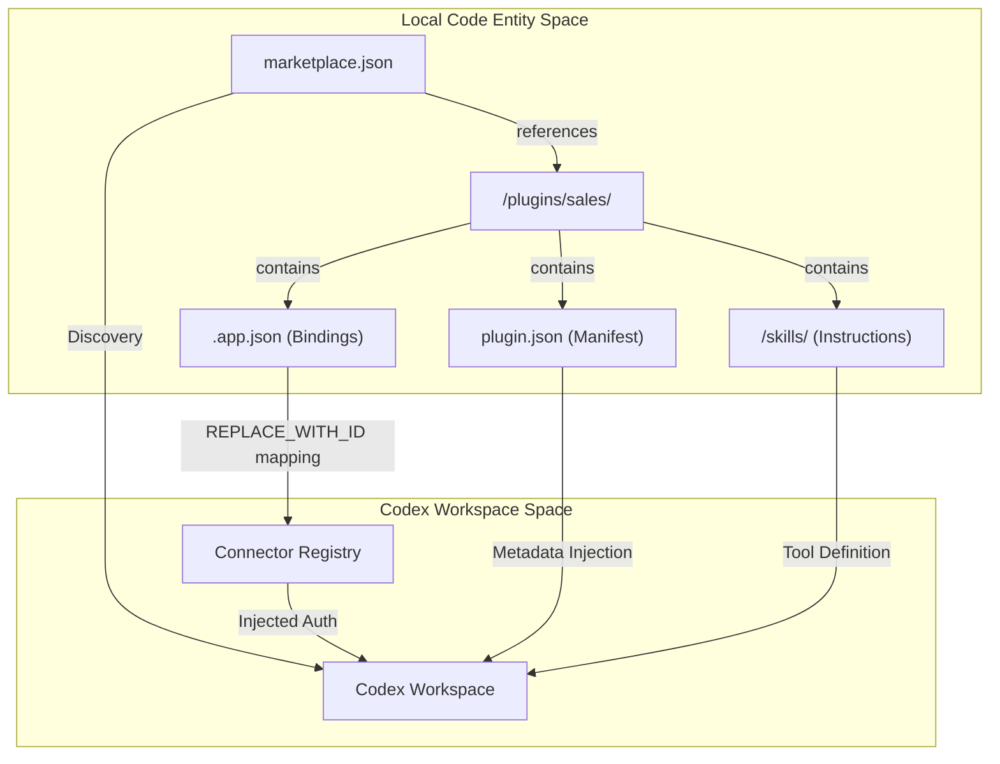
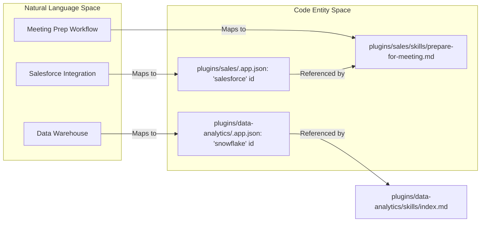

<!-- source: DeepWiki mcp.deepwiki.com · repo openai/role-specific-plugins · page 1.1 Getting Started & Configuration · fetched 2026-10-26 -->

# Getting Started & Configuration

Relevant source files

The following files were used as context for generating this wiki page:

- [.agents/plugins/marketplace.json](.agents/plugins/marketplace.json)
- [README.md](README.md)
- [plugins/data-analytics/.app.json](plugins/data-analytics/.app.json)

This page provides a technical guide for initializing and configuring the `role-specific-plugins` repository. It covers the transition from cloning the source code to deploying functional plugins within a Codex workspace, with a specific focus on the connector binding lifecycle and configuration requirements.

### Repository Initialization

The repository is structured as a multi-plugin monorepo where each plugin is a self-contained unit located under the `plugins/` directory [README.md:24-34](). The marketplace configuration, which governs how these plugins are discovered by the platform, is defined in `.agents/plugins/marketplace.json` [.agents/plugins/marketplace.json:1-56]().

#### Setup Workflow
1. **Clone the Repository**: Obtain the source code from the GitHub repository.
2. **Environment Review**: Ensure you have access to a Codex workspace where you have permissions to install local plugins.
3. **Connector Mapping**: Identify which third-party services (Salesforce, Slack, Snowflake, etc.) are required for your target plugin.
4. **Binding Configuration**: Modify the `.app.json` files within the specific plugin directories to link your workspace's connector instances.

### Connector Configuration & .app.json

Plugins interact with external data through **Connectors**. These connections are defined in a `.app.json` file located at the root of each plugin directory [README.md:41]().

#### Portable vs. Non-Portable Bindings
The framework distinguishes between three types of IDs in the `apps` registry:

| Binding Type | ID Pattern | Action Required |
| :--- | :--- | :--- |
| **Portable (Template)** | `templated_apps_*` | **Leave unchanged.** These refer to global template registries [README.md:71-72](). |
| **Portable (Canonical)** | `connector_*` | **Leave unchanged.** These are shared platform IDs available across workspaces [README.md:71-72](). |
| **Non-Portable (Placeholder)** | `REPLACE_WITH_*` | **Must be replaced.** These are specific to your organization's app installations [README.md:50-61](). |

#### Example: Data Analytics Connector Registry
In `plugins/data-analytics/.app.json`, you will find a mix of these binding types:

*   **Portable Binding**: `google_drive` uses `connector_5f3c8c41a1e54ad7a76272c89e2554fa` [plugins/data-analytics/.app.json:29-31]().
*   **Template Binding**: `snowflake` uses `templated_apps_Snowflake` [plugins/data-analytics/.app.json:40-43]().
*   **Placeholder Binding**: `slack` requires a local workspace ID to replace `REPLACE_WITH_SLACK_APP_OR_CONNECTOR_ID` [plugins/data-analytics/.app.json:3-5]().

**Sources:** [README.md:48-78](), [plugins/data-analytics/.app.json:1-85]()

### Implementation Diagram: Plugin Installation Data Flow

The following diagram illustrates how the local filesystem configuration maps to the Codex platform's internal registry during the installation process.

**Plugin Registration Architecture**

**Sources:** [.agents/plugins/marketplace.json:1-56](), [README.md:36-46](), [README.md:48-61]()

### Handling Optional Connectors

Many plugins define connectors as `optional: true`. If your workspace does not use a specific service (e.g., you use Google Drive but not SharePoint), you have two choices:
1. **Keep and Ignore**: Leave the placeholder as is; the plugin will attempt to initialize but fail gracefully for that specific tool.
2. **Clean Installation**: Remove the entire app block from `.app.json` before installation to prevent the platform from prompting for missing credentials [README.md:76-78]().

### Technical Entity Mapping

This diagram bridges the Natural Language concepts of "Tools" and "Skills" to the specific file entities in the codebase.

**Entity Mapping: Natural Language to Code Space**

**Sources:** [README.md:17-22](), [plugins/data-analytics/.app.json:1-85](), [README.md:39-46]()

### Installation Steps into Codex

Once `.app.json` is configured with valid IDs:

1.  **Open Codex Workspace**: Navigate to your developer settings or plugin management interface.
2.  **Add Local Plugin**: Point the workspace to the directory containing the `marketplace.json` file.
3.  **Authentication**: Since most plugins are configured with `"authentication": "ON_USE"` [.agents/plugins/marketplace.json:15](), you will be prompted to sign in to the mapped connectors (Salesforce, Slack, etc.) the first time a skill is invoked.
4.  **Verification**: Invoke the `index` skill of the plugin to verify that all connectors are successfully bound and accessible.

**Sources:** [.agents/plugins/marketplace.json:1-56](), [README.md:1-13]()

---

