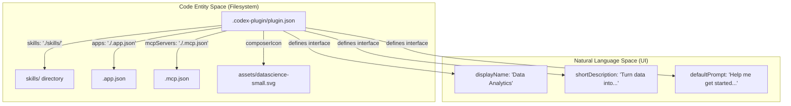
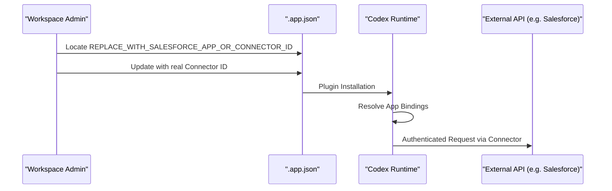

<!-- source: DeepWiki mcp.deepwiki.com · repo openai/role-specific-plugins · page 1.2 Plugin Framework & Manifest Structure · fetched 2026-10-26 -->

# Plugin Framework & Manifest Structure

Relevant source files

The following files were used as context for generating this wiki page:

- [README.md](README.md)
- [plugins/data-analytics/.codex-plugin/plugin.json](plugins/data-analytics/.codex-plugin/plugin.json)
- [plugins/data-analytics/.gitignore](plugins/data-analytics/.gitignore)
- [plugins/data-analytics/.mcp.json](plugins/data-analytics/.mcp.json)

The Role-Specific Plugins repository utilizes a standardized directory convention to package domain-specific intelligence, external integrations, and user interface components. This framework allows for a modular "plug-and-play" architecture where skills, connector bindings, and Model Context Protocol (MCP) servers are defined declaratively via manifest files.

## Plugin Directory Architecture

Each plugin is contained within a dedicated directory under `plugins/` and follows a consistent structure to ensure compatibility with the Codex workspace environment [README.md:24-34]().

| File/Directory | Purpose |
| :--- | :--- |
| `.codex-plugin/plugin.json` | The primary manifest containing metadata, versioning, and entry points [README.md:40](). |
| `.app.json` | Registry for external application and connector bindings [README.md:41](). |
| `.mcp.json` | Configuration for MCP servers used to provide custom tools or UI widgets [README.md:42](). |
| `skills/` | Markdown-based instruction sets defining specific workflows [README.md:43](). |
| `assets/` | Static resources including icons, templates, and compressed widget bundles [README.md:44](). |

### Sources:
- [README.md:24-46]()

---

## The Plugin Manifest (`plugin.json`)

The `plugin.json` file, located in the `.codex-plugin/` subdirectory, serves as the source of truth for the plugin's identity and capabilities. It maps the high-level plugin definition to the underlying file system entities [plugins/data-analytics/.codex-plugin/plugin.json:1-41]().

### Key Manifest Properties
- **Metadata**: Fields like `name`, `version`, and `description` define how the plugin is indexed [plugins/data-analytics/.codex-plugin/plugin.json:2-4]().
- **Entry Points**: The `skills`, `apps`, and `mcpServers` keys point to the relative paths of their respective configuration files or directories [plugins/data-analytics/.codex-plugin/plugin.json:39-41]().
- **Interface**: The `interface` object controls the plugin's appearance in the Codex UI, including `brandColor`, `composerIcon`, and `defaultPrompt` suggestions [plugins/data-analytics/.codex-plugin/plugin.json:42-65]().

### Manifest to Code Entity Mapping
The following diagram illustrates how the `plugin.json` manifest bridges the Natural Language Space (UI/Descriptions) to the Code Entity Space (Files/Logic).

**Diagram: Manifest Entity Mapping**

### Sources:
- [plugins/data-analytics/.codex-plugin/plugin.json:1-66]()

---

## Connector Bindings (`.app.json`)

The `.app.json` file manages the lifecycle of external integrations. It acts as a mapping layer between generic application keys (e.g., `salesforce`) and specific environment IDs [README.md:50-55]().

### Binding Types
1.  **Portable Bindings**: IDs starting with `templated_apps_*` or canonical platform IDs. These are pre-configured and should not be modified [README.md:71-74]().
2.  **Placeholder Bindings**: IDs using the `REPLACE_WITH_...` pattern. These require manual intervention by the administrator before activation [README.md:57-61]().

### Activation Flow
The activation of a plugin involves resolving these placeholders to actual connector instances within the target workspace [README.md:63-65]().

**Diagram: Connector Activation Lifecycle**

### Sources:
- [README.md:48-78]()

---

## MCP Server Configuration (`.mcp.json`)

For plugins requiring custom UI or complex tool execution, the `.mcp.json` file defines Model Context Protocol servers. This allows the plugin to execute code locally or in a containerized environment to provide "widgets" [plugins/data-analytics/.mcp.json:1-5]().

### Server Definition
The configuration specifies the runtime environment and the entry point for the server:
- **Command**: Typically `node` or `python` [plugins/data-analytics/.mcp.json:23]().
- **Arguments**: Path to the server implementation, such as `./mcp/server.cjs`, and the transport protocol (e.g., `--stdio`) [plugins/data-analytics/.mcp.json:24-27]().
- **CWD**: The current working directory context for the server process [plugins/data-analytics/.mcp.json:22]().

### Sources:
- [plugins/data-analytics/.mcp.json:1-30]()

---

## Skills and Assets

### Skills Directory
The `skills/` directory contains the core logic of the plugin. Each skill is typically a Markdown file that provides the LLM with specific instructions, few-shot examples, and tool-use guidelines [README.md:43](). These are indexed by the plugin and made available as distinct capabilities during a session.

### Assets Directory
The `assets/` directory stores static content:
- **Visuals**: Logos (`.png`) and icons (`.svg`) referenced by the `plugin.json` [plugins/data-analytics/.codex-plugin/plugin.json:62-63]().
- **UI Components**: In the case of the Data Analytics plugin, this directory may contain compressed asset parts for React-based widgets [plugins/data-analytics/.mcp.json:8-20]().

### Sources:
- [README.md:43-44]()
- [plugins/data-analytics/.codex-plugin/plugin.json:62-63]()
- [plugins/data-analytics/.mcp.json:6-21]()

---

