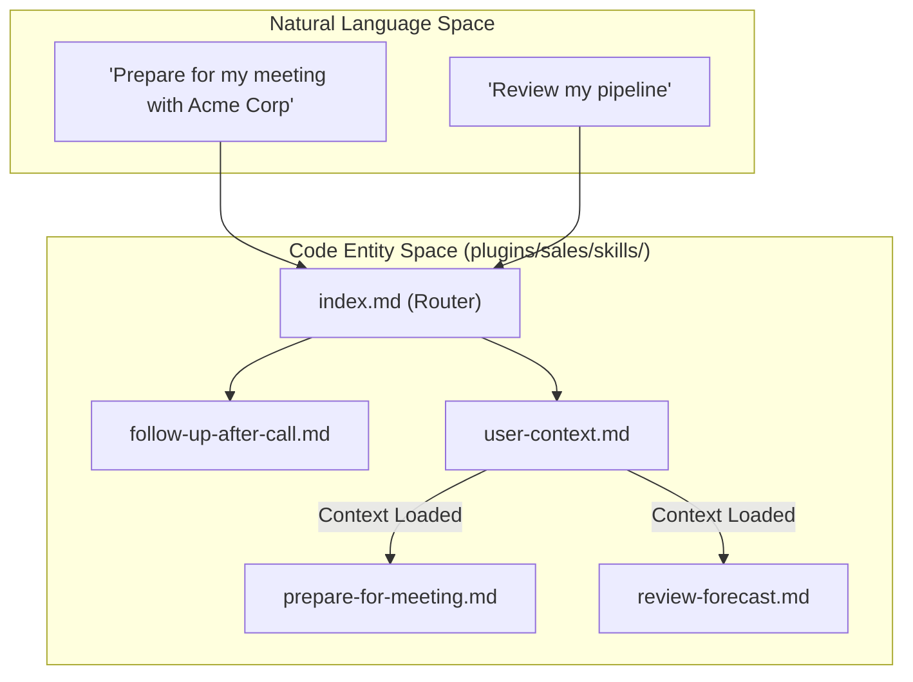
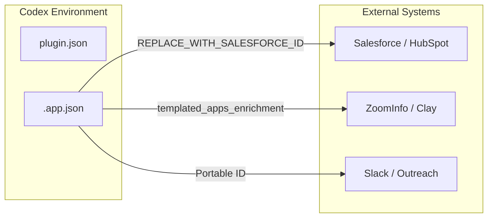

<!-- source: DeepWiki mcp.deepwiki.com · repo openai/role-specific-plugins · page 2 Sales Plugin · fetched 2026-10-26 -->

# Sales Plugin

Relevant source files

The following files were used as context for generating this wiki page:

- [.agents/plugins/marketplace.json](.agents/plugins/marketplace.json)
- [README.md](README.md)

The Sales plugin is designed to streamline the daily operations of sales professionals by automating high-frequency workflows such as meeting preparation, post-call follow-ups, and pipeline management. It leverages a suite of domain-specific skills and deep integrations with CRM, messaging, and sales enrichment tools to reduce administrative overhead and improve deal execution.

## Overview and Purpose

The Sales plugin serves as a centralized intelligence layer for sales teams. It is defined in the repository at `plugins/sales` [.agents/plugins/marketplace.json:11](). Its primary purpose is to assist users in navigating the complex sales lifecycle—from initial account research to closing deals and forecasting revenue.

By integrating with tools like Salesforce, HubSpot, Slack, and ZoomInfo [README.md:19](), the plugin allows sales reps to pull real-time data into their workflows without manual context switching.

### Key Capabilities
*   **Meeting Lifecycle:** Automated preparation briefs and post-call follow-up generation.
*   **Strategic Planning:** Deal strategy planning, business case construction, and competitive intelligence.
*   **Pipeline Hygiene:** Account prioritization, signal analysis, and forecast reviews.
*   **Data Enrichment:** Contact and company data enrichment via specialized sales tools.

## Skill Architecture

The Sales plugin follows a modular "Skill" architecture where each workflow is encapsulated in a dedicated instruction set within the `skills/` directory [README.md:43](). 

### Skill Invocation Flow
The plugin uses a routing pattern where a user's intent is mapped to a specific skill. Most workflows are gated by a `user-context` preflight check to ensure the plugin has the necessary background on the rep's territory and current priorities.

The diagram below illustrates how natural language requests transition into the execution of specific code-based skill entities.

**Sales Skill Dispatcher Map**

Sources: [README.md:39-46](), [.agents/plugins/marketplace.json:8-12]()

For a complete reference of all available skills and their specific instruction sets, see **[Sales Skills & Workflows (#2.1)](#)**.

## Connector Integrations

The Sales plugin relies on a robust set of connector bindings defined in `.app.json` [README.md:41](). These connectors bridge the gap between the AI's reasoning and the team's system of record (CRM), communication channels, and external data providers.

### Integration Categories
| Category | Supported Tools |
| :--- | :--- |
| **CRM** | Salesforce, HubSpot, Close, Zoho, Pipedrive |
| **Messaging** | Slack, Microsoft Teams, Outreach |
| **Intelligence** | ZoomInfo, Clay, Apollo, Rox, Actively |
| **Productivity** | Google Drive, Gmail, Outlook, Zoom, Fireflies |

**Connector Binding Architecture**

Sources: [README.md:19](), [README.md:53-61]()

### Configuration Note
Many connector bindings in the Sales plugin use placeholder IDs (e.g., `REPLACE_WITH_SALESFORCE_APP_OR_CONNECTOR_ID`) that must be updated to match your specific environment before deployment [README.md:57-68]().

For detailed setup instructions and a registry of portable vs. non-portable IDs, see **[Sales Connector Bindings (#2.2)](#)**.

## Related Pages
*   **[Sales Skills & Workflows (#2.1)](#)**: Deep dive into the logic for `prepare-for-meeting`, `analyze-account-signals`, and more.
*   **[Sales Connector Bindings (#2.2)](#)**: Technical guide for configuring `.app.json` and managing CRM permissions.

---

