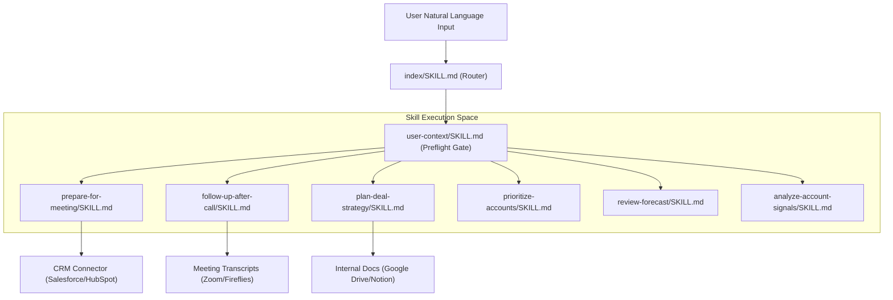
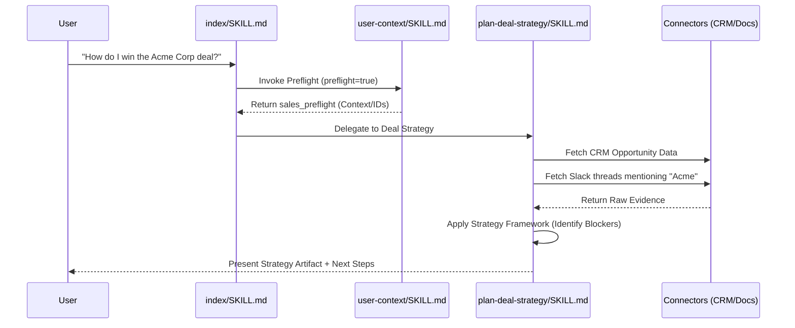

<!-- source: DeepWiki mcp.deepwiki.com · repo openai/role-specific-plugins · page 2.1 Sales Skills & Workflows · fetched 2026-10-26 -->

# Sales Skills & Workflows

Relevant source files

The following files were used as context for generating this wiki page:

- [plugins/data-analytics/skills/analyze-data-quality/SKILL.md](plugins/data-analytics/skills/analyze-data-quality/SKILL.md)
- [plugins/data-analytics/skills/analyze-data-quality/agents/openai.yaml](plugins/data-analytics/skills/analyze-data-quality/agents/openai.yaml)
- [plugins/data-analytics/skills/index/SKILL.md](plugins/data-analytics/skills/index/SKILL.md)
- [plugins/data-analytics/skills/index/agents/openai.yaml](plugins/data-analytics/skills/index/agents/openai.yaml)
- [plugins/data-analytics/skills/user-context/SKILL.md](plugins/data-analytics/skills/user-context/SKILL.md)
- [plugins/data-analytics/skills/user-context/agents/openai.yaml](plugins/data-analytics/skills/user-context/agents/openai.yaml)

The Sales plugin provides a suite of specialized skills designed to automate and enhance common sales activities, from meeting preparation and deal strategy to forecast reviews and competitive intelligence. Each skill is grounded in connected company data (CRM, meeting notes, messaging) to ensure outputs are specific to the user's accounts and opportunities.

## Technical Architecture & Invocation Pattern

All Sales workflows follow a standardized invocation pattern centered around a mandatory preflight gate. This ensures that every action is informed by the user's specific context, saved preferences, and connected data sources.

### User Context Preflight Gate
Before any Sales skill executes its primary logic, it must invoke the `user-context` skill in preflight mode. This gate loads durable source-routing preferences, onboarding progress, and account-specific context.

*   **Implementation**: Preflight is typically handled by a dedicated script (e.g., `scripts/sales_preflight.py` or equivalent) that reads from `$CODEX_HOME/state/plugins/{marketplace_id}/{plugin_id}/user-context.md` [plugins/data-analytics/skills/user-context/SKILL.md:12-15]().
*   **Data Flow**: The preflight returns a `sales_preflight` envelope containing `source_preferences`, `connector_setup_summary`, and `final_obligations` [plugins/data-analytics/skills/user-context/SKILL.md:15-15]().

### The Index Router
The `index` skill serves as the primary entry point for the plugin. It analyzes natural language intent to route the user to the most appropriate focused skill.

*   **Routing Logic**: It applies Source Discovery and Verification across CRM, documents, and communication lanes before selecting a response mode (`inline` for quick lookups or `report` for deep analysis) [plugins/data-analytics/skills/index/SKILL.md:44-66]().

### Natural Language to Code Entity Mapping

The following diagram illustrates how user requests are mapped to specific code entities and skills within the Sales plugin.

**Sales Skill Routing Map**

**Sources:** [plugins/data-analytics/skills/index/SKILL.md:1-66](), [plugins/data-analytics/skills/user-context/SKILL.md:1-38]()

---

## Sales Skill Catalog

### Account & Deal Management

| Skill | Purpose | Key Data Sources |
| :--- | :--- | :--- |
| `prepare-for-meeting` | Generates briefings including recent news, CRM history, and stakeholder bios. | CRM, LinkedIn, News APIs |
| `plan-deal-strategy` | Identifies blockers, champions, and next steps for specific opportunities. | CRM, Slack/Teams, Internal Docs |
| `prioritize-accounts` | Ranks accounts based on intent signals, firmographics, and recent activity. | CRM, Enrichment (ZoomInfo/6sense) |
| `analyze-account-signals` | Detects "buying signals" from external news or internal product usage data. | News, Product Analytics, CRM |

### Post-Call & Execution

| Skill | Purpose | Key Data Sources |
| :--- | :--- | : :--- |
| `follow-up-after-call` | Drafts personalized follow-up emails and updates CRM fields based on call transcripts. | Meeting Notes, CRM, Email |
| `get-rep-call-feedback` | Analyzes call recordings for coaching moments (objection handling, discovery quality). | Meeting Transcripts |
| `suggest-sales-next-step` | Predicts the most effective next action based on historical winning patterns. | CRM Historical Data |

### Strategy & Intelligence

| Skill | Purpose | Key Data Sources |
| :--- | :--- | :--- |
| `build-competitive-brief` | Synthesizes competitor strengths/weaknesses against the user's value prop. | Battlecards, Web Search |
| `build-business-case` | Creates ROI models and justification decks for prospects. | Spreadsheets, Templates |
| `find-customer-quotes` | Locates relevant testimonials or case studies based on the prospect's industry/use-case. | Marketing Docs, CMS |

### Sales Operations

| Skill | Purpose | Key Data Sources |
| :--- | :--- | :--- |
| `review-forecast` | Analyzes pipeline health, identifies "at-risk" deals, and validates close dates. | CRM Forecast, Activity Logs |
| `review-rep-call-trends` | Aggregates themes across multiple calls (e.g., "competitor X is appearing more"). | Aggregate Transcripts |
| `enrich-company-and-contact-data` | Fills missing CRM fields (emails, titles, revenue) using third-party providers. | ZoomInfo, Apollo, Clay |

**Sources:** [plugins/data-analytics/skills/index/SKILL.md:1-3](), [plugins/data-analytics/skills/analyze-data-quality/SKILL.md:2-3]()

---

## Data Flow: From Intent to Artifact

The following diagram details the internal data flow when a user invokes a complex skill like `plan-deal-strategy`.

**Detailed Skill Data Flow**

**Sources:** [plugins/data-analytics/skills/index/SKILL.md:46-59](), [plugins/data-analytics/skills/user-context/SKILL.md:33-38]()

## Quality & Validation Standards

For skills involving data analysis (like `review-forecast` or `analyze-account-signals`), the plugin incorporates a **Data Quality Gate** [plugins/data-analytics/skills/analyze-data-quality/SKILL.md:6-9]().

1.  **Trust Assessment**: Before reporting pipeline risks, the skill assesses whether the CRM data is "trustworthy" (e.g., checking for stale close dates or missing mandatory fields) [plugins/data-analytics/skills/analyze-data-quality/SKILL.md:8-9]().
2.  **Compact Profiling**: It builds a profile of the dataset (row counts, null rates in "Amount" fields) to identify anomalies before interpretation [plugins/data-analytics/skills/analyze-data-quality/SKILL.md:31-35]().
3.  **Remediation**: If quality is low, the skill recommends the "smallest useful remediation" (e.g., "Update these 5 deals with missing amounts before forecasting") [plugins/data-analytics/skills/analyze-data-quality/SKILL.md:73-75]().

**Sources:** [plugins/data-analytics/skills/analyze-data-quality/SKILL.md:1-98]()

---

