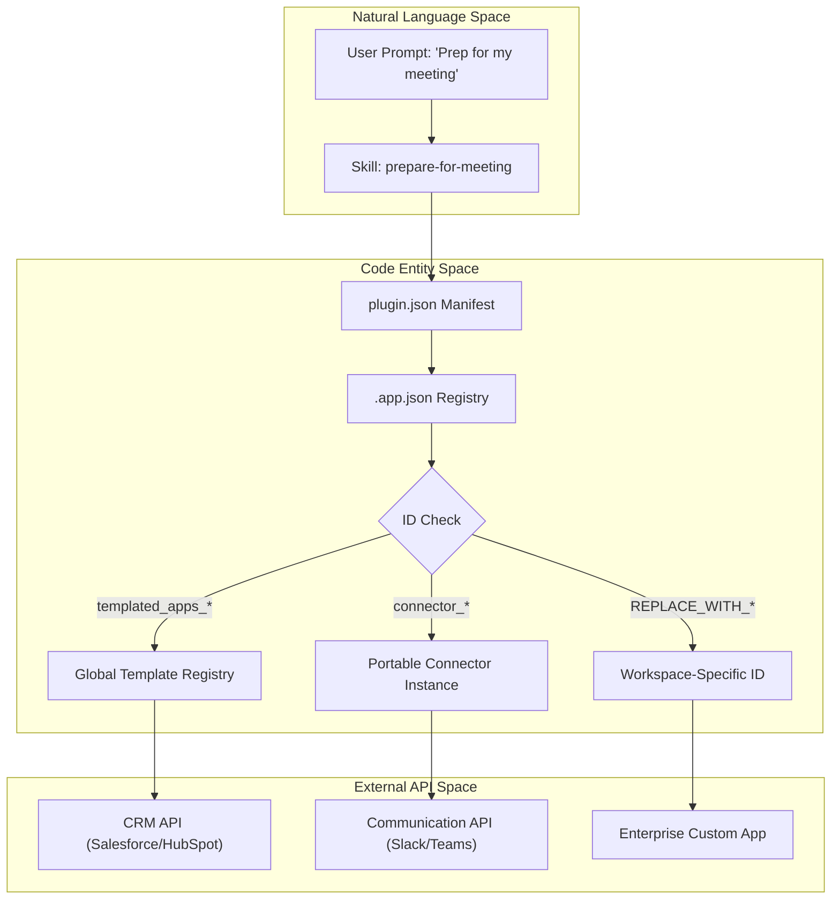
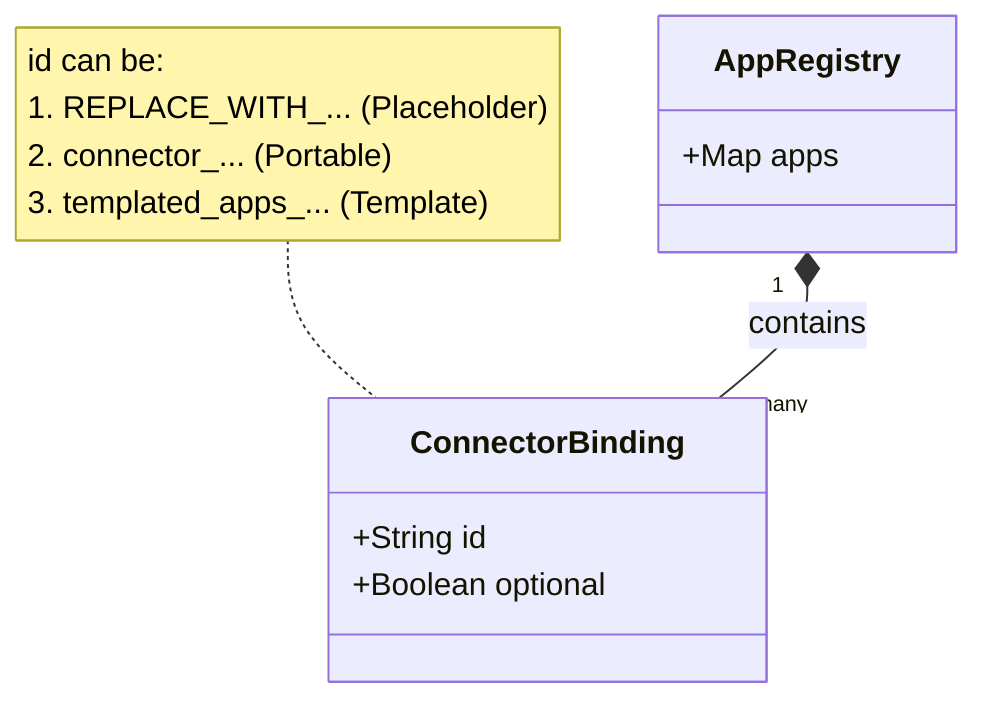

<!-- source: DeepWiki mcp.deepwiki.com · repo openai/role-specific-plugins · page 2.2 Sales Connector Bindings · fetched 2026-10-26 -->

# Sales Connector Bindings

Relevant source files

The following files were used as context for generating this wiki page:

- [README.md](README.md)
- [plugins/data-analytics/.app.json](plugins/data-analytics/.app.json)

The Sales plugin relies on a robust registry of external service integrations defined in its connector bindings. These bindings bridge the natural language requests of a sales representative (e.g., "Find my next meeting in Zoom") to specific API entities within the Codex environment. The configuration is primarily managed through the `.app.json` file located in the plugin root [plugins/sales/.app.json]().

## Connector Registry Overview

The Sales plugin categorizes its connectors into five functional domains: CRM, Meeting Intelligence, Messaging, Enrichment, and Productivity. These connectors are defined in the `apps` object within `.app.json`.

### CRM Systems
These connectors serve as the primary source of truth for account, lead, and opportunity data.

| System | Binding ID Type | Portability |
| :--- | :--- | :--- |
| **Salesforce** | `REPLACE_WITH_SALESFORCE_APP_OR_CONNECTOR_ID` | Placeholder (Requires Manual Update) |
| **HubSpot** | `connector_*` | Portable |
| **Close** | `connector_*` | Portable |
| **Zoho CRM** | `connector_*` | Portable |
| **Pipedrive** | `connector_*` | Portable |

### Meeting & Messaging Tools
Used for extracting meeting transcripts, scheduling follow-ups, and internal team coordination.

| System | Binding ID Type | Description |
| :--- | :--- | :--- |
| **Zoom** | `connector_*` | Meeting audio/video and transcripts. |
| **Granola** | `connector_*` | AI-enhanced meeting notes. |
| **Fireflies** | `connector_*` | Automated transcription and search. |
| **Otter.ai** | `connector_*` | Live transcription and notes. |
| **Slack** | `REPLACE_WITH_SLACK_APP_OR_CONNECTOR_ID` | Internal communication and deal rooms. |
| **Microsoft Teams** | `connector_*` | Video conferencing and chat. |

### Enrichment & Prospecting
These tools provide external data signals to build business cases and find new contacts.

| System | Binding ID Type | Category |
| :--- | :--- | :--- |
| **ZoomInfo** | `connector_*` | B2B Intelligence |
| **Clay** | `connector_*` | Data Orchestration |
| **Apollo** | `connector_*` | Lead Generation |
| **Rox** | `connector_*` | AI Sales Signals |
| **Actively** | `connector_*` | Intent Monitoring |

### Productivity & Documents
Standard office suite integrations for calendars, email, and document storage.

| System | Binding ID Type | Role |
| :--- | :--- | :--- |
| **Google Drive** | `connector_*` | Proposal and deck storage. |
| **Gmail** | `connector_*` | Customer correspondence. |
| **Outlook** | `connector_*` | Enterprise email and calendar. |

Sources: [README.md:17-22](), [README.md:50-61]()

## Implementation and Data Flow

The Sales plugin uses these bindings to resolve skill requirements during the execution of a workflow. When a skill like `prepare-for-meeting` is invoked, the system references `.app.json` to identify which specific connector instance should be used to fetch the latest account notes.

### Connector Resolution Logic
The following diagram illustrates how the system resolves a connector binding from a skill request to the external API.

**Diagram: Connector Binding Resolution Flow**

Sources: [README.md:36-46](), [README.md:50-61]()

## Placeholder vs. Portable IDs

The `.app.json` configuration distinguishes between IDs that are "portable" (shared across all Codex environments) and "placeholders" (which must be generated per workspace).

### 1. Placeholder IDs
Placeholders use the prefix `REPLACE_WITH_`. These are typically used for applications where the connector must be manually authenticated or created within the specific target workspace [README.md:50-61]().
*   **Salesforce:** `REPLACE_WITH_SALESFORCE_APP_OR_CONNECTOR_ID` [README.md:68-68]().
*   **Slack:** `REPLACE_WITH_SLACK_APP_OR_CONNECTOR_ID` [plugins/data-analytics/.app.json:3-5]().

### 2. Portable IDs
Portable IDs allow the plugin to function "out of the box" if the connector is already globally registered or uses a standard template [README.md:71-74]().
*   **Connector Prefix:** `connector_` followed by a UUID (e.g., `connector_5f3c8c41...` for Google Drive) [plugins/data-analytics/.app.json:29-31]().
*   **Templated Apps:** `templated_apps_` followed by the service name (e.g., `templated_apps_Databricks`) [plugins/data-analytics/.app.json:32-35]().

### 3. Optional Bindings
Many connectors in the Sales registry are marked with `"optional": true`. This allows the plugin to remain functional even if a workspace does not utilize every supported tool (e.g., a team using HubSpot instead of Salesforce) [plugins/data-analytics/.app.json:7-9]().

**Diagram: Binding Structure in .app.json**

Sources: [README.md:53-61](), [plugins/data-analytics/.app.json:1-84]()

## Configuration Workflow

To initialize the Sales connector bindings:
1.  **Identify Required Apps:** Review the `.app.json` and determine which CRM and messaging tools the team uses.
2.  **Replace Placeholders:** Navigate to the Codex workspace settings, locate the App ID or Connector ID for Salesforce/Slack, and update the `.app.json` file [README.md:63-65]().
3.  **Prune Unused Apps:** If a connector is not used by the team and is not required for core skills, it can be removed from the `apps` object to reduce noise [README.md:76-78]().

Sources: [README.md:48-78]()

---

