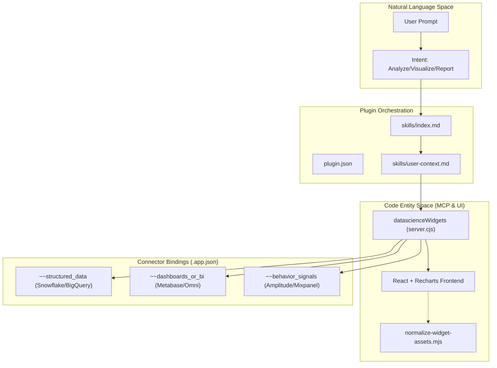
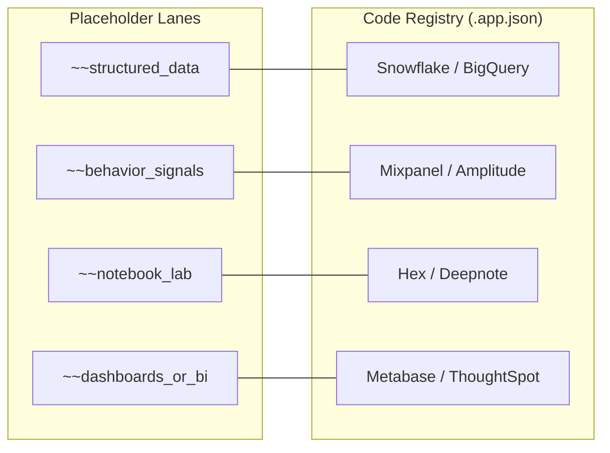

<!-- source: DeepWiki mcp.deepwiki.com · repo openai/role-specific-plugins · page 3 Data Analytics Plugin · fetched 2026-10-26 -->

# Data Analytics Plugin

Relevant source files

The following files were used as context for generating this wiki page:

- [plugins/data-analytics/.codex-plugin/plugin.json](plugins/data-analytics/.codex-plugin/plugin.json)
- [plugins/data-analytics/AGENTS.md](plugins/data-analytics/AGENTS.md)
- [plugins/data-analytics/DEPENDENCIES.MD](plugins/data-analytics/DEPENDENCIES.MD)
- [plugins/data-analytics/README.md](plugins/data-analytics/README.md)

The Data Analytics plugin is designed to turn complex analytical questions into validated answers, interactive dashboards, and executive-ready reports. It enables users to understand product and business performance, diagnose metric movements, and establish data-driven measurement plans.

The plugin operates as a tool-agnostic framework that uses "lane placeholders" to interact with various data sources, ranging from enterprise data warehouses to local spreadsheets and uploaded files [[plugins/data-analytics/DEPENDENCIES.MD:3-8](), [plugins/data-analytics/.codex-plugin/plugin.json:42-45]()].

## Core Capabilities

*   **Metric Diagnostics & KPI Design**: Identify drivers behind metric changes and design measurement frameworks with outcome metrics, guardrails, and targets [[plugins/data-analytics/README.md:28-29](), [plugins/data-analytics/.codex-plugin/plugin.json:17-19]()].
*   **Interactive Visualization**: Generate production-ready charts, tables, and dashboards using a specialized MCP widget architecture [[plugins/data-analytics/README.md:31-34](), [plugins/data-analytics/AGENTS.md:3-5]()].
*   **Automated Reporting**: Create polished analytical reports and reproducible Jupyter/SQL notebooks [[plugins/data-analytics/README.md:33-35]()].
*   **Data Quality & Validation**: Assess table reliability (grain, freshness, missingness) and perform QA on existing analyses [[plugins/data-analytics/README.md:37-38]()].

## Architecture Overview

The plugin architecture bridges high-level natural language requests to specific technical implementations via an MCP (Model Context Protocol) server and a React-based widget system.

### Data Analytics System Flow
The following diagram illustrates how the plugin maps user intent to code entities and external data connectors.

Sources: [plugins/data-analytics/.codex-plugin/plugin.json:39-42](), [plugins/data-analytics/AGENTS.md:16-20](), [plugins/data-analytics/DEPENDENCIES.MD:11-16]()

## Skill Catalog & Workflows

The plugin's functionality is partitioned into specialized skills located in the `skills/` directory. Every workflow is preceded by a mandatory `user-context` preflight gate to ensure the AI has access to the necessary data sources and business definitions.

| Workflow | Key Skill | Result |
| :--- | :--- | :--- |
| **Product/Business Analysis** | `product-business-analysis` | Decision-ready analysis with evidence and recommendations. |
| **Metric Diagnostics** | `metric-diagnostics` | Calibrated explanation of drivers and contributors. |
| **KPI Design** | `design-kpis` | Measurement plan with targets and validation priorities. |
| **Dashboard Building** | `build-dashboard` | Source-backed dashboard with filters and visual hierarchy. |
| **Analytical Reporting** | `build-report` | Polished report with answer-first narrative and charts. |

For a full reference of all 13+ skills and the mandatory preflight gate, see [Data Analytics Skills & Workflows (#3.1)](#).
Sources: [plugins/data-analytics/README.md:25-38](), [plugins/data-analytics/.codex-plugin/plugin.json:39-39]()

## MCP Widget Architecture

The plugin utilizes a custom MCP server (`datascienceWidgets`) to render interactive UI components. This architecture distinguishes between **inline widgets** (focused views of query results) and **fullscreen artifacts** (snapshot-first workspaces) [[plugins/data-analytics/AGENTS.md:3-5]()].

*   **Server**: Built on `server.cjs` using stdio transport.
*   **Frontend**: React + Recharts stack following a strict design contract defined in `tokens.css` and `codex-theme.css`.
*   **Build System**: A Vite-based pipeline and `normalize-widget-assets.mjs` script produce compressed `.gz.b64` assets for efficient plugin delivery.

For details on the server implementation and asset pipeline, see [MCP Server & Widget Architecture (#3.2)](#).
Sources: [plugins/data-analytics/AGENTS.md:9-10](), [plugins/data-analytics/AGENTS.md:16-20]()

## Connector Bindings

The Data Analytics plugin is "tool-agnostic," using lane placeholders (e.g., `~~structured_data`) to interact with various providers. These are mapped in the `.app.json` registry [[plugins/data-analytics/DEPENDENCIES.MD:3-5]()].

### Connector Mapping Logic

Sources: [plugins/data-analytics/DEPENDENCIES.MD:11-16](), [plugins/data-analytics/.codex-plugin/plugin.json:40-40]()

For documentation on the connector registry and placeholder patterns, see [Data Analytics Connector Bindings (#3.4)](#).

## Design System & Testing

The plugin follows a local Codex style contract to ensure visual consistency across metric cards, chart blocks, and report layouts. The test suite covers chart transformations, Recharts configurations, and MCP server contract compliance [[plugins/data-analytics/AGENTS.md:9-10](), [plugins/data-analytics/AGENTS.md:16-18]()].

For details on color tokens and the test suite, see [Data Analytics Design System & Testing (#3.3)](#).

---

