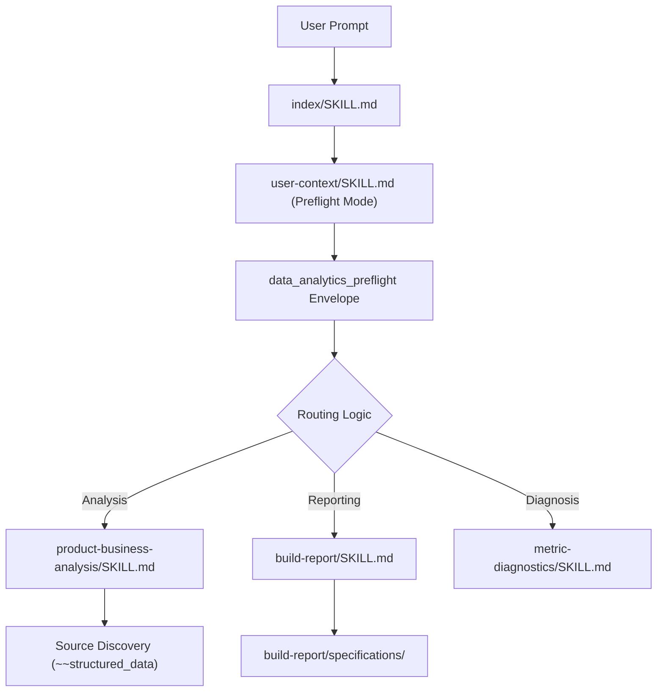
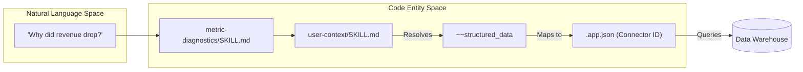

<!-- source: DeepWiki mcp.deepwiki.com · repo openai/role-specific-plugins · page 3.1 Data Analytics Skills & Workflows · fetched 2026-10-26 -->

# Data Analytics Skills & Workflows

Relevant source files

The following files were used as context for generating this wiki page:

- [plugins/data-analytics/DEPENDENCIES.MD](plugins/data-analytics/DEPENDENCIES.MD)
- [plugins/data-analytics/skills/analyze-data-quality/SKILL.md](plugins/data-analytics/skills/analyze-data-quality/SKILL.md)
- [plugins/data-analytics/skills/build-dashboard/SKILL.md](plugins/data-analytics/skills/build-dashboard/SKILL.md)
- [plugins/data-analytics/skills/build-report/SKILL.md](plugins/data-analytics/skills/build-report/SKILL.md)
- [plugins/data-analytics/skills/design-kpis/SKILL.md](plugins/data-analytics/skills/design-kpis/SKILL.md)
- [plugins/data-analytics/skills/gather-business-context/SKILL.md](plugins/data-analytics/skills/gather-business-context/SKILL.md)
- [plugins/data-analytics/skills/index/SKILL.md](plugins/data-analytics/skills/index/SKILL.md)
- [plugins/data-analytics/skills/jupyter-notebooks/SKILL.md](plugins/data-analytics/skills/jupyter-notebooks/SKILL.md)
- [plugins/data-analytics/skills/kpi-reporting/SKILL.md](plugins/data-analytics/skills/kpi-reporting/SKILL.md)
- [plugins/data-analytics/skills/market-sizing/SKILL.md](plugins/data-analytics/skills/market-sizing/SKILL.md)
- [plugins/data-analytics/skills/metric-diagnostics/SKILL.md](plugins/data-analytics/skills/metric-diagnostics/SKILL.md)
- [plugins/data-analytics/skills/product-business-analysis/SKILL.md](plugins/data-analytics/skills/product-business-analysis/SKILL.md)
- [plugins/data-analytics/skills/spreadsheets/SKILL.md](plugins/data-analytics/skills/spreadsheets/SKILL.md)
- [plugins/data-analytics/skills/user-context/SKILL.md](plugins/data-analytics/skills/user-context/SKILL.md)
- [plugins/data-analytics/skills/user-context/plugin-author-config/automation-config.md](plugins/data-analytics/skills/user-context/plugin-author-config/automation-config.md)
- [plugins/data-analytics/skills/user-context/plugin-author-config/source-category-config.json](plugins/data-analytics/skills/user-context/plugin-author-config/source-category-config.json)
- [plugins/data-analytics/skills/user-context/plugin-author-config/user-context-config.md](plugins/data-analytics/skills/user-context/plugin-author-config/user-context-config.md)

This page serves as the high-level reference for the Data Analytics plugin's skill architecture and operational workflows. The plugin is designed to be tool-agnostic, utilizing "lane placeholders" to interface with various data sources while maintaining consistent analytical standards across diverse environments.

## Overview of Analytics Skills

The Data Analytics plugin organizes its capabilities into specialized skills, each governed by a mandatory preflight gate. These skills range from low-level data quality assessments to high-level executive reporting.

### Core Analytical Skills
*   **[analyze-data-quality](plugins/data-analytics/skills/analyze-data-quality/SKILL.md)**: Assesses trustworthiness of datasets (nulls, duplicates, schema drift) before modeling or analysis [plugins/data-analytics/skills/analyze-data-quality/SKILL.md:1-10]().
*   **[metric-diagnostics](plugins/data-analytics/skills/metric-diagnostics/SKILL.md)**: Investigates why metrics move, quantifying drivers and validating hypotheses [plugins/data-analytics/skills/metric-diagnostics/SKILL.md:6-10]().
*   **[product-business-analysis](plugins/data-analytics/skills/product-business-analysis/SKILL.md)**: Provides evidence-backed recommendations for product decisions and opportunity sizing [plugins/data-analytics/skills/product-business-analysis/SKILL.md:6-10]().
*   **[design-kpis](plugins/data-analytics/skills/design-kpis/SKILL.md)**: Framework for defining success metrics, guardrails, and measurement plans [plugins/data-analytics/skills/design-kpis/SKILL.md:6-9]().
*   **[market-sizing](plugins/data-analytics/skills/market-sizing/SKILL.md)**: Estimates TAM/SAM/SOM using top-down or bottom-up modeling [plugins/data-analytics/skills/market-sizing/SKILL.md:6-10]().

### Delivery & Interface Skills
*   **[build-report](plugins/data-analytics/skills/build-report/SKILL.md)**: Orchestrates the creation of durable narratives (MCP or HTML). For details, see [Build-Report Skill & Export Scripts](#3.1.1) [plugins/data-analytics/skills/build-report/SKILL.md:6-12]().
*   **[build-dashboard](plugins/data-analytics/skills/build-dashboard/SKILL.md)**: Builds monitoring views across BI platforms, MCP widgets, or Streamlit [plugins/data-analytics/skills/build-dashboard/SKILL.md:6-13]().
*   **[jupyter-notebooks](plugins/data-analytics/skills/jupyter-notebooks/SKILL.md)**: Manages `.ipynb` artifacts for reproducible research and data-quality checks [plugins/data-analytics/skills/jupyter-notebooks/SKILL.md:6-9]().
*   **[spreadsheets](plugins/data-analytics/skills/spreadsheets/SKILL.md)**: Handles Excel/Google Sheets workflows for modeling and stakeholder-friendly tables.

## The User-Context Preflight Gate

Every Data Analytics skill is required to invoke the `user-context` skill in **preflight mode** before executing any tools or drafting responses [plugins/data-analytics/skills/index/SKILL.md:48-51](). This gate provides the `data_analytics_preflight` envelope, which serves as the source of truth for:
1.  **Saved Context**: User preferences and historical context.
2.  **Source-Category Mapping**: Mapping of generic placeholders (e.g., `~~structured_data`) to specific connector IDs.
3.  **Semantic-Layer Registry**: Definitions for metrics and business logic.

### Skill Invocation Flow
The following diagram illustrates how the `index` router coordinates with the `user-context` gate and specific skills.

**Skill Routing and Preflight Flow**

Sources: [plugins/data-analytics/skills/index/SKILL.md:46-59](), [plugins/data-analytics/skills/user-context/SKILL.md:1-15]()

## Source-Category Lanes & Tool Agnosticism

The plugin uses "lane placeholders" to remain tool-agnostic. Instead of hardcoding a specific database, the skills refer to `~~structured_data`, which the preflight gate resolves to the user's connected warehouse (e.g., Snowflake, BigQuery) [plugins/data-analytics/DEPENDENCIES.MD:3-7]().

| Placeholder | Purpose | Typical Providers |
| :--- | :--- | :--- |
| `~~structured_data` | Querying tables and schemas | Snowflake, Databricks, BigQuery |
| `~~behavior_signals` | Event trends and funnels | Amplitude, Mixpanel |
| `~~dashboards_or_bi` | Inspecting BI metadata | Metabase, ThoughtSpot, Omni |
| `~~notebook_lab` | Code-heavy exploration | Hex, Deepnote, Jupyter |

Sources: [plugins/data-analytics/DEPENDENCIES.MD:11-27]()

## Semantic Layer & Source Discovery

Skills must prioritize the **Semantic Layer** identified in the preflight envelope [plugins/data-analytics/skills/build-dashboard/SKILL.md:22-25](). This layer acts as a map for metrics, joins, and filters. However, skills are prohibited from relying solely on the semantic layer; they must perform **Live Source Discovery** to verify data through fresh queries against the resolved lanes [plugins/data-analytics/skills/index/SKILL.md:16-25]().

**Data Source Resolution Pattern**

Sources: [plugins/data-analytics/skills/metric-diagnostics/SKILL.md:13-35](), [plugins/data-analytics/DEPENDENCIES.MD:3-7]()

## Detailed Sub-Pages

### [Build-Report Skill & Export Scripts](#3.1.1)
Covers the `build-report` skill, which handles the transition from raw analysis to polished deliverables. This includes the Python-based pipeline for Google Docs/Slides export and the HTML shell templates used for portable reports. For details, see [Build-Report Skill & Export Scripts](#3.1.1).

---

