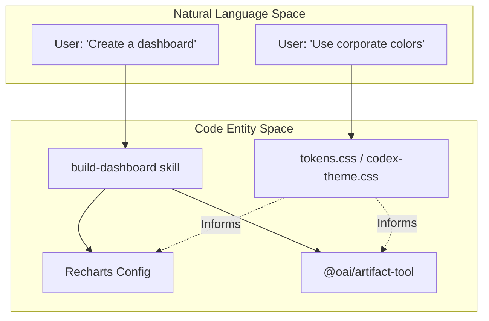
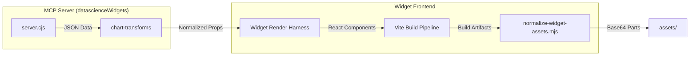

<!-- source: DeepWiki mcp.deepwiki.com · repo openai/role-specific-plugins · page 3.3 Data Analytics Design System & Testing · fetched 2026-10-26 -->

# Data Analytics Design System & Testing

Relevant source files

The following files were used as context for generating this wiki page:

- [plugins/data-analytics/AGENTS.md](plugins/data-analytics/AGENTS.md)
- [plugins/data-analytics/assets/datascience-small.svg](plugins/data-analytics/assets/datascience-small.svg)
- [plugins/data-analytics/assets/datascience.png](plugins/data-analytics/assets/datascience.png)
- [plugins/data-analytics/assets/datascience.svg](plugins/data-analytics/assets/datascience.svg)
- [plugins/data-analytics/skills/spreadsheets/assets/file-spreadsheet.png](plugins/data-analytics/skills/spreadsheets/assets/file-spreadsheet.png)
- [plugins/data-analytics/skills/spreadsheets/charts.md](plugins/data-analytics/skills/spreadsheets/charts.md)
- [plugins/data-analytics/skills/spreadsheets/references/artifact_tool_api.md](plugins/data-analytics/skills/spreadsheets/references/artifact_tool_api.md)
- [plugins/data-analytics/skills/spreadsheets/style_guidelines.md](plugins/data-analytics/skills/spreadsheets/style_guidelines.md)

This page documents the design contract, visual tokens, and testing infrastructure for the Data Analytics plugin. The system is built around a "snapshot-first" architecture for fullscreen artifacts, complemented by compact inline widgets for charts and tables [plugins/data-analytics/AGENTS.md:3-5]().

## Analytics Design System

The design system is governed by a local Codex style contract that defines how analytics surfaces should look and behave. The visual baseline is established by `codex-theme.css`, which is extended by analytics-specific tokens [plugins/data-analytics/AGENTS.md:9-10]().

### Visual Tokens & Theming
The styling hierarchy ensures that shared controls (typography, spacing, borders, shadows) resolve through Codex tokens, while analytics-specific extensions handle complex data visualizations [plugins/data-analytics/AGENTS.md:10]().

| Layer | File Path | Role |
| :--- | :--- | :--- |
| **Baseline** | `src/styles/codex-theme.css` | Fallback baseline for all Codex plugins. |
| **Extension** | `src/analytics-app/tokens.css` | Analytics-specific overrides for charts, KPI states, and layouts. |
| **Contract** | `src/codex-style-contract.md` | Human-readable specification for visual consistency. |

### Component Specifications
The system defines specific behaviors for different data surfaces:
*   **Metric Cards:** Focused views for high-level KPIs.
*   **Chart Blocks:** Interactive visualizations using the Recharts stack [plugins/data-analytics/AGENTS.md:10]().
*   **Table Lists:** Structured data views with support for large datasets.
*   **Fullscreen Surfaces:** Inline widgets expose a top-right control to enter fullscreen mode, which is then hidden once active [plugins/data-analytics/AGENTS.md:12-14]().

### Spreadsheet Artifact Design
For deliverables involving Excel/Spreadsheets, the design system shifts to a document-centric layout [plugins/data-analytics/skills/spreadsheets/style_guidelines.md:23-24]().

**Visual Hierarchy Levels:**
1.  **Page Title Band:** Large type, strong fill, often merged [plugins/data-analytics/skills/spreadsheets/style_guidelines.md:33]().
2.  **Section Header Bands:** Distinct fill, bold text, clear alignment [plugins/data-analytics/skills/spreadsheets/style_guidelines.md:34]().
3.  **Body Area:** Neutral surface with restrained styling [plugins/data-analytics/skills/spreadsheets/style_guidelines.md:35]().

**Sources:** [plugins/data-analytics/AGENTS.md:1-21](), [plugins/data-analytics/skills/spreadsheets/style_guidelines.md:1-82]()

---

## Data Flow: Natural Language to Design Entity

This diagram illustrates how user requests for data visualization are transformed into themed code entities within the plugin architecture.

### Visualization Pipeline

**Sources:** [plugins/data-analytics/AGENTS.md:9-10](), [plugins/data-analytics/skills/spreadsheets/references/artifact_tool_api.md:1-50]()

---

## Spreadsheet & Chart Testing

The testing suite ensures that generated artifacts (specifically workbooks and charts) meet functional and aesthetic requirements before export.

### Chart Validation Logic
Charts must be verified for "readability over decoration" [plugins/data-analytics/skills/spreadsheets/charts.md:3](). The following checks are mandatory before a chart is considered "ready":
*   **Source Binding:** Must chart from a bounded helper range where the first row is headers [plugins/data-analytics/skills/spreadsheets/charts.md:8]().
*   **Visual Integrity:** Checks for blank charts, stale ranges, or clipped labels [plugins/data-analytics/skills/spreadsheets/charts.md:15]().
*   **Consistency:** Single-series line charts must use consistent colors and marker styles [plugins/data-analytics/skills/spreadsheets/charts.md:23]().

### The Artifact Tool API
The `@oai/artifact-tool` provides the programmatic interface for inspecting and testing workbooks.

| Function | File Path | Purpose |
| :--- | :--- | :--- |
| `workbook.inspect()` | [plugins/data-analytics/skills/spreadsheets/references/artifact_tool_api.md:113-125]() | Generates a compact summary of sheets, tables, and formulas. |
| `workbook.trace()` | [plugins/data-analytics/skills/spreadsheets/references/artifact_tool_api.md:65]() | Audits the dependency tree from an output cell back to source data. |
| `sheet.render()` | [plugins/data-analytics/skills/spreadsheets/references/artifact_tool_api.md:79]() | Visual verification of the workbook state. |

**Sources:** [plugins/data-analytics/skills/spreadsheets/charts.md:1-32](), [plugins/data-analytics/skills/spreadsheets/references/artifact_tool_api.md:52-135]()

---

## System Architecture: Widget Rendering

This diagram shows the relationship between the MCP server and the widget rendering harness.

### Render Harness Architecture

**Sources:** [plugins/data-analytics/AGENTS.md:18-20](), [plugins/data-analytics/skills/spreadsheets/references/artifact_tool_api.md:14-50]()

---

## Development & Test Workflows

The development cycle relies on a suite of NPM scripts to maintain alignment between source code and the serialized assets used by the plugin.

*   **Preview:** `npm run preview:widgets` provides a local environment for testing UI changes [plugins/data-analytics/AGENTS.md:18]().
*   **Build:** `npm run build` synchronizes the `assets/` directory with normalized bundle parts [plugins/data-analytics/AGENTS.md:20]().
*   **Validation:** `npm run typecheck` and `npm test` cover the MCP server and widget contract integrity [plugins/data-analytics/AGENTS.md:18]().

**Sources:** [plugins/data-analytics/AGENTS.md:16-21]()

---

