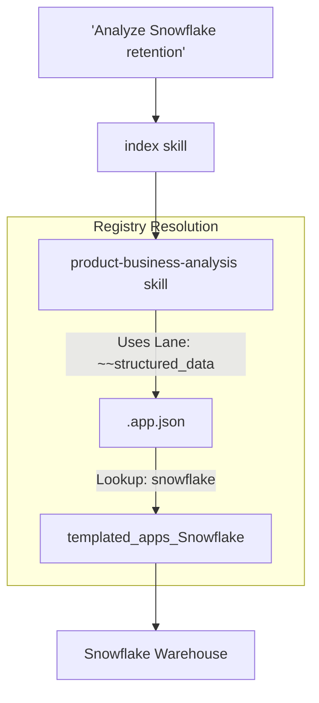
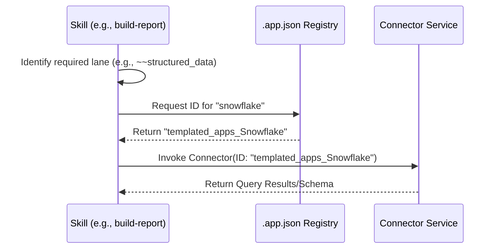

<!-- source: DeepWiki mcp.deepwiki.com · repo openai/role-specific-plugins · page 3.4 Data Analytics Connector Bindings · fetched 2026-10-26 -->

# Data Analytics Connector Bindings

Relevant source files

The following files were used as context for generating this wiki page:

- [plugins/data-analytics/.app.json](plugins/data-analytics/.app.json)
- [plugins/data-analytics/.codex-plugin/plugin.json](plugins/data-analytics/.codex-plugin/plugin.json)
- [plugins/data-analytics/DEPENDENCIES.MD](plugins/data-analytics/DEPENDENCIES.MD)

The Data Analytics plugin utilizes a centralized connector registry to bridge natural language analytical requests with specific data platforms, BI tools, and collaboration suites. These bindings are defined in the `.app.json` file and mapped to abstract "analysis lanes" within the plugin's skills.

## Overview of Connector Architecture

The plugin architecture is designed to be tool-agnostic, using **lane placeholders** (e.g., `~~structured_data`) in skill definitions to represent categories of tools [plugins/data-analytics/DEPENDENCIES.MD:3-7](). The `.app.json` file serves as the registry that maps these abstract lanes to concrete application IDs or connector instances [plugins/data-analytics/.codex-plugin/plugin.json:40-40]().

### Binding Categories and Lanes

The following table maps the abstract placeholders used in the plugin's logic to the providers registered in the connector registry:

| Category | Placeholder | Registered Providers in `.app.json` |
| :--- | :--- | :--- |
| **Data Warehouse** | `~~structured_data` | Databricks, BigQuery, Snowflake [plugins/data-analytics/DEPENDENCIES.MD:13-13]() |
| **BI Tools** | `~~dashboards_or_bi` | Metabase, ThoughtSpot, Omni Analytics [plugins/data-analytics/DEPENDENCIES.MD:16-16]() |
| **Product Analytics** | `~~behavior_signals` | Amplitude, Mixpanel [plugins/data-analytics/DEPENDENCIES.MD:15-15]() |
| **Notebooks** | `~~notebook_lab` | Hex, Deepnote [plugins/data-analytics/DEPENDENCIES.MD:14-14]() |
| **Collaboration** | `~~team_communication` | Slack, Microsoft Teams [plugins/data-analytics/DEPENDENCIES.MD:17-17]() |
| **Knowledge Base** | `~~company_docs` | Google Drive, SharePoint, Notion [plugins/data-analytics/DEPENDENCIES.MD:20-20]() |

**Sources:** [plugins/data-analytics/DEPENDENCIES.MD:11-28](), [plugins/data-analytics/.app.json:1-84]()

## Data Flow: From Intent to Connector

The following diagram illustrates how a natural language request is routed through the plugin's skill layer to the specific connector bindings defined in the registry.

### Natural Language to Code Entity Mapping

**Sources:** [plugins/data-analytics/DEPENDENCIES.MD:13-13](), [plugins/data-analytics/.app.json:40-43]()

## Connector ID Patterns

The `.app.json` file uses three distinct patterns for identifying connectors, which dictate how the plugin interacts with the host environment.

### 1. Templated Apps (`templated_apps_`)
Used for standard integrations where the plugin expects a specific, well-defined schema or interface. These are often portable across different workspace environments.
*   **Example:** `"snowflake": { "id": "templated_apps_Snowflake" }` [plugins/data-analytics/.app.json:41-41]()
*   **Example:** `"metabase": { "id": "templated_apps_Metabase" }` [plugins/data-analytics/.app.json:76-76]()

### 2. Static Connector IDs (`connector_`)
These represent specific UUIDs for pre-configured connectors. These are typically "portable" IDs that refer to standard global connectors in the ecosystem.
*   **Example (BigQuery):** `connector_7c3f2c8cdbf64bb0b183ff52f527a06e` [plugins/data-analytics/.app.json:37-37]()
*   **Example (GitHub):** `connector_76869538009648d5b282a4bb21c3d157` [plugins/data-analytics/.app.json:49-49]()

### 3. Placeholder IDs (`REPLACE_WITH_`)
These indicate connectors that require manual configuration by the user or administrator before the plugin can be fully functional.
*   **Example (Slack):** `REPLACE_WITH_SLACK_APP_OR_CONNECTOR_ID` [plugins/data-analytics/.app.json:4-4]()
*   **Example (Amplitude):** `REPLACE_WITH_AMPLITUDE_APP_OR_CONNECTOR_ID` [plugins/data-analytics/.app.json:64-64]()

**Sources:** [plugins/data-analytics/.app.json:1-84]()

## Detailed Registry Reference

The full registry defined in `plugins/data-analytics/.app.json` categorizes apps by their operational role.

### Warehouse and BI Connectors
These connectors provide the foundation for `~~structured_data` and `~~dashboards_or_bi` lanes.

| App Key | Connector ID / Pattern | Optional |
| :--- | :--- | :--- |
| `databricks` | `templated_apps_Databricks` | Yes [plugins/data-analytics/.app.json:33-34]() |
| `bigquery` | `connector_7c3f2c8cdbf64bb0b183ff52f527a06e` | Yes [plugins/data-analytics/.app.json:37-38]() |
| `snowflake` | `templated_apps_Snowflake` | Yes [plugins/data-analytics/.app.json:41-42]() |
| `metabase` | `templated_apps_Metabase` | Yes [plugins/data-analytics/.app.json:76-77]() |
| `omni-analytics` | `REPLACE_WITH_OMNI_ANALYTICS_APP_OR_CONNECTOR_ID` | Yes [plugins/data-analytics/.app.json:71-73]() |

### Collaboration and Productivity
These connectors facilitate the `~~team_communication`, `~~email_context`, and `~~company_docs` lanes.

| App Key | Connector ID / Pattern | Optional |
| :--- | :--- | :--- |
| `slack` | `REPLACE_WITH_SLACK_APP_OR_CONNECTOR_ID` | No [plugins/data-analytics/.app.json:3-5]() |
| `teams` | `connector_246af0940da3457da0e751171dc1ce60` | Yes [plugins/data-analytics/.app.json:6-9]() |
| `google_drive` | `connector_5f3c8c41a1e54ad7a76272c89e2554fa` | No [plugins/data-analytics/.app.json:29-31]() |
| `notion` | `REPLACE_WITH_NOTION_APP_OR_CONNECTOR_ID` | No [plugins/data-analytics/.app.json:10-12]() |
| `github` | `connector_76869538009648d5b282a4bb21c3d157` | No [plugins/data-analytics/.app.json:48-50]() |

### Binding Resolution Sequence
The diagram below describes how the plugin resolves a tool requirement during a workflow execution.

**Sources:** [plugins/data-analytics/.app.json:40-43](), [plugins/data-analytics/DEPENDENCIES.MD:5-7]()

---

