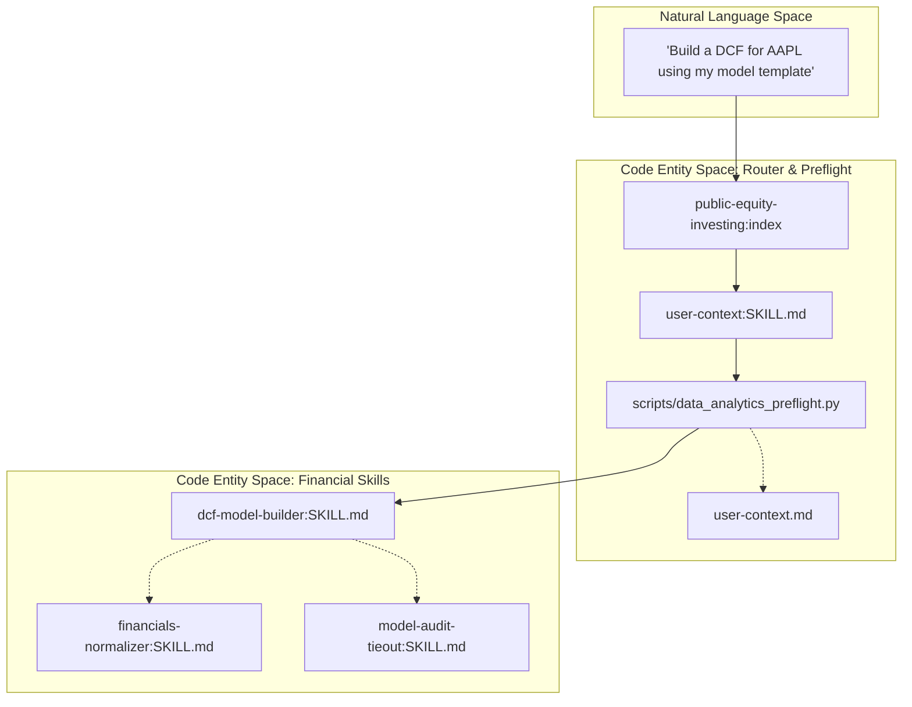
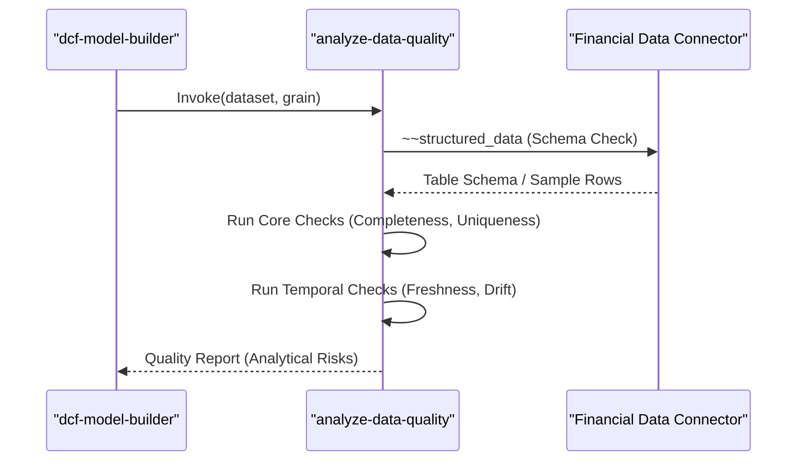

<!-- source: DeepWiki mcp.deepwiki.com · repo openai/role-specific-plugins · page 4.1 Financial Markets Skills & Workflows · fetched 2026-10-26 -->

# Financial Markets Skills & Workflows

Relevant source files

The following files were used as context for generating this wiki page:

- [plugins/data-analytics/skills/analyze-data-quality/SKILL.md](plugins/data-analytics/skills/analyze-data-quality/SKILL.md)
- [plugins/data-analytics/skills/analyze-data-quality/agents/openai.yaml](plugins/data-analytics/skills/analyze-data-quality/agents/openai.yaml)
- [plugins/data-analytics/skills/index/SKILL.md](plugins/data-analytics/skills/index/SKILL.md)
- [plugins/data-analytics/skills/index/agents/openai.yaml](plugins/data-analytics/skills/index/agents/openai.yaml)
- [plugins/data-analytics/skills/kpi-reporting/references/report-templates.md](plugins/data-analytics/skills/kpi-reporting/references/report-templates.md)
- [plugins/data-analytics/skills/user-context/SKILL.md](plugins/data-analytics/skills/user-context/SKILL.md)
- [plugins/data-analytics/skills/user-context/agents/openai.yaml](plugins/data-analytics/skills/user-context/agents/openai.yaml)

This page serves as the technical reference for the 23 Financial Markets skills within the Public Equity Investing plugin. It details the implementation of the invocation gate, the mandatory `user-context` preflight, and the specialized workflows for equity research, modeling, and portfolio management.

## Skill Catalog Overview

The Financial Markets plugin provides a comprehensive suite of skills designed for institutional-grade equity research and investment analysis. These skills are categorized into four primary domains:

| Domain | Skills |
| :--- | :--- |
| **Research & Analysis** | `earnings-deep-dive`, `earnings-preview`, `company-tearsheet`, `initiating-coverage`, `long-short-pitch`, `memo-builder`, `idea-generation`, `thesis-tracker`, `meeting-prep`, `catalyst-calendar`, `event-driven-analyzer`, `economic-impact-report` |
| **Financial Modeling** | `dcf-model-builder`, `three-statement-model-builder`, `comps-valuation`, `equity-model-update`, `financials-normalizer`, `model-audit-tieout`, `scenario-sensitivity-generator` |
| **Portfolio & Risk** | `portfolio-risk-management`, `deck-report-qc` |
| **Routing & Context** | `public-equity-investing` (router), `user-context` |

## The Invocation Gate & Preflight Workflow

All Financial Markets workflows are protected by a mandatory pre-answer gate. Before executing any domain-specific logic, the system must invoke the `user-context` skill to establish the "Financial Source of Truth" and load user-specific preferences.

### User Context Preflight
The `user-context` skill manages durable source-routing preferences and the semantic-layer registry. It ensures that the plugin uses the correct data providers (e.g., Daloopa, Quartr, Bloomberg) based on the user's environment [plugins/data-analytics/skills/user-context/SKILL.md:6-10]().

**Key Functions of Preflight:**
1.  **State Loading:** Uses `scripts/data_analytics_preflight.py` to read the `user-context.md` state file [plugins/data-analytics/skills/user-context/SKILL.md:12-15]().
2.  **Source Mapping:** Resolves `source-category` placeholders to actual connector IDs (e.g., mapping "Earnings Data" to a specific provider) [plugins/data-analytics/skills/user-context/SKILL.md:49-50]().
3.  **Semantic Layer Registry:** Loads pointers to existing models and datasets to prevent redundant data retrieval [plugins/data-analytics/skills/user-context/SKILL.md:33-38]().

### Bridge: Natural Language Space to Code Entity Space (Routing)

This diagram illustrates how a natural language request is routed through the `index` (router) and the mandatory `user-context` gate before reaching a specific financial skill.

"Financial Markets Routing Architecture"

**Sources:** [plugins/data-analytics/skills/index/SKILL.md:1-10](), [plugins/data-analytics/skills/user-context/SKILL.md:1-20]()

## Core Workflow Implementation

### Research & Analysis Workflows
Skills like `earnings-deep-dive` and `initiating-coverage` follow a structured "Source Discovery and Verification" pattern. They prioritize live source reads from connected financial databases over cached data [plugins/data-analytics/skills/index/SKILL.md:16-25]().

*   **Source Access Guardrail:** Before drawing conclusions, the skill checks if the "Source of Truth" (e.g., SEC filings via a connector) is available. If missing, it halts and requests access rather than using weak substitutes [plugins/data-analytics/skills/index/SKILL.md:26-33]().
*   **Response Modes:** Simple lookups use `inline` mode, while complex analyses escalate to `report` mode, which triggers the `$build-report` sub-skill [plugins/data-analytics/skills/index/SKILL.md:60-70]().

### Financial Modeling & Data Quality
Modeling skills utilize the `analyze-data-quality` framework to ensure the integrity of financial inputs.

"Data Quality Assessment Flow"

**Sources:** [plugins/data-analytics/skills/analyze-data-quality/SKILL.md:17-40](), [plugins/data-analytics/skills/analyze-data-quality/SKILL.md:79-91]()

### Key Modeling Skills Reference

| Skill | Technical Role | Implementation Detail |
| :--- | :--- | :--- |
| `financials-normalizer` | Standardizes raw data | Maps disparate line items from SEC filings or provider APIs into a standard three-statement format [plugins/data-analytics/skills/analyze-data-quality/SKILL.md:86-87](). |
| `model-audit-tieout` | Verification | Compares model outputs against original source documents to identify "fat-finger" errors or formula breaks [plugins/data-analytics/skills/analyze-data-quality/SKILL.md:81-82](). |
| `scenario-sensitivity-generator` | Simulation | Iterates through variable ranges (e.g., WACC, Terminal Growth) to produce sensitivity tables [plugins/data-analytics/skills/analyze-data-quality/SKILL.md:61-66](). |

## Artifact Generation & Reporting

Financial deliverables are standardized via the `report-templates.md` reference. When a skill like `long-short-pitch` or `memo-builder` completes its analysis, it hands off to the reporting layer.

*   **Executive Business Review:** Uses KPI cards and scorecard components for high-level summaries [plugins/data-analytics/skills/kpi-reporting/references/report-templates.md:19-33]().
*   **Inline Updates:** Used for quick alerts or "earnings beats" delivered directly in the chat interface [plugins/data-analytics/skills/kpi-reporting/references/report-templates.md:7-10]().

**Sources:** [plugins/data-analytics/skills/kpi-reporting/references/report-templates.md:1-33]()

## Technical Standards for Financial Skills

1.  **Audience Translation:** All outputs must be translated from "implementation-speak" (e.g., "API response") to "Financial Market impact" (e.g., "Adjusted EBITDA variance") [plugins/data-analytics/skills/index/SKILL.md:34-39]().
2.  **Source Linking:** Inline references must use clickable Markdown links when available, using record names or meeting dates as link text [plugins/data-analytics/skills/index/SKILL.md:40-43]().
3.  **State Management:** Skills are prohibited from using `user-context.md` for general memory; it is strictly for source-routing and semantic-layer pointers [plugins/data-analytics/skills/user-context/SKILL.md:33-38]().

**Sources:** [plugins/data-analytics/skills/index/SKILL.md:34-43](), [plugins/data-analytics/skills/user-context/SKILL.md:33-38]()

---

