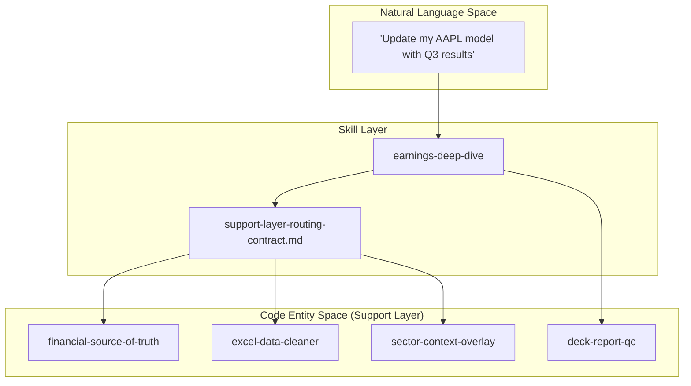

<!-- source: DeepWiki mcp.deepwiki.com · repo openai/role-specific-plugins · page 4.2 Financial Markets Shared Standards & Support Layer · fetched 2026-10-26 -->

# Financial Markets Shared Standards & Support Layer

<details>
<summary>Relevant source files</summary>

The following files were used as context for generating this wiki page:

- [plugins/data-analytics/skills/build-dashboard/specifications/bi-platform-dashboard.md](plugins/data-analytics/skills/build-dashboard/specifications/bi-platform-dashboard.md)
- [plugins/data-analytics/skills/build-dashboard/specifications/mcp-artifact-dashboard.md](plugins/data-analytics/skills/build-dashboard/specifications/mcp-artifact-dashboard.md)
- [plugins/data-analytics/skills/metric-diagnostics/SKILL.md](plugins/data-analytics/skills/metric-diagnostics/SKILL.md)
- [plugins/data-analytics/skills/metric-diagnostics/agents/openai.yaml](plugins/data-analytics/skills/metric-diagnostics/agents/openai.yaml)
- [plugins/data-analytics/skills/product-business-analysis/SKILL.md](plugins/data-analytics/skills/product-business-analysis/SKILL.md)
- [plugins/data-analytics/skills/product-business-analysis/agents/openai.yaml](plugins/data-analytics/skills/product-business-analysis/agents/openai.yaml)

</details>


This page documents the `shared/` directory and the underlying support infrastructure for the Financial Markets plugin. It covers the standards for deliverable quality, the internal support sub-skills used for complex financial tasks, and the Python-based artifact utilities that power data-heavy financial models and research reports.

## Overview of Shared Standards

The Financial Markets plugin operates under a strict set of standards to ensure institutional-grade output. These standards govern how skills are invoked, how deliverables are structured, and how data is validated.

| Standard | Purpose |
| :--- | :--- |
| **Invocation Policy** | Defines the "gatekeeper" logic for when a financial skill should be triggered. |
| **Final Deliverable Framework** | Specifies the mandatory sections (Summary, Thesis, Risks, Valuation) for investment memos. |
| **Deliverable Intake Policy** | Governs how existing user documents are parsed and validated for quality. |
| **HTML/Workbook Standards** | Technical specifications for rendered artifacts and Excel-compatible files. |

**Sources:** `plugins/financial-markets/shared/invocation-policy.md` (), `plugins/financial-markets/shared/final-deliverable-framework.md` (), `plugins/financial-markets/shared/deliverable-intake-policy.md` ().

## Support Sub-Skills & Routing

Complex financial workflows (e.g., an Earnings Deep Dive) do not run as monolithic blocks. They decompose tasks into specialized support sub-skills. These sub-skills are coordinated via the `support-layer-routing-contract.md`.

### Internal Support Catalog
*   **financial-source-of-truth**: Resolves conflicting data points between providers like Daloopa and Quartr.
*   **excel-data-cleaner**: Standardizes raw CSV/XLSX exports into model-ready formats.
*   **deck-report-qc**: A specialized audit layer that checks for "stale language" or mathematical inconsistencies.
*   **sector-context-overlay**: Injects industry-specific KPIs (e.g., ARPU for SaaS, Load Factor for Airlines) into generic models.

### Routing Logic Diagram
The following diagram illustrates how a top-level skill (like `earnings-deep-dive`) interacts with the support layer.

**Financial Support Layer Routing**

**Sources:** `plugins/financial-markets/shared/support-layer-routing-contract.md` (), `plugins/financial-markets/shared/equity-research-support-standard.md` ().

## Python Artifact Utilities

The plugin relies on a suite of Python utilities to package, inspect, and validate financial artifacts. These utilities bridge the gap between raw LLM output and structured files (Excel/HTML).

### Core Utility Classes

| File | Key Function/Class | Description |
| :--- | :--- | :--- |
| `artifact_packager.py` | `PackageManager` | Handles the compression and base64 encoding of multi-file artifacts. |
| `artifacts.py` | `FinancialArtifact` | Base class for defining metadata, citations, and data snapshots. |
| `workbook_artifacts.py` | `WorkbookGenerator` | Generates `.xlsx` files with preserved formulas and financial formatting. |
| `workbook_inspection.py` | `inspect_cells()` | Audits existing workbooks for hardcoded values vs. formulas. |
| `model_citations.py` | `CitationMapper` | Maps specific cells or paragraphs back to source filings (10-K/10-Q). |

### Data Flow: From Source to Artifact
This diagram shows how the Python utilities process financial data into a final user-facing deliverable.

**Artifact Generation Pipeline**
```mermaid
flow_chart
graph LR
    subgraph "Data Acquisition"
        Daloopa["Daloopa API"]
        Quartr["Quartr API"]
    end

    subgraph "Processing (Python)"
        MC["model_citations.py"]
        WI["workbook_inspection.py"]
        WA["workbook_artifacts.py"]
    end

    subgraph "Packaging"
        AP["artifact_packager.py"]
    end

    Daloopa --> MC
    Quartr --> MC
    MC --> WI
    WI --> WA
    WA --> AP
    AP --> Result["Final .xlsx / .html Artifact"]
```
**Sources:** `plugins/financial-markets/shared/artifact_packager.py` (), `plugins/financial-markets/shared/workbook_artifacts.py` (), `plugins/financial-markets/shared/model_citations.py` ().

## HTML & Workbook Standards

To maintain consistency across different financial models, the plugin adheres to strict formatting standards defined in the `shared/` directory.

### HTML Artifact Standard (`html-artifact-standard.md`)
*   **Theming**: Must use the `codex-theme.css` variables for dark/light mode compatibility.
*   **Structure**: Requires a `sticky-header` for ticker/price information and a `source-footer` for disclosures.
*   **Interactivity**: Charts must be rendered using the shared Recharts v3 configuration.

### Workbook Artifact Standard (`workbook-artifact-standard.md`)
*   **Color Coding**: 
    *   **Blue**: Hardcoded inputs (historical data).
    *   **Black**: Formulas/Calculations.
    *   **Green**: Links to other sheets/files.
*   **Audit Trail**: Every workbook must include an `Audit` tab generated by `workbook_inspection.py` that flags potential errors.

**Sources:** `plugins/financial-markets/shared/html-artifact-standard.md` (), `plugins/financial-markets/shared/workbook-artifact-standard.md` (), `plugins/financial-markets/shared/workbook_inspection.py` ().

## PM Judgment Heuristics

The `pm-judgment-heuristics.md` file provides a framework for the plugin to make qualitative "Portfolio Manager" level decisions when data is ambiguous.

*   **Confidence Scoring**: If two data sources disagree (e.g., Bloomberg vs. FactSet on consensus), the plugin uses the `financial-source-of-truth` sub-skill to weight sources based on historical accuracy.
*   **Skew Analysis**: When generating scenarios in `scenario-sensitivity-generator`, the heuristics prevent "symmetric" bull/bear cases, forcing the model to account for fat-tail risks and realistic skew.

**Sources:** `plugins/financial-markets/shared/pm-judgment-heuristics.md` (), `plugins/financial-markets/shared/workflow-source-resolution.md` ().

---

