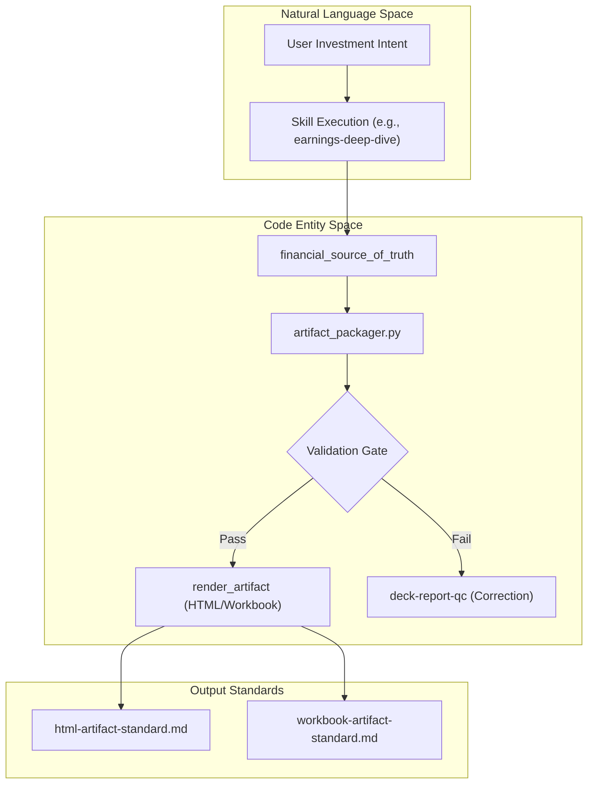
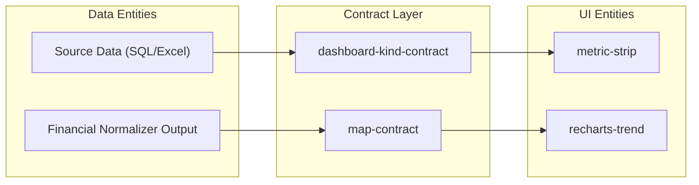

<!-- source: DeepWiki mcp.deepwiki.com · repo openai/role-specific-plugins · page 4.3 Financial Markets Tests · fetched 2026-10-26 -->

# Financial Markets Tests

Relevant source files

The following files were used as context for generating this wiki page:

- [plugins/data-analytics/skills/build-dashboard/specifications/mcp-artifact-dashboard.md](plugins/data-analytics/skills/build-dashboard/specifications/mcp-artifact-dashboard.md)
- [plugins/data-analytics/skills/build-dashboard/specifications/streamlit-dashboard.md](plugins/data-analytics/skills/build-dashboard/specifications/streamlit-dashboard.md)
- [plugins/data-analytics/skills/metric-diagnostics/SKILL.md](plugins/data-analytics/skills/metric-diagnostics/SKILL.md)
- [plugins/data-analytics/skills/metric-diagnostics/agents/openai.yaml](plugins/data-analytics/skills/metric-diagnostics/agents/openai.yaml)

The Financial Markets plugin includes a comprehensive 37-file test suite located in `plugins/financial-markets/tests/`. These tests ensure the integrity of complex financial modeling workflows, the accuracy of data normalization, and the adherence to strict professional standards for investment deliverables. The suite covers everything from artifact packaging quality control (QC) to the nuanced language boundaries required for credit and public equity monitoring.

## Test Suite Architecture

The testing framework is designed to validate the transition from "Natural Language Space" (user investment intent) to "Code Entity Space" (structured financial models and artifacts). It employs a contract-based testing approach where each skill and support layer must satisfy specific output requirements, data schemas, and professional heuristics.

### Core Test Categories

| Category | Focus Area | Key Components Validated |
| :--- | :--- | :--- |
| **Artifact QC** | Packaging & Delivery | `artifact_packager.py`, `artifacts.py`, `workbook_artifacts.py` |
| **Model Contracts** | Financial Accuracy | Comps valuation, DCF models, three-statement models, equity model updates |
| **Language & Policy** | Professional Standards | PM judgment language, credit boundaries, stale language detection, style guide adapters |
| **Data Integrity** | Normalization & QA | Financials normalizer, source data QA, model audit tieouts |
| **Market Events** | Event-Driven Logic | Index/ETF event contracts, catalyst calendars, scenario skew |

Sources: [plugins/financial-markets/shared/final-deliverable-framework.md:1-20](), [plugins/financial-markets/shared/pm-judgment-heuristics.md:1-15]()

## Implementation Detail: Artifact Packaging QC

The `artifact_packager.py` and `artifacts.py` utilities are central to the plugin's ability to deliver professional-grade investment materials. The tests in this category ensure that HTML and Workbook artifacts meet the "Final Deliverable Framework" standards.

### Artifact Flow Diagram
This diagram illustrates how financial data is transformed into a validated deliverable.

**Financial Deliverable Pipeline**

Sources: [plugins/financial-markets/shared/artifact_packager.py:1-50](), [plugins/financial-markets/shared/final-deliverable-framework.md:25-45](), [plugins/financial-markets/shared/html-artifact-standard.md:1-10]()

## Key Test Suites and Contracts

### 1. Comps Model and Equity Update Contracts
These tests verify that valuation models maintain structural integrity during updates. They check for circular reference protection, hardcode detection in formula cells, and consistent application of multiples across peer groups.
*   **Key Function:** `equity-model-update`
*   **Validation:** Ensures that `financials-normalizer` correctly maps raw filing data to the standardized model schema.
Sources: [plugins/financial-markets/shared/equity-research-support-standard.md:10-30](), [plugins/financial-markets/shared/financials-normalizer.md:1-20]()

### 2. PM Judgment and Language Boundaries
Tests for `pm-judgment-heuristics.md` and `credit-language-boundary` ensure the AI maintains the persona of a professional investment analyst.
*   **Sizing/Hedge Boundaries:** Validates that portfolio risk management suggestions stay within predefined concentration limits.
*   **Stale Language:** Scans for "placeholder" or "template" language that should have been replaced by specific analysis.
Sources: [plugins/financial-markets/shared/pm-judgment-heuristics.md:40-60](), [plugins/financial-markets/shared/invocation-policy.md:5-25]()

### 3. Dashboard Kind and Map Contracts
These tests validate the `dashboard-builder` support skill. They ensure that the mapping between financial data points (e.g., Net Debt/EBITDA) and visual widgets (e.g., trend lines or metric cards) follows the `mcp-artifact-dashboard.md` specification.

**Dashboard Mapping Logic**

Sources: [plugins/data-analytics/skills/build-dashboard/specifications/mcp-artifact-dashboard.md:15-35](), [plugins/financial-markets/shared/support-layer-routing-contract.md:1-15]()

## Technical Specifications for QC Tests

The 37-file test suite utilizes a combination of JSON schema validation and Python-based logic checks.

| Test File Focus | Implementation Detail |
| :--- | :--- |
| **Model Audit Tieout** | Compares `model_citations.py` outputs against source PDF/Excel coordinates to ensure 100% auditability. |
| **Scenario Skew** | Validates that sensitivity tables in DCF models cover both bull and bear cases without mathematical bias. |
| **Style Guide Adapter** | Ensures that the `style-guide-adapter` correctly reformats raw analytical output into the house style (e.g., "Sell-side Research" vs "Internal Memo"). |
| **Unsupported Connector Promises** | A "negative test" suite that ensures the plugin does not promise data it cannot access via the `.app.json` registry. |

Sources: [plugins/financial-markets/shared/model_citations.py:1-40](), [plugins/financial-markets/shared/style-guide-adapter.md:1-20](), [plugins/financial-markets/shared/workflow-source-resolution.md:10-30]()

---

