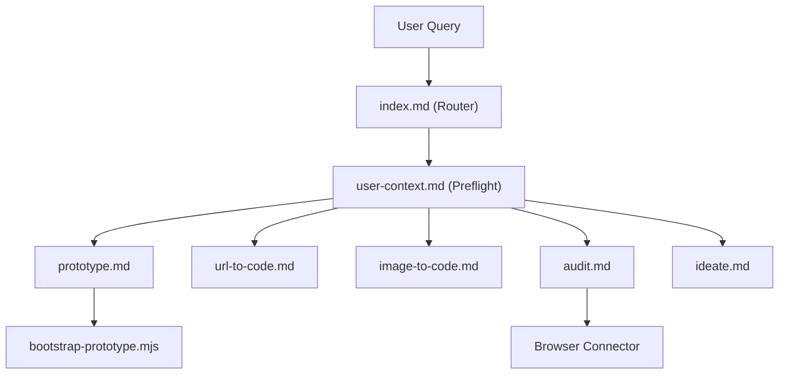
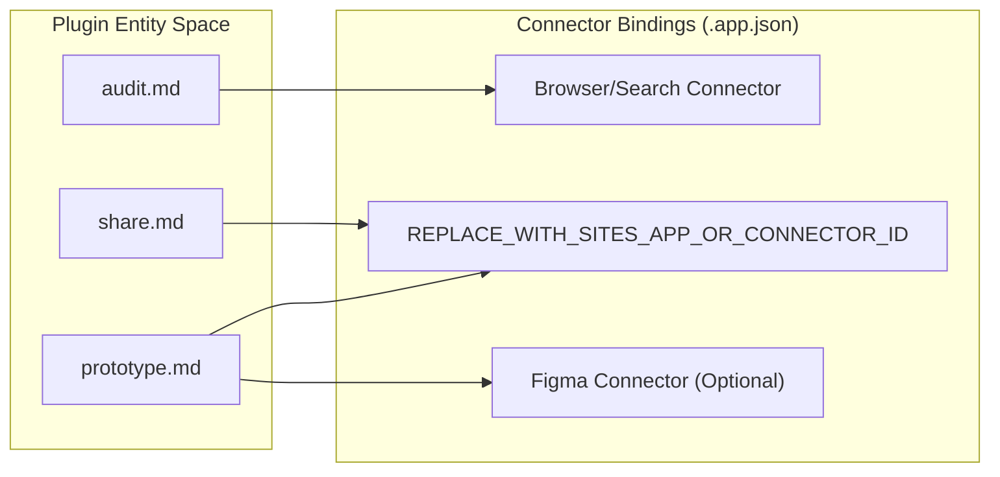

<!-- source: DeepWiki mcp.deepwiki.com · repo openai/role-specific-plugins · page 5 Product Design Plugin · fetched 2026-10-26 -->

# Product Design Plugin

Relevant source files

The following files were used as context for generating this wiki page:

- [.agents/plugins/marketplace.json](.agents/plugins/marketplace.json)
- [README.md](README.md)

The **Product Design Plugin** is a specialized toolkit designed to accelerate the product development lifecycle, from initial ideation and research to high-fidelity prototyping and code generation. It provides a structured set of skills that allow designers and product managers to transform concepts into functional artifacts using a "design-partner" approach.

The plugin is located in the `plugins/product-design/` directory and is categorized under "Design" in the marketplace manifest [.agents/plugins/marketplace.json:32-42]().

## Skill Architecture

The plugin's intelligence is distributed across several domain-specific skills. These skills are coordinated by an index router that determines the appropriate workflow based on user intent. 

### High-Level Skill Workflow
The following diagram illustrates how the `index` skill routes natural language requests to specific code-backed skill entities within the `skills/` directory.

**Product Design Skill Routing**

Sources: [plugins/product-design/skills/index.md](), [plugins/product-design/skills/user-context.md](), [plugins/product-design/skills/prototype.md]()

## Supported Workflows

The plugin supports a variety of design-centric workflows, primarily focused on bridging the gap between visual design and production-ready code.

| Workflow | Description | Key Skill Entity |
| :--- | :--- | :--- |
| **Prototype** | Generates functional React/Tailwind prototypes using a "golden rule" of ideation first. | `prototype.md` |
| **URL-to-Code** | Analyzes an existing website and recreates its components or layout in code. | `url-to-code.md` |
| **Image-to-Code** | Converts uploaded screenshots or wireframes into frontend code. | `image-to-code.md` |
| **Ideate** | Brainstorms product features, user flows, and UX improvements. | `ideate.md` |
| **Audit** | Performs UX and accessibility reviews, often backed by live browser screenshots. | `audit.md` |
| **Research** | Synthesizes user feedback and market trends into design requirements. | `research.md` |
| **Share** | Packages artifacts for stakeholder review and deployment. | `share.md` |

For a detailed breakdown of these workflows, see [Product Design Skills & Workflows](#5.1).

## Connector Integrations

The Product Design plugin relies on connector bindings to interact with external design tools and deployment platforms. These are defined in the plugin's configuration files [README.md:21]().

### Connector Binding Map
The diagram below shows how the plugin links its internal skills to external services via the `.app.json` connector registry.

**Connector Integration Architecture**

Sources: [README.md:69](), [plugins/product-design/.app.json](), [plugins/product-design/skills/audit.md]()

*   **Sites/Vercel**: Used for deploying prototypes and hosting live previews of generated code. Requires replacement of the `REPLACE_WITH_SITES_APP_OR_CONNECTOR_ID` placeholder [README.md:69]().
*   **Browser**: Enables the `audit` and `research` skills to fetch live web data and capture screenshots for UI critiques.
*   **Figma/Canva**: Optional integrations for pulling design tokens, brand assets, and frame data into the `user-context`.

## Reference & Template System

The plugin includes a robust set of references and templates to ensure consistency in output and communication.

*   **Communication Protocol**: Defines the "design-partner" tone and the mandatory "next-step" convention for all responses.
*   **Prototype Templates**: Located in `templates/prototype/`, these provide the scaffolding for new projects, including `bootstrap-prototype.mjs` for environment setup.
*   **User Context**: A preflight mechanism that loads saved product context, such as brand guidelines, preferred tech stacks, and existing URLs.

For more information on the internal directory structure and templates, see [Product Design References & Templates](#5.2).

---
## Child Pages
- [Product Design Skills & Workflows](#5.1) — Detailed reference for all skills, communication protocols, and the "golden rule" of prototyping.
- [Product Design References & Templates](#5.2) — Documentation for the `references/` and `templates/` directories, including preflight scripts and local environment setup.

---

