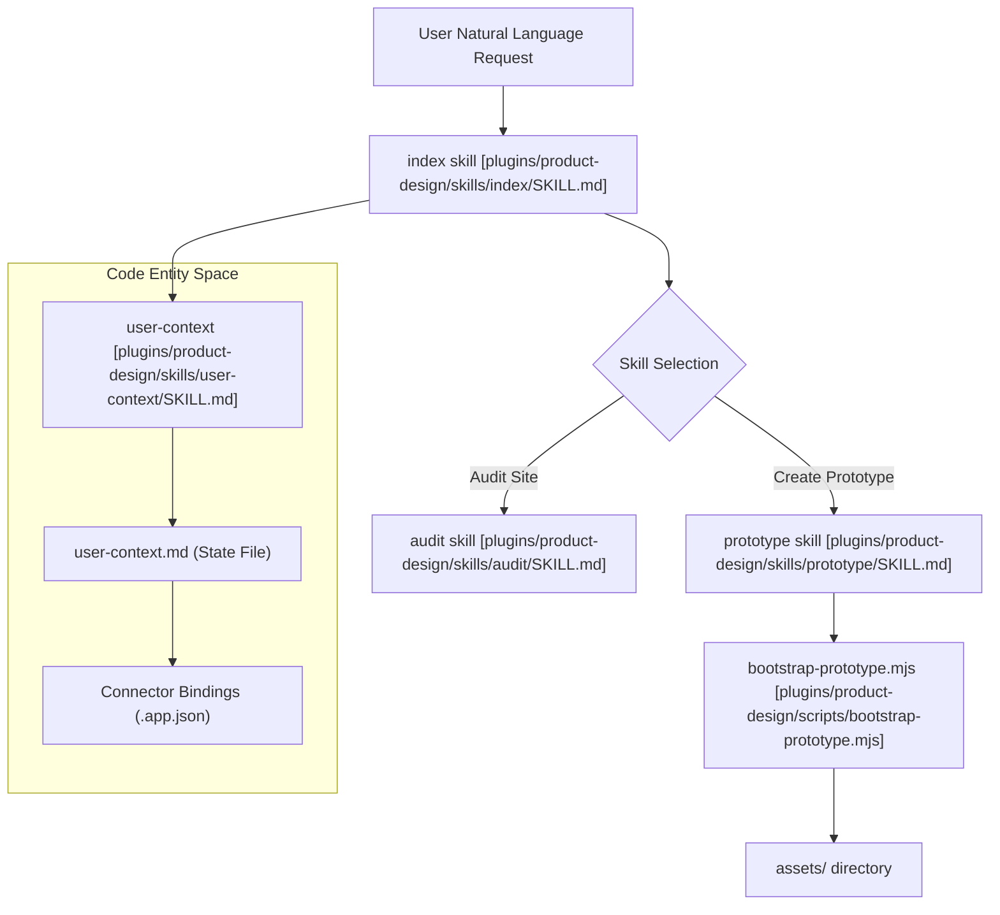
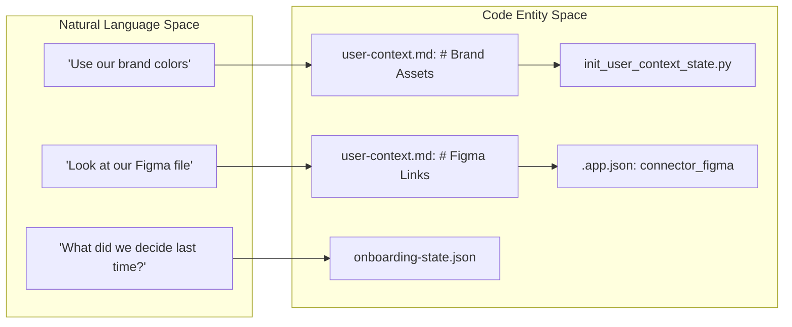

<!-- source: DeepWiki mcp.deepwiki.com · repo openai/role-specific-plugins · page 5.1 Product Design Skills & Workflows · fetched 2026-10-26 -->

# Product Design Skills & Workflows

Relevant source files

The following files were used as context for generating this wiki page:

- [plugins/data-analytics/skills/analyze-data-quality/SKILL.md](plugins/data-analytics/skills/analyze-data-quality/SKILL.md)
- [plugins/data-analytics/skills/analyze-data-quality/agents/openai.yaml](plugins/data-analytics/skills/analyze-data-quality/agents/openai.yaml)
- [plugins/data-analytics/skills/index/SKILL.md](plugins/data-analytics/skills/index/SKILL.md)
- [plugins/data-analytics/skills/index/agents/openai.yaml](plugins/data-analytics/skills/index/agents/openai.yaml)
- [plugins/data-analytics/skills/user-context/SKILL.md](plugins/data-analytics/skills/user-context/SKILL.md)
- [plugins/data-analytics/skills/user-context/agents/openai.yaml](plugins/data-analytics/skills/user-context/agents/openai.yaml)

The Product Design plugin is engineered to support the end-to-end product development lifecycle, from initial research and ideation to high-fidelity prototyping and code generation. This page serves as the technical reference for the skill architecture, communication protocols, and the data flow between design intent and code implementation.

## Purpose and Scope

The Product Design plugin provides a suite of specialized skills for UI/UX designers and product managers. It focuses on:
*   **Prototyping**: Generating functional web prototypes from descriptions or images.
*   **Audit & Research**: Analyzing existing interfaces for UX and accessibility improvements.
*   **Design-to-Code**: Converting URLs or screenshots into clean, maintainable code.
*   **Context Management**: Maintaining a durable record of brand assets, design tokens, and project-specific constraints.

## Skill Catalog

### 1. Prototype
The `prototype` skill follows the "golden rule": **Ideate-First**. It prioritizes structural and functional clarity before high-fidelity styling.
*   **Golden Rule**: Always start with a low-fidelity wireframe or functional spec unless the user provides a specific design reference.
*   **Implementation**: Utilizes `bootstrap-prototype.mjs` to scaffold new projects and `templates/prototype/` for standardized components.
*   **Flow**: Ideate -> Bootstrap -> Iterate.

### 2. URL-to-Code & Image-to-Code
These skills facilitate the translation of visual or existing web assets into code entities.
*   **URL-to-Code**: Scrapes a provided URL to extract DOM structure, styles, and assets to recreate the interface in a local environment.
*   **Image-to-Code**: Uses vision capabilities to interpret screenshots and generate equivalent HTML/CSS/React code.

### 3. Ideate
A brainstorming-focused skill that leverages the `ideate` workflow to generate product concepts, user flows, and feature lists. It often serves as the precursor to the `prototype` skill.

### 4. Audit
Performs UX and accessibility (A11y) reviews.
*   **Mechanism**: Analyzes screenshots or code snippets against established design heuristics and WCAG standards.
*   **Output**: Screenshot-backed findings with prioritized remediation steps.

### 5. Research & Share
*   **Research**: Gathers competitive intelligence and user sentiment.
*   **Share**: Prepares design deliverables for stakeholders, often formatting outputs for specific communication channels (Slack, Email, or Slide decks).

## Communication Protocol

The plugin operates under a specific **Design-Partner Tone**. This ensures the agent acts as a collaborator rather than a passive tool.

| Protocol Element | Requirement |
| :--- | :--- |
| **Tone** | Professional, collaborative, and proactive. Use "we" when discussing the design process. |
| **Next-Step Convention** | Every response must conclude with a clear "Next Step" suggestion to maintain momentum. |
| **Critical Overrides** | References `references/critical-overrides.md` to ensure brand consistency and technical constraints are never ignored. |

## Data Flow: Natural Language to Code Entity

The following diagram illustrates how a natural language request (e.g., "Build a dashboard") is routed through the system and transformed into code entities using the `index` router and `user-context` preflight.

### System Routing Logic

**Sources:** [plugins/data-analytics/skills/index/SKILL.md:44-59](), [plugins/data-analytics/skills/user-context/SKILL.md:12-19]().

## User Context and Preflight

The `user-context` skill is a **mandatory pre-answer gate**. No substantive design work (prototyping, auditing, or researching) may begin until the preflight script has been executed.

### Preflight Sequence
1.  **Invoke `user-context`**: The system runs `scripts/data_analytics_preflight.py` (or the Product Design equivalent).
2.  **Load State**: Reads the `user-context.md` file from the plugin's state directory.
3.  **Identify Constraints**: Loads brand colors, typography, Figma URLs, and project-specific URLs.
4.  **Source Selection**: Determines which connectors (Figma, Browser, GitHub) are required for the task.

### Data Association Diagram
This diagram maps the logical concepts in the `user-context` to their physical code manifestations.

**Sources:** [plugins/data-analytics/skills/user-context/SKILL.md:12-19](), [plugins/data-analytics/skills/user-context/SKILL.md:43-50]().

## Technical Reference: Index Router

The `index` skill [plugins/data-analytics/skills/index/SKILL.md:1-4]() acts as the primary entry point. It handles:
*   **Routing**: Directing requests to specific skills like `analyze-data-quality` [plugins/data-analytics/skills/analyze-data-quality/SKILL.md:1-4]() or `prototype`.
*   **Source Discovery**: Using the semantic layer and connector registry to find relevant data.
*   **Response Mode**: Deciding between `inline` (short chat answers) and `report` (complex deliverables) [plugins/data-analytics/skills/index/SKILL.md:60-68]().

### Routing Run Order
1.  Run `user-context` preflight.
2.  Check for onboarding or setup requests.
3.  Apply semantic-layer lookups.
4.  Verify source access (Source Access Guardrail).
5.  Select primary skill and execute workflow.
**Sources:** [plugins/data-analytics/skills/index/SKILL.md:46-59]().

## Critical Overrides Reference

The `references/critical-overrides.md` file contains non-negotiable technical and design constraints.
*   **Browser Order**: Specific sequences for using the browser tool to ensure consistent scraping results.
*   **Local Preflight**: Steps to verify the local environment before attempting to run `bootstrap-prototype.mjs`.
*   **Design Tokens**: Mandatory variable naming conventions for CSS and Tailwind configurations.

**Sources:** [plugins/data-analytics/skills/analyze-data-quality/SKILL.md:1-98](), [plugins/data-analytics/skills/index/SKILL.md:1-68](), [plugins/data-analytics/skills/user-context/SKILL.md:1-50]().

---

