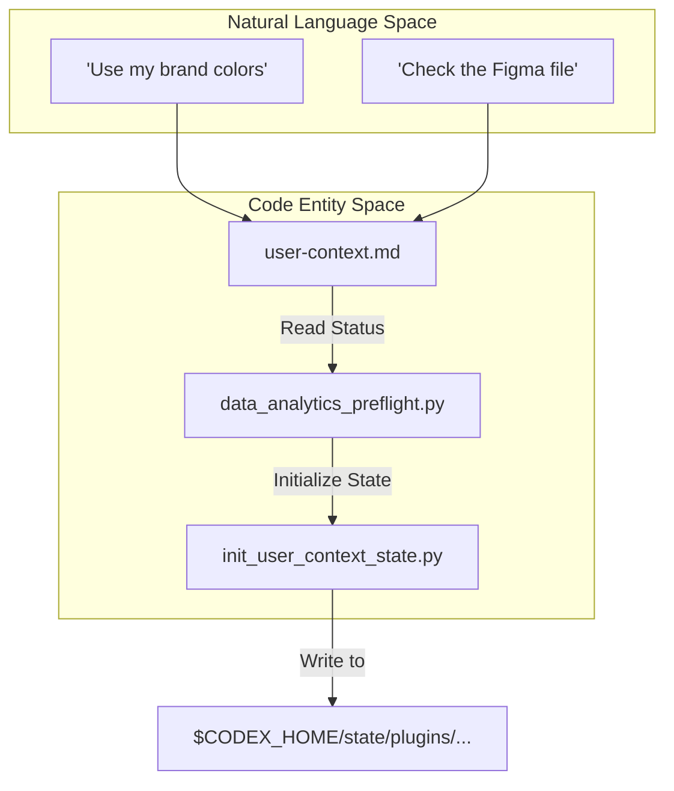
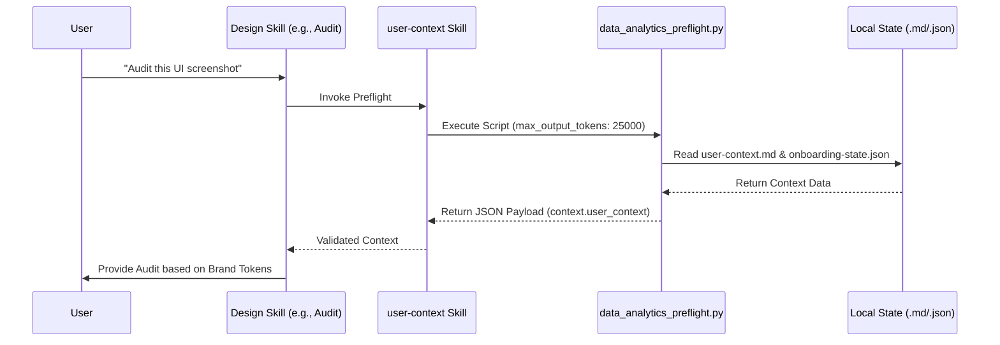

<!-- source: DeepWiki mcp.deepwiki.com · repo openai/role-specific-plugins · page 5.2 Product Design References & Templates · fetched 2026-10-26 -->

# Product Design References & Templates

Relevant source files

The following files were used as context for generating this wiki page:

- [README.md](README.md)
- [plugins/data-analytics/skills/user-context/SKILL.md](plugins/data-analytics/skills/user-context/SKILL.md)
- [plugins/data-analytics/skills/user-context/agents/openai.yaml](plugins/data-analytics/skills/user-context/agents/openai.yaml)
- [plugins/data-analytics/skills/user-context/plugin-author-config/automation-config.md](plugins/data-analytics/skills/user-context/plugin-author-config/automation-config.md)

This section documents the foundational design references, communication protocols, and the local prototyping environment within the Product Design plugin. These assets ensure that the AI agent maintains a consistent "design partner" persona while providing a technical bootstrap for rapid UI prototyping.

## References Directory

The `references/` directory contains the governance and operational standards for the Product Design plugin. These files act as the "source of truth" for the agent's behavior and the technical constraints of the browser environment.

### Communication Protocol & Overrides
The plugin adheres to a specific tone and operational logic defined in the following files:

*   **`communication-protocol.md`**: Defines the "design partner" persona. It mandates a collaborative tone, specific next-step conventions, and ensures the agent provides rationale for design decisions rather than just executing commands.
*   **`critical-overrides.md`**: Contains high-priority instructions that override default model behaviors, specifically regarding accessibility standards, brand consistency, and error handling in design workflows [plugins/product-design/skills/user-context/SKILL.md:46-50]().

### Browser & Local Environment
*   **`browser-order.md`**: Specifies the preferred order of operations when the agent interacts with web-based design tools or live URLs.
*   **`local-prototype-preflight.md`**: A checklist used by the agent to verify the local environment before attempting to run the `bootstrap-prototype.mjs` script. It ensures necessary dependencies and directory structures are in place.

Sources: [plugins/product-design/skills/user-context/SKILL.md:41-50]()

---

## Prototype Templates & Bootstrapping

The `templates/prototype/` directory provides a standardized scaffold for generating functional UI prototypes from design specs, images, or URLs.

### bootstrap-prototype.mjs
This script is the primary engine for initializing a new prototype. It automates the following:
1.  **Directory Setup**: Creates the necessary folder structure for a React/Vite-based prototype.
2.  **Asset Linking**: Maps local brand assets and tokens into the prototype environment.
3.  **Dependency Management**: Handles the initial `npm install` for required UI libraries (e.g., Tailwind CSS, Radix UI).

### Agents Directory
The `agents/` directory within the prototype template contains configuration files (like `openai.yaml`) that define the interface for specific design sub-tasks.

| File | Purpose |
| :--- | :--- |
| `openai.yaml` | Defines the `display_name`, `short_description`, and `default_prompt` for the Product Design interface [plugins/data-analytics/skills/user-context/agents/openai.yaml:1-7](). |

### .npmignore
The `.npmignore` file in the templates directory ensures that local development artifacts, sensitive state files, and bulky node_modules are not included when the prototype is packaged or shared.

Sources: [plugins/product-design/skills/user-context/SKILL.md:44-50](), [plugins/data-analytics/skills/user-context/agents/openai.yaml:1-7]()

---

## User Context & Product Data Flow

The `user-context` skill acts as a mandatory pre-answer gate. It loads saved product context—such as Figma file keys, brand tokens, and design system URLs—into the agent's active memory.

### Context Loading Mechanism
The system uses a "Preflight Gate" pattern to ensure the agent is aware of the user's specific design environment before generating code or critiques.

**Natural Language to Code Entity Mapping: User Context**

Sources: [plugins/data-analytics/skills/user-context/SKILL.md:10-20](), [plugins/data-analytics/skills/user-context/SKILL.md:43-45]()

### Data Flow: Preflight Execution
When a design skill (like `prototype` or `audit`) is invoked, it must first call the `user-context` skill to populate the `context` object.

**Logic Flow: Mandatory Pre-Answer Gate**

Sources: [plugins/data-analytics/skills/user-context/SKILL.md:12-15](), [plugins/data-analytics/skills/user-context/SKILL.md:43-44]()

### Key State Files
*   **`user-context.md`**: Stores durable preferences like source-routing choices and semantic-layer pointers [plugins/data-analytics/skills/user-context/SKILL.md:33-38]().
*   **`onboarding-state.json`**: Tracks technical progress, such as whether the `bootstrap-prototype.mjs` has been run or if Figma tokens have been successfully validated [plugins/data-analytics/skills/user-context/SKILL.md:19-20]().

Sources: [plugins/data-analytics/skills/user-context/SKILL.md:15-20](), [plugins/data-analytics/skills/user-context/SKILL.md:35-38]()

---

