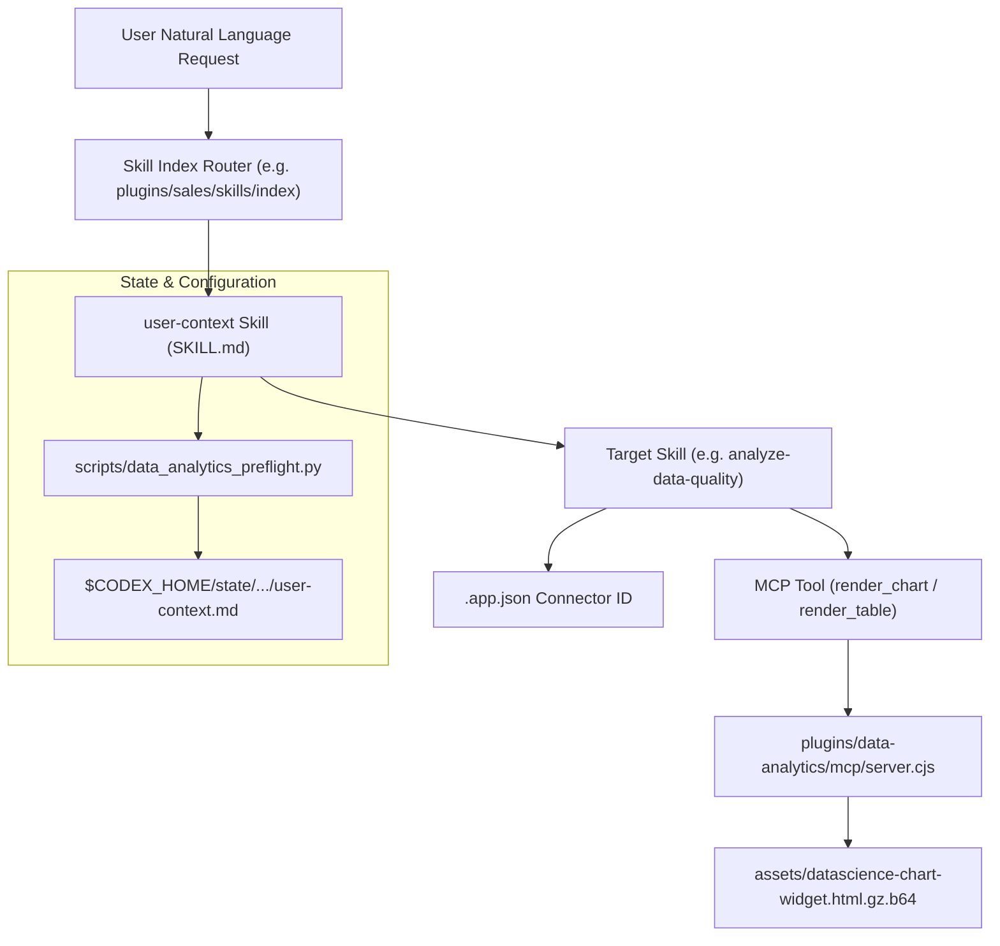
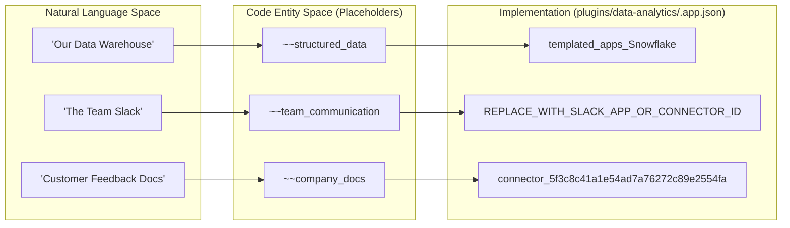

<!-- source: DeepWiki mcp.deepwiki.com · repo openai/role-specific-plugins · page 6 Glossary · fetched 2026-10-26 -->

# Glossary

Relevant source files

The following files were used as context for generating this wiki page:

- [.agents/plugins/marketplace.json](.agents/plugins/marketplace.json)
- [README.md](README.md)
- [plugins/data-analytics/.app.json](plugins/data-analytics/.app.json)
- [plugins/data-analytics/.codex-plugin/plugin.json](plugins/data-analytics/.codex-plugin/plugin.json)
- [plugins/data-analytics/.mcp.json](plugins/data-analytics/.mcp.json)
- [plugins/data-analytics/AGENTS.md](plugins/data-analytics/AGENTS.md)
- [plugins/data-analytics/DEPENDENCIES.MD](plugins/data-analytics/DEPENDENCIES.MD)
- [plugins/data-analytics/mcp/server.cjs](plugins/data-analytics/mcp/server.cjs)
- [plugins/data-analytics/scripts/normalize-widget-assets.mjs](plugins/data-analytics/scripts/normalize-widget-assets.mjs)
- [plugins/data-analytics/skills/user-context/SKILL.md](plugins/data-analytics/skills/user-context/SKILL.md)

This glossary defines codebase-specific terms, jargon, and domain concepts used across the Role-Specific Plugins repository. It provides technical definitions and code pointers to help onboarding engineers and plugin authors understand the underlying architecture and data flow.

## 1. Core Architecture Terms

### Plugin Manifest (`plugin.json`)
The central configuration file for every plugin. It defines metadata (name, version, author), the entry point for skills, associated connector bindings, and MCP server definitions.
*   **Implementation:** Found in the `.codex-plugin/` subdirectory of each plugin [plugins/data-analytics/.codex-plugin/plugin.json:1-66]().
*   **Data Flow:** The Codex platform reads this file to register the plugin's capabilities and UI elements [README.md:36-40]().

### Connector Bindings (`.app.json`)
A registry of third-party application integrations (SaaS tools) required by a plugin. It maps internal app keys (e.g., `salesforce`, `snowflake`) to specific platform connector IDs.
*   **Implementation:** Defined at the root of the plugin directory [plugins/data-analytics/.app.json:1-84]().
*   **Portable vs. Non-Portable:** Some IDs are "portable" (canonical shared IDs like `templated_apps_Snowflake`), while others are placeholders (e.g., `REPLACE_WITH_SALESFORCE_APP_OR_CONNECTOR_ID`) that must be swapped during workspace installation [README.md:50-74]().

### Skill
A structured directory containing instructions (`SKILL.md`) and supporting scripts that define a specific autonomous workflow or capability within a plugin.
*   **Implementation:** Located in the `skills/` directory [README.md:43-43]().
*   **Preflight Gate:** Most skills require a "preflight" check (often via a `user-context` skill) to load routing preferences before execution [plugins/data-analytics/skills/user-context/SKILL.md:10-20]().

---

## 2. Data Analytics & MCP Concepts

### MCP (Model Context Protocol) Server
A sidecar process that allows the LLM to interact with local tools, specifically for rendering complex UI components or performing secure data operations.
*   **Implementation:** Configured in `.mcp.json` [plugins/data-analytics/.mcp.json:1-30]() and implemented in `server.cjs` [plugins/data-analytics/mcp/server.cjs:1-130]().
*   **Transport:** Uses `stdio` for communication between the Codex host and the plugin [plugins/data-analytics/.mcp.json:26-26]().

### Analytics Artifact
A high-fidelity, interactive "workspace" (dashboard or report) rendered as a fullscreen MCP app. It includes snapshots of data, source provenance, and interactive charts.
*   **Code Symbol:** `render_artifact` tool [plugins/data-analytics/mcp/server.cjs:36-36]().
*   **Constraint:** Artifacts are "snapshot-first," meaning they contain a bounded, reviewed dataset rather than live, unvalidated queries [plugins/data-analytics/AGENTS.md:3-6]().

### Lane Placeholders
Tool-agnostic identifiers used in skills to refer to categories of data sources. This allows the plugin to function regardless of whether a user connects Snowflake, BigQuery, or uploads a CSV.
*   **Common Lanes:** `~~structured_data` (Warehouses), `~~behavior_signals` (Product Analytics), `~~company_docs` (Knowledge Bases) [plugins/data-analytics/DEPENDENCIES.MD:11-25]().

### Asset Normalization
The process of compressing and encoding HTML/JS widget source code into `.gz.b64.part` files for efficient storage and transport within the plugin bundle.
*   **Script:** `normalize-widget-assets.mjs` [plugins/data-analytics/scripts/normalize-widget-assets.mjs:1-34]().

---

## 3. Visual & Technical Mapping

### Diagram 1: Natural Language to Code Entity (System Flow)
This diagram maps how a user's natural language request (e.g., "Analyze our sales data") moves through the code entities defined in the repository.

**Sources:** [plugins/data-analytics/skills/user-context/SKILL.md:10-15](), [plugins/data-analytics/mcp/server.cjs:28-30](), [plugins/data-analytics/scripts/normalize-widget-assets.mjs:9-13]()

### Diagram 2: Data Entity Mapping
This diagram bridges the "Natural Language Space" of data categories to the specific "Code Entity Space" of lane placeholders and connector bindings.

**Sources:** [plugins/data-analytics/DEPENDENCIES.MD:11-27](), [plugins/data-analytics/.app.json:3-31]()

---

## 4. Summary Table of Key Code Symbols

| Symbol | Type | Description |
| :--- | :--- | :--- |
| `plugin.json` | File | The manifest defining the plugin's identity and capabilities. |
| `.app.json` | File | The registry for mapping app keys to platform connector IDs. |
| `SKILL.md` | File | The core logic and prompt instructions for a specific workflow. |
| `server.cjs` | Script | The entry point for the Data Analytics MCP server. |
| `user-context` | Skill | A mandatory preflight skill that manages source-routing and onboarding state. |
| `validate_artifact` | MCP Tool | A function in `server.cjs` that ensures a data manifest is valid before rendering. |
| `~~structured_data` | Placeholder | A "lane" representing any SQL-capable data source. |
| `.gz.b64.part` | Extension | Compressed asset chunks used to deliver the MCP UI. |

**Sources:** [README.md:36-46](), [plugins/data-analytics/mcp/server.cjs:35-40](), [plugins/data-analytics/skills/user-context/SKILL.md:6-9](), [plugins/data-analytics/scripts/normalize-widget-assets.mjs:29-30]()