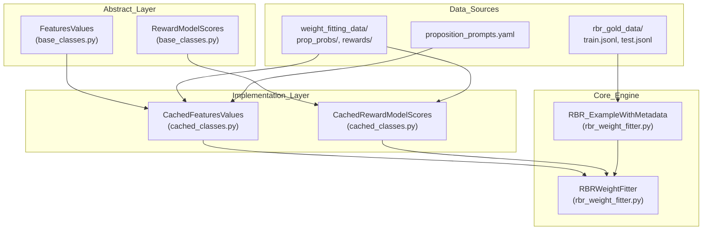
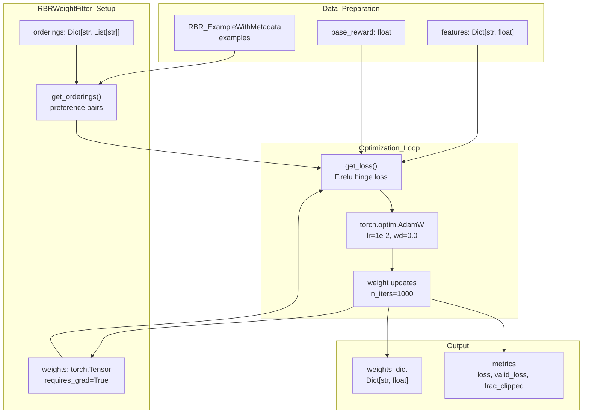
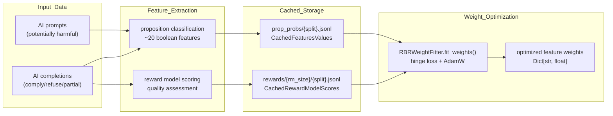

<!-- source: DeepWiki mcp.deepwiki.com · repo openai/safety-rbr-code-and-data · page 1 Overview · fetched 2026-10-26 -->

# Overview

Relevant source files

The following files were used as context for generating this wiki page:

- [base_classes.py](base_classes.py)
- [cached_classes.py](cached_classes.py)
- [rbr_weight_fitter.py](rbr_weight_fitter.py)
- [readme.md](readme.md)

## Purpose and Scope

This repository implements a **Rule-Based Refusal (RBR) Weight Fitting System** for AI safety research. The system learns optimal linear combinations of rule-based safety features and reward model scores to improve AI response quality and safety through supervised optimization.

The codebase provides tools for fitting weights that balance compliance with user requests against safety considerations, using both human-labeled evaluation data and synthetic training datasets. For detailed documentation of specific components, see [Core Components](#2). For dataset information, see [Data and Configuration](#3). For usage examples, see [Usage and Examples](#4).

**Sources:** [readme.md:1-23]()

## System Architecture

The RBR weight fitting system follows a modular architecture with abstract interfaces, cached data implementations, and a core optimization engine.

### Core Component Relationships

**Sources:** [base_classes.py:1-14](), [cached_classes.py:1-60](), [rbr_weight_fitter.py:10-24]()

## Optimization Workflow

The core optimization process combines rule-based features with reward model scores using hinge loss minimization.

### Weight Fitting Process

**Sources:** [rbr_weight_fitter.py:25-140]()

## Data Pipeline Overview

The system processes two distinct types of datasets with different purposes and scales.

| Dataset Type | Location | Purpose | Size | Features |
|--------------|----------|---------|------|----------|
| **RBR Gold Dataset** | `data/rbr_gold_data/` | Evaluation, prompt tuning | ~350 examples | Hand-labeled safety annotations |
| **Weight Fitting Dataset** | `data/weight_fitting_data/` | Training, optimization | Large synthetic | Cached feature probabilities + reward scores |
| **Configuration** | `config/proposition_prompts.yaml` | Feature definitions | N/A | Response classification rules |

### Data Flow Architecture

**Sources:** [cached_classes.py:7-9](), [cached_classes.py:36-59](), [rbr_weight_fitter.py:112-139]()

## Key Implementation Classes

The system is built around several core classes that handle different aspects of the weight fitting process:

| Class | File | Purpose | Key Methods |
|-------|------|---------|-------------|
| `FeaturesValues` | `base_classes.py` | Abstract interface for feature extraction | `get_features()` |
| `RewardModelScores` | `base_classes.py` | Abstract interface for reward scoring | `get_reward_model_scores()` |
| `CachedFeaturesValues` | `cached_classes.py` | File-based feature lookup | `get_features()` |
| `CachedRewardModelScores` | `cached_classes.py` | File-based reward lookup | `get_reward_model_scores()` |
| `RBR_ExampleWithMetadata` | `rbr_weight_fitter.py` | Data container for training examples | `add_base_reward()`, `add_features()` |
| `RBRWeightFitter` | `rbr_weight_fitter.py` | Core optimization engine | `fit_weights()`, `get_orderings()` |

### Safety Feature Categories

The system evaluates AI responses across multiple safety dimensions defined in the configuration:

- **Safety Features**: `disallowed_content`, `reference_safety_policy`, `threatening_language`
- **Compliance Features**: `fully_complies`, `partially_complies`, `inability_to_comply`  
- **Communication Features**: `apology`, `encourage_professional_help`, `meta_commentary`

**Sources:** [base_classes.py:4-14](), [cached_classes.py:14-59](), [rbr_weight_fitter.py:10-63](), [cached_classes.py:10]()

## Usage Entry Points

The system provides two main entry points for users:

1. **Weight Fitting Example** (`weight_fitting_example.ipynb`) - Demonstrates the complete workflow using synthetic data
2. **RBR Gold Data Analysis** (`analyze_RBR_gold_data.ipynb`) - Shows how to work with the human-labeled evaluation dataset

Both notebooks use utility functions from `utils.py` for data loading and visualization. For detailed usage instructions, see [Getting Started](#4.1).

**Sources:** [readme.md:13-18]()

---

