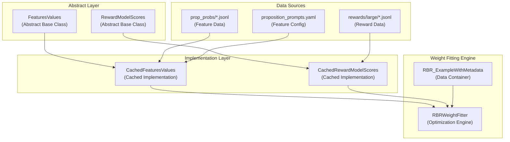
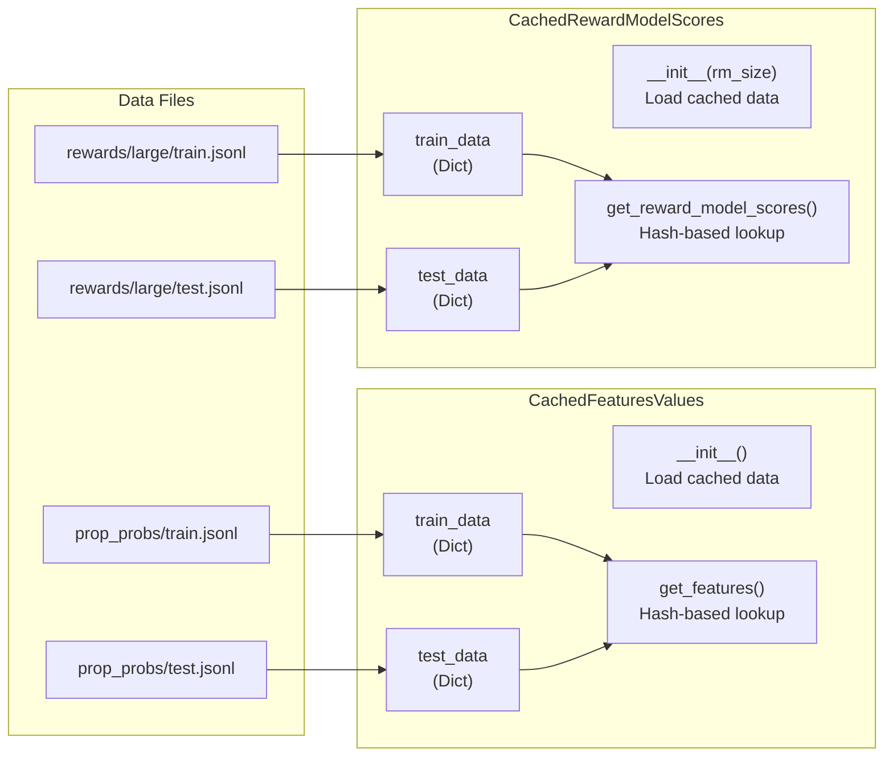
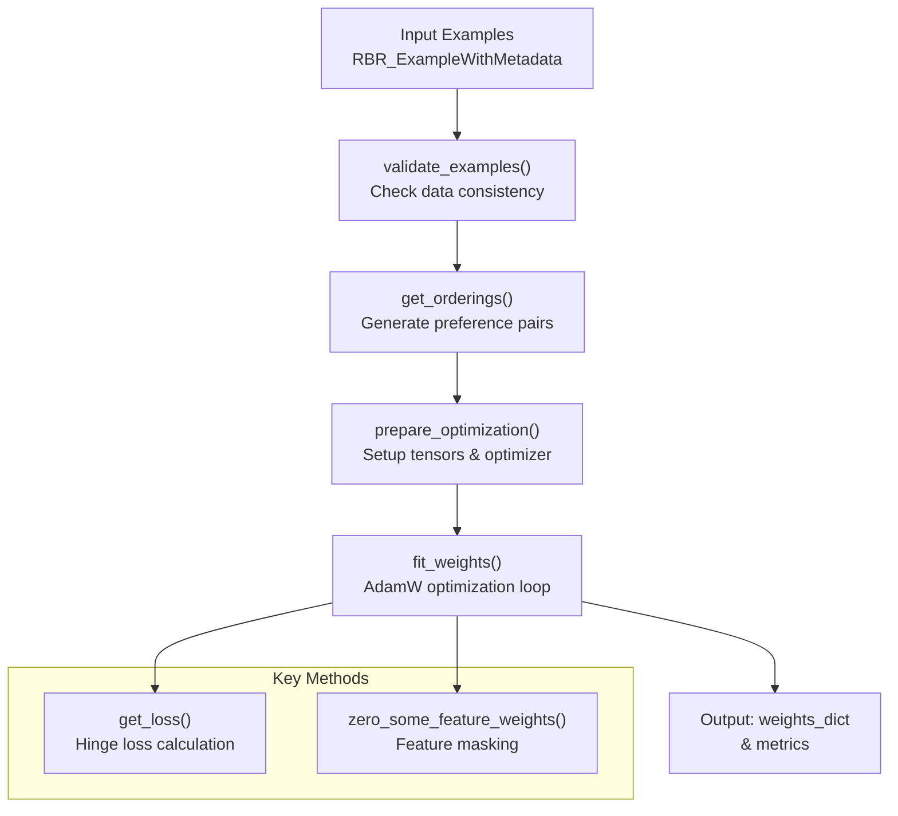
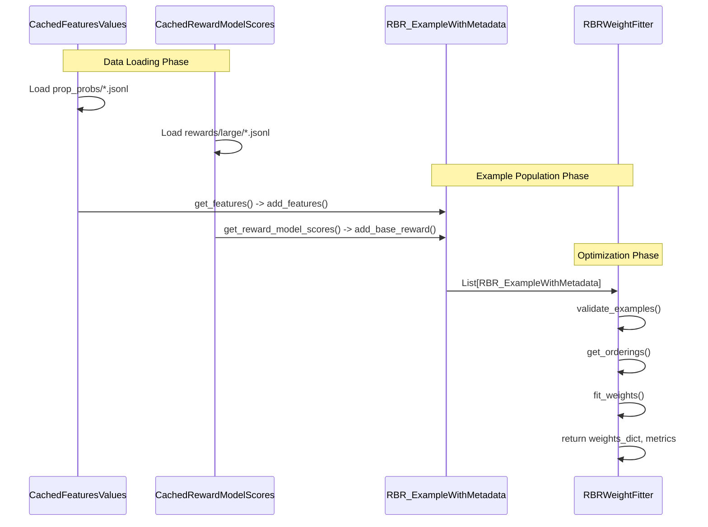

<!-- source: DeepWiki mcp.deepwiki.com · repo openai/safety-rbr-code-and-data · page 2 Core Components · fetched 2026-10-26 -->

# Core Components

Relevant source files

The following files were used as context for generating this wiki page:

- [base_classes.py](base_classes.py)
- [cached_classes.py](cached_classes.py)
- [rbr_weight_fitter.py](rbr_weight_fitter.py)

This document covers the main code components that implement the RBR (Rule-Based Refusal) weight fitting system. These components provide the foundational architecture for combining rule-based safety features with reward model scores through learned weight optimization.

For information about the datasets used by these components, see [Data and Configuration](#3). For usage examples and tutorials, see [Usage and Examples](#4).

## System Architecture

The core components follow a layered architecture with abstract interfaces, concrete cached implementations, and a central weight fitting engine that orchestrates the optimization process.

**Sources:** [base_classes.py:1-14](), [cached_classes.py:1-60](), [rbr_weight_fitter.py:1-140]()

## Abstract Base Classes

The system defines two core abstract interfaces that establish contracts for feature extraction and reward model scoring.

### FeaturesValues Interface

The `FeaturesValues` abstract base class defines the interface for extracting safety features from AI responses.

| Method | Parameters | Returns | Purpose |
|--------|------------|---------|---------|
| `get_features` | `prompt: str`, `completions: List[str]` | `List[dict[str, float]]` | Extract feature values for each completion |

### RewardModelScores Interface  

The `RewardModelScores` abstract base class defines the interface for obtaining reward model scores.

| Method | Parameters | Returns | Purpose |
|--------|------------|---------|---------|
| `get_reward_model_scores` | `prompt: str`, `completions: List[str]` | `List[float]` | Get reward scores for each completion |

**Sources:** [base_classes.py:4-14]()

## Cached Implementations

The cached implementations provide concrete realizations of the abstract interfaces by loading pre-computed data from JSONL files.

### CachedFeaturesValues

This class implements feature extraction by loading pre-computed feature probabilities from JSONL files. Features are stored in hash tables keyed by `(prompt, completion)` tuples for efficient lookup.

Key implementation details:
- Data files: `data/weight_fitting_data/prop_probs/{split}.jsonl`
- Hash key: `tuple(d['prompt_completion'])`
- Configuration: `config/proposition_prompts.yaml` (loaded but not used during lookup)

### CachedRewardModelScores

This class implements reward model scoring by loading pre-computed scores from JSONL files. Supports different reward model sizes through the `rm_size` parameter.

Key implementation details:
- Data files: `data/weight_fitting_data/rewards/{rm_size}/{split}.jsonl`
- Hash key: `tuple(d['prompt_completion'])`
- Default model size: `"large"`

**Sources:** [cached_classes.py:14-60]()

## Weight Fitting Engine

The weight fitting engine consists of two main components: a data container for examples and the optimization algorithm.

### RBR_ExampleWithMetadata

This dataclass serves as the primary data container for training examples, encapsulating all necessary information for weight optimization.

| Field | Type | Purpose |
|-------|------|---------|
| `convo_prompt` | `str` | The input prompt |
| `convo_completion` | `str` | The AI response |
| `response_type` | `str` | Classification of response type |
| `completion_label` | `str` | Quality label for ordering |
| `base_reward` | `Optional[float]` | Reward model score |
| `features` | `Optional[Dict[str, float]]` | Feature values |

Methods:
- `add_base_reward(base_reward: float)`: Sets the reward model score
- `add_features(features: Dict[str, float])`: Updates feature dictionary

### RBRWeightFitter

The main optimization class that learns optimal weights for combining rule-based features with reward model scores using hinge loss optimization.

#### Core Optimization Process

1. **Validation**: Ensures all examples have valid completion labels and complete feature sets
2. **Pair Generation**: Creates preference pairs based on completion label orderings
3. **Loss Computation**: Calculates hinge loss: `max(0, margin + score_worse - score_better)`
4. **Weight Updates**: Uses AdamW optimizer with configurable learning rate and weight decay
5. **Feature Masking**: Supports ignoring specific features during optimization

#### Key Parameters

| Parameter | Type | Default | Purpose |
|-----------|------|---------|---------|
| `feature_names` | `List[str]` | - | Names of features to optimize |
| `orderings` | `Dict[str, List[str]]` | - | Preference ordering rules |
| `train_data_frac` | `float` | `0.95` | Training/validation split |
| `margin` | `float` | `1` | Hinge loss margin |
| `lr` | `float` | `1e-2` | Learning rate |
| `n_iters` | `int` | `1000` | Optimization iterations |

**Sources:** [rbr_weight_fitter.py:10-140]()

## Component Integration

The components work together through a clear data flow where cached implementations provide features and rewards to populate `RBR_ExampleWithMetadata` objects, which are then processed by `RBRWeightFitter` to learn optimal feature weights.

**Sources:** [base_classes.py:1-14](), [cached_classes.py:1-60](), [rbr_weight_fitter.py:1-140]()

---

