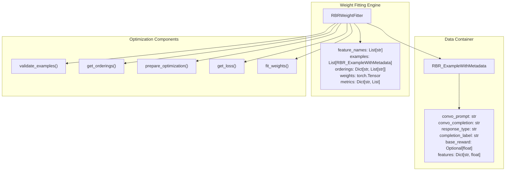
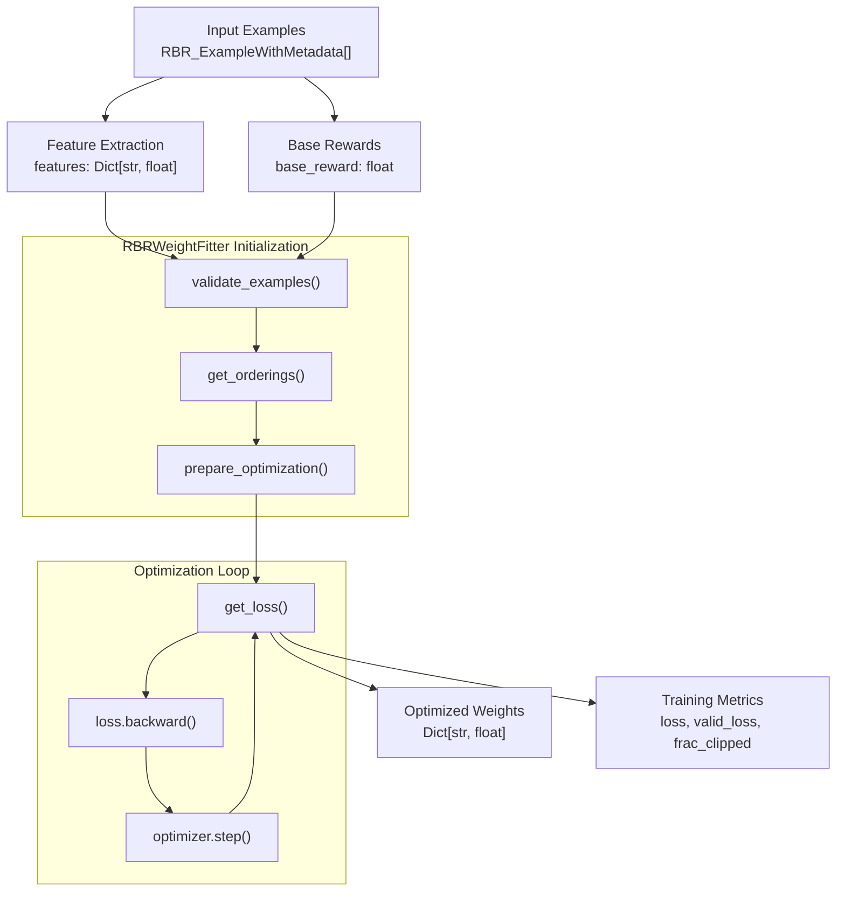
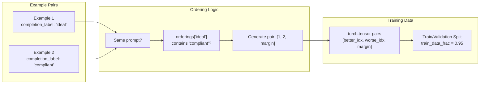
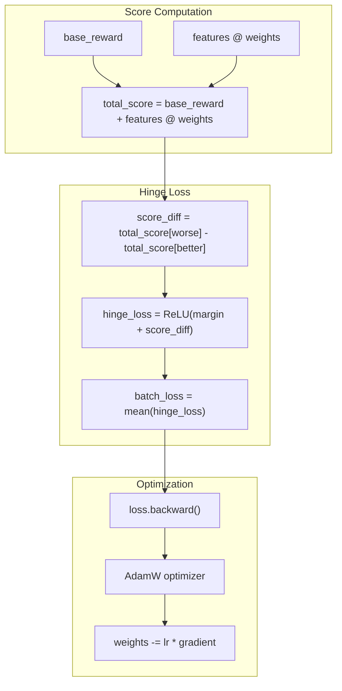
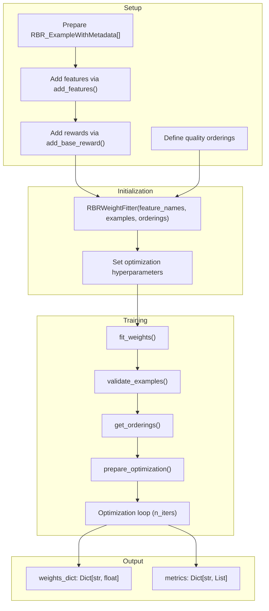

<!-- source: DeepWiki mcp.deepwiki.com · repo openai/safety-rbr-code-and-data · page 2.1 Weight Fitting Engine · fetched 2026-10-26 -->

# Weight Fitting Engine

<details>
<summary>Relevant source files</summary>

The following files were used as context for generating this wiki page:

- [rbr_weight_fitter.py](rbr_weight_fitter.py)

</details>


## Purpose and Scope

The Weight Fitting Engine implements the core optimization logic for the Rule-Based Refusal (RBR) weight fitting system. This engine learns optimal linear combinations of safety features and reward model scores to improve AI response quality while maintaining safety constraints. The engine uses hinge loss optimization with pairwise ranking constraints to fit weights that respect human-defined response quality orderings.

For information about the abstract base classes and data interfaces, see [Base Architecture](#2.2). For details about the underlying datasets, see [RBR Gold Dataset](#3.1) and [Weight Fitting Dataset](#3.2).

## Architecture Overview

The Weight Fitting Engine consists of two main classes that work together to optimize feature weights through pairwise ranking optimization.

### Core Classes Architecture



*Sources: [rbr_weight_fitter.py:10-24](), [rbr_weight_fitter.py:25-65]()*

### Data Flow Through the Engine



*Sources: [rbr_weight_fitter.py:112-139]()*

## Data Structures

### RBR_ExampleWithMetadata

The `RBR_ExampleWithMetadata` class serves as the primary data container for training examples. Each example represents a conversation prompt-completion pair with associated metadata and features.

| Field | Type | Description |
|-------|------|-------------|
| `convo_prompt` | `str` | The input conversation prompt |
| `convo_completion` | `str` | The AI-generated completion |
| `response_type` | `str` | Classification of response behavior |
| `completion_label` | `str` | Quality label for ranking |
| `base_reward` | `Optional[float]` | Reward model score |
| `features` | `Dict[str, float]` | Safety and quality features |

The class provides methods to incrementally build examples:
- `add_base_reward(base_reward: float)` - Sets the reward model score
- `add_features(features: Dict[str, float])` - Updates the feature dictionary

*Sources: [rbr_weight_fitter.py:10-23]()*

### RBRWeightFitter Configuration

The `RBRWeightFitter` constructor accepts comprehensive configuration for the optimization process:

| Parameter | Type | Default | Description |
|-----------|------|---------|-------------|
| `feature_names` | `List[str]` | Required | Names of features to optimize |
| `examples` | `List[RBR_ExampleWithMetadata]` | Required | Training examples |
| `orderings` | `Dict[str, List[str]]` | Required | Quality ordering constraints |
| `ignore_features` | `List[str]` | `[]` | Features to exclude from optimization |
| `train_data_frac` | `float` | `0.95` | Fraction of data for training |
| `margin` | `float` | `1` | Hinge loss margin |
| `lr` | `float` | `1e-2` | Learning rate |
| `wd` | `float` | `0.0` | Weight decay |
| `n_iters` | `int` | `1000` | Optimization iterations |
| `completion_label_margin` | `Dict[str, float]` | `{}` | Custom margins per label |

*Sources: [rbr_weight_fitter.py:25-52]()*

## Optimization Process

### Pairwise Ranking Generation

The engine generates training pairs from examples based on quality orderings. For each pair of examples with the same prompt, it determines the preferred ordering based on completion labels.



*Sources: [rbr_weight_fitter.py:71-89]()*

### Hinge Loss Optimization

The core optimization uses hinge loss to enforce ranking constraints. The loss function ensures that better examples receive higher scores than worse examples by at least the specified margin.



*Sources: [rbr_weight_fitter.py:105-110](), [rbr_weight_fitter.py:127-136]()*

### Mathematical Formulation

The optimization objective minimizes the hinge loss over pairwise rankings:

**Score Function:**
```
score(example) = base_reward + Σ(feature_i × weight_i)
```

**Hinge Loss:**
```
loss = mean(ReLU(margin + score(worse) - score(better)))
```

**Constraints:**
- Weights for ignored features are zeroed via gradient hooks
- Custom margins can be specified per completion label
- Train/validation split for monitoring overfitting

*Sources: [rbr_weight_fitter.py:91-94](), [rbr_weight_fitter.py:105-110]()*

## Usage Workflow

### Complete Optimization Pipeline



*Sources: [rbr_weight_fitter.py:112-139]()*

### Monitoring and Metrics

The engine tracks three key metrics during optimization:

| Metric | Description |
|--------|-------------|
| `loss` | Training hinge loss per iteration |
| `valid_loss` | Validation hinge loss per iteration |
| `frac_clipped` | Fraction of constraints already satisfied |

The `frac_clipped` metric indicates optimization progress - higher values mean more ranking constraints are being satisfied with sufficient margin.

*Sources: [rbr_weight_fitter.py:64](), [rbr_weight_fitter.py:108](), [rbr_weight_fitter.py:134-136]()*

---

